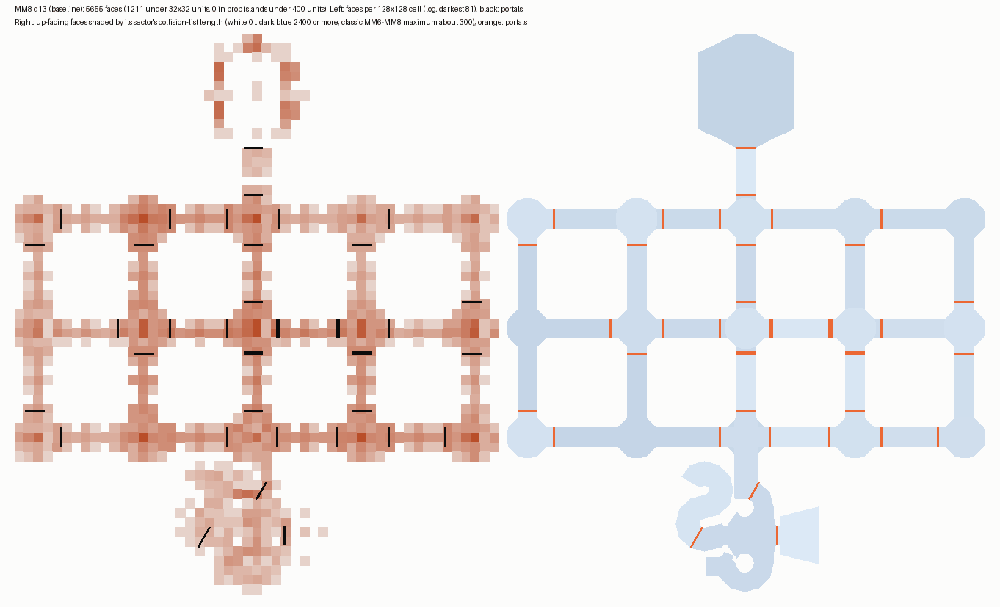
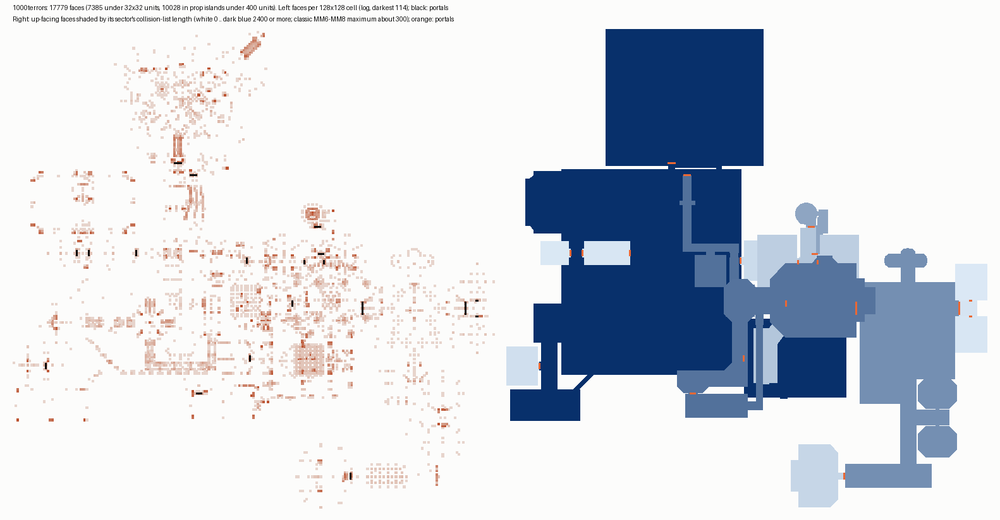
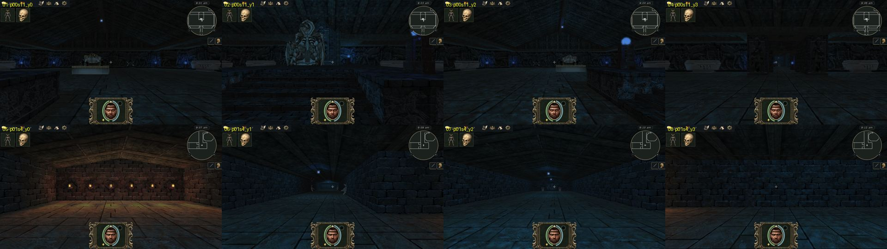
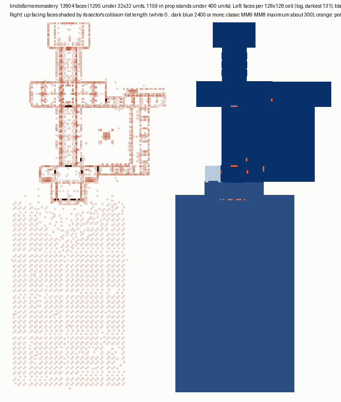
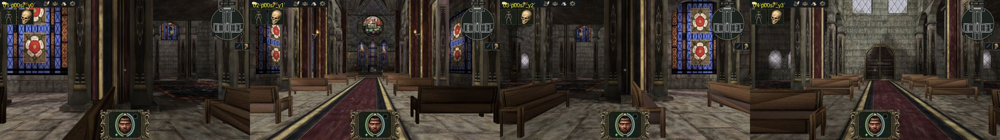
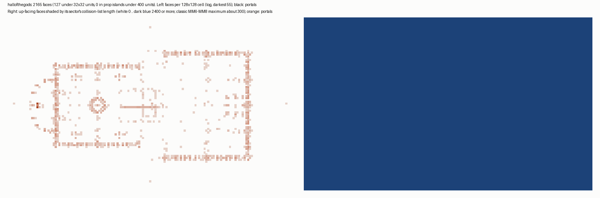
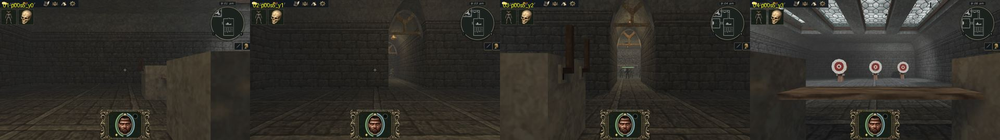
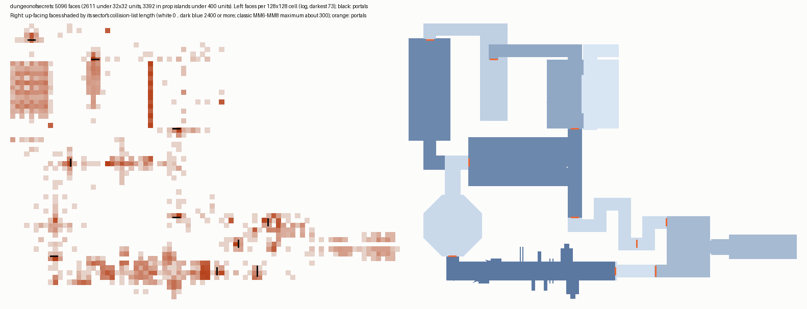

# BLV geometry costs of the rebuilt MM9 dungeons

This investigation asks whether the geometry of the 24 rebuilt MM9 dungeon BLVs suits the engine, and whether the
converter (`level_generation/projects/mm9r_common/dungeon/`) should simplify or restructure it. It changed no engine
code, converter, map or review-root file. Triangle count is not the question: 3D monsters already cost more. The
question is everything else that grows with the number of faces or with the sector and portal structure.

Work files, scripts and raw logs are in `output/mm9_rework/geometry_audit/`. The doc's images are in
[blv_geometry_costs/](blv_geometry_costs/).

## Summary

1. **One cost matters, and it scales with faces per sector, not faces per map.** That cost is actor line of
   sight, `hasIndoorCombatLineOfSight`. It runs for every active monster on every 128 Hz AI step. Each call does
   three things:
   - collects every floor, wall, ceiling and cylinder face of each sector the line crosses;
   - **sorts and de-duplicates that list** (`collectIndoorCombatLineFaceCandidates`);
   - tests each face.

   Callgrind on a benchmark with 16 goblins fighting the party in the map's biggest room shows where the CPU
   goes:

   | map | actor line of sight | of which the sort | `findIndoorSectorForPoint` | collision (`resolveMove`) |
   |---|--:|--:|--:|--:|
   | The Thousand Terrors | 89 % | 66 % | 9.5 % | about 1.5 % |
   | Lindisfarne Monastery | 90 % | 68 % | 9.6 % | 1 % |
   | MM8 `d13` | 71 % | 30 % | 23 % | — |

2. **The measured cost per monster is linear in the size of its sector's face lists.** The fit gives about
   5 µs of CPU per face per monster per game second (r = 0.98 over 23 maps).
   - The Thousand Terrors (biggest sector 4 815 faces): 25 ms of CPU per goblin per game second.
   - Lindisfarne (4 745 faces): 23 ms.
   - MM6–MM8 baselines (≤ 300 faces): 0.9–2.3 ms.

   At 60 FPS, 16 monsters in Lindisfarne's nave cost about 6 ms of every frame; 30 cost about 11 ms.
3. **No MM6–MM8 sector was over about 300 faces.** Only 1 of 161 classic BLVs has a sector over 300 collision
   faces (352). The MM9 maps are different:
   - The faces in the sector a standing point is in, weighted by floor area, have a median of 652 (classic 153).
   - 17 of the 24 maps have a sector over 1 000 faces.
   - Five maps have one over 2 000: The Thousand Terrors, Lindisfarne, Verhoffin Ruins, Lich Lab and Hall of the
     Gods.
4. **Everything else is fine.** That covers:
   - total and per-view render batches;
   - draw calls, apart from the translucent-face exception below;
   - portal visibility;
   - lightmaps (one page per map, 6–54 MB);
   - map load (median 2.7 s for MM9 and classic alike);
   - memory, path search per node, nav build, collision, and save size.
5. **The exception is translucent faces, which get one batch and one draw each.** In Training Hall's archery
   range, 596 invisible hit shells at opacity 0 raise draw calls from about 90 to 680–717 per view.
6. **The cheapest fix for the dominant cost is in the engine, not the converter.** De-duplicating without the sort
   removes about two thirds of the actor CPU on the worst maps. A per-sector spatial grid removes the
   faces-per-sector scaling for every map. If the engine is to stay as it is, the converter fix is to split
   oversized rooms into sectors of a few hundred faces, and to move prop islands out of the BLV.
   [Recommendations](#recommendations-ranked) has the ranking.

## Done (2026-10-31): E1, E2 and the opacity-0 faces

The engine changes E1 and E2 and the engine variant of converter recommendation 3 are in. With them, the
faces-per-sector cost of actor line of sight is gone, and converter recommendation 1 is no longer needed for
performance.

- **E1: no sort.** The line-of-sight, projectile and item-sweep candidate lists are de-duplicated with a per-face
  visit stamp in the geometry cache (`IndoorFaceGeometryCache::beginFaceVisit`, `markFaceVisited`), not with
  `std::sort` + `unique`. `findProjectileIndoorFaceHit` and `findWorldItemIndoorWallHit` keep the nearest hit and
  now break exact ties by the lower face index, so the order of the candidates no longer matters.
- **E2: a per-sector face grid** (`game/indoor/IndoorSectorFaceGrid.{h,cpp}`).
  - **Layout.** Each sector gets a uniform x/y grid of 256-unit cells, at most 128 per axis. Sectors of at most 32
    faces keep one cell. A cell lists the faces whose bounds, padded by 10 units, overlap it. A face whose vertices
    leave its plane is padded by that distance as well, so a hit on its plane is always inside its cells.
  - **Doors.** Faces a door can move are never placed in cells. That covers every face in a door's `faceIds` and
    every face with a door vertex. Segment queries always test those faces, and point queries list them in every
    cell. Faces without usable geometry are treated the same way.
  - **Segment queries.** `collectIndoorSegmentFaceCandidates` walks the rows of cells along the segment, widened
    by a margin: 1 unit for line of sight, the padding for projectiles, and reach + 8 for item sphere chains.
    Line of sight, projectiles and world items use it.
  - **Point queries.** `findIndoorSectorForPoint` reads the floor and portal lists of the point's cell. Each such
    list keeps the faces in the sector list's order, so the 5-candidate cap gives the same sector.
  - **Ownership.** `IndoorWorldRuntime` builds the grid with its runtime geometry cache and attaches it to that
    cache (`setSectorFaceGrid`). It is rebuilt only for a new map, a restored snapshot or a map re-entry, not on
    door moves or face-bit changes. Caches without a grid (movement controller, renderer, editor) work as before.
  - **Cost.** Build time is 0.6–2 ms on MM6–MM8 maps and up to 5 ms on The Thousand Terrors (7.5 ms in the test,
    where every 61st face moves). Memory is 44–212 KB on MM6–MM8 and 66–360 KB on MM9.
- **Opacity-0 translucent faces.** These are not drawn (`IndoorRenderer::renderTranslucentFaces`). They write no
  depth and blend nothing, so the image is unchanged; they are still faces for collision, picking and hits.
  [Translucent faces](../INDOOR_TRANSLUCENT_FACES.md) has the note.

### Same results

`tests/IndoorSectorFaceGridTests.cpp` loads MM8 `d13` and `d19`, MM7 `7d35`, MM6 `6d17`, and (when the review root
exists) The Thousand Terrors, Lindisfarne, Training Hall and Hall of the Gods. A pillar-hall fixture runs without
assets. A fake door moves every 61st face after the grid is built. On random segments, half of them in the
largest sector, the test checks three things:
- Without a grid, the candidates are the same set as the old sorted, de-duplicated list, each face once.
- With a grid at margins 0, 1 and 24, every face that the segment crosses is a candidate. A crossed face has a
  plane hit within the segment that lies inside the polygon, which is a superset of what line of sight and
  projectiles accept. Every face that an item's three-sphere chain sweeps into is a candidate too.
- `findIndoorSectorForPoint` returns the same sector with and without the grid, with and without the bounding
  fallback.

The test passes at 1 500 segments per map (now 800 to keep it short), about 200 000 assertions.

On random segments the grid cuts the candidate list from 3 194 to 526 faces on The Thousand Terrors, 3 908 to 675
on Lindisfarne and 284 to 97 on `d13`.

Training Hall's tour screenshots before and after differ only in the animated torch flames.

### Measurements

These numbers come from the audit's benchmark: 16 goblins in the biggest room, with the scenarios in `scen/`. The
runs used a frozen hard-link copy of the review root (`e_fix/frozen_root`, the benchmarked maps copied for real), so
the converter session's rebuilds could not change the maps under the runs.

Instructions are callgrind totals for `advanceRuntime` over 10 s. They do not depend on machine load.

| map | total, before | after E1 | after E1 + E2 | line of sight, before → after | sector lookup, before → after |
|---|--:|--:|--:|--:|--:|
| The Thousand Terrors | 30.9 G | 21.0 G (−32 %) | 4.09 G (−87 %) | 27.6 G → 0.81 G | 2.94 G → 0.27 G |
| Lindisfarne | 29.5 G | 21.3 G (−28 %) | 4.38 G (−85 %) | 26.6 G → 1.49 G | 2.82 G → 0.39 G |
| MM8 `d13` | 2.52 G | 2.14 G (−15 %) | 0.71 G (−72 %) | 1.78 G → 0.19 G | 0.57 G → 0.17 G |
| MM7 `7d35` | 2.39 G | 2.13 G (−11 %) | 1.06 G (−56 %) | 1.49 G → 0.19 G | 0.42 G → 0.13 G |

E1 alone saved less than the audit's −66 %, which was the sort's inclusive share. Once the sort is gone, testing
each of the 4 800 faces still costs most of it (line of sight 17.7 G of 21.0 G on The Thousand Terrors). E2
removes that part. What remains on the MM9 maps is mostly hover picking (`inspectAtCursor`, 2.2–2.4 G). The headless benchmark runs
it on every step; the game refreshes it at most 30 times a second.

CPU per goblin per game second is the median of 3 repeats, with the three binaries interleaved per repeat
(`e_fix/bench.sh`, `summary.py`, labels `f0`/`f1`/`f3`):

| map | before | E1 | E1 + E2 |
|---|--:|--:|--:|
| The Thousand Terrors | 25.3 ms | 16.5 ms | 1.4 ms |
| Lindisfarne | 22.3 ms | 16.8 ms | 0.7 ms |
| MM8 `d13` | 2.1 ms | 1.8 ms | 0.4 ms |
| MM7 `7d35` | 1.6 ms | 1.7 ms | 0.2 ms |

Other sessions loaded the machine throughout (load average 30–40). The classic maps' per-goblin cost is near the
noise of the subtraction, and the E1 column there is noise. An earlier, non-interleaved round gave E1 at 9.5 ms on
both MM9 maps. The instruction counts are the reliable measure.

Training Hall's 40-view tour (`e_fix/tour.sh`) drew 680–717 calls per view in the archery range before, and 84–121
after. The other views and the median (about 90) are unchanged.

### Tests

- Unit tests: 2 422 of 2 422 pass, including the 3 new ones.
- `openyamm_runtime_tests`: 54 of 55 pass. The one failure is the New Sorpigal braziers case, which failed before.
- Regression suites: `indoor` 173 of 174, `actors` 192 of 193. In both, the one failure is
  `mm6_ogr_actor_models_bind_all_tiers` ("Ogre Hit did not blend out"). It fails the same way on the binary from
  before these changes, and comes from another session's uncommitted ogre model.

### Left open

- Hover picking (`inspectAtCursor`, O(F) per refresh) could use the same grid. It is now the largest share of
  the headless benchmark on MM9 maps, but the game runs it at most 30 times a second.
- The movement controller's own geometry cache does not get the grid. Collision was about 1 % of the profile.

## Cost inventory

These costs come from reading the code: `game/indoor/`, `game/maps/`, `game/pathfinding/`, `engine/render/`. Line
numbers are approximate. In the scaling column, F is faces in the map, F_s is faces in a sector's collision lists
(floor + wall + ceiling + cylinder), and B is textured batches.

| Cost | Where | When | Scales with | MM9 vs classic | Matters? |
|---|---|---|---|---|---|
| **Actor line of sight** | `IndoorWorldRuntime::hasIndoorCombatLineOfSight` (≈4929) → `indoorSegmentBlockedByCombatFace` (≈2722): collect, sort and de-duplicate, then test | each active actor every 1/128 s (≈10128), plus detection, targeting, area spells and wake-ups | F_s of the crossed sectors; the sort adds F_s log F_s | 3–20× (area-weighted median 652 vs 153; max 4 815 vs ≤ 352) | **Yes**: 89–90 % of the actor CPU on the worst maps; 25 vs about 1 ms per monster-second |
| Sector lookup for a point | `findIndoorSectorForPoint` (`IndoorGeometryUtils.cpp` ≈2156) | resolving both ends of a line of sight, plus movement, spawns and blood | floor faces of every sector whose box holds the point | median 140 vs 45 floor faces scanned; Lindisfarne 1 067 | Some: 9.5 % (MM9 worst), 23 % (`d13`) |
| Party and actor collision | `IndoorMovementController::resolveMove`: candidates from foot and eye sector lists with a box test, ≤ 8 sweep passes | 128 Hz per mover | F_s, but rejected by a cheap box test | as above | No: ≈1–1.5 % of the profile |
| Projectile and world-item sweeps | `findProjectileIndoorFaceHit` (≈2475): same collect, sort and de-duplicate as line of sight; all F if no sector resolves | 60 Hz per projectile or item, up to 4 steps | F_s of the touched sectors | as line of sight | Minor: few projectiles; the same engine fix applies |
| Hover and inspect picking | `IndoorRenderer::inspectAtCursor` (≈12669): loop over **all F**, filtered by the visible-sector mask | ≤ 30 Hz while the view moves; also used by billboard occlusion | F | 170–190 µs per refresh at 9 000 faces | No: about 0.5 % of one core at 30 refreshes a second |
| Opaque render batches | `rebuildAllTexturedBatches` (≈10754), key lightmap page × texture × sector × back sector × water; per-frame loop over all B with a sector-visibility test, no frustum test inside a sector (≈4267) | built at load; looped every frame | textures × sectors | B median ≈260 (7–762) vs 149–935; drawn per view: median of the per-map medians 15 vs 6 | No |
| Translucent faces | one batch and one draw per face, sorted back to front every frame (`renderTranslucentFaces` ≈10652) | per frame | translucent faces in visible sectors | Training Hall 647, Dark Passageway 311, Beethoven 216, Ruined Temple 211; classic 0 | **Locally**: Training Hall draws 680–717 per view (90 elsewhere) |
| Portal visibility | `buildIndoorPortalVisibility`: breadth-first walk with frustum clipping, ≤ 256 nodes, depth 32; cached only for an unchanged camera | each camera move | portals reached × portal vertices × frustum planes | 0–145 portals; build ≤ 20 µs usually, 208 µs at worst | No (sectors with no portals simply draw everything, which is cheap here) |
| Door and mover updates | `updateMechanismGeometryResourcesForDoorIds` (≈11846): moved faces only, plus an O(F) mask, dirty-batch bounds over the batch's vertices, and a forced visibility rebuild | per mover tick | moved faces + F + vertices of the dirty batches | big-sector batches are larger | No (not measured beyond `[IndoorPerf]`) |
| Full surface rebuild | `setFacetBit` / `SetTexture` → `rebuildAllTexturedBatches` (string keys, linear texture scans, B² merge) and path-map invalidation | on events that change face bits or textures | F × textures + B² | 2–8× F | Rare spikes, not measured |
| Lightmaps | `IndoorBakedLighting`: RGBM pages decoded to BGRA8 at load | load | lit area plus per-chart padding | one 4096 × 364–3447 page per map, 6–54 MB; read in 6–100 ms; classic baselines have none | No |
| Dynamic lights | `IndoorLightingRuntime::buildFrame`: reach lists through portals, capped at 16 sectors (`LightGridMaxReach`) | per frame | lights × reached sectors | — | Not a cost. It is a visual note: a light lights its whole sector, so a huge sector lets torch and spell light pass through interior walls |
| Pathfinding: nav build | `IndoorPathfindingBuilder` + `PathMap::buildSpatialGrid` (256-unit grid), lazy on the first request, **rebuilt after every door settles** | load and door settle | F (all faces become facets; no merging) | 0.5–33 ms vs 1–11 ms | Small hitch on The Thousand Terrors (≈33 ms per settled door while monsters path) |
| Pathfinding: search | `PathPlanner` A* on a 24–40 unit lattice; per node: grid-cell facet queries | per path request | facets near the node, not F | 52–270 µs per node vs 70–205 | No |
| Blood splats | `bakeBloodSplatGeometry`: 11 × 11 floor samples, each with a sector lookup | per death | floor faces of nearby sectors | — | No |
| Automap outlines | compiler cap of 7 000 (875-byte bitset); reveal touches every outline on each visibility change | compile; visibility change | edges of up-facing faces | Lindisfarne 6 877, Drangheim 6 710, Chasm 6 693, Lich Lab 6 603, The Thousand Terrors 6 295 | It is a **limit** on any converter change that adds faces |
| Map load | asset load, decoration billboards, renderer init (batches, lightmap decode), view init | load | F, decorations, textures | total median 2 720 ms (2 092–4 372) vs 2 640 (2 536–2 908) | No |
| Memory | `IndoorFace` and geometry caches (about 1 KB per face, several caches), lightmap textures | resident | F, lit area | headless RSS median 374 MB (max 416) vs 326 (max 346); +6–54 MB GPU | No |
| Save size | `MapDeltaData` per visited map: 4 B face attributes per face, the 875-byte outline bitset, doors | save | F | 71 KB for The Thousand Terrors | No |

## Measurements

### Method

- **Machine.** Every number was taken while other sessions were running games, builds and callgrind on the same
  32-thread machine (load average about 40). Wall-clock times are noisy. Medians over repeats are given where
  repeats exist. The benchmark therefore uses CPU time (user + sys), which suffers less from that contention than
  wall time.
- **Binary.** Another session rebuilt `build/game/openyamm` at 13:41. Tours of `7d26`, Connecting Tunnels and `d19`,
  and part of the benchmark's third repeat, ran on the newer binary. The counts do not depend on it. No BLV in the
  review root changed during the audit.
- **Structure.** `blv_stats.py` and `geo_metrics.py` read every BLV of the review root (24 MM9) and all 161 MM6–MM8
  BLVs. They decode the engine's per-sector face lists the way `IndoorMapData.cpp` does. "Collision faces" means the
  floor + wall + ceiling + cylinder lists that collision, line of sight and projectiles scan. The area weighting
  uses walkable floor, which is where the party and monsters stand.
- **Rendering.** `make_tour.py` builds a 40-view tour per map: 10 floor points chosen by farthest-point sampling,
  starting in the sector with the most faces, × 4 yaws. The tours ran in minimized isolated desktop runs with
  `logging.performance_trace` and `logging.indoor_visibility` (`run_tours.sh`, `parse_tours.py`). The counts do not
  depend on other runs. Dark Passageway gave only 8 usable views because the trace logged too rarely there.
- **Actor CPU benchmark** (`make_scen.py`, `run_bench.sh`, `bench_summary.py`). This is a headless scenario:
  - the party is teleported to the tour's first point (the largest floor of the biggest sector) and made immortal;
  - 16 hostile goblins spawn beside it;
  - `--load-unique-actor 0` removes the map's own monsters.

  Three variants run three times each: load only, 40 s without goblins, and 40 s with goblins. The per-goblin cost
  is (with − without) / 40 s / 16.

  `--load-unique-actor` also forces `logging.indoor_pathfinding` on. On four maps the goblins got stuck pathing:
  Beethoven, Verhoffin Ruins, Dark Passageway and Ruined Temple logged 16 000–53 000 blocked-move lines. Their
  numbers mix pathing trouble and logging with geometry cost, and they were left out of the fit.
- **Profiles.** Callgrind recorded only `ScenarioRuntimeDriver::advanceRuntime` over 10 s of the same benchmark, on
  The Thousand Terrors, Lindisfarne and `d13`.
- **Map load.** `OPENYAMM_MAP_LOAD_TIMING=1` was set; each map was loaded three times on the desktop (the tour run
  plus two load-only runs, `run_loads.sh`, `load_summary.py`), and the median is reported.
- **Navigation.** `nav/nav_harness.cpp` builds the engine's unchanged `PathMap` and `PathPlanner` with g++ -O2 (the
  same approach as the 1000 Terrors `path_harness`). It works on `dump_facets.py` output and makes 20 requests per
  map between tour points (far and short).
- **Baseline.** Seven classic maps: Goblinwatch `6d01`, `6d17`, `cd1`, `7d35`, `7d26`, and MM8 `d13`, `d19`. These
  are among the largest MM6–MM8 dungeons.

### Structure and query load

| map | faces | sectors | portals | coll. faces of a standing point's sector (area-weighted) | p90 | max | faces scanned by sector lookup | texture × sector combos | outlines |
|---|--:|--:|--:|--:|--:|--:|--:|--:|--:|
| The Thousand Terrors | 17 759 | 19 | 20 | 2 854 | 4 815 | 4 815 | 629 | 189 | 6 295 |
| Anskram Keep | 8 904 | 47 | 64 | 268 | 478 | 814 | 50 | 374 | 3 489 |
| Bath House | 2 440 | 25 | 22 | 275 | 417 | 625 | 52 | 174 | 1 386 |
| Beethoven | 7 275 | 39 | 42 | 512 | 788 | 1 080 | 135 | 293 | 5 285 |
| Chasm of the Dead | 11 906 | 62 | 65 | 329 | 788 | 948 | 78 | 529 | 6 693 |
| Connecting Tunnels | 4 222 | 31 | 32 | 305 | 836 | 836 | 110 | 102 | 2 878 |
| Dark Passageway | 4 402 | 29 | 22 | 679 | 1 180 | 1 180 | 318 | 142 | 3 174 |
| Dook's Castle | 4 576 | 11 | 12 | 766 | 1 313 | 1 313 | 224 | 100 | 2 650 |
| Dragon Stadium | 1 478 | 3 | 2 | 1 178 | 1 204 | 1 204 | 320 | 8 | 927 |
| Drangheim Prison | 12 748 | 90 | 96 | 269 | 566 | 682 | 69 | 551 | 6 710 |
| Dungeon of Secrets | 5 086 | 10 | 10 | 898 | 1 468 | 1 468 | 235 | 163 | 1 536 |
| Hall of the Gods | 2 165 | 1 | 0 | 2 165 | 2 165 | 2 165 | 368 | 28 | 1 342 |
| Inventa Storca | 9 029 | 27 | 29 | 445 | 609 | 718 | 88 | 329 | 4 838 |
| Kluso's House | 1 703 | 10 | 13 | 624 | 930 | 930 | 118 | 87 | 741 |
| Lich Lab | 12 314 | 65 | 145 | 593 | 2 196 | 2 196 | 130 | 601 | 6 603 |
| Lindisfarne Monastery | 13 791 | 7 | 13 | 2 740 | 4 745 | 4 745 | 1 067 | 137 | 6 877 |
| Ruined Temple | 3 714 | 9 | 10 | 764 | 1 148 | 1 148 | 144 | 106 | 1 921 |
| Tasar Academy | 6 884 | 29 | 34 | 464 | 1 107 | 1 107 | 82 | 207 | 3 139 |
| Temple of Honk | 5 765 | 22 | 24 | 588 | 1 080 | 1 080 | 83 | 258 | 3 076 |
| The Arena | 1 417 | 4 | 4 | 1 151 | 1 248 | 1 248 | 300 | 38 | 886 |
| Thjorad Mine | 11 014 | 59 | 62 | 394 | 1 346 | 1 346 | 75 | 412 | 4 623 |
| Training Hall | 6 680 | 13 | 17 | 860 | 1 548 | 1 548 | 188 | 128 | 3 088 |
| Verhoffin Ruins | 5 925 | 29 | 32 | 1 880 | 2 584 | 2 584 | 451 | 261 | 2 311 |
| Yanmir's Fort | 10 636 | 27 | 31 | 718 | 1 199 | 1 199 | 266 | 193 | 6 146 |
| MM6 `6d01` Goblinwatch | 2 230 | 58 | 60 | 72 | 131 | 168 | 34 | 307 | 1 874 |
| MM6 `6d17` | 5 258 | 123 | 123 | 117 | 281 | 281 | 34 | 847 | 5 561 |
| MM6 `cd1` | 5 086 | 180 | 229 | 67 | 145 | 211 | 22 | 936 | 4 766 |
| MM7 `7d35` | 6 721 | 70 | 76 | 130 | 225 | 264 | 57 | 149 | 5 419 |
| MM7 `7d26` | 5 424 | 39 | 42 | 222 | 285 | 296 | 98 | 301 | 5 842 |
| MM8 `d13` | 5 612 | 37 | 43 | 191 | 274 | 293 | 44 | 207 | 4 508 |
| MM8 `d19` | 4 102 | 27 | 26 | 126 | 254 | 294 | 54 | 212 | 3 874 |

Over all 161 classic BLVs, the area-weighted median is 153 collision faces (max 293), the p90 236 (max 323), and the
largest sector anywhere 352. Over the 24 MM9 maps the median is 652 (max 2 854) and the p90 1 190 (max 4 815). The
sector lookup scans 45 floor faces at the classic median against 140 for MM9 (Lindisfarne 1 067).

### Actor CPU benchmark

The table gives CPU ms per goblin per game second. Divide by the frame rate to get ms per frame per monster. The
goblins are in the sector named in the second column.

| map | that sector's coll. faces | ms per goblin per game second (median of 3) | min–max | blocked-path log lines |
|---|--:|--:|--:|--:|
| The Thousand Terrors | 4 815 | **25.4** | 12.6–25.9 | 0 |
| Lindisfarne Monastery | 4 745 | **22.6** | 19.1–24.2 | 0 |
| Lich Lab | 2 196 | 10.8 | 8.1–12.1 | 5 053 |
| Hall of the Gods | 2 165 | 9.7 | 5.1–10.1 | 0 |
| Training Hall | 1 548 | 8.6 | 6.5–9.2 | 5 217 |
| Dungeon of Secrets | 1 468 | 2.9 | 2.9–5.4 | 0 |
| Thjorad Mine | 1 346 | 6.4 | 4.1–7.7 | 1 |
| Dook's Castle | 1 313 | 3.5 | 3.5–9.1 | 0 |
| The Arena | 1 248 | 4.8 | 4.1–6.8 | 0 |
| Dragon Stadium | 1 204 | 5.2 | 1.4–6.5 | 0 |
| Yanmir's Fort | 1 199 | 6.4 | 1.0–7.3 | 0 |
| Tasar Academy | 1 107 | 5.2 | 3.7–6.6 | 0 |
| Temple of Honk | 1 080 | 4.4 | 1.5–5.1 | 25 |
| Chasm of the Dead | 948 | 3.3 | 1.2–5.1 | 0 |
| Kluso's House | 930 | 4.0 | 3.2–4.1 | 0 |
| Connecting Tunnels | 836 | 3.1 | 1.3–5.8 | 0 |
| Anskram Keep | 814 | 3.1 | −1.1–4.3 | 12 |
| Inventa Storca | 718 | 2.7 | 2.7–3.2 | 0 |
| Drangheim Prison | 682 | 4.0 | 1.9–5.7 | 0 |
| Bath House | 625 | 2.9 | −1.3–3.3 | 208 |
| Verhoffin Ruins | 2 584 | 29.1 (pathing) | 17.4–33.0 | 22 647 |
| Dark Passageway | 1 180 | 23.2 (pathing) | 17.6–25.9 | 28 305 |
| Ruined Temple | 1 148 | 15.2 (pathing) | 13.7–16.4 | 16 451 |
| Beethoven | 1 080 | 373 (pathing) | 292–375 | 53 214 |
| MM8 `d13` | 293 | 2.3 | −0.6–3.5 | 0 |
| MM7 `7d26` | 296 | 2.1 | −1.1–2.4 | 2 361 |
| MM6 `6d17` | 281 | 1.6 | −1.3–1.7 | 0 |
| MM7 `7d35` | 264 | 1.3 | −1.5–1.8 | 0 |
| MM6 `cd1` | 211 | 1.2 | −1.2–1.5 | 0 |
| MM6 `6d01` | 168 | 0.9 | −1.2–1.6 | 0 |

- **The fit.** Over the 23 maps without heavy path logging, a least-squares line gives ms ≈ −0.6 + 0.005 × faces
  (r = 0.98). By that line a sector of 300 faces costs 0.9 ms, 600 faces 2.3, 1 000 faces 4.3, 2 000 faces 9.3 and
  4 800 faces 23.
- **The pathing outliers.** On Beethoven, Verhoffin, Dark Passageway and Ruined Temple the goblins spent the run
  blocked and replanning. That is not a geometry-size cost, but the Beethoven start room deserves a pathing check.

Callgrind of the 10 s benchmark, inclusive share of the simulation:

| function | The Thousand Terrors | Lindisfarne | MM8 `d13` |
|---|--:|--:|--:|
| instructions for 10 s, 16 goblins | 30.9 G | 29.5 G | 2.5 G |
| `hasIndoorCombatLineOfSight` | 89.4 % | 89.9 % | 70.8 % |
| …of which the candidate sort (`std::__introsort_loop`) | 65.8 % | 67.8 % | 30.1 % |
| `findIndoorSectorForPoint` | 9.5 % | 9.6 % | 22.8 % |
| hover picking (`inspectAtCursor`, every headless step) | 7.7 % | 7.4 % | 15.3 % |
| party movement and collision (`updateWorldMovement`) | 1.6 % | 1.1 % | — |

The two worst MM9 maps run 12× the instructions of `d13` for the same 16 goblins. Almost all of the difference is
the line-of-sight candidate list.

### Rendering

These counts come from the 40-view tours. "Opaque batches drawn" is `textured_submitted`. "Visible incl.
translucent" also counts the per-face translucent batches. Lightmap MB is the decoded BGRA8 page.

| map | batches in map | opaque batches drawn per view, median / max | visible incl. translucent, max | draw calls median / max | sectors drawn median / max | render CPU µs median / max | lightmap MB |
|---|--:|--:|--:|--:|--:|--:|--:|
| The Thousand Terrors | 203 | 15 / 63 | 87 | 102 / 186 | 1 / 5 | 214 / 532 | 54 |
| Anskram Keep | 361 | 21 / 85 | 87 | 94 / 165 | 2 / 10 | 130 / 216 | 26 |
| Bath House | 169 | 14 / 65 | 69 | 82 / 144 | 2 / 6 | 86 / 149 | 13 |
| Beethoven | 452 | 10 / 63 | 173 | 92 / 220 | 1 / 8 | 153 / 370 | 44 |
| Chasm of the Dead | 504 | 11 / 51 | 52 | 87 / 141 | 1 / 7 | 150 / 438 | 49 |
| Connecting Tunnels | 115 | 5 / 20 | 36 | 72 / 119 | 2 / 4 | 171 / 290 | 22 |
| Dark Passageway (8 views) | 438 | 8 / 16 | 168 | 114 / 187 | 1 / 2 | 160 / 289 | 39 |
| Dook's Castle | 92 | 8 / 39 | 39 | 82 / 156 | 1 / 4 | 137 / 348 | 17 |
| Dragon Stadium | 7 | 3 / 7 | 7 | 68 / 75 | 1 / 3 | 68 / 132 | 23 |
| Drangheim Prison | 542 | 10 / 71 | 79 | 80 / 169 | 1 / 12 | 152 / 434 | 19 |
| Dungeon of Secrets | 286 | 20 / 56 | 153 | 100 / 227 | 1 / 4 | 126 / 280 | 7 |
| Hall of the Gods | 41 | 26 / 26 | 41 | 111 / 141 | 1 / 1 | 102 / 192 | 41 |
| Inventa Storca | 389 | 22 / 98 | 98 | 94 / 196 | 2 / 9 | 190 / 609 | 18 |
| Kluso's House | 82 | 24 / 68 | 68 | 116 / 194 | 2 / 8 | 180 / 483 | 6 |
| Lich Lab | 630 | 16 / 46 | 91 | 90 / 173 | 2 / 5 | 372 / 1 191 | 42 |
| Lindisfarne Monastery | 124 | 31 / 99 | 100 | 96 / 223 | 1 / 5 | 274 / 1 044 | 53 |
| Ruined Temple | 303 | 20 / 92 | 303 | 138 / 354 | 1 / 3 | 255 / 742 | 8 |
| Tasar Academy | 201 | 10 / 36 | 37 | 85 / 142 | 1 / 6 | 165 / 342 | 14 |
| Temple of Honk | 242 | 26 / 61 | 61 | 91 / 150 | 2 / 4 | 240 / 701 | 9 |
| The Arena | 103 | 15 / 33 | 103 | 156 / 176 | 1 / 4 | 174 / 262 | 14 |
| Thjorad Mine | 423 | 9 / 62 | 74 | 80 / 169 | 1 / 9 | 370 / 1 190 | 37 |
| Training Hall | 762 | 14 / 49 | **624** | 90 / **717** | 1 / 4 | 217 / 690 | 11 |
| Verhoffin Ruins | 261 | 51 / 134 | 147 | 160 / 324 | 2 / 8 | 306 / 784 | 15 |
| Yanmir's Fort | 234 | 12 / 42 | 92 | 88 / 189 | 1 / 4 | 307 / 1 905 | 53 |
| MM6 `6d01` | 307 | 6 / 22 | 22 | 86 / 111 | 2 / 4 | 334 / 688 | – |
| MM6 `6d17` | 840 | 8 / 34 | 34 | 88 / 134 | 2 / 7 | 312 / 594 | – |
| MM6 `cd1` | 935 | 12 / 39 | 39 | 90 / 135 | 2 / 6 | 557 / 1 774 | – |
| MM7 `7d35` | 149 | 4 / 12 | 12 | 77 / 105 | 2 / 6 | 354 / 1 047 | – |
| MM7 `7d26` | 300 | 12 / 56 | 56 | 79 / 136 | 1 / 5 | 152 / 418 | – |
| MM8 `d13` | 206 | 6 / 20 | 20 | 80 / 90 | 1 / 4 | 153 / 276 | – |
| MM8 `d19` | 204 | 6 / 15 | 15 | 71 / 93 | 1 / 5 | 132 / 382 | – |

- **Batch counts are not a problem.** MM9 draws 2–3× the classic number of opaque batches per view (median of the
  per-map medians 15 against 6), but that is still 3–51 at the median. Draw calls are dominated by the HUD, actors
  and decorations, and stay at 70–160. Render CPU is the same order as classic (single samples on a loaded
  machine). Big sectors with no portals, such as Hall of the Gods (1 sector, 41 batches, 26 drawn), are cheap to
  draw.
- **Translucent faces are the exception.** The archery range in Training Hall draws 600+ per-face translucent
  batches. They are listed in the [Training Hall README](../../level_generation/projects/mm9r_traininghall/README.md)
  (row 76): 596 MM9 target-ring "hit shells" at opacity 0 (420 `TRAI39PW68`, 96 banner, 80 shiny-metal faces). They
  make no pixel, but each costs a draw. Ruined Temple (211: 108 web faces at 0.7, 60 perception hints), Beethoven
  (216: 153 webs, 53 grilles) and Dark Passageway (311: water, torch flames) follow.
- **Lightmaps are one page per map.** Each has a single 4 096-wide page, so the lightmap page never splits a
  sector's batches.

### Load and navigation

| map | asset load ms | renderer init ms | view init ms | whole map load ms | path facets | nav build ms | path search µs/node |
|---|--:|--:|--:|--:|--:|--:|--:|
| The Thousand Terrors | 870 | 892 | 426 | 3 119 | 17 779 | 33.4 | 165 |
| Anskram Keep | 780 | 661 | 308 | 2 409 | 8 968 | 9.8 | 270 |
| Bath House | 838 | 635 | 350 | 2 575 | 2 462 | 3.6 | 59 |
| Beethoven | 902 | 803 | 354 | 2 943 | 7 317 | 11.4 | 75 |
| Chasm of the Dead | 834 | 962 | 386 | 3 747 | 11 971 | 12.1 | 126 |
| Connecting Tunnels | 1 429 | 841 | 481 | 4 372 | 4 254 | 4.9 | 189 |
| Dark Passageway | 896 | 878 | 361 | 2 697 | 4 424 | 13.5 | 121 |
| Dook's Castle | 1 078 | 702 | 421 | 2 928 | 4 588 | 3.2 | 146 |
| Dragon Stadium | 854 | 708 | 421 | 2 700 | 1 480 | 4.0 | 227 |
| Drangheim Prison | 778 | 775 | 363 | 2 753 | 12 844 | 6.8 | 132 |
| Dungeon of Secrets | 676 | 577 | 330 | 2 255 | 5 096 | 4.2 | 184 |
| Hall of the Gods | 759 | 712 | 324 | 2 370 | 2 165 | 6.2 | 113 |
| Inventa Storca | 932 | 601 | 368 | 2 547 | 9 058 | 5.6 | 63 |
| Kluso's House | 851 | 757 | 416 | 2 948 | 1 716 | 0.5 | 86 |
| Lich Lab | 1 020 | 837 | 376 | 3 044 | 12 459 | 8.0 | 60 |
| Lindisfarne Monastery | 999 | 846 | 373 | 3 155 | 13 804 | 16.4 | 52 |
| Ruined Temple | 1 142 | 887 | 429 | 3 420 | 3 724 | 1.7 | 111 |
| Tasar Academy | 584 | 522 | 294 | 2 092 | 6 918 | 2.4 | 60 |
| Temple of Honk | 776 | 672 | 469 | 2 583 | 5 789 | 2.4 | 102 |
| The Arena | 780 | 587 | 334 | 2 387 | 1 421 | 8.5 | 188 |
| Thjorad Mine | 857 | 790 | 366 | 2 740 | 11 076 | 11.1 | 104 |
| Training Hall | 787 | 585 | 296 | 2 291 | 6 697 | 3.6 | 128 |
| Verhoffin Ruins | 824 | 718 | 331 | 2 508 | 5 957 | 2.8 | 69 |
| Yanmir's Fort | 832 | 837 | 496 | 3 048 | 10 667 | 22.8 | 95 |
| MM6 `6d01` | 808 | 743 | 358 | 2 640 | 2 290 | 2.0 | 141 |
| MM6 `6d17` | 793 | 835 | 487 | 2 908 | 5 381 | 7.9 | 70 |
| MM6 `cd1` | 737 | 812 | 388 | 2 819 | 5 315 | 3.5 | 70 |
| MM7 `7d35` | 813 | 598 | 386 | 2 620 | 6 797 | 10.8 | 88 |
| MM7 `7d26` | 916 | 692 | 391 | 2 722 | 5 464 | 10.4 | 88 |
| MM8 `d13` | 711 | 704 | 417 | 2 536 | 5 655 | 1.1 | 205 |
| MM8 `d19` | 868 | 619 | 409 | 2 556 | 4 090 | 8.2 | 135 |

- **Map load.** Medians: asset load 845 vs 808 ms, renderer init 738 vs 704, whole load 2 720 vs 2 640. The
  geometry part is small: BLV parse 1–11 ms, lightmap read 6–100 ms. Decoration billboards (≈600 ms) dominate,
  and they are the same for both.
- **Navigation.** Neither nav build nor path search shows a face-count penalty; per-node cost depends on the local
  facet density. The one scaling point is the rebuild after each door settles: 33 ms on The Thousand Terrors.

## What the faces are

Each top-down plan has two panels. The left panel shows face density: faces per 128 × 128 cell, walls and ceilings
included, on a log scale. The right panel shades up-facing faces by the length of their sector's collision lists,
from white at 0 to dark blue at 2 400 or more; the classic maximum is about 300. Portals are black on the left and
orange on the right.

**MM8 `d13`, the baseline.** It is just as dense, but a portal cuts every corridor segment and junction, so no
sector passes 300:

**The Thousand Terrors.** The west wing is one sector of 4 815 faces with no inner portals. Its rooms and corridors
are joined by openings the converter did not cut. 56 % of the map's faces (10 028 in 532 islands) are small detached
objects under 400 units across. In that sector, 1 817 faces are brown-marble trim (`MarbleBrown`, mean area about
28 × 28 units: pedestals, column bases, sarcophagus trims), and 460 faces of area 128 (`yanmiricenoise`) are tiny
detail. 2 948 of the sector's faces are under 64 × 64.

**Lindisfarne Monastery.** It has 7 sectors and 13 portals. The nave and its aisles are one sector of 4 745 faces:
- 1 765 church-stone faces (`sturmchurchbase`: piers, vault ribs, arches; mean area about 220 × 220);
- 816 metal trim faces;
- 879 wood-grain faces (pews; 713 of them under 64 × 64);
- 144 candle faces and 120 tiny black faces.

The pews are welded to the floor, so the island test misses them: only 210 faces in that sector are islands. Of
the map's faces, 1 722 are invisible, most of them (1 507) `TRIGGER_detail` faces moved there for the outline limit
and shown again at load. They still sit in the sector lists.

**Hall of the Gods.** It is one sector with no portals: 2 165 faces of large architecture (marble 917, block 433;
only 6 % under 32 × 32, no islands). It is one big hall and an annex inside a sky box. A portal at the arch between
the two halls would halve the scan.

**Training Hall.** Sector 5, the archery range, holds 1 548 faces:
- 795 target-ring faces of about 28 × 28 (`TRAI39PW68`);
- the 596 opacity-0 hit shells, drawn per face (see Rendering);
- 1 300 of the sector's faces belong to islands, which leaves 248 without them.

**Dungeon of Secrets.** Its 10 sectors are cut sensibly, but 67 % of its faces (3 392) are islands, and 51 % are
under 32 × 32. The largest sector (1 468 faces) is mostly 706 `pr_metal_hrz` trim faces of about 29 × 29 (grates,
rails, cell bars). Without its islands that sector would hold 379 faces.

**Drangheim Prison, the good case.** It has 90 sectors and 96 portals. The area-weighted sector has 269 faces and
the largest 682, about classic levels. It costs 4 ms per goblin per second although it has 12 748 faces. The total
face count does not matter; the cut does.

Face classes on the worst maps and the baselines (`face_classes.py`):

| map | faces | < 32 × 32 | < 64 × 64 | in islands < 400 units (count) | triangles | collinear (T-junction) vertices per face | in a convex-mergeable coplanar pair | invisible |
|---|--:|--:|--:|--:|--:|--:|--:|--:|
| Lindisfarne Monastery | 13 791 | 9 % | 29 % | 8 % (163) | 14 % | 1.5 | 2 % | 1 722 |
| The Thousand Terrors | 17 759 | 42 % | 61 % | 56 % (532) | 24 % | 0.7 | 3 % | 2 061 |
| Hall of the Gods | 2 165 | 6 % | 12 % | 0 % | 15 % | 1.9 | 13 % | 93 |
| Training Hall | 6 680 | 43 % | 62 % | 46 % (305) | 18 % | 0.8 | 8 % | 247 |
| Dungeon of Secrets | 5 086 | 51 % | 61 % | 67 % (298) | 20 % | 0.6 | 5 % | 163 |
| Drangheim Prison | 12 748 | 25 % | 44 % | 22 % (201) | 10 % | 1.2 | 14 % | 85 |
| MM6 `6d01` | 2 230 | 4 % | 12 % | 0 % | 43 % | 0.4 | 10 % | 0 |
| MM8 `d13` | 5 612 | 22 % | 48 % | 0 % | 33 % | 0.9 | 10 % | 73 |
| MM7 `7d35` | 6 721 | 1 % | 4 % | 0 % | 87 % | 0.0 | 8 % | 5 |
| MM6 `cd1` | 5 086 | 2 % | 11 % | 0 % | 5 % | 0.7 | 6 % | 5 |

Over all 24 MM9 maps:
- 19 % of faces are under 32 × 32 and 40 % under 64 × 64;
- 22 % (37 915 faces) sit in prop islands;
- only 6.6 % are in a coplanar pair whose union would stay convex (the classic maps show the same 6–10 %);
- 7 779 are invisible.

What the faces are not:
- **Not merge leftovers.** `merge_coplanar` already joined MM9's BSP fragments: Lindisfarne went from 14 383
  source polygons to 13 440.
- **Not triangulated quads.** The build reports triangulate only 0.1–9 % of polygons (quantisation broke
  planarity).
- **Not T-junction splits.** The collinear vertices (0.6–1.9 per face) make the mesh watertight against its
  neighbours and add no faces.

The face count is MM9's authored detail. It differs from MM6–MM8 in two ways: it is detached prop-scale geometry,
and it is gathered into a few big rooms instead of being spread over many small sectors.

The sector and portal cut:
- **Sensible where portals exist.** No portal traversal costs over about 200 µs, and the visibility counts are
  normal.
- **Too coarse in five places.** The halls with no inner portals are The Thousand Terrors' west wing, Lindisfarne's
  nave, Hall of the Gods, Verhoffin Ruins' sector 19 (2 584) and Lich Lab's sector 44 (2 196).
- **Portals that cull nothing** do not cost anything measurable here.

## Recommendations, ranked

### Before any converter change: the engine fix (outside the converter, for comparison)

The dominant cost is an engine algorithm, so the most effective fix is in the engine:

- **E1. Drop the sort in `collectIndoorCombatLineFaceCandidates` and `findProjectileIndoorFaceHit`.**
  - *Change:* de-duplicate with a per-face visit stamp, or skip it when the line stays in one sector.
  - *Gain (measured):* −66 to −68 % of the monster AI CPU on The Thousand Terrors and Lindisfarne, −30 % on `d13`.
  - *Effort:* an hour. *Risk:* none visible.
- **E2. A per-sector 2D grid of face ids** (the PathMap already has a 256-unit grid) for line of sight and
  `findIndoorSectorForPoint`.
  - *Gain:* removes the faces-per-sector scaling (the remaining ~20 % of the worst maps' CPU) for every world.
  - *Effort:* 1–2 days. *Risk:* low, covered by unit and regression tests.

With E1 and E2, recommendation 1 below is no longer needed for performance. Hover picking (O(F) at ≤ 30 Hz) could
use the same grid, but it is not urgent.

### Converter changes, ranked by gain on the measured costs

1. **Split oversized rooms into sectors of at most about 600–800 collision faces.** Use the existing archway-cut
   machinery (`portals:` in `overrides.yml`), or a new automatic pass in `rooms.py` that cuts any room over N faces
   at its narrowest air cross-section and repeats.
   - *Targets:* The Thousand Terrors (west wing 4 815), Lindisfarne (nave 4 745), Verhoffin Ruins (2 584), Lich Lab
     (2 196) and Hall of the Gods (2 165, the arch between the halls). Then the 1 000–1 550 rooms: Training Hall,
     Dungeon of Secrets, Thjorad Mine, Dook's Castle, The Arena, Dragon Stadium, Yanmir's Fort, Dark Passageway,
     Ruined Temple, Tasar Academy.
   - *Gain:* by the fit, 4 800 → 800 faces cuts the actor cost from 23 to 3.4 ms per monster per game second (−85 %).
     With E1 alone the remaining cost is about a third of that.
   - *Costs and risks:*
     - The sector is part of the batch key, so open halls drawn as several sectors draw roughly 2–3× the opaque
       batches: about 30–100 → 60–250, still under 400 draws.
     - More portal nodes are walked, within the 256 cap.
     - Faces crossing a cut are split, adding 1–3 % faces and some outlines. Lindisfarne (6 877), Drangheim, the
       Chasm and Lich Lab are close to the 7 000-outline cap and would move more trim to `TRIGGER_detail`.
     - Every split map needs a **lightmap re-bake** (the geometry hash changes) and its scenarios rerun, since
       sector and face ids shift.
     - Cuts through open air must stay inside the walls; the playbook warns that a cut in the open grows to the sky
       box.
   - *Effort:* manual cuts, about half a day to a day per map including bake and checks; the automatic pass, 2–3
     days plus per-map review.
2. **Move prop islands into decoration models.** These are detached objects under about 400 units: pedestals,
   column bases, target rings, grates, candle stands.
   - *Gain:* 22 % of all MM9 faces. The largest sectors drop:

     | map | largest sector now | without islands |
     |---|--:|--:|
     | Training Hall | 1 548 | 248 |
     | Dungeon of Secrets | 1 468 | 379 |
     | The Thousand Terrors | 4 815 | 2 306 (needs recommendation 1 as well) |
     | Lindisfarne | 4 745 | 4 535 (no help: its detail is welded) |

     Fewer BLV faces also free outline headroom.
   - *Risks:*
     - Collision changes, since a decoration is a cylinder or nothing where the BLV was exact geometry.
     - Models take model lighting, not the lightmap, so they look different.
     - Re-bake, decoration table entries, and the per-world decoration rules
       ([World decoration contributions](../WORLD_DECORATION_CONTRIBUTIONS.md)).
   - *Effort:* high. This is per-shape GLB extraction with de-duplication, as already done for The Thousand Terrors'
     candle orbs. Do it for the maps where islands dominate (Training Hall, Dungeon of Secrets, The Thousand
     Terrors, Inventa Storca at 36 %).
3. **Training Hall's opacity-0 hit shells.**
   - *Change:* build each ring's shell as a low prism of at most 8 faces instead of 37, cutting 596 faces to about
     130. Alternatively, in the engine, skip drawing translucent faces at opacity 0, or give them an "invisible but
     blocks missiles" attribute.
   - *Gain:* draw calls in the archery range from 680–717 to about 200 (or about 90 with the engine variant); the
     range's sector loses about 460 faces from its line-of-sight scan.
   - *Risk:* a coarser hit shape for the targets, and a re-bake.
   - *Effort:* small, in `mm9r_traininghall/convert.py`.
4. **Cut-out "glass" at opacity 1.0 as ordinary faces** (grilles, bars, ladder rungs, arena crowds; Beethoven 63,
   The Arena 70, Ruined Temple 43, Training Hall about 15).
   - *Change:* keep the glass portal, but emit the pane as an opaque face. The opaque shader already discards
     alpha ≤ 0.001 and draws without back-face culling, so these faces batch with the rest.
   - *Gain:* up to 70 fewer draws per view. *Risk:* hard instead of blended edges; the bake treats them as full
     occluders. *Effort:* small in `rooms.Glass` / `build.translucent_faces`. Low priority.

### Not recommended

- **More coplanar merging or relaxed convexity.** At most 2–3 % fewer faces, the same as the classic maps' own
  potential, and the engine fan-triangulates (it needs convex faces).
- **Removing T-junction vertices.** This would open cracks, adds no faces, and costs only a few vertex tests.
- **Dropping tiny faces outright.** They are visible detail, and the cost lies in where they sit, not that they
  exist.

### Fine as they are

- total and per-view render batches;
- portal visibility and its cache;
- opaque draw calls;
- the lightmap atlas (one page) and its memory;
- map load time;
- memory;
- save size;
- pathfinding search and nav build (except the 33 ms rebuild per settled door on The Thousand Terrors);
- party and monster collision (about 1 % of the profile);
- blood splats;
- face counts per map as such: Drangheim Prison has 12 748 faces and costs about classic levels.

## Reproduce

Run these from `output/mm9_rework/geometry_audit/`:

- **Structure:** `python3 blv_stats.py`, `geo_metrics.py`, `face_classes.py`, `islands.py`, `lightmap_pages.py` on
  the BLVs and lighting sidecars. `plot_plan.py <blv> <png>` draws the plans; `sheet.py` makes the screenshot
  sheets.
- **Tours:** `make_tour.py` writes `tours/*.yml`; `run_tours.sh <lane> world:map...`; `parse_tours.py` writes
  `tours_summary.tsv`; screenshots go to `shots/<map>/`.
- **Benchmark:** `make_scen.py` writes `scen/`; `run_bench.sh <rep> world:map...`; `bench_summary.py` writes
  `bench_summary.tsv`. `run_cg.sh` produces the callgrind profiles in `cg/`; read them with
  `callgrind_annotate --inclusive=yes`.
- **Loads:** `run_loads.sh <rep> world:map...`, then `load_summary.py`.
- **Navigation:** `nav/nav_harness.cpp` (build line in its header) with `dump_facets.py` from
  `level_generation/projects/mm9r_1000terrors/work/pathing_investigation/`; results in `nav/nav_summary.txt`.

## The grid for floor queries and collision sweeps (2026-11-02)

An MM9 outdoor map built as a BLV (`level_generation/projects/mm9r_common/outdoor_blv.py`) is one open-air sector of
25 000-27 000 faces. Two queries still walked a sector's whole lists, and on Sturmford with 200 monsters the monster
update took 340-500 ms (2-3 frames a second):

- `sampleIndoorFloor` evaluated every floor (and portal) face of the sector: it now takes the grid's `floorFacesAt`
  and `portalFacesAt` lists (a subsequence in list order; FloorSlack <= PointSlack), so the same floor wins.
- `IndoorMovementController::collectSweptCollisionFaceCandidates` gathered every floor, wall and ceiling face of the
  move's sectors: it now takes the grid's faces along the move, widened by the body's radius, in the sector lists'
  order (`faceSectorListRanks`: ties between equally near faces, common on sloped platforms, go the same way; Silver
  Helm's and Temple of Baa's tests showed it), the cylinder faces after them as before.

The movement controller builds its own grid with its runtime geometry cache (re-attached on every refresh, so a copied
controller uses its copy). Sturmford, 200 monsters, 48 active, party in the densest spot, 75 s visible: monster update
157 us (was 340 000), frame CPU p50 0.46 ms and p95 2.4 ms against MM8's Ravenshore (about 200 actors) 0.73 and
0.93 ms. Unit tests, the indoor regression suite and `mm8_party_slopes.yml` pass.

**The p95 spikes (profiled, 2026-11-02).** The indoor AI runs fixed 1/128 s steps, so at 1 400 frames a second about
one frame in eleven carries a step, and the p95 was those frames. A `perf` profile of the same run
(`tools/profile_game.sh --pid`) put half of each step in two leftover full-sector scans, both in the 85 dragonflies'
flying moves, and found a third in rendering:

- `collectSweptCollisionFaceCandidates` still copied every floor, wall and ceiling id of the sectors into its list
  before taking the grid path, which uses only the cylinder faces from it: 4.6 % of all samples. It now copies only
  the cylinder faces when the grid is used.
- `sampleIndoorCeiling` walked the sector's whole ceiling list: 2.2 %. The grid now keeps ceiling lists too
  (`ceilingFacesAt`, same rules as the floors).
- `IndoorRenderer`'s model lighting looked up each moving model's sector with a fresh geometry cache every frame,
  without the grid, building face geometry over the sector: 5.9 % (every frame, not only step frames). It keeps one
  cache between frames now, with the world runtime's grid attached (`IndoorWorldRuntime::sectorFaceGrid`; the grid
  lists door-moved faces in every cell, so it serves the renderer's vertices too).

Same run again: AI apply per step 1.29 ms -> 0.44 ms, frame CPU p95 2.4 -> 1.6 ms (max 8.1 -> 2.1), average frame
0.71 -> 0.55 ms, render world 0.33 -> 0.25 ms. What remains in a step: gathering the AI facts (0.30 ms) and the 48 active
monsters' moves (0.44 ms). A second profile after these fixes shows no scan left and the cost spread evenly: the
facts are mostly the active monsters' own work (each one's combat line of sight to the party: about half; the
monster-against-monster target scan: most of the rest), the 152 background monsters' facts are a small part, and
the moves are mostly the dragonflies' (flying moves sample a supporting floor and resolve twice). Skipping the
background facts would save little and change what the shared AI sees, so it was not done. Hover picking still
ray-tests every face each frame (`IndoorRenderer::inspectAtCursor`, about 30 us here).

