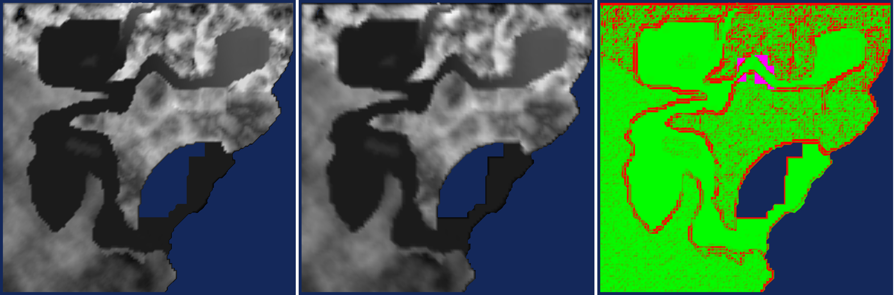

# MM9 rework: feasibility checks before the Isle of Ashes pilot (2026-10-29)

Three questions from the [plan](PLAN.md) that had to be answered before modelling starts.

## 1. Party scale: keep 2.56 and use the default eye height

MM9 doors measured from the DAT world models (`Door`/`RotatingDoor` objects), height × width at scale 2.56:

| Map | Doors | Median height × width |
| --- | --- | --- |
| Sturmford City | 105 | 246 × 164 |
| Thjorgard City | 145 | 246 × 164 |
| Anskram Keep | 97 | 246 × 123 |
| Bootcamp, Beethoven (sewers) | 23, 34 | 328 × 164 |

MM6–MM8 house doors are 128 × 256 native units in New Sorpigal, Harmondale and Ravenshore
([visual calibration](../../level_generation/VISUAL_CALIBRATION.md)).

| Eye height | MM9 town door (246) | MM6–MM8 door (256) |
| --- | --- | --- |
| 176 (engine default, MM8) | 1.40 eye heights | 1.45 |
| 152 (current `worlds/mm9/world.yml` override) | 1.62 | – |

At scale 2.56 MM9 already has MM6–MM8 proportions with the default eye height. The world's override to 152 makes
MM9 doors read larger than MM6–MM8 doors, not smaller. Neither bigger doors nor a lowered eye is needed: keep 2.56
and let the remade maps use the default eye height and collision. MM9 doors are about 30 % wider (164 against 128);
keep them.

## 2. Terrain resample: landforms survive, cliffs do not

`tools/mm9_import_discovery/check_mm9_terrain_resample.py <map>.dat <output_dir>` rasterizes the visible terrain
world models (terrain-folder textures; water volumes, the VisBSP helper and the PhysicsBSP collision hull excluded),
samples the 128² ODM grid (512-unit cells, 32-unit height steps), interpolates it back over the classic two-triangle
cells and compares against a 64-unit raster. Heights are measured from the lowest water surface.

| Map | Terrain extent | Max height byte | Mean error, gentle ground (< 30°) | Mean error, steep (> 45°) | Error > 256, all land | Overhangs |
| --- | --- | --- | --- | --- | --- | --- |
| Isle of Ashes | 37 × 43k | 97 | 58 | 117 | 6.6 % | 0.1 % |
| Sturmford | 51 × 51k | 136 | 28 | 142 | 6.4 % | 0.5 % |
| Thjorgard | 49 × 51k | 229 | 44 | 122 | 9.4 % | 0.0 % |
| Guberland | 49 × 51k | 255 (clipped: terrain reaches 8,823) | 39 | 159 | 11.7 % | 0.1 % |

Original | resampled | error (green 0, red ≥ 256, magenta stacked surfaces). Also
[Isle of Ashes](checks/terrain_resample_isleofashes.png), [Thjorgard](checks/terrain_resample_thjorgard.png),
[Guberland](checks/terrain_resample_guberland.png).

Findings:

- Playable valley floors and gentle slopes resample almost exactly (mean error 28–58 units, under knee height).
  The heightmap carries the layout, routes and gating.
- The error sits on cliff walls between valleys and the mountain rim, and on rocky ridges: a vertical MM9 cliff
  becomes a 512-unit slope. These are the places that need BModel cliff faces or rock assemblies, as MM6–MM8 maps do
  with rock decorations. Isle of Ashes is the most rugged (42 % of inland ground steeper than 45° at 64-unit scale).
- Overhangs and arches are rare (≤ 0.5 % of land); they become BModels.
- The terrain extends to 49–51k including the mountain rim, which fits the 65k grid; the 45k party bounds sit
  inside the rim.
- Height: Guberland's peaks exceed the 8,160 ceiling. They are one summit inside the party bounds (up to 8,742,
  about 4 million square units; the rim outside the bounds stays under 5,400), so a soft compression of heights
  above about 6,000 fixes it without touching the playable ground. Thjorgard has inland lakes above sea level; each
  map's base height needs choosing by hand.

### Gating: what the coarse grid opens and closes

The party slides off a terrain cell whose corner heights differ by more than 512 (about 45°;
`outdoorTerrainSlopeTooHigh`). So a cliff that rises less than 512 within one cell becomes a walkable slope, and a
passage narrower than a cell between steep walls can turn into slide cells. Comparing MM9 walkability (slope under
50° at 128-unit scale, MM9's navigation limit is 49.5°) with the resampled grid, terrain only, inside the party
bounds, for walkable regions of at least 500 × 500 units:

| Map | MM9 ground steeper than 50° | ...of it walkable after resampling | New connections | MM9 regions split by the grid |
| --- | --- | --- | --- | --- |
| Isle of Ashes | 38 % | 21 % | 5 | 5 |
| Sturmford | 15 % | 15 % | 2 | 5, including the main valley |
| Thjorgard | 32 % | 12 % | 7 | 4, including the main valley |
| Guberland | 32 % | 14 % | 11 | 7, including the main valley |

So each map has a handful of spots to fix by hand: 2–11 places where a softened cliff lets the party climb where
MM9 blocked it (raise the cells, or add a rock BModel or invisible wall), and 4–7 narrow MM9 passages, ramps or
switchbacks that the grid closes (widen them to at least one cell, or build the ramp as a BModel). The closed
passages matter more: they can cut a map's main area in two. Both lists are terrain-only: MM9 bridges, stairs,
invisible brushes and AI barriers are not included, so some new connections are already blocked in MM9 by
invisible geometry, which the remade map can reproduce. The pilot tool should print both lists with coordinates.

## 3. Dragonfly: MM9 rig and clips are reusable

Converted with `convert_abc_model.py` in a scratch venv (`pygltflib`), all three tiers. Contact sheets:
[bind pose](checks/dragonfly_bind.png), [idle and move](checks/dragonfly_idle_move.png),
[attacks](checks/dragonfly_attacks.png), [wince and die](checks/dragonfly_wince_die.png).

- The MM9 dragonfly is serpentine (long coiled body, four wings, no legs), unlike MM7's insect Dragonfly; the
  current MM7 sprite is only a stand-in.
- Skeleton: 31 joints, clean hierarchy (centre → back chain → tail chain; wing base → neck/head/jaw and four wings),
  unit scale, no mirroring. Joint axes do not follow the bones and right-side joints are rotated 180°: fine for
  playback, awkward for hand editing. Drop the two one-triangle dummy pieces on `tailnode`/`headnode`.
- Skinning is rigid (one weight per vertex); a new mesh needs smooth weights along the chains.
- Bind pose: wings spread in a raised V, S-curved body, within 10° of the first frame of `StandAir`. A usable
  modelling pose, but a Meshy mesh must be posed to it in Blender before weighting.
- Clips: 21, all in place (no root travel). Wings flap through their joints (50–71° at the root). Attacks and
  deaths are clearly authored (coiled strike, tail whip, jaw; tumble, fall, landing). Idle flaps are sparse (keys
  about every 170 ms, linear), so resample them to smooth curves. `StandAir` and `TauntAir` pop 8.5° and 12° at the
  loop seam.
- Role mapping: Standing `StandAir`, Walking `Flap`, Bored `FidgetAir1/2`, AttackMelee `HAttackair1/2` (`Bite` at
  0.46, `RKick` at 0.37), AttackRanged `Rattack1` (`rangeattack` at 0.56), GotHit `WinceAir1/2`. No run clip
  (play `Flap` faster). Dying is three MM9 clips (`DieAir1` → looping `fall1` → `FallDOwn1`) to stitch into one
  clip of about 2.7 s, blending a 28° jump between the first two.
- Floor: the hover height differs between clips (the centre sits 16 units lower in `Flap`/`Glide`); fit each clip to
  the floor rule of the [quadruped playbook](../../level_generation/creatures/CLAUDE_QUADRUPED_PLAYBOOK.md).

Verdict: the route "new HD mesh weighted to the MM9 skeleton, MM9 clips played unchanged" is feasible. The work is
the weighting, the death stitch, the loop seams and the floor pass.
