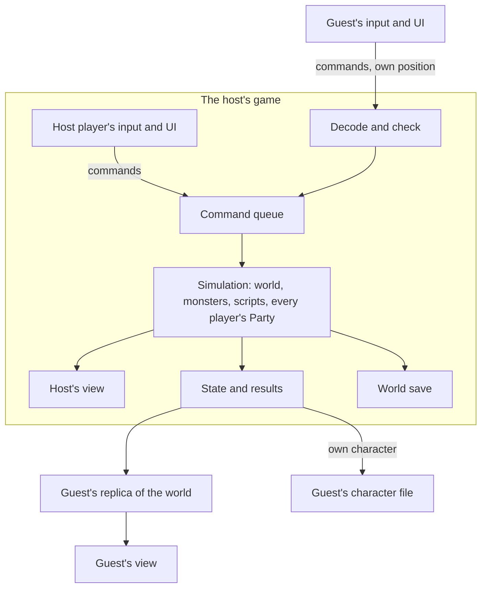

# Co-op multiplayer: one character per player on a host's world

Revision 2, 2026-11-19: the design. Since then slices A to E are built (the sections named "... as built" say how),
so a second game can join a host's world and play in it. What is still missing or wrong is tracked in
[the open items](MULTIPLAYER_OPEN_ITEMS.md), one row each: look there before starting co-op work.

This document replaces revision 1 of this file (2026-09-27, commit `f99e042707`), whose shared-roster design the
user set aside after a review on 2026-11-19. The [earlier investigation](MULTIPLAYER_ARCHITECTURE_INVESTIGATION.md)
still holds for feasibility and for what MMMerge's multiplayer does; where the two differ, this document is current.

## The shape

- **One character per player in a solo run** (`devdocs/solo_action/`): first person, an action bar, talents under
  MAW. Two to four players. Since 2026-11-21 a player may also bring a party where the host's game is no solo run
  ("A player may bring a party" under "The network as built").
- **The host owns the world, each player owns their character.** The world is the host's save: maps, quests, the
  calendar, shop stock. A character is a file on its player's machine and can be taken into another host's world.
- **One simulation, in the host's game.** The host runs monsters, scripts, damage, loot and time. The other games send
  commands and show what the host sends back. No dedicated server in the first version; the same simulation can run
  in one later.
- **Each player's game moves its own character.** The host checks the positions it is sent for sanity and does not
  simulate the players' movement.
- **Drop in, drop out.** A session is found in a list, by an invitation code, on the LAN or by address. A player who
  leaves or loses the connection is simply gone; the world does not pause.
- **A co-op ruleset** removes what cannot work with several players: pause, turn-based combat, fast mode and
  time-skipping services. Travel and rest are decided by a vote.
- **Friends, not strangers.** The host is trusted, and the other games are checked for ownership and sanity, not for
  cheating. A public session has a password, the host's approval and a kick.

## Decisions

Decided by the user on 2026-11-19:

| Decision | Choice |
| --- | --- |
| Party | One character per player, built on the solo run |
| Ownership | The host's world plus player-owned characters, one `Party` per player |
| Authority | The host's game is the server (a listen server); clients connect to the host only |
| Movement | Each client owns its own character's position in the first version |
| Time | A co-op ruleset: training takes no time, rest and travel by vote |
| Disconnect | No pause for the world |
| Joining | A session list and relay of our own; LAN, direct address or a VPN for the first tests |

Decided by the user on 2026-11-19, in answer to this document's first list of questions:

| Subject | Choice |
| --- | --- |
| Players | 2 to 4 |
| Ruleset | MAW's solo run first, because it is the tuned one; Standard allowed but not balanced |
| Monster strength | Monsters have more health with more players; damage stays as it is, theirs and the players' |
| Kill experience | In full to every player on the map, not split |
| Loot | One shared drop, first to take it; gold picked up is credited in full to every player on the map |
| Solo comforts | No 24-hour scroll buffs, no 24-hour minimum for timed potions and no Invisibility scroll stock in co-op |
| Shop hours | Always open. Boats and stables leave on every day |
| Gold, bank, food | Each character's own |
| Quest progress | The world's. Quest items lie in the world's quest pouch, not in a character's bag |
| Friendly fire | A host option, off by default |
| The server | Built and tested on the development PC, on localhost. Where it runs for players is decided once multiplayer exists |
| Turn-based combat | Off in a co-op session. Fast mode is off with it, since all players share one clock |
| MAW's level bank in co-op | Grows by one share per kill, a number for play to settle |

Left to this design by the user, and settled here:

| Subject | Rule | Why |
| --- | --- | --- |
| Joining level | No limit in the first version. The lobby and the session list show every character's level, and the host approves or removes a player | Among friends the group decides; a setting is added if play shows a need |
| A downed player | A teammate's revival, or after ten seconds a return to where the players arrived on the map, at the defeat's price | Below, "A downed player" |
| Whose level the monsters follow | The world's. MAW's level bank belongs to the world, not to a character | Below, "Monster level when characters differ" |
| How MAW's state splits | The table under "MAW state" | The same section |

## What changed from revision 1

| Revision 1 | Now | Why |
| --- | --- | --- |
| All characters live in the host's campaign save and are assigned to friends | Characters are their players' files; the world is the host's | Proxy control, the pause on a disconnect, reconnect credentials and reward claim records existed only for campaign-owned characters |
| One roster of at most five, cut into groups | One `Party` per player, each a party of one | Every "whole party" rule keeps its meaning; `party()` is called at about 475 places in 57 files |
| Everyone walks to the exit and readies up | A vote, then everyone is pulled along | A map changes at every dungeon door |
| Training visits with cohorts and paid rounds | Training takes no calendar time in co-op | MAW's online mode does the same; the machinery served single-player timing only |
| The host simulates every player's movement; clients predict and replay | The client moves its character, the host checks | The host is trusted and the session is among friends |
| A fixed 60 Hz step for everything | The frame-time step stays | A fixed step changes single-player behaviour, and an authoritative host does not need it |
| No rules for the solo run, MAW, rifts, battle orders, statistics | A section for each | They were built after revision 1 |
| An invitation code, no lobby; the relay left open | A rendezvous server with a session list and a relay | Without Steam or GOG the lobby has to be ours |

Kept from revision 1: one authoritative simulation in the host's game, commands instead of shared state, scripts and
random rolls run once on the host, results that survive a retry, and a first proof with two players in one process
before any socket.

## Who owns what

There are three kinds of state. Today all three sit in `Party` and `GameSaveData`.

| State | Owner | Stored in |
| --- | --- | --- |
| World | The host's simulation | The host's save, as today |
| Character | The host's simulation while in a session; the player between sessions | A character file on the player's machine; the host's save keeps the last state of every guest |
| Local | Each game | Settings and view state, as today |

### Splitting `Party`

`Party` (`game/party/Party.h`) holds one member in a solo run, and also the world's state. The world's fields move to
a world-owned record; the rest stays and becomes the player's.

| Goes to the world | Stays with the player's `Party` |
| --- | --- |
| `m_questBits`, `m_autonotes`, `m_historyEventTimesByContinent`, `m_objectiveQBits`, `m_humQBits` | `m_members` (the one character: stats, skills, spells, awards, equipment, inventory, battle and upkeep orders, Lloyd's beacons) |
| `m_eventVariables`, the NPC overrides (`m_npcTopicOverrides`, `m_npcGreetingOverrides`, `m_npcHouseOverrides`, `m_npcItemOverrides`, `m_npcGroupNews`), `m_unavailableNpcIds` | `m_partyBuffs`, `m_characterBuffs`, `m_expiringPotionEffects` |
| `m_houseStockStates`, `m_houseStockSeed` | `m_gold`, `m_bankGold`, `m_food`, `m_fineGold` |
| `m_gameMinutes` (the calendar), `m_itemWeeklyEffectSequence` | Movement and hazard counters (`m_waterDamageTicks`, `m_burningDamageTicks`, `m_lastFallDamageDistance`, `m_floorBurnType`) |
| `m_continentReputations`, `m_worldCompletions`, `m_foundArtifactItems` | `m_hiredNpcFollowers` and the hireling state |
| `m_journalMapNotes` | `m_activeMemberIndex`, `m_lastStatus`, `m_selfTextEvents`, `m_pendingAudioRequests` |
| The quest pouch of `m_pouches` | `m_adventurersInnMembers`, the other pouches, `m_everOwnedItemIds`, `m_explosiveMixes`, `m_teacherLedgers`, `m_daysWithoutRest`, `m_awakeDayIndex` |
| `m_arcomageWonHouseIds` | `m_arcomageWinCount`, `m_arcomageLossCount` |

- **The table is a first sorting** by what each field is for. Slice B settles every field against its uses.
- **This split is done for single-player first**, with no network code, and must not change how the game plays. A
  save keeps loading: the reader fills both records from the old layout (a save version step, as for every change).
- **Lloyd's beacons** are on the character (`Character::lloydsBeacons`) but name places in one world. A beacon
  carries the world's id and works only in that world; elsewhere its slot shows as set in another world.
- **`MawRules::m_state`** (`MawGameState`) needs the same split, below.
- **`GameSaveData`** keeps `party` (the host's character), `namedGlobalVars`, the map states and the ruleset. It
  gains the world record and a table of guests' characters by character id.

### The split as built (first step, 2026-11-19)

The world's record is the class `CampaignState` (`game/party/CampaignState.{h,cpp}`). The code says "campaign" because
"world" already names a content package such as MM8.

- **Moved into it, with their code:** quest bits, autonotes, history, journal map notes, event variables, the seven
  NPC records, shop stock and its seed, reputation, the artifacts found, the stories finished and the Arcomage
  taverns won. 41 functions left `Party.cpp`.
- **How it is reached:** `Party::campaign()`. A call site reads `party.campaign().hasQuestBit(id)`; about 800 were
  rewritten, in over 60 files. `Party` has no forwarding functions for what moved.
- **Still combined on `Party`, because they need both:** `applyGlobalNpcStateTo` (the campaign's NPC state and the
  party's followers), `recordArcomageWin` (the campaign's taverns, the party's gold and awards),
  `dialogueEligibilityRevision` (the party's own counter plus the campaign's quest counter).
- **The save's layout did not change.** `Party::Snapshot` holds a `CampaignState::Snapshot`, and the reader and
  writer take the same fields in the same order from it. No save version step was needed.
- **The session owns it** (second step, the same day). `GameSession::m_campaign` is the campaign; the session's party
  and the loaded map's party are bound to it with `Party::bindCampaign`, as they are bound to the rules and the
  statistics. `party.campaign()` reads as before, so no call site changed again.
- **A party is still a value.** A copy of a party is never bound: it owns a copy of the campaign's state. Assigning
  a party over a bound one writes that state through and keeps the binding (`Party::CampaignLink`). So the places
  that rely on a copy carrying quest state still work unchanged: loading a save, the scenario runner's checkpoints,
  the pickup probe that restores the party it tried the pickup on, and the trial parties of MAW's tooltips.
- **When the map's party is bound:** at the first hand-over from the map to the session after a load
  (`GameplayController::synchronizeSessionFromRuntime`), where the two hold the same state. Until then the map's
  party owns a copy, exactly as it always did, so what an indoor map's restore does before that is unchanged.
- **What it is for:** a second party bound to the same campaign shares its quests, journal and shop stock. That is
  the next slice; today one party is bound.
- **Sorted differently from the table above, after reading the code:**
  - `m_gameMinutes` stays on `Party`. It is a copy the map runtime publishes for conditions; the clock's owner is
    the map runtime.
  - `m_itemWeeklyEffectSequence` stays on `Party`: it counts the weekly effects of the party's own items.
  - `m_objectiveQBits` and the Hum's quest bits stay on `Party`: they are the current map's settings, read against
    the campaign's quest bits.
- **`MawGameState`:** the party's own part (auras and where they came from, the food held back, the death count)
  was first grouped inside it and is now the party's own (`PartyRulesetState`, `Party::rulesetState()`; "MAW's state
  per party as built"). A save still holds it inside MAW's state, with the layout unchanged. The barrels that
  raised a stat stay with the game for now: they are kept per map.
- **Not moved yet:** the quest pouch (it matters only once several parties share items), and the lift of the
  campaign's snapshot from `Party::Snapshot` into `GameSaveData`. The save still writes the campaign with the
  party; it is lifted when a save holds more than one party.
- **Not moving:** the Adventurer's Inn roster. Co-op does not use the Inn ("Sessions", below).

### The character file

- **Content:** the `Party` part above as a snapshot, the character's part of the MAW state, a random 128-bit
  character id, the ruleset it was made under, the save version.
- **Where:** `saves/characters/`, beside the saves. One file per character, replaced atomically (a temporary file,
  then a rename), with the previous copy kept.
- **Made by:** creating a character for co-op, or copying the character out of one of the player's solo run saves.
  The save is not changed and the copy lives on by itself.
- **Written:** by the client, from the state the host sends, at every host save, on leaving and every few minutes.
- **In the host's save:** the last state of every guest, by character id. It serves a rejoin after the client lost
  its file's newest write, and never overrides a client file with a higher revision.
- **The host's own character** stays in the save's `party` as today. Any solo run save can therefore be hosted, and
  a hosted world can be continued alone.
- **A character in several worlds** keeps what it earned in each. Joining a fresh world and repeating its quests for
  experience is possible, as in other games with portable characters. It is accepted among friends. There is no
  level limit for joining; the host sees each character's level before approving it.

## Sessions

- **Hosting.** Main menu or the game menu: host a save or a new world, with a name, an optional password, a player
  limit and "listed" or "by invitation". A new world starts in a lobby where the players pick or make characters
  before the first map loads.
- **Joining.** From the session list, the LAN list, an invitation code or an address. Before admission the player
  picks one of their character files or makes a new character, on the same screen the lobby uses.
- **Not from the Adventurer's Inn** (the user, 2026-11-19). Discord asked that a joiner may take a character waiting
  in the host's Inn. It is left out: a solo run's Inn is nearly always empty, since nobody joins a solo run; the
  characters that do wait there are often story recruits whose presence quest events check; and they have no action
  bar or talents. The Inn stays what it is in a single-player game, and its roster stays on `Party`.
- **Admission.** The host compares the build's protocol version, the ruleset and its options, the enabled mods in
  mount order and the gameplay content, and names what differs. The content's identity is the set of pack
  `content_id`s the updater already computes (`packaging/UPDATER_PLAN.md` §5.3) in a release, and a hash of the
  gameplay tables and scripts in a development tree. Each map's layout identity
  (`devdocs/SAVED_MAP_STATE_IDENTITY.md`) is compared again when that map loads.
- **Arriving.** The joiner loads the current map without running its load events, receives the state, and appears
  beside the host. While the host is in a fight the joiner waits in the loading screen with a notice.
- **Leaving.** The character's state goes to its player and into the host's save, the body leaves the world, the
  player's conversation or chest is closed, and what the player held on the cursor goes back into the bag.
- **A lost connection** is a leave without the goodbye: the host keeps the last state and the player can rejoin.
  Nothing pauses.
- **The host leaves:** the session ends for everyone after a save. The host's game closing without a save costs the
  world what happened since the last save, and every guest keeps the character state of their last write.
- **A dedicated server** is a later step: the same simulation without a window, for a world that stays up without
  its host. It changes no rule here.

## Co-op rules

A co-op session is a ruleset option on top of Standard or MAW, as the solo run is. Single-player keeps every rule
it has.

| Subject | Rule in a co-op session |
| --- | --- |
| Pause | None. Inventory, spellbook, journal, the potion and scroll popups, the game menu and Settings leave the world running |
| Turn-based combat, fast mode, `time_scale` | Off |
| The calendar | Runs at the normal rate for everyone. It jumps only by a vote |
| Map travel | A vote, then everyone moves together (below) |
| Rest and waiting | A vote. Allowed when no player has hostile monsters near, by the rule the rest screen uses today for one party. Everyone rests where they stand, the calendar advances once, each character pays its own food |
| Training | Costs gold and takes no calendar time |
| Boats, stables | Leave on every day of the week. A map travel vote that shows the days and the fare; each character pays its own fare; the calendar advances once |
| Prison, other scripted time jumps | Applied once by the host, to everyone |
| Shops, temples, guilds | Open at every hour. Each player visits alone. Stock is the world's, gold is the character's, the host books every purchase |
| Houses | A player inside a house cannot be attacked and cannot attack. The world goes on outside |
| Dialogue | One player talks to an NPC at a time; the others in reach can read along. Two players can talk to two NPCs |
| Chests, corpses | One player at a time; contents and traps are rolled once by the host |
| Kill experience | In full to every player on the map |
| Loot on the ground | Shared, first to take it. Gold is credited in full to every player on the map |
| Trading | Dropping an item for the other player works from the first version; a trade window is a later comfort |
| Party buffs | Reach the caster and every player within the aid reach at the cast, each for the normal duration. The aid reach is the party's spell reach (`IGameplayWorldRuntime::partyHitReach`: 5120 map units, 3800 in MM9); no line of sight is needed (the user, 2026-11-21) |
| Auras (MAW) | An aura in effect reaches the other players' parties within the aid reach, without line of sight: they have its buff while they stand there, hold nothing and reserve nothing. The stronger of an own and a lent aura counts. Immolation is not lent. See "Auras lent between parties" below |
| Healing and cures on another player | Aimed at the body in the world, or chosen from the players who need it; within the aid reach and with a clear line between the two parties' eyes (`GameSession::playersInAidSight`) |
| Fly, Water Walk, Invisibility | As party buffs: granted at the cast to those in the radius, then each player's own |
| Town Portal, Lloyd's Beacon recall | A map travel vote. The caster pays the mana when the vote passes |
| Friendly fire | A blast burns every party inside it, the caster's own and the other players' (the user, 2026-11-21: a Fireball thrown into a fight burns the friend who stands in it, as a party's own blast always burned that party). A missile's direct hit and a melee blow never land on another player. No host option yet |
| Players and collision | Players do not block each other. Monsters block and are blocked as today |
| A player goes down | A teammate's revival, or a return to the map's arrival point (below). While it lies there and another party still stands it is out of the fight: no missile, blast, death explosion, Armageddon or charge hurts it further, so a heal is still enough to bring it back (ruled 2026-11-21) |
| Everyone is down | The normal defeat, once: one move to the respawn place, each character pays its own price |
| Cinematics and movies | Play for everyone with the world held until they end. The host's skip skips for all; a guest's skip only readies that guest |
| Arcomage | The playing player is in a house; the match runs in that player's game and the host books the result |
| Companions and hirelings | No companion joins a party (as in a solo run). MM9 hirelings stay each player's own and give their services and passives |
| Saving | The host saves; a guest can ask. Loading is the host's and puts everyone on the loaded state |

### Map travel

One map is active for everyone in the first version.

1. A player uses an exit, a travel service or a travel spell. The host works out the destination and the cost.
2. Everyone sees the proposal in one window (since 2026-11-21, "The travel vote's window" below): who, where to,
   how many days, what it costs, and every player with where its answer stands. The world waits while the vote is
   open.
3. Every player accepts or declines. One decline cancels it, and the proposer may take the trip back. A guest may
   instead drop out of the session for now (the proposer: go there alone, in its own world). With no answer after
   30 seconds the host player may force it; after a minute the vote lapses.
4. On acceptance the host holds the world, runs the map's leave events once, moves the calendar and takes the fares
   once, loads the destination, runs its load events once and places every player at the arrival point.
5. Each client loads the same map, receives the state and reports ready. The world resumes when all have.

- **A client that fails to load** is dropped from the session after a retry; the others go on.
- **A forced move** by a script (a trap, a story event) skips the vote and takes everyone.
- **A move inside the same map** (a teleporter, a jump) moves only the player it happened to.
- **Later: players on different maps.** The state leaves some room for it: every player has its own party, and a
  map's state is already addressed by map and instance id (`GameSession::mapStateKey`). As built (step 4) nothing
  else does: a player record (`GameSession::GuestPlayer`) has no map of its own, the host runs one world runtime
  with every player's body in it, and the messages speak of one map (one map revision for the session). Running two
  maps needs the world runtimes free of the one "current map" and of the loader's world context; it is a separate
  step with its own measurements.

### Monster strength with several players

One solo character is tuned to be about as strong as a party of five (the user's benchmark in
`devdocs/solo_action/HANDOFF_POWER_CURVE.md`). Several of them would walk through the same monsters.

- **No more health for more players since 2026-11-21** (the user's decision, after asking what MAW's own
  multiplayer does): the factor is 1 whatever the number of players (`MonsterRules::playerHealthFactor`, its
  `HealthPerExtraPlayer` 0). MAW's `getMonsterHealth` reads level, difficulty, Austerity, tier and boss
  multipliers only ("What MAW's own multiplayer does" below). The rest of this section describes the sizing as
  it was built and still stands, with the factor at 1.
- **The rule from 2026-11-19 until then:** monsters had more health, and no damage number changed. A monster's
  maximum health was multiplied by `1 + 0.5 × (players − 1)`: 1, 1.5, 2 and 2.5 for one to four players in the
  session.
- **Monster damage stays,** and so does every hit a player deals. Each monster still attacks one player at a time.
- **When the number of players changes** (a join, a leave, a lost connection), every living monster on the map keeps
  its share of health: the maximum becomes the ruleset's own number times the new factor, rounded up, and the
  current health the same share of it. Leaving in the middle of a fight therefore gains nothing.
- **In a save,** each map state records the number of players its monsters are sized for; a state without one has
  1. Entering a map with another number of players sizes its living monsters again the same way. A single-player
  game always has 1, so a hosted world continued alone goes back to the ordinary values, and an ordinary save
  never holds another.
- **One place.** The factor is applied where the ruleset sets a monster's health for the map
  (`MonsterRules::resolveMonster`), not in the combat code. Built: "Two players as built".
- **What reads a monster's health for another purpose** (experience, loot, a script's threshold) uses the value
  without the factor. MAW's kill experience does read it: `mawMemberKillExperience` compares the monster's maximum
  health with that of a monster of the member's level, and already divides a rift's health affix out. The co-op
  factor is divided out at the same place.
- **Not scaled:** monsters a player summoned or controls.

### Whom a monster fights

With several players each monster has one party it fights (`partyPlayer`), chosen anew at every step of the monsters'
minds by `chooseMonsterTarget` (`game/gameplay/MonsterTargetChoice.h`), the same outdoors and indoors:

- **Only a party that can act.** A party that is down is left alone while another stands.
- **Not an invisible party while a visible one stands.** Before, the nearest player's Invisibility switched the
  monster off for everyone.
- **Whoever last hurt it,** for three game minutes (six seconds of play): a blow names the acting player, a missile
  its shooter (`noteActorThreat`). A shooter far away so pulls the monster off the player beside it.
- **Else the nearest, in three dimensions,** and its present target stays until another is a quarter nearer, so two
  players at a like distance do not pass it to and fro. A player on the floor above is not near.

A charge is aimed at that party, any party's body stops it, and the party it ran into takes the hit. Indoors the
rooms the other players stand in wake as the host's does.

What goes with the target (2026-11-21, after the pathfinding audit):

- **Routes** always led to each monster's own party (one path planner per monster over the level's one path map,
  no field or cache made for one party's place). A monster that turns to another party now drops its route and
  what it had learned of reaching the old one (`ActorPathRuntime::resetActor`, MM9's "unreachable").
- **Bodies in the way:** indoors every party's body stops a walking monster, so a player can hold a doorway.
  Outdoors no party's body does, as before.
- **Active monsters outdoors:** the nearest 48 of each party, as indoors, so players far apart each meet monsters
  that act. Players together share the same nearest ones.
- **Shots led at a moving target** use the other party's speed between the places its game tells
  (`GuestPartyVelocities`).
- **Scripted behaviours** (`ActorBehaviorRuntime`: `self:distanceToParty`, MM9's distance and bearing, a push
  towards the party), **MM9's hiding places, help calls and swimmers,** a scripted blink and MAW's boss summon
  measure to the party the monster fights (`IGameplayWorldRuntime::actorPartyFeet`).
- **A party that is down** is not chosen, not struck and stops no charge while another stands
  (`GameplayCombatController::handleAndClearPendingCombatEvents`). Checked by `coop/net_downed_out_of_fight.yml`.

- **A flying party:** a player's body says whether it flies (`GameplayPlayerBody::flying`, protocol 17), so a
  flier comes to meet a flying guest and hovers over one on the ground, as with the host.
- **A missile that strikes one party** gives that party its own damage and no blast on top, as in a game of one;
  the parties beside it take the blast (`coop/net_missile_blast_beside_struck.yml`).
- **MAW's Leecher** drains each party by its own distance: every game works the boss auras out for its own party
  on its copy of the world (`coop/net_maw_leecher_aura.yml`).

The replica runs no monster minds and no path planning.

### The world's half of a character's change

A guest's game sends what it did to its character every frame, and the host drops such a change when it was made
before that game knew what its last command did. What the game did to the world in the same frame (a thing taken out
of a chest, an item dropped from the cursor) names that change's number (`guestSendCommand(..., true)`, protocol
16) and is dropped with it, so an item is never gone from the chest and missing from the bags, or on the ground and
still on the cursor. The host then sends the chest and the character as it has them.

### Auras lent between parties

Twice a second the host works out, for every party, what the parties within the aid reach lend it
(`GameSession::updateLentAuras`): each asks its rules what it holds that reaches others (`SpellRules::aurasToLend`,
MAW: every aura in effect but Immolation) and the strongest of each spell goes to the borrower's rules
(`SpellRules::setLentAuras`, kept in `MawPartyRuntime::lentAuras`). `MawSpellRules::auraSources` then counts a lent
aura like a scroll's or temple's: no holder in the party, nothing reserved. A guest's game runs the rules for its own
character, so the host tells it what its party is lent (`Message::LentAuras`, protocol 15), again after every map it
loads. The aura report lists only what the party holds itself. Checked by `coop/net_maw_auras.yml`.

### A guest's console

A guest's game is a copy of the host's world, so its debug console refuses what would change the world, the quests,
the clock or the map (`DebugConsole::setCommandGate`, set in `GameApplication`): `goto`, `reload`, `event`, `lua`,
`qbit`, `autonote`, `ledger`, `npc`, `arcomage`, `mapvar`, `global`, `destructible`, `arena`, `projectile`,
`testparty`, `hire`, `tp`, `ruleset`, `actor`, `time` with an argument, `cinematic play`, `hireling add`, `player
add`. The forms that only show something stay. The commands that change the guest's own character (gold, items,
skills, hit points) stay too: they reach the host with the character. The host's console does everything. Checked by
`coop/net_guest_console.yml` (a console step's `expect_refusal`).

### What MAW's own multiplayer does

Read on 2026-11-21 from MAW's Lua at `7ddb228c` (the clone `devdocs/maw/HANDOFF.md` names as current; the copy in
`reference/Maw-Mod-MMMerge/` is older and lacks most of its Multiplayer module). Paths are under its `Scripts/`.

| Question | MAW | This game |
| --- | --- | --- |
| Monster health by number of players | None (`Modules/MawCore/Estimates.lua` `getMonsterHealth`) | None since 2026-11-21 |
| Kill experience | Divided by `min(players, 5)`, then split over the party's living members (`Modules/Multiplayer/Synchronization/Players/Experience.lua:16`) | In full to every player's party on the map |
| Map-clear experience | Divided by `min(players, 5)` (`General/zzMaw-Monsters.lua:2793`) | Not divided |
| The crafting gem's bonus roll | Divided by the players (`General/zzAlchemy.lua:1178`) | Not divided |
| Whose level sets the monsters | The host's level bank, mirrored to every client; clients never bank (`Modules/MawCore/Sync.lua:46`, `General/zzzMaw_Experience.lua:250`) | The world's bank, the same rule ("Monster level when characters differ") |
| A character far above or below the monsters | Its share of a kill's experience is scaled by the monster's level against its own, to at most three times (`Experience.lua:31`) | `mawMemberKillExperience`, MAW's own single-player scaling |
| A join check on level | None | None |
| Difficulty and modes of a joining game | Not checked: the client takes the host's difficulty, progression and challenge modes (`Sync.lua:47`) | The guest plays by the host's, as in MAW; refused only for another kind, solo or party (`coopRulesRefusal`) |
| A solo party | No rule of its own | Must match: solo runs join solo runs |
| Training and shops | Training instant, shops always open while online | Training takes no time in a shared world; shops keep their hours |
| Turn-based mode | Off online | Off in a session |
| Players in a session | 3 by default (two clients) | 4 |

What this leaves to decide: with no extra monster health, MAW keeps a group from out-levelling the world by
dividing kill and map-clear experience by the players. This game pays each party in full.

### Monster level when characters differ

Under MAW the monsters' level follows the party's progress: the level bank (`MawGameState::continentLevels`,
`bankedExperience`, `bankedLevel`). The same bank sets loot and shop levels, quest gold and experience bonuses and
artifact strength. In co-op the characters can be of very different levels.

- **The rule: the bank is the world's.** Monsters, loot and bonuses follow the world's bank exactly as in a
  single-player game. Who is connected does not matter, and nothing changes when a player joins or leaves.
- **Why not the highest level:** a newcomer would face monsters made for the strongest character and be of no use.
- **Why not the average:** with levels far apart it suits nobody (a level 100 and a level 1 would meet level 50
  monsters), and it jumps with every join and leave.
- **Why the world's fits MAW:** the bank already records where the levels were earned, continent by continent
  ("finish Enroth at 100 and Antagarich starts 100 higher"). That is the history of a world, not of a character
  that visits it.
- **A weaker character catches up by MAW's own rule.** A kill's experience is scaled by how tough the monster is for
  that member (`mawMemberKillExperience`), up to `(level + 1) × 1000` a kill. A low character in a high world
  therefore gains fast, and a high character in a low world gains little. No gift of levels is needed for a
  newcomer.
- **The early monster cut is each character's own.** It is two damage stages keyed by the character's level (a
  monster's hit on that character is divided, that character's hit multiplied), so it also shelters a low newcomer.
  A hit that names its character reads the cut of that character ("MAW's state per party as built").
- **How the bank grows.** A kill banks once, whatever the number of players: the mean of the players' awards, put
  through the division a solo run uses today. A co-op world then advances about as fast as a solo one. To be tuned.
- **What it leaves:** a high character in a young world walks through it. The host sees the level before approving,
  and friends who want that may have it.
- **Standard** is allowed but not balanced. Its bolster reads a party level too; that becomes a world value by the
  same reasoning when Standard co-op is balanced.

### A downed player

In a single-player solo run a fallen character is a defeat, and a defeat moves the party to another map. With one
active map for everyone that cannot happen to one player alone.

- **Down.** The character lies where it fell. Its player watches through a teammate's eyes, can chat and can vote.
- **A teammate's help** is free and needs no new mechanic: whatever heals, cures or raises a character today works
  on another player's character, at the body.
- **Return.** Ten seconds after falling, the player may return: the character stands up where the players arrived
  on this map, on its feet and whole. It costs no gold (the user's decision of 2026-11-21, after playing it: a player
  who falls beside the others loses none); a death is counted. A defeat of everyone is still the ruleset's defeat.
- **While down** (built 2026-11-21) the player's walking keys do nothing: it looks around and lies where it fell.
  Its screen says so the whole time, with what the others can do and the key that returns it, counting the ten
  seconds down.
- **Why the arrival point and not beside a teammate:** the walk back is the cost. Standing up next to the fight
  would make every boss a matter of falling and returning in turns. It also needs no test for "the fight is over".
- **Travel while down.** A map travel vote takes the fallen character along. It arrives still down, and its return
  point is the new map's arrival point.
- **Everyone down** is the normal defeat, once, for all.
- **Rules that count deaths** (MAW's Madness, a later hardcore mode) count a return as a death of that character.

## What was built since revision 1

| Feature | Rule in co-op |
| --- | --- |
| Solo run (`Party::setSoloRun`) | Every player's `Party` is a solo run. A co-op character and a solo run character are the same thing |
| Talents and archetypes (MAW) | The character's own. A talent that helps "the party" helps its owner; reaching other players is decided per talent, later |
| The delayed blow (`GameplayScreenRuntime::ViewModelLink`) | The client decides when its blow lands and at whom (below) |
| Solo comforts | The 24-hour scroll buffs, the 24-hour minimum of timed potions and the Invisibility scroll stock do not apply in co-op (the user, 2026-11-19); scrolls, potions and shops follow the ruleset's party rules. The halved experience surcharge stays |
| Battle orders and the upkeep list | On the character, so they travel with it. "An ally's HP is below" reads the character's own HP in the first version |
| Potion and scroll popups, quick item rings | Open without pausing |
| MAW rifts (`devdocs/maw/DIMENSION_INSTANCES_PLAN.md`) | One open rift per world. The Dimensional Portal is a world quest item, and entering is a map travel vote |
| MAW state (`MawGameState`) | Split below |
| Statistics (`devdocs/PLAYTHROUGH_STATISTICS_PLAN.md`) | The world is the playthrough and its id is the world's id. The host's records count the host's character and are flagged "co-op". A guest's character file carries no sealed statistics in the first version |
| Saves by playthrough | A co-op world is listed as the host's playthrough. A guest has no save of it unless it keeps a copy, which is a playthrough of the guest's own ("What a player keeps, as built") |
| Map layout identity | Compared when each map loads, so a guest with another build of a map is told before playing on it |
| Named mods, rulesets | Part of admission: the same mods, in the same order, and the same ruleset options |
| Scripted actors (`devdocs/ACTOR_SCRIPTING_INVESTIGATION.md`) | Scripts run on the host; clients get the results |
| Hit feedback (hitstop, flash, camera kick) | Shown by each client from the host's hit results. The host's monster timing must not depend on a hitstop; today the hitstop holds the actor's animation tick inside the world runtimes, which has to be checked |
| Destructibles, rotating movers, ladders, pulsing lights, ambient sounds | Movers and destructibles are world state like doors. Ladders are the client's movement. Lights and sounds are local |
| In-engine cinematics | The rule in the table above |

### MAW state

The user left this split to the design (2026-11-19). Fields are those of `game/rules/maw/MawGameState.h`; slice B
checks every field against its uses.

| Owner | Fields |
| --- | --- |
| The world | The level bank (`continentLevels`, `bankedExperience`, `bankedLevel`; see "Monster level when characters differ"), `mapResetCounts`, `pendingRefills`, `completedMaps`, `clearedSinceRefill`, `mapVisits`, `mapsDropped`, `dimensionRuns`, `dimensionQuest`, `dimensionRunsCleared`, `bountiesClaimed`, `artifactDrops`, `legendaryAffixDrops`, `soldUniqueItems`, and every pity counter (loot is rolled once, for the world) |
| The character | `auraHolders`, `fixedAuraMaps`, `fixedAuraEndMinutes`, `heldFood`, `madnessDeaths` |
| The character, per world | `usedStatDecorations` (a barrel raises one character once in one world) |

A character file therefore carries no bank. A character's own level and experience are on the character as today.

MAW's own online mode shows what must be shared between games: monster deaths, short-lived projectiles, per-monster
stacks, and buffs that must not follow a player onto another map. With one host simulation the first three are
shared by construction.

## Architecture

### The host and the clients

- **The host** runs what a single-player game runs, with one `Party` per player instead of one, and with every
  action entering through a command.
- **A client** runs no monster AI, no map scripts and no loot rolls. Its world runtimes run in a **replica mode**:
  actors, doors, items and projectiles take their state from the host and only animate locally. It runs the movement
  of its own character and all of its own presentation.
- **Single-player** is the host alone: the same commands, handled in process, with no transport, no encoding and no
  replica.

Replica mode is the largest piece of new structure. `OutdoorWorldRuntime` and `IndoorWorldRuntime` today simulate
and present in the same update; the split is between "decide what an actor does" (host only) and "show what it is
doing" (everyone).

### Where the code stands (checked 2026-11-19)

| Place | Today | Change |
| --- | --- | --- |
| `GameApplication::renderFrame` (`game/app/GameApplication.cpp`) | The gameplay update runs inside the render call; time scale and game speed are multiplied in there; UI state decides whether the world moves | In a co-op session the host updates the session whether or not it draws, and no UI state stops the world |
| `engine/EngineApplication.cpp` | Frame-time steps, 1/60 s as the fallback | Kept. A long frame is cut into several steps on the host so that monsters do not jump |
| `Party` | World state and the player's state together (above) | Split |
| `IndoorPartyRuntime`, `OutdoorPartyRuntime` | Each holds a `Party` value and the movement state | Hold the local player's movement; the host keeps a pose for every other player |
| `party()` (about 475 calls in 57 files), `activeMember` (about 380 uses) | One party everywhere | Sorted into three kinds: local UI (unchanged), "the acting player" (gets the player from the command), "the players" (monster targeting, projectiles, area effects: a loop) |
| `EventRuntimeState` | One `pendingDialogueContext`, `pendingMapMove`, `pendingInputPrompt`, `dialogueState` | A conversation per talking player; the map move becomes the vote |
| `GameSaveData` | One `party`, one held cursor item | Gains the world record and the guests' characters |
| `MawRules::m_state` | One `MawGameState` | Split as above |
| `ScenarioRuntimeDriver` | Drives one player through the real game | Gains a second player and, later, a transport that can delay and drop |

### The host loop as built (2026-11-19)

`GameSession::coopSession()` is the switch. It belongs to the running session: it is not saved and a new or loaded
game keeps it. Nothing hosts or joins yet, so the console's `coop on` sets it.

- **A screen of this game holds this game's input and nothing else.** Under the inventory, the spellbook, the
  journal, a dialogue, a house, a chest, the quick reference, the potion and scroll popups, a spell waiting for its
  target and the right button's inspect pause, a co-op world goes on: the party's physics and timers, the clock,
  monsters, projectiles, map timers and doors. The party takes no movement or action input meanwhile.
- **The debug console** does not freeze a co-op world. Its explicit `render freeze` still does.
- **Full screens** (the game menu and what it opens, a card game) used to end the frame before the world's update.
  A co-op session's frame first runs `GameApplication::advanceWorldBehindScreens`: the gameplay update with nothing
  held and the map's update, in steps of at most 0.05 s. Behind the game menu the world is then drawn as it goes:
  effects, poses, sounds and, indoors, the map's own simulation run with the frame's time as in any drawn frame
  (`GameApplication::presentWorldFrame`, shared with the ordinary frame).
- **Screens that hold the world.** A movie and a story's end are watched by everyone, so a session's world waits
  for them: `IScreen::holdsCoopWorld`, true for `CutsceneVideoScreen` and `WinGameScreen`. The defeat's movie is one
  of them, which fits the rule that a defeat is everyone's.
- **Frames the window does not draw.** The engine calls the application for a frame without a drawable
  (`EngineApplication::setUndrawnFrameCallback`), and a session's world takes the same tick. Indoors the doors that
  move meanwhile are noted and their geometry follows at the next drawn frame, so no buffer update queues up
  unseen. The console's `render undrawn on` takes frames this way on a desktop whose minimized window keeps drawing.
- **Indoors the map's simulation was part of drawing.** It is now `IndoorRenderer::advanceWorldSimulation` (the
  clock, timers, doors and the door geometry that moved), which the renderer calls for a drawn frame and a co-op
  session also calls for a frame whose world is hidden.
- **Turn-based combat and fast mode** are refused in a session with a status line.
- **A single-player game takes every path it took before:** each change is behind the switch.

- **Commands.** `GameSession::playerCommands()` (`game/gameplay/PlayerCommands.{h,cpp}`) is where a player's
  actions on the world enter, each with the player who does it: an attack, a cast, the activation of something in
  the world (a door, a chest, an NPC, a decoration, a corpse) and the use of a held item on a member. The input code
  still decides what the player means and with what target; the command front resolves the player's party and runs
  the existing handler. The game's own call sites and the scenario runner's go through it. One player exists,
  `LocalPlayer`; the next slice adds the second and gives `party(player)` more than one answer.

Checked: four scenarios in `tests/scenarios/coop/` (outdoors and indoors a dialogue holds a single-player clock and
not a co-op one; the Combat key is refused; an attack, an activation and an item's use are counted by the command
front), and the real game, outdoors and indoors, with and without a session:

- the game menu open for 20 seconds: a session's clock moves 10 game minutes behind it and shows on the HUD, a
  single-player clock stands; the mouse stays a free cursor under the menu;
- the inventory open for 20 seconds: the same;
- 20 seconds of undrawn frames: a session's clock moves 10 game minutes, a single-player clock stands;
- an attack from the real input path is counted as one command.

Still outside the command front:

- **Picking an item up from the ground and stealing.** Both go through the cursor's held item, which is the state of
  the game at whose screen it is. They move with the item work of the network slice.
- **A battle order's spell** is cast inside the attack it belongs to, so it is part of that attack command.
- **Inventory moves, shops, dialogue choices, votes.** They were never part of this slice ("Commands", below).
- **A command is not data yet.** It is a call with the player's id and the request the handlers already take.
  What of a request travels between games is decided where it is first sent, in the network slice.

Not verified: a window that really has no drawable (Android in the background). The path is the one the console
switch runs; the engine's own branch is two lines.

### Two players as built (2026-11-19)

Slice D: a second player plays in the host's process, with no network. It has no screen and no body to look at. The
console (`coop ...`) and the scenario runner drive it. Everything below is off in a game of one party: the lists are
empty and the single-party code paths run as before.

**The players**

- **A guest player** (`GameSession::GuestPlayer`) is an id, a `Party` bound to the session's campaign, a place on the
  map (`GameplayPlayerBody`) and the seconds it has been down. The local player is `LocalPlayer` (0).
  `GameSession::partyOfPlayer` names anyone's party; `playerCount` counts them.
- **The world knows where the others stand** (`IGameplayWorldRuntime::setGuestBodies`, sent every frame and at once
  when a player comes or goes).

**Monsters**

- **Each monster deals with one party:** the nearest one that can still act (`partyPlayer` on the actor, chosen in
  `assignActorPartyPlayers` at every AI step). Its distance, sight, reach, melee and missiles use that party's place
  and that party's armour. Monsters stay active around every player, not only the local one.
- **A hit names its player** (`CombatEvent::player`, set through `GameplayCombatController::setRecordingPlayer`), and
  the session applies it to that player's party.
- **Area blasts and a monster's death explosion** hit every party in reach and in sight, each where it stands.
- **Health per player.** `MonsterRules::resolveMonster` sizes the ruleset's result with
  `healthForPlayers(context.playerCount)`; the rulesets decide in `resolveMonsterByRules`. A map keeps the count its
  monsters are sized for (`monsterHealthPlayerCount`, in the map's saved state since save version 198; 1 in older
  saves). The session compares it with the number of players every frame and calls `resizeMonstersForPlayers` when
  they differ: after a join or a leave, on a map last played with another number, after a load. A living monster's
  maximum is the ruleset's own number sized for the new count, and its current health keeps its share. A kill's
  reward reads the health without the players' share (`healthWithoutPlayers`).

**What a player does**

- **A command of another player** runs with the world's party swapped to that player's (`ActingPartyScope` in
  `PlayerCommands.cpp`, `IGameplayWorldRuntime::swapActingParty`), so the handlers and the world code they call take
  the acting party from the world. Meanwhile the session still names the local player's party correctly
  (`setLocalPartyBehindActingParty`).
- **An event** runs for the acting party (`PlayerCommands::runEvent`; outdoors `OutdoorSceneRuntime::eventParty`).
  What it asks of the world is applied while that player acts.
- **Each player has their own open chest and corpse.** The world's members hold the acting player's; the others wait
  in `WaitingPlayerViews` and are exchanged with the party. A chest or corpse that another player has open is refused
  with "Another player is using this". `PlayerCommands::openChest`, `takeAllFromOpenChest` and
  `closeOpenChestAndCorpse` serve a player without a screen; the taking itself is the one function the local Take
  All button uses.
- **A spell on one character can name another player's** (`PartySpellCastRequest::pTargetParty`, set by
  `PlayerCommands::castSpell` and `castSpellDirect` from a target player): heals, cures, revivals, Reanimate and the
  one-character buffs. The caster pays and recovers.

**Rewards**

- **A kill's experience** goes to every party in full (`grantKillExperienceToPlayers`). MAW's level bank grows once,
  by the killing party's share (`MonsterKillReward::banksExperience`).
- **What an event gives** (experience, gold, an award) goes to every party (`EventRuntimeState::coopParties`, which
  the session fills while it has other players). What an event takes, the acting party pays.
- **Found gold** from chests, corpses and the ground goes to every party (`creditFoundGold`). Things go to the party
  that took them.
- **Quest bits, the journal, shop stock and NPC state** are the campaign's, so they change once for everyone.

**Travel, defeat and return**

- **A move to another map waits for the others** (`GameSession::proposeTravel`, in
  `GameApplication::processPendingMapMove`). The proposer is the player whose command asked for it. One "no" drops
  it, every "yes" lets it pass, and after 30 seconds it may be forced. A move inside the map is not a proposal.
- **On arrival** every player stands at the arrival point, side by side (`GameSession::updateMapArrival`).
- **One party down is not a defeat.** The game is lost when no player can act; then the defeat is everyone's: each
  party pays and stands up, and the death is counted once.
- **A downed player returns** after ten seconds (`GameApplication::returnDownedPlayer`): at the map's arrival point,
  on its feet, its carried gold gone where the world takes it, one death counted.

**The scenario runner** has `player` on `party_attack`, `cast_spell` and `lua_event`, `target_player` on
`cast_spell`, `near_player` on `spawn_actor` and `kill` on `party_attack`. The console's `coop` command adds,
places, hurts, checks and removes players, shows a player's chest and casts the votes.

**Scenarios** (`tests/scenarios/coop/`, all headless):

| Scenario | Shows |
| --- | --- |
| `monsters_fight_the_nearest_player.yml`, `..._indoor.yml` | Monsters beside player 1 hurt player 1 and not the local party |
| `player_commands.yml` | An attack as player 1 is that party's attack |
| `kill_experience_for_every_player.yml` | Player 1's kill gives both parties the experience |
| `event_rewards_for_every_player.yml` | An event's experience and gold reach both; a cost is the acting party's |
| `monster_health_per_player.yml`, `..._indoor.yml` | 20, then 30 with two players; 20 of 30 becomes 13 of 20 when one leaves; the same across saves, and a two-player save loaded by one |
| `heal_across_players.yml` | A heal and a resurrection on the other player's character, both ways round |
| `one_chest_two_players.yml` | The same chest is refused, another opens; the taker gets the things, both get the gold |
| `travel_vote.yml` | A decline, a proposal by player 1, an acceptance; player 1 arrives beside the party |
| `downed_player_returns.yml` | One party down is not a defeat; the return's place and price; both down is the defeat and both stand again |

**Not in this slice, and where it went** (state on 2026-11-19, after slice E):

- **Done with slice E:** the quest pouch is the campaign's and so everyone's (`CampaignState::questPouch`; saves
  keep their place for it); dialogue, houses, shops and the transition prompt of another player ("The replica as
  built"); a move a script forces (`evt.MoveToMap` with no leave dialogue) takes everyone without a vote
  (`PendingMapMove::forced`, `forced_move_takes_everyone.yml`), and one inside the map moves only the player whose
  event asked; a spell for another player needs that player within the aid reach (since 2026-11-21 the party's
  spell reach, `GameSession::aidReach`, and a clear line for a heal or cure), and a party-wide buff reaches every
  player within it; a monster a player summoned is not sized up for
  the other players; picking up from the ground as another player; the rest vote (`rest_vote.yml`).
- **Done on 2026-11-20:** MAW's state per party and the fares (the two sections below).
- **Everything still open** is in [the open items](MULTIPLAYER_OPEN_ITEMS.md), one row each.

### MAW's state per party as built (2026-11-20)

MAW kept a few things once per game that belong to a party. With two players the guest's aura landed on the host.

- **What a party keeps** is on the party: `PartyRulesetState` (`game/party/PartyRulesetState.h`, reached as
  `Party::rulesetState()`): the auras it holds, where its fixed auras came from and when they end, the food held
  back from it, its deaths. It is part of `Party::Snapshot`, so a copy of the party carries it, a guest's character
  travels with it (`SaveSections::encodeCharacters`), and the character file will hold it.
- **Saves are unchanged.** A save keeps this inside MAW's state, where it lay before; the writer takes it from the
  party and the reader gives it back (`writeMawState`, `readSavedMawState` in `SaveGame.cpp`). The save version is
  still 198.
- **Two writers, as for the rest of the character** (`mergeGuestCharacter`): the auras are the host's when the host
  changed them (a cast, a scroll, a temple and a pedestal are done by the host), otherwise the guest's, whose game
  ends them (a map left, a time up). The held food and the deaths are the guest's game's to count.
- **What the rules work out for a party as the game runs** (the auras in effect, the monsters near it, its staffs'
  resistance, the notes of the aura update) is one block per party in the rules: `MawPartyRuntime` in `MawRules`.
  Most rules read these with no party at hand, so the rules have a **party in play** (`MawRules::setPartyInPlay`,
  `GameSession::setRulesPartyInPlay`). It is the local player's, except in three places on a host:
  - while a command of another player runs (`ActingPartyScope`);
  - while a monster's hits on another player's party are worked out (`GameSession`, where the combat events are
    handed to each player's party);
  - once a frame for each other player, where the host works out what it reads of that party
    (`CombatRules::observeRemoteParty`: the auras in effect from what the party holds, the staffs, the monsters
    around the place it stands). It changes nothing of the party.
- **A guest's own game runs the rules for its character** as before: its auras are applied, its regeneration and
  timers run there, with its own rules object. The host does not run those for a guest's party, so nothing is
  applied twice.
- **The early monster cut** is read from the character a hit names (the one struck, or the one who struck:
  `MawSoloTalents::earlyMonsterCut`). Only a hit that names no character reads the party in play's value. Applying a
  character's class bonuses no longer sets a cut for the whole game.
- **Checked by** `coop/net_maw_auras.yml` (two games under MAW: the guest's aura is the guest's in both games, the
  host's is the host's, the guest lets its own go), the merge and wire cases in `tests/CoopNetTests.cpp`, the save
  round trip in `tests/RulesetTests.cpp`, and the cut's case in `tests/MawGapTests.cpp`.
- **Left as it was:** the death ledger is each game's own file and follows the campaign's death count
  (open item CO-34); Austerity's respec flag and the unstuck wait are still one per rules object (CO-35).

### Fares as built (2026-11-20)

A trip to another map was paid when its player chose it, before the others were asked: a refused vote still cost
the fare and the days.

- **One record says what a trip costs** (`TravelCost` in `game/gameplay/TravelRuntime.h`): the fare, the wait for a
  ride's day and its food, the days on the road and the road's food. One function pays it (`applyTravelCost`):
  every party its own fare and food, everyone rests, the calendar moves once.
- **A game of one party pays as before,** at the moment the trip is chosen. The coach and boat of MM6 to MM8, MM9's
  boats, MM9's exits with days, a walk off the map's edge and a voyage that does not ask all build the record and
  pay it at once.
- **With other players in the world** the same places attach the record to the move
  (`PendingMapMove::unpaidCost`) and pay nothing. The move becomes the proposal. When everyone agreed, the host pays
  it for every party as the move sets off (`GameApplication::processPendingMapMove`). A refusal costs nothing.
- **The others' question says the price:** the days, and the gold or food from each player. The cost travels with
  the proposal to a guest's game.
- **Coaches and boats leave on every day of the week** while other players are in the world (`routeLeavesToday`).
- **Checked by** `coop/fares_wait_for_the_vote.yml` (refused: nobody paid, the same day; accepted: 50 gold from each
  of two players, two days once) and the payment's case in `tests/CoopNetTests.cpp`.
- **Left:** a player short of the fare pays what it has and rides; a ride bought in the moment the only other
  player is loading the map is paid at once by the buyer (CO-42). The schedule screen (a later day's ride) is not
  handed to a guest (CO-30).

### The network as built (2026-11-20)

Slice F without its last step: everything here ran on one PC. Two machines have not played together yet.

**The character file** (`game/coop/CharacterFile.h`)

- **What it is:** one character in a file of its own, `saves/characters/<name>.oychar`: a random id that names the
  character for good, a count of the times it was written, the ruleset it was made under, and the character with
  what the ruleset keeps for it (its auras, held food and deaths). No quests and no journal: those are each
  world's.
- **How it is laid out:** a short header and then the character in a save's own layout, written by the save's own
  code. A later build therefore reads an old character file the way it reads an old save.
- **Made by** `coop character save <name>`: a copy of the character of the game in progress. The copy lives on by
  itself and the save is not changed.
- **Joining with it:** `coop join <address> <name>`. The host gets the file's character. The guest's own game is
  kept aside as before and comes back unchanged on leaving.
- **Written** from the state the host sends: every two minutes while playing, on leaving, and when the host is
  lost. Each write goes to a temporary file first, the file there is kept as `<name>.oychar.bak`, then the new one
  takes its name.
- **Without a file** a guest still joins with the character of its game in progress, and that character goes home
  into that game on leaving, as in step 4.
- **Not built:** the host's save holds no copy of a guest's character, so a rejoin after a crash starts from the
  guest's last write (CO-6); the file is not written when the host saves; making a new character for co-op and the
  screen that picks a file belong to the lobby (CO-20).

**Admission** (`CoopSession::hostHandleHello`)

- **A joining game names its content,** a line each (`GameApplication::coopContentIdentity`): every content package
  with its schema number, every named mod with its version in the order they mount, and the ruleset (of the
  character file, when it joins with one). The host compares the lines with its own and refuses with the first
  difference in words (`coopContentDifference`): "the host has "mod x 1.2" and this game does not".
- **The ruleset's options are the world's.** A guest's game takes them with the host's world, as loading a save
  does. Only the ruleset itself has to match.
- **A guest's copy of the map must be the host's.** The host's state of a map carries the map's layout identity
  (`devdocs/SAVED_MAP_STATE_IDENTITY.md`). A guest's game whose copy of the map has another one would reset that
  state and show another map than the host plays; it leaves instead and says so. This is checked at joining and at
  every map change.
- **Not compared:** the gameplay tables and scripts themselves. Two development trees at different commits with
  the same packages and mods pass (CO-5).

**A bad line for tests** (`Engine::NetFaults`, `LoopbackTransport::setFaults`)

- **What it does:** everything an end sends is late by a set delay and a random part more. A message that must
  arrive still does, in the order sent on its channel. A message of which only the newest counts is lost at a set
  rate, and one that a newer one overtook is dropped. That is what a game sees of a real connection through ENet,
  which hides duplicates and resends what must arrive.
- **Its clock** is moved by the scenario driver with the games' frames, so a run is the same every time.
- **In scenarios:** the step `coop_network`, and `tools/coop_bad_line/run.sh` for every two-game scenario at once.
- **What ran:** every two-game scenario passes at 100 ms and up to 40 ms more each way with a tenth of the
  newest-only messages lost. `net_bad_line.yml` plays a join, a fight, a refused and an agreed travel at 150 to
  220 ms with a fifth lost.
- **What it found:** the host's quests could reach a joining game before the host's world did, because the
  channels do not wait for each other and the world is the larger message. The joining game, still its player's
  own, took them as its own quests and kept them after leaving. Such news now waits until the host's world is
  loaded (`CoopSession::m_guestHeldGameNews`); `net_own_quests_survive_join.yml` fails without that.
- **Not covered:** a connection that is cut (CO-6), and the same thing taken by two players in the same moment
  (CO-3).

**What the host no longer takes on trust**

- **A place that jumps** (`CoopSession::hostHandlePosition`): farther than 6000 units a second and 1024 units
  besides since the last place taken. The host keeps the character where it has it and orders the guest's game
  back (`net_position_jump.yml`).
- **A guest that does not get the map loaded** within two minutes is let go with the reason; the others play on.

**What the played sessions changed** (2026-11-20, `tools/coop_two_machines/run.sh session` on two PCs)

- **Messages are packed** (`Engine::packBytes`, zstd). A message of 256 bytes or more goes out with
  `Coop::PackedFlag` on its kind's byte and the rest packed, when that is smaller; the three messages of the
  admission never, so a game of another version is refused in words it can read. Protocol version 6. A map's
  whole state is about 20 kB instead of 290 kB, and a session sends a guest about 10 kB a second on Dagger Wound.
- **The transport's patience** (`EnetTransport.cpp`). A connected peer counts as lost after 45 to 120 seconds of
  silence, not five: a game loading a map answers nothing that long. A lost reliable packet waits two seconds at
  most before it is sent again; ENet doubles that wait at every loss of the same packet, which held a map
  change back for a minute and more on a line losing one packet in ten.
- **Only the host's game decides a defeat.** A guest's game knows no party but its own; its party down is a
  downed player, with the offer to return.
- **A guest's own save.** Loading one leaves the session first. The host's load is every guest's next map.
- **A lying item is the host's to give.** A guest's taking asks the host by the item's lasting key
  (`Coop::Command::TakeWorldItem`); the host takes it out of its world and gives it
  (`Coop::Message::TakenWorldItem`), or gives nothing when another player was quicker.
- **`coop net` shows the line** as the transport measures it: the round trip, the loss, the send window.

**The screens after the first look at them** (2026-11-20)

- **Into it:** the game menu's Multiplayer, or the title menu's, which continues the latest adventure (or starts
  a new game) and opens the screen when that game runs.
- **Hosting:** Host This Game. The screen then shows the code (with a lobby) and the address, and Copy
  Invitation puts a whole message on the clipboard for the others.
- **Joining:** a click on a game found (the local network's show by themselves, a lobby's once its address is
  known; the list asks again every four seconds), or Paste Invitation, or a code or an address typed.
- **Which lobby** (2026-11-21): every game asks the built-in one, `Coop::DefaultLobbyAddress`
  (`oylobby.jasicek.net`, a name so that the lobby can move without a new build), unless the player typed a
  lobby server of their own (one field for hosting and joining; empty means the built-in one) or ticked **Local
  Network Only**, which asks no lobby at all: the game is hosted for and found on the local network only. An
  invitation with a code unticks it.
- **A lobby's name is looked up beside the game** (`game/coop/LobbyLookup.h`), never on the frame: a hosted game
  is open to the local network at once and registers with the lobby when its address is found; when it is not
  found (no network), the game stays open to the local network and says so. The Join list shows the local
  network's games meanwhile.
- **Remembered** in `settings.ini`, `[coop]`: the game's name, the player's own lobby address, the Local Network
  Only tick, the last address typed and the tab.
- **An invitation** ends in `[oyamm:CODE]`, `[oyamm:CODE@lobby]` or `[oyamm:address]`
  (`game/coop/CoopInvitation.h`); the lobby is named only when it is not the built-in one.

**Before outside testers** (2026-11-20, later)

- **A password.** A host's game may ask for one (`CoopSession::setHostPassword`): the Hello carries it, a join
  without it or with a wrong one is refused with the reason, the lists mark the game, an invitation carries it
  after `#`.
- **The same gameplay data.** The content identity ends with a number worked out from every gameplay table,
  ruleset patch and event script as the game reads them; two games that differ there refuse each other.
- **Silence is told.** Four seconds without a message from the other side is told to the player, again every
  four; the transport gives a peer up after 45.
- **Saving.** A guest's save key asks the host's player; the host saving tells the guests, whose games keep
  their characters then.
- **Cinematics and movies** of the host's game play in the guests' too (`Coop::Message::Presentation`).
- **The players panel** shows spell points and what ails a character.
- **A lying item** is given within reach of the guest only.
- **A disconnect waits for what was sent,** so a refusal's reason arrives.
- **In a shared world** the day-long scroll buffs and the day's least of timed potions of a solo run are off
  (`Party::worldShared`).
- **The lobby** refuses an address that asks too much and logs what it does; it runs on the home server with
  its ports open, and waits for the router to pass them on.
- Protocol version 7.

**Whose doing it is, when the host acts for a guest** (2026-11-21, after a check of the audit's findings):

- **A guest's try of its own cast changes nothing** in its copy of the map. It only answers whether the cast can be
  asked of the host (also for Telekinesis and Stone to Flesh on a thing in the world).
- **What outlives the command remembers the player.** A missile, a Fire Spike and Armageddon carry the player whose
  character sent them (`sourcePlayer`); the damage is that party's and the blows are recorded for that player
  (`ActingPartyScope` names the player to the combat controller and the projectile service while it lasts).
  Armageddon strikes every player's party; every player's Immolation burns around that player.
- **Where the acting player stands** is what the world answers for a shot's height, a chest trap's height and,
  indoors, the starting sector (`partyFootZ()`, `IndoorWorldRuntime::actingEyeSectorId`).
- **A blow's marks on a monster** (MAW's spear stacks and the like) go to the host as a world call
  (`addActorHitMarks`).
- **A boss's swap or pull and a charge's knock-back** move the host's body only when the host's own party was
  struck.
- **The map's edge:** the question is the guest's own game's, and its OK is that player's travel proposal
  (`Command::ProposeTravel`).
- **The bank:** the host tells the guest's game that an amount is asked for; what is typed there goes back to the
  host (`PlayerCommands::houseBankAmount`).
- **An event's gift** is handed to the guest at the end of every command the host runs for it.
- **Every join starts the character's change counts anew,** so leaving and joining again in one run syncs as the
  first join did.

**A spell on another player's character** (2026-11-21): a heal, cure or raising reaches the other players within
`GameSession::AidRadius` (`GameplaySpellService::coopCharacterTarget`).

- A cast from the spellbook or a spell's key goes to the player whose body the view is pointed at. For a player
  with one character it else goes to whoever within reach needs it most, the caster included, else to the caster.
  A player with a party of its own still picks among its members when it points at nobody.
- An Attack order and the Upkeep key go to whoever within reach needs it most; "an ally below X %" counts the
  other players' characters.
- Needing it is read from what every game knows of the others: hit points and the one condition shown (the dead
  for the raisings, the stoned for Stone to Flesh, a cure's condition, a wound for a heal); the lowest share of hit
  points first. A character with two ailments shows one, so a cure may be offered for the other only once the first
  is gone.
- A guest's game tries the cast on a stand-in as hurt and ailing as it knows that player to be, then asks the host.
- The other players' faces in the panel are their own portrait art (`OtherPlayer::portraitTextureName`); protocol
  version 9.

**The travel vote's window** (2026-11-21, the user's design after playing the first version, where the proposer saw
nothing and the others an OK and a Close):

- **One window in every game** while a trip waits: the place as its title, "{name} wants to travel to {place}"
  (or "You want ..."), the trip's cost where it has one, one line per player on the map ("proposed it", "agreed",
  "has not answered") and "The world waits while the players decide". It is the game's choice box (an event's
  question with one button per answer: `PendingDialogueContext::OwnQuestion`), drawn anew when what it says
  changes (`GameApplication::updateCoopPrompts`). Closing it answers nothing and it stays.
- **A guest's trip is asked of that guest first** (the user, 2026-11-21): Travel with the Party, Go Alone or Cancel
  the Trip, before anyone else is asked and before the world waits (`TravelProposal::open`). With the party puts
  it to the others. The host's own trip is put to the others at once: the host cannot go alone.
- **The destination's travel icon** heads the window, as it heads a transition's.
- **The choices by role** (`GameSession::TravelChoice`): a voter has Travel and Stay Here; one who agreed has Stay
  Here After All; the proposer has Cancel the Trip, and a guest who proposed has Go Alone; every guest who did not
  propose has Drop Out (out of the session for now, its seat kept; the others travel on); the host has Travel
  Anyway once the vote is 30 seconds old.
- **The world waits** in every game while a vote is open (`travelVoteOpen` in `GameSession`): monsters, missiles
  and the players' own walking. A vote unanswered for a minute lapses, so the wait has an end.
- **When everyone agreed** the host tells the guests before its map load holds it (`Message::TravelDeparting`):
  their games show "Everyone agreed ... Waiting for the host to arrive there" until their own load starts.
- **A session's open votes end with the session.** A vote left standing in a game that had left passed there,
  with nobody else to answer, and took that game to the map alone (found by the scenario for Drop Out).
- For tests: `coop propose <map file>` in a console proposes a trip. `net_travel_vote_window.yml`,
  `net_guest_map_edge.yml`, `net_step_out_travel.yml`.

**Whose rules, and which games play together** (2026-11-21, the user's decision after seeing what MAW does): the
world is the host's, so a guest plays by the host's difficulty and progression while it is there, and is told so
on joining ("You play by the host's rules here: maw hard"); its own game has its own again when it leaves. A player
may change those in its own game anyway, so refusing them protected nothing. What must be the same
(`coopRulesRefusal`):

- the ruleset (MAW against Standard: other tables);
- under a ruleset package, the kind, a solo run or a party: the solo run is a rule of the whole world there (MAW's
  class and skill rules read it for everyone), a party joining a solo host would be cut to one character and a solo
  character in a party's world would lose its talents.

Nightmare and the challenge modes are no exception (the user, 2026-11-21: "it's co-op, let them do whatever, follow
MAW"): a game that keeps its difficulty for good may join an easier host and the other way round.

A session advertises its rules as a text (`coopRulesText`: "maw nightmare solo"). The Join list shows it, marks a
game this one cannot join and does not let it be clicked, and the Multiplayer screen names this game's rules. A
refusal names both games' rules and which of the two it was. `net_rules_must_match.yml`.

**A guest keeps the host's world without asking** (2026-11-21): the host sends it to every guest whenever it saves
(`CoopSession::hostSaved`) and once more when it stops hosting, which now takes up to twenty seconds: each guest is
sent the world, let go when it has it, and then the session closes (`leave`, `m_hostStopSeconds`). The guest's game
keeps it in one file of the join, `saves/coop_world_<host>.oysav`, renewed in place, and says where it is when the
session ends, by the host's stop or by a lost line. The named copy a guest asks for stays as it was.

**A player may bring a party** (2026-11-21, the user's decision after playing a host with five beside a guest with
one). "One character per player" stays the rule of a solo run; elsewhere it is no longer enforced:

- **Admission.** A guest joins with its whole party; only a host whose game is a solo run takes a party's first
  character alone (the others wait in the guest's own game and are back in their places when it comes home).
- **The players panel.** A player with one character is drawn as before. A player with a party keeps that slot
  for its first member, and its other members are small faces (the slot's own face and health arc at two thirds)
  in a row to the left, the second member nearest; the name stands left of them. A row is as tall as a slot, so
  three parties take the height three characters did (`renderCoopPlayersRail`, `CoopHudPlayer::mates`).
- **One body per player,** its first member's, with the player's name.
- **Spells on another party** go to the member the spell would help most (`CoopAidPlayer::members`); pointing at
  the body chooses the party, not the member.
- **Monster strength counts players, not characters:** one solo character is tuned to be about as strong as a
  party of five, so a party is one unit as a solo character is.
- **Down** is the whole party unable to act, as before.
- **A guest's copy is down when its hit points say so.** The host sends hit points alone many times a second and
  the whole character only when more changed; a guest whose hit points had fallen to nothing before the whole
  character arrived walked about meanwhile. The guest's game now sets Unconscious and Dead from the hit points it
  is given (`Party::refreshIncapacitatedConditions`). Whether that was what the user saw on 2026-11-21 (a greyed
  lich walking) is not proven: it could not be reproduced in a scripted run.
- Protocol version 10 (the players list names every member).

**Stepping out and coming back** (2026-11-21): a guest may leave for its own game with its seat kept, by "Go Alone"
on its own waiting travel proposal or from the Multiplayer screen, and return with one click. The connection ends
in between; the host keeps an away seat and the guest the way back. What was built and what was left out is in
[the step-out assessment](MULTIPLAYER_STEP_OUT_ASSESSMENT.md). Protocol version 8.

What the events do with several players is read out of the code and the scripts in
[the event sweep](MULTIPLAYER_EVENT_SWEEP.md); the bodies that stand for players are installed models, described under
"Another player's body" below.

### The lobby and the screens as built (2026-11-20)

Slice G, on one PC: the screens, the players panel, chat and pointing, another player's body by race, sex and class
with its blows and casts, the players' gold colour and the glow by gear (2026-11-21), a scan of the local network,
and the lobby service with the game's use of it. Not run between two machines or through real routers, and not on
Android.

**The Multiplayer screen** (`game/ui/screens/CoopMenuScreen.h`, the game menu's Multiplayer button)

- **Host:** a name for the session and, optionally, a lobby's address, then Host This Game. Hosting needs no
  lobby: without one the others join by the host's address or find the game on the local network.
- **Join:** who joins (the game's own character, or a character file from the list), and three ways to a game: an
  address typed; a game from the list on the right, which holds the local network's games and, once a lobby's
  address is typed and Refresh pressed, that lobby's sessions; or a lobby's address and a session's code. A game of
  another version is listed and cannot be picked.
- **In a session:** what the session is (the port, this machine's address on its network, the lobby's code), who
  plays, which member of the party the others see (a party of several: a click takes the next; 2026-11-21), Stop
  Hosting or Leave, and what a player can keep under a name typed: the character as a file (not while a guest) and,
  as a guest, a copy of the host's world.
- **How it is made:** the frame is `ui/menu/coop.yml`; every control is laid out in code on the menu canvas with the
  menus' own widgets. It needs a game in progress, so it is in the game menu only; the main menu has no entry yet.
- **The game menu** got its eighth button by moving the others closer (`ui/gameplay/menu.yml`: a pitch of 30 units
  instead of 34.1, buttons 25.6 high instead of 27.2). The user has not looked at this yet.
- **Not built:** the addresses and names typed are not remembered between runs; no password, no player limit, no
  host approval of who joins; making a new character for co-op.

**The players panel** (`renderCoopPlayersRail` in `GameplayUiRenderer.cpp`)

- **Where:** at the right edge under the minimap's tabs, in the slots of MM9's hireling rail, after the party's own
  hirelings. Each other player has its face in the party's rim, its health arc and its name beside the rail; it is
  greyed while down or loading the map.
- **On the minimap** every other player is a mark of its own colour, always, not only with Wizard Eye.
- **Not shown:** spell points, conditions, buffs, a key to target a player. A party with three hirelings leaves no
  slot.

**Chat and pointing** (`CoopSession::sayChat`, `sendPing`)

- **Chat:** the Chat key (slash by default; rebindable) opens a line on the status bar; Return says it, Escape
  drops it. What is said shows in the combat log's panel as lines of its own, at most three lines a message, under
  a Chat chip beside All, Dealt and Taken. Where the log itself is hidden (the Standard ruleset, MM9) the panel is
  the chat alone. The first line of a session opens the panel; a line from another player also shows on the status
  bar for a moment.
- **Pointing:** the Point key (backslash by default) marks the place under the middle of the view: a line over it
  in the world and a blinking mark on every player's minimap, for eight seconds, one place a player.
- **On the wire:** `Message::Say` and `Point` from a guest, which the host passes on as `Chat` and `Ping`.

**Another player's body** (`coopBodyDescriptor`, `coopGearTier`, `WorldFxSystem::syncPlayerBodies`)

- **An installed model, not a body of its own** (the user, 2026-11-21): one of the monsters' and townsfolk's models
  of MM6 to MM9, chosen by race, sex and kind of class. The plan for bodies made for players
  (`level_generation/creatures/player_bodies/README.md`) is set aside.
- **By race first** (the user, 2026-11-20): a Minotaur mage is a minotaur, a Dwarf a dwarf. A human, and a race
  the mounted worlds have no model of, stands by the kind of its class, a woman by a woman's model where there is a
  fitting one; a class and its promotions share a body, and a hooded or helmeted model serves both sexes. The table
  is `BodyRows` in `CoopBodies.cpp`, each row with the nearest model of every other world after its first choice.
- **The first choices** (the user's of 2026-11-21 where named):

  | Who | Model |
  |---|---|
  | Human Knight, Paladin | MM7 Fighter Plate (the user) |
  | Human woman Knight, Paladin | MM7 Fighter Chain (the user) |
  | Human Sorcerer, Necromancer | MM6 Sorcerer (the user) |
  | Human woman Sorcerer / Necromancer | MM7 Warlock / MM7 Necromancer |
  | Human Cleric, Druid | MM6 Cleric (the user) |
  | Human woman Cleric, Druid | MM6 Druidess (the user) |
  | Human Archer, Ranger | MM7 Archer; a woman MM6 Archer |
  | Human Thief | MM6 Thief; a woman MM8 Regnan Crossbowman |
  | Human Monk | MM7 Monk, both sexes |
  | Minotaur | MM8 Minotaur, every class (the user) |
  | Vampire | MM7 Vampire, both sexes (the user: the man's for a woman for now) |
  | Lich | MM7 Lich (the user) |
  | Troll, Dragon, Zombie | MM8 Troll, MM8 Dragon (the Hatchling's size), MM7 Zombie |
  | Dark elf | MM8 Dark Elf Warrior |
  | Elf | A woman MM7 Elf Archer; a Knight or Monk the human's helmeted or hooded model; else MM7 Elf Spearman |
  | Dwarf | MM7 Dwarf; an Archer MM8 Dark Dwarf; who is no fighter MM6 Dwarf |
  | Goblin | MM7 Goblin; who casts MM6 Goblin (it has a cast clip) |
  | MAW's Death Knight, Seraphim, Shaman, Peasant | MM6 Death Knight, MM7 Angel, MM6 tribesman, MM6 peasants |

- **Which member stands for a party** (the user, 2026-11-21): the player's choice, the first by default. Its body in
  the world, its face in the others' players panel and the name above the body are that member's; the rest of the
  party are the small faces, in the party's order. The choice is made on the Multiplayer screen (while in a session,
  beside the players list: a click takes the next member) or with `coop avatar [member]`, and is kept in the
  settings (`[coop] avatar_member`, counted from 1). A host reads its own from the setting; a guest tells its host
  (`Message::Avatar`) when it is welcomed and when the choice changes. A party without such a member shows its
  first. The members a spell is aimed at are still counted in the party's order (`updateCoopSession` puts the shown
  member back in its place).
- **The players' colour:** every body's colour regions (the cloth the monster's tiers A, B and C recolour) are
  turned to gold, a colour no monster tier has, so a player is told from the monster of the same model. It is made
  at run time from the model's first tier, with no new asset (`ModelInstanceSystem::setRegionRecolor`,
  `engine/render/MODEL_RENDERING.md` "A recolour per instance"). A model without colour regions (MM9's named
  characters, the dragon) keeps its colours.
- **A glow by gear:** the host works out each player's gear tier, the average skin tier of the unbroken weapons and
  armour pieces of every member of the party (the user, 2026-11-21: the whole party, since the others see one body
  for a player; the body's own gear and its glow may then differ) by the rule of the first-person weapons (`held_tiers.yml`: value, artifacts,
  enchantments, MAW's rarity; no rings or amulets), and sends it with the players list. From tier 2 the body has a
  glowing shell in one gold, weak, strong and strongest with the tier (the user, 2026-11-21, after three colours:
  one colour, and stronger). It is the energy shield's shell at 0.3, 0.6 and 0.95 of its strength, steady, without
  ripples; not while the player is down.
- **One height for a race and a sex** (`coopBodyHeight`; the user left the numbers to the agent, 2026-11-21): the
  body is scaled until the top of its standing pose is that high, whatever the monster's own size (a woman knight's
  model stood 164 units, a minotaur's 309). A human, elf, dark elf or vampire 190, a woman 180; a lich or zombie
  195; a goblin 180 and 175; a dwarf 140 and 130; a minotaur or troll 235; a dragon 370 to its wing tips, which
  puts its head at a man's height (the MM8 dragon at scale 600, half the Hatchling). The top is the pose's highest
  point, so a tall plume or horns make the body under them a little shorter.
- **The body does not change with the gear** (the user, 2026-11-21), and it holds the model's own weapon: showing the
  worn weapon is left for later.
- **What it plays:** standing, walking and running by the ground it covers; the attack clip for a blow, the ranged
  one for a shot, the cast clip for a spell (the ranged attack where a model has none), once, over the recovery the
  character began with and never slower than the clip; on the move the upper body plays it over the gait; the
  dying clip while the player is down.
- **Where the action comes from:** each game reads its own character's actions off the first-person arms' counters
  (`CoopSession::updateOwnAction`) and sends a count, the kind and the recovery with its place; the host passes
  them on with the bodies.
- **On the wire:** two bytes more for each player in `Players` (the gear tier and the member shown), and a guest's
  `Avatar` message. Protocol version 14.
- **Seen** in captures of three and four games on 2026-11-21 (`tools/coop_local/run.py standard_3_gear --hidden
  --capture 75` and `standard_4_sizes`, whose parties wear fine, rich and relic gear and are a dwarf, a minotaur and
  a dragon): the knight in Fighter Plate with a gold tabard and a weak glow, the sorceress as the Warlock in a gold
  gown with a strong glow, the lich as the MM7 Lich in gold with the strongest; the dwarf short and the minotaur
  tall beside the knight's eye height, and the dragon at half the Hatchling.
- **Not done** ([open items](MULTIPLAYER_OPEN_ITEMS.md) CO-76, CO-163): the attack and cast clips themselves were
  not seen; the body is no target for the cursor; the women of the vampires, dark elves, dwarves and goblins are the
  men's models and an elf who is no knight the spearman or the archer, because six fitting models have no attack
  clip; a half-orc is drawn as a goblin; the gold covers only the cloth a model's tiers recolour (the Warlock's
  cape stays blue).

**Finding a game without a server** (`engine/net/LanDiscovery.h`)

- A game that looks broadcasts a question to the port games host on (padded to the length of the longest answer,
  so that a hosting game is no amplifier; a shorter question is not answered); every hosting game answers on its own
  socket with its session's name, world, ruleset and number of players. Only games on the default port answer.

**The lobby service** (`tools/lobby_server_main.cpp`, the program `openyamm_lobby_server`)

- **Open to the internet since 2026-11-21** (`oylobby.jasicek.net`; where it runs and how it is deployed:
  `tools/coop_two_machines/README.md`). What that asked of it (`RendezvousVersion` 2):
  - **A sender proves its address first.** The first register, list or join request is answered with a cookie made
    from the sender's address and a secret that changes every minute; nothing is stored. Only a request that
    brings the cookie back is served, so a forged sender address gets nothing kept, listed or introduced.
  - **A session moves only with its key and the new address's cookie,** and one address holds eight sessions at
    most.
  - **A relay port forwards only between the two addresses its tokens were sent to,** one port per address, and a
    private or loopback address is relayed only with another such (`--relay-lan-with-internet` for a lobby on a
    home network whose own machines play with outside ones).
  - **An introduction carries the session's key,** so a host punches only where its lobby said, towards private
    addresses only, three games per address and twelve in all.
  - **Limits:** requests per proven address, 120 log lines a minute, sixteen relay ports, 64 games in a network
    scan.

- **What it does:** a hosting game registers its session and gets a code; a joining game asks for the list or
  names a code; the service tells both where the other is, they open a path through their routers on the sockets
  their connection will use, and where none opens the service relays between them on a port of its own. It holds
  nothing of a game's state.
- **Where it is from:** the prototype of `tools/net_spike`, moved into the engine (`engine/net/Rendezvous*.{h,cpp}`)
  with the game's own byte streams. The transport got the prototype's way of carrying other datagrams on the
  connection's socket (`EnetTransport::sendDatagram`, `setDatagramHandler`).
- **Fixed on the way:** a host whose session the service had lost (a restart) never registered again; it now does
  after three unanswered heartbeats, under a new code.
- **In the game:** `CoopSession::host` with a lobby's address, `joinByCode`, and `CoopLobbyBrowser` for the lists.
- **Running it:** `build/tools/openyamm_lobby_server [--port 27910] [--relay-ports 16]`. It needs only the network
  library, so it builds for a small server. Where it will run for players is not decided (CO-26).
- **Checked by** `tools/coop_two_windows/run_lobby.sh`: the service, a hosting game and a joining game as three
  programs on this PC. Joined by code over a direct path with nothing relayed; with `relay`, joined through the
  relay (1488 datagrams). Also the lobby's case in `tests/CoopNetTests.cpp` (register, list, a path by code, an
  unknown code).
- **Not proven:** real routers. Everything ran on one machine.

**Console lines added:** `coop host [port] [lobby <address> [name]]`, `coop find [lobby address]`,
`coop join code <code> <lobby> [character]`, `coop join relay <code> <lobby>`, `coop say <words>`,
`coop ping [x y z]`, `coop chat`, `coop avatar [member]` (2026-11-21).

### What a player keeps, as built (2026-11-20)

The user's question: what does a guest take home, and what stays with the host? Decided the same day.

- **A character's gains come home:** level, experience, skills, spells, gold, food, the bags, what is worn, a
  promotion and its awards. **A world's progress stays with the world:** quests, quest bits, the journal, NPC and
  shop state, map states, quest items.
- **Why no quest is copied:** a finished quest is spread over the world (an NPC moved, a door opened, an item taken
  from a chest) and the game keeps no list of what a quest changed, so one cannot be carried into another world or
  compared with it. The whole world can; see the copy below.

**Quest items are the world's, under any ruleset** (`CampaignState::questPouchShared`)

- **In a session quest items lie in the world's quest pouch,** which every player's party shares. MAW has that
  pouch anyway. Standard has no pouches, so a session gives every party the quest pouch alone (`Party::hasPouch`)
  and the inventory shows its tab.
- **What a quest item is:** what is worth nothing and is no gear, bottle or reagent (`ItemRules::questItem`, the
  rule MAW's pouch already used).
- **When a session starts,** the host's quest items leave its bags for the pouch. When it ends under Standard they
  go back into the host's bags; what finds no room stays in the pouch, whose tab then stays.
- **A guest's own world's quest items stay at home.** They leave the character's bags before it is sent
  (`CoopSession::joinOn`), wait in the guest's own game, and are in its bags again when it comes back. The host
  drops any quest item an arriving character still carries (a character file made earlier).
- **A quest item a guest's own game gains** (its player takes one out of a chest, which a guest's game does
  itself) is told to the host, which puts it into the world's pouch (`Coop::Command::QuestItem`). Before this the
  item was gone with the host's next news.
- **Also fixed on the way:** the loaded map's party and the other players' parties could each have a campaign of
  their own until the session first took the map's party's state. A shared game now binds them at once
  (`GameSession::bindLoadedPartyToCampaign`).
- **Checked by** `coop/quest_items_are_the_worlds.yml` (Standard, one game) and `coop/net_quest_items.yml` (two
  games).

**A guest's gains are on disk while it plays**

- **With a character file:** in the file, every two minutes and on leaving ("The network as built").
- **With the character of its own game:** that game, with the character as the session has it, is written into
  the game's own Autosave every two minutes and on leaving (`CoopSession::writeGuestOwnGame`). The game itself comes
  back in memory as before. A game without a playthrough of its own (an old save, a test's game) has no Autosave of
  its own and is not written.

**A copy of the host's world** (`coop keep <name>`)

- **What it is:** the host's whole world as a save in the guest's own saves folder: every map's state, the quests
  and the journal as they are now, and the guest's own character in the party, standing where the host stands. It
  is a playthrough of its own from then on, with no history.
- **What it is for:** a group that plays together can each continue the same world alone, or host it next time. The
  guest's old game is not touched, and nothing is merged into it.
- **How:** the guest asks (`Coop::Message::WorldCopyRequest`), the host answers with the save it builds for a
  joining guest without the cut to one map (`GameApplication::buildCoopWorldState`), and the guest's game writes
  `saves/<name>.oysav`. A save of that name is kept unless the line ends in `replace`.
- **Not built:** a button for it (it is a console line until the lobby's screens exist), the host's consent, and a
  mark in the statistics that the world came from a co-op session.
- **Checked by** `coop/net_world_copy.yml`.

### The replica as built (2026-11-19)

Slice E, with the part of slice F it could not do without (the transport). A second game joins a host's world and
plays in it: inside one process for the tests, and in two windows over UDP on one machine. There are no screens for
any of it yet. The debug console starts and joins a game.

**Trying it**

| Console line | What it does |
| --- | --- |
| `coop host [port]` | Opens this game to guests (UDP, port 27950 unless given) |
| `coop join <address>` | Joins that host (`host` or `host:port`) with this game's character; this game's own world is kept and comes back on leaving, with what the character gained |
| `coop join <address> <name>` | Joins with the character file of that name instead; the file keeps what the character gains, and this game comes back as it was |
| `coop character` | Lists the character files; `coop character save <name>` copies this game's character into one |
| `coop keep <name>` | As a guest: saves a copy of the host's whole world, with this player's character in it, as `saves/<name>.oysav` |
| `coop leave` | Ends hosting, or goes back to the own game |
| `coop net` | The connection, the other players and the traffic by message kind |

Two games on one PC need two user data folders: start the second with `--user-data <folder>`.
`tools/coop_two_windows/run.sh` does all of it unattended (a host and a guest on Dagger Wound, both minimized, the
guest walks about) and leaves screenshots of each game seeing the other in `output/coop_two_windows/`.

**The pieces**

| Where | What |
| --- | --- |
| `engine/net/` | `INetTransport` (peers, four channels, reliable and newest-only delivery); `LoopbackTransport`, two games in one process; `EnetTransport`, ENet 1.3.18 fetched by CMake; `ByteWriter` and `ByteReader`, messages written field by field |
| `game/coop/CoopProtocol.h` | The message and command numbers, the port, the version (1), the limits |
| `game/coop/CoopSession` | Both sides of a session: admission, the join state, what the host sends and when, what a guest sends, the guest's way back to its own game |
| `game/coop/CoopCharacter` | A guest's character between two games: the merge, the vitals |
| `game/coop/ReplicaWorldCalls` | What a guest's own blows do to the host's map, one small call each |
| `game/coop/CoopBodies` | The stand-in body of another player and the name above it |
| `game/maps/SaveSections.h` | The save's writers and readers by section. Records travel in the save's own format, so a field added to a save is on the wire too |

**Joining.** The guest says hello (protocol and save version, its name, its character). The host adds it as a guest
player and answers with the world: a save of its own game cut to the map it is on, with the guest's character in
it. The guest's game loads that through the ordinary save loading, as a replica, and says when it is ready; until
then the host keeps the map's news for it in a queue and leaves the player out of the world. A map change is the same
again under a new map revision, and a message of an older revision is dropped. A guest that leaves, or loses the
host, gets its own game back, with the character as it is now and its own quests and journal.

**A replica** is a world runtime that shows a world and does not run it (`setReplica`, both runtimes): no monster
AI, no timers, no events on load, no respawn, no bounty or refill hooks. Its monsters move by what the host says and
by their speed in between (`ReplicaActorSmoothing`: an error fades over a moment, a large one jumps).

**What the host sends**

| What | When | How |
| --- | --- | --- |
| The world (`WorldState`) | On joining and on every map change | Once, reliable; 261 kB for Dagger Wound |
| A monster's record | When anything in it changed that is not its place (health, state, target, loot) | Reliable, the save's record |
| Monsters' places | Twenty times a second for those within 2560 units of a guest, every fourth time for the others; each change three times, and a few unchanged ones each time so that a lost one is put right. Indoors with the room the monster stands in, which decides whether a game draws it (protocol 18) | Newest-only |
| The map's event state, mechanisms, ground items | When changed (the mechanisms by a key over every door's state and motion). The replica takes the mechanisms in its own door step, so that a door that arrives settled elsewhere has its faces and walls moved too | Reliable |
| Missiles | Appeared, ended and where, impact effects: reliable. Their places: newest-only, and the replica flies them on in between | |
| Sounds | The world's sounds, for every guest to hear from where it stands; what a guest's own character says or sounds like, to that guest | Reliable |
| The other players | Bodies twenty times a second; names, classes and health when changed | |
| The campaign, the ruleset's game state (MAW), a waiting travel or rest proposal | When changed | Reliable |
| A guest's character | Whole when something of it changed, else its vitals (health, spell points, recovery, buff times) ten times a second | Reliable |
| What a guest's command led to | After the command: a dialogue to show, status lines, sounds, the chest or corpse it opened, the shop screen | Reliable, after the state it reads |

Measured with one guest on Dagger Wound while its villagers fight the pirates (about a hundred monsters moving):
about 30 kB a second from the host, 17 of them monsters' places, 5 missiles' places, 3.5 the character's vitals.
Nothing is tuned yet.

**A guest's character has two writers.** The host keeps the true copy and the world changes that (a monster's hit,
a reward, loot, another player's heal). The guest's game keeps a mirror (`Party::setMirror`: its timers do not run)
and changes it by what its player does (a blow's recovery, a potion, the bags, skill points), then sends the result.
The host puts the two together (`mergeGuestCharacter`): numbers such as health, gold and experience take the world's
change on top of the guest's; a condition, a buff, an award or the bags that the world changed are the world's; the
rest is the guest's. A result that was made before the host's last command for that player is dropped and the
guest's game gets the character again.

**What a guest's player does, and which game works it out**

| The player | Worked out by | How |
| --- | --- | --- |
| Walks, jumps, flies | Its own game | The host takes the place it is told. No speed check yet |
| Attacks, shoots, uses a talent | Its own game: the aim, the roll and the number over the monster | What it does to the map goes to the host as calls (melee damage, a missile, a stun, a push ...), which the host runs for that player if the monster is within reach |
| Casts a spell | The host | The guest's game tries it on a copy first, for the answer on screen and the targeting |
| Uses a door, an NPC, a chest, a corpse, a thing on the ground | The host | With that player's place and facing |
| Talks | The host | It keeps a dialogue for every guest and runs each choice; the guest's game shows the same conversation |
| Shops | The host for the stock (buy, steal, reroll); its own game for its own things (sell, identify, repair) | The host opens the stock screen for the player and the guest's game shows it |
| Loots a chest or corpse | Its own game on the copy it was sent | The host takes the result; gold goes to everyone |
| Leaves the map | A proposal | The others' games show the exit's own question; OK agrees, Cancel refuses |
| Rests or waits | A proposal | The others agree with their Rest key within twenty seconds; then the host rests everyone where they stand, checks every player for monsters near, and each pays its own food |
| Is down for ten seconds | The host | The Use key asks for the return |
| Saves | The host only | A guest's game refuses; its character goes home when it leaves |

While the host does something for a guest it stands in that player's place (`ActingPartyScope` in
`PlayerCommands.cpp`): the world's party, the body and facing, the open dialogue, the screen state and the event
state of one conversation are that guest's for the length of the command, the sounds are held back, and what the
command wants shown is collected and sent.

**The other player's body** is a stand-in: a creature model chosen by the character's class from what the mounted
worlds have (a Cleric is a cleric, a Minotaur a minotaur, anyone else a mercenary or a knight;
`coopBodyDescriptor`). It is one more instance in the monsters' model system (`WorldFxSystem::syncPlayerBodies`),
so it is lit, shadowed and culled as they are. It is eased between the places the session reports, walks or runs by
the ground it covers, lies down while the player is down, and has the player's name above it. It does not attack,
shows no worn gear, and is no target for the cursor.

**Also changed for this:** while other players are in the world, training takes no time and a room at an inn
rests its guest at once without the night passing; such a world is never paused by a guest's screens; fast mode is
off.

**Checked by**

| Check | What it shows |
| --- | --- |
| `net_join.yml` | A second game joins, stands beside the host and is listed |
| `net_replica_monsters.yml` | The guest's monsters are the host's: a death, health, places |
| `net_replica_monsters_indoor.yml` | Indoors a monster the host moved into another room is drawn by that room in the guest's game |
| `net_paired_doors.yml` | The Barrow Downs' two key-hole panels move and open in the guest's game |
| `net_character.yml` | The world's hit and the guest's own doing both reach both games |
| `net_guest_fights.yml`, `net_missiles.yml` | A guest's blow kills the host's monster; the host's stars fall in the guest's game; a guest's Fire Bolt is the host's missile |
| `net_guest_heals.yml` | A guest raises the host's dead character |
| `net_guest_chest.yml`, `net_guest_talks.yml`, `net_guest_shops.yml` | One chest, a conversation with a topic, a purchase from the host's stock |
| `net_travel.yml`, `net_rest.yml` | The votes between two games: a refusal, an acceptance and the map change of both; a rest asked by the guest |
| `tests/CoopNetTests.cpp` | Messages field by field, the in-process transport, the merge, the vitals, sounds, the body by class |
| `tools/coop_two_windows/run.sh` | Two real games over UDP on this PC, each drawing the other |
| `tools/coop_two_machines/run.sh` | Two real games on two PCs over the home network: by address, by a scan, by the lobby's code, through its relay ([Two machines](../../tools/coop_two_machines/README.md)) |

The scenario steps are `coop_guest`, `coop_join` and a step's `game: guest` (`tests/scenarios/README.md`).

**Not built, and known to be wrong:** every gap is a row in [the open items](MULTIPLAYER_OPEN_ITEMS.md), which
is the list to keep. In short, as of 2026-11-20: no screens, lobby, players panel or chat; never run between two
machines and no test with a bad network; no character file; a guest is trusted with its place and its own
character's changes; some house screens and all movies are the host's only; traffic is not tuned.

### Commands

- **What a client may send:** its position; attack, cast, use an item or talent, each with the target; interact with
  a world object; a dialogue choice; an inventory move; buy, sell and service requests; a vote; a chat line.
- **What the host checks:** the sender owns the character, the map and session are current, the target exists and is
  in reach or in sight, the character is ready and can pay, the conversation or chest is the sender's.
- **What is not a command:** running an event by number, running Lua, console commands, writing a save.
- **Retries.** Each command carries an id. The host answers a repeated id with the first result and does nothing
  twice.
- **Inventory** commands name the slot and the item expected there, with the inventory's revision; a stale one is
  refused and the client refreshes. No global item ids are needed: a character's items are that character's, and
  world items are addressed by the map's item index and its generation.
- **Old packets.** A session number changes at every load and a map number at every map change. A packet with an
  old number is dropped.

### Movement

- **The client** moves its character with the existing movement code against its local collision and the replicated
  doors and movers, and sends position, velocity, movement mode and sector about 20 to 30 times a second.
- **The host** accepts a position when the session and map numbers match and the distance from the last one fits the
  character's speed with a margin. A position that does not fit is answered with a correction the client must take.
- **The host uses the position** for monster awareness and pathing, melee reach, projectile hits and line of sight.
- **Hazards** are found by the client's movement code and sent as events (a fall of this height, standing in lava,
  under water); the host applies the damage by the rules.
- **Triggers** by position (walking into an event face or zone) are reported by the client; the host checks the
  distance and runs the event.
- **Moves the host decides** (a teleport, a knockback, an arrival, flight ending) go to the client as a reliable
  order with a movement revision; the host ignores positions older than the order.
- **Other players** are drawn from the host's relay of their positions, interpolated about 100 ms behind.

The price of this choice is that a modified client can move as it likes. That is accepted for sessions among
friends; a host-simulated movement can replace it later without changing the rest.

### Combat

- **The host resolves every hit**, with its own random numbers, and sends results. Clients show them.
- **A player's blow.** On the press the client sends the attack; the host starts the recovery. At the swing's Hit
  key the client sends "the blow lands" with the target it has in reach. The host checks that the target lives and
  is within reach plus a margin for the delay, then rolls the blow. What the player sees in reach is what gets hit.
- **Spells and shots** leave the hand on the client's release key the same way; the projectile is the host's from
  then on.
- **Monsters** pick among the players by the rules they use today for the one party (awareness, range, sight,
  invisibility). Their blows and projectiles are tested against the last position each player sent.
- **A monster near any player is active.** The host builds the active set from all players' surroundings, once.
- **Experience, kills and quest counts** are booked once per kill and then given out by the rules above.

### Scripts, quests and dialogue

- **Events run once, on the host**, with the acting player known: who touched the face, who chose the topic. Map
  timers and load events have no acting player.
- **"Current" and "all" in an event** both mean the acting player's character, since each party is one. The
  exceptions are quest completions: experience, gold and awards given when a quest is turned in go to every player
  in the session.
- **Quest bits, the journal, NPC changes and event variables** are the world's and change once.
- **Items an event gives** go to the acting player; quest items go to the world's quest pouch, which every player
  sees and any event can take from. A player who leaves cannot carry a key out of the world.
- **Promotions and other one-time character changes** apply to every connected character that qualifies when the
  quest is turned in. A character that joins later is promoted by the NPC as later recruits are today.
- **Events that add a party member** are refused, as in a solo run.
- **Ambiguous cases** (an old event whose "all" was meant for the whole expedition, a forced teleport) are fixed in
  the exporter or in an event overlay, never in generated Lua. A sweep of the MM6, MM7, MM8 and MM9 events comes
  before co-op is called complete for a world.

### What travels over the network

| Kind | Delivery |
| --- | --- |
| Admission | Reliable. Versions, content identity, password, the character |
| Own position | Unreliable, newest wins |
| Commands and their results | Reliable, in order, with ids |
| Positions and animation of monsters, players and projectiles | Unreliable snapshots about 20 times a second, newest wins |
| Spawns and removals, health, doors, world items, quest and world changes, the player's own character | Reliable, with revisions, so that an old message never overwrites a newer state |
| The state at joining or after a map change | Reliable, in chunks, on its own lane so that it does not hold up play |
| Sounds and effects | Reliable where a player must see them (a reward, a status line), droppable otherwise |

- **Formats** are written out field by field with fixed widths and limits. No C++ structs, no pointers, no Lua.
- **What each client is sent:** the whole active map in the first version. Sending by distance is added only if the
  measurements ask for it.
- **Other players** are sent in short form: name, class, portrait, level, HP and SP, conditions, buffs.
- **Bandwidth** is not measured. A crowded MAW map with the players apart is the case to measure first.

### Transport, lobby and relay

- **Shape.** A star: every client talks to the host only, so only those links have to cross a router.
- **The transport** sits behind one small interface with three implementations: in process (single-player tests and
  the two-player proof), a UDP library, and a recorded or faulty one for tests.
- **Which library: ENet 1.3.18,** by the spike of 2026-11-19 ([tools/net_spike](../../tools/net_spike/README.md)).
  It built for Linux, Windows (the release toolchain) and Android without a change, ran on Linux and under Wine,
  and carries the rendezvous datagrams on the connection's own socket. GameNetworkingSockets (encryption and
  peer-to-peer connection included, a heavy dependency) was the other candidate and was not built, since the small
  one was enough. What ENet leaves to us: encryption (Monocypher is already in the game's build), IPv6 (ENet is
  IPv4 only) and the hole punch and relay, which the spike has.
- **The rendezvous server** is a small service of ours:
  - a host registers a session (name, world, ruleset, players, version, password yes or no) and gets an invitation
    code;
  - a client asks for the list or resolves a code;
  - the server tells both sides each other's public address so that they can open a path through their routers;
  - where that fails it relays the packets. A relayed packet is forwarded, never read; the host stays the authority.
- **Without the server** the LAN list (a broadcast) and a typed address still work, and so does any VPN.
- **Where it runs.** It is built and tried on the development PC first (the user, 2026-11-19); the program is the
  same wherever it runs, so the place is decided after that. The release server is a machine behind a home router
  with one forwarded port (`packaging/RELEASE.md`). The session list is small enough for it; a relay needs upstream
  bandwidth and uptime that a rented server gives more surely. The server's address is a setting, so others can run
  their own.
- **Public sessions.** A listed session can be joined by strangers. It has a password or the host's approval for
  each joiner, and the host can remove a player.

### Saving

- **The host's save** is today's save plus the world record and the guests' characters. It is written from a state
  taken at one moment, to a temporary file that then replaces the old one; `saveGameDataToPath` writes straight to
  the destination today.
- **A save is not taken** while a map travel is being carried out.
- **Loading** in a session is the host's decision, puts every player on the loaded state and starts a new session
  number. A guest's character is set back to the state in that save.
- **Autosaves** follow the host's settings.

## What is missing besides the network code

- **A body for other players.** The solo run has first-person arms only (`assets_dev/engine/view_model/`). Other
  players need a third-person body. The first version is in: an existing creature model by class with a name above
  it ("The replica as built"; by class only, not by sex). Bodies that show the worn gear are an art project of their
  own.
- **A players panel** on the HUD: each other player's portrait, HP and SP, conditions, distance and direction, and
  a key to target them.
- **Chat and a ping** on the map or in the world.
- **The lobby and session screens**, the vote prompt, the character picker.
- **The character file** and its screen.
- **Android.** A phone can join; hosting from a phone is not promised, because the system suspends a game in the
  background.

## Slices

Each slice ends with single-player behaving as before, checked by the unit tests and the release scenarios.

| Slice | Work | Done when |
| --- | --- | --- |
| A. Rules and spike | The remaining questions answered. Beside it, the transport spike on every platform and a rendezvous and relay prototype run on the development PC | **Done 2026-11-19** as far as one PC allows: the rules are confirmed, and two games connect through the prototype on localhost, directly and through its relay, on Linux and with the Windows build under Wine. Open: a run through real routers from two networks, Android at run time, macOS and iOS builds |
| B. World and player state | Split `Party`, `GameSaveData` and `MawGameState`; saves migrate | Old saves load and play; save round trips hold; no gameplay change. **Done 2026-11-19** ("The split as built"): the campaign is the session's, and MAW's party state is grouped. Left for when a second party exists: the quest pouch, a save with several parties |
| C. The host loop | The session updates outside the render call; a co-op flag turns off every pause; actions enter through commands for the one local player | A minimized host or an open menu does not stop a co-op world; single-player is unchanged. **Done 2026-11-19** ("The host loop as built") |
| D. Two players, no sockets | A second `Party` and position driven by the scenario runner; monster targeting, projectiles, events with an acting player, the vote, the health factor, the downed player's return | Scenarios: a fight away from the first player, a heal across players, one chest opened by two, a quest reward, a map change. **Done 2026-11-19** ("Two players as built"), with ten new scenarios in `tests/scenarios/coop/`. Its list of what is not in the slice names what moved to later slices: the shared quest pouch, MAW's state per party, another player's dialogue and shops |
| E. The replica | World runtimes in replica mode fed by an in-process host through the real encoding; the other player's body; client-owned movement; the delayed blow | Two windows on one machine play slice D's scenarios. **Done 2026-11-19** ("The replica as built"): eleven two-game scenarios and a run of two real games over UDP on this PC. The user has yet to play it by hand and to look at the stand-in body |
| F. The network | The transport, LAN and direct address, join and leave, the character file, the joining state, tests with delay, loss and reordering | Two machines play an evening without a desync, a duplicate or a lost item. Moved forward into slice E: the transport (ENet in the engine), a direct address, join and leave, the joining state. **Built 2026-11-20** ("The network as built"): the character file, the test line that delays and loses, admission by content, a place that jumps, a guest that never loads. **Run on two machines 2026-11-20** (two Linux PCs on one home network, `tools/coop_two_machines/`): a join by address and by a scan of the network, in both directions. A played session (a fight, a pickup, a guest struck down and returned, a rest, a map change) agreed in both games at every beat on a clean line and with 2 % loss; it found and closed CO-85 and CO-86 and left CO-87. **Not done:** an evening of real play by two people, which is the slice's own done-criterion, and the rows of [the open items](MULTIPLAYER_OPEN_ITEMS.md) under slice F |
| G. The lobby | Rendezvous server, session list, codes, hole punch, relay, the screens, Android as a client | Two players behind ordinary routers join without touching the router. **Built 2026-11-20** on one PC ("The lobby and the screens as built"): the Multiplayer screen, the players panel, chat and pointing, the body by race, the scan of the local network, the lobby service and the game's use of it. **Run on two machines 2026-11-20** on one home network: a join by the lobby's code over a direct path and through its relay. **Not done:** real routers (the slice's own done-criterion), Android, and the rows of [the open items](MULTIPLAYER_OPEN_ITEMS.md) under slice G |
| H. Content and balance | The event sweep per world, the scaling numbers, MAW's rules reviewed, the open comforts | A world is named supported when its story and services have been played through in co-op |

Slice D is the proof the rest depends on: two players in one simulation, with no network at all.

**Effort is not estimated again here.** Revision 1's ranges were for a larger design. Gone are the group split, the
movement prediction, the training visits and proxy control; new are the character files, the lobby and its server,
the replica mode as a named piece, and the players' bodies. Slice B gives the first measured number.

## Tests

| Case | Must hold |
| --- | --- |
| Player A fights far from player B, B is in a shop | Time and monsters go on for A; B's menu stops nothing |
| Both take the same item from the ground; the same with a retry and a reordered packet | One of them has it; exactly one item exists |
| A purchase whose answer was lost, then sent again | Paid once, one item |
| Two players buy the last potion | One gets it; the other is refused and sees the new stock |
| A quest is turned in by A | The quest bit is set once; both get the experience; the quest item is taken once from the quest pouch |
| A travel vote with a decline, then with all accepting | No cost and no move after the decline; one fare each, one calendar step, one run of the load events after acceptance |
| A client fails to load the destination | It is dropped; the others play on; the travel is not paid twice |
| A rest vote with a monster near B | Refused; nothing is paid |
| B's connection is cut during a fight, B rejoins | The world never paused; B has the last state; nothing was duplicated |
| A packet from before a map change arrives after it | Dropped |
| A position that jumps across the map | Corrected; the character does not move there |
| A's blow lands with 150 ms of delay on a monster that stepped back | The host's margin decides; the result is the same for both players |
| A monster of 200 health with three players; one leaves at half health; the host later loads the save alone | 400 of 400; then 150 of 300; then 100 of 200. Every hit shows and removes its ordinary damage |
| A player falls, returns after ten seconds; another falls and is healed by a teammate | The first stands at the map's arrival point and paid the defeat's price once; the second stands at the body and paid nothing |
| Shops at night in a co-op session, and in a single-player game | Open; closed as today |
| The host loads a save | Every player is on the loaded state; old commands are dropped |
| The host's window is minimized, a frame takes a second | The world goes on in bounded steps |
| A single-player game | No socket, no encoding, no replica; the release scenarios pass unchanged |
| MM9 not mounted | No cost from this work |

Unit tests cover the state split, the commands, the vote, the encoding and the health factor. The scenario runner gets
a second player and a transport that delays, drops and reorders. Real sessions on two machines cover routers, the
relay and Android.

Built so far: the scenarios of `tests/scenarios/coop/` ("Two players as built" and "The replica as built" list them;
their console commands and step keys are in `tests/scenarios/README.md`), `tests/CoopRulesTests.cpp` (the health
sizing and its round trip, each player's own open chest) and `tests/CoopNetTests.cpp`. Of the rows above, the two-game
scenarios cover the fight away from the other player, the heal, the chest, the travel vote with a decline and an
acceptance, and the last potion in part (one buyer). Since step 5 also: a late and
lossy line (`net_bad_line.yml`, and every two-game scenario through `tools/coop_bad_line/run.sh`), the travel vote's
cost (`fares_wait_for_the_vote.yml`), the position that jumps (`net_position_jump.yml`) and a packet from before a
map change. Not covered yet: a cut connection and a rejoin, a failed load, the same item taken by two players in one
moment, a purchase whose answer was lost, and the delayed blow's margin ([open items](MULTIPLAYER_OPEN_ITEMS.md),
CO-3 and CO-6).

## Still open

Every question this document asked was answered on 2026-11-19 (the tables under "Decisions"). Nothing blocks slice
A. What is put off until there is a multiplayer to play:

1. **Where the server runs for players:** the home server or a rented one, and a public session list from the
   start or invitations only at first. Until then it runs on the development PC, on localhost.
2. **A new character near the players' level,** as asked on Discord. Not planned: MAW's kill experience already
   lets a low character catch up in a high world. To be judged again after play.
3. **The numbers to tune,** listed in the next section.

## What must not change, and what is to be tuned

- **Must hold:** one simulation on the host; scripts, rolls and time run once; every action is a command checked on
  the host; a result survives a retry; the world is the host's and a character is its player's; a single-player
  game pays nothing for any of it.
- **To be tuned by play:** the health factor, the level bank's share per kill, the return's ten seconds, the aid
  radius, the vote's time, how often positions and snapshots are sent, the speed margin, the reach margin of the
  delayed blow.

Checked for this revision: the two earlier documents, the documents linked above, and the named fields and functions
in the current tree. No code was written, built or run.
