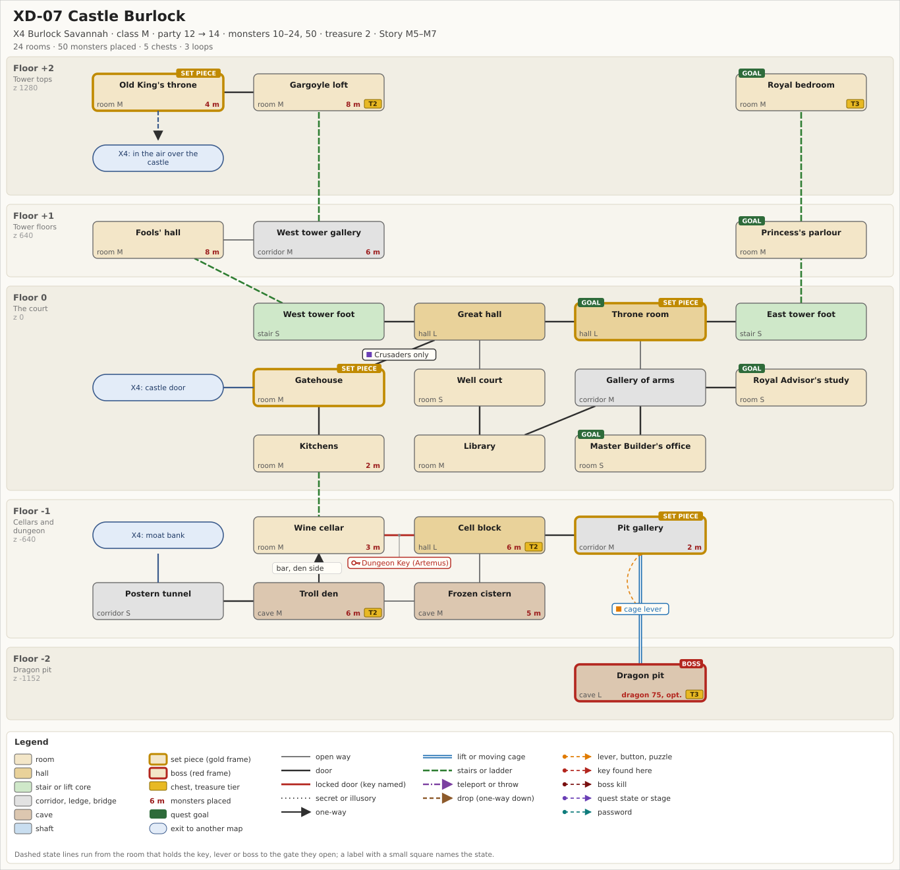
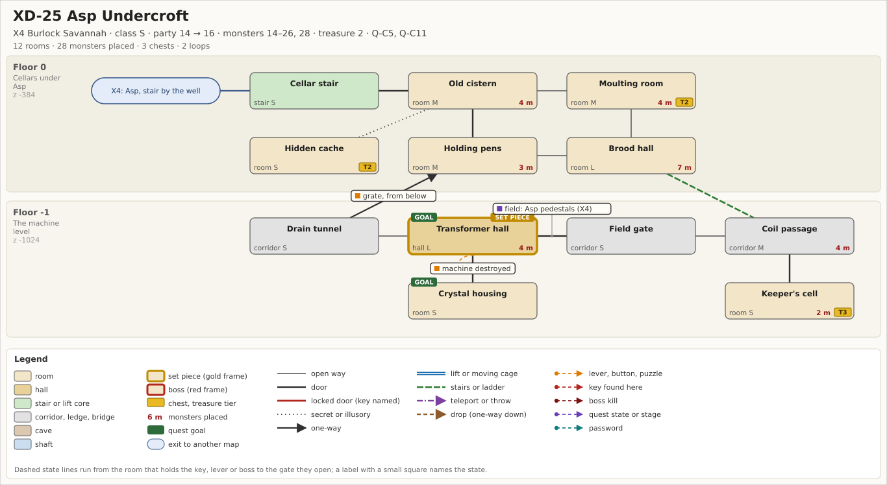
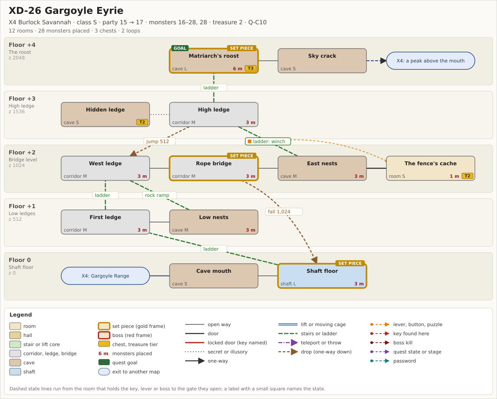
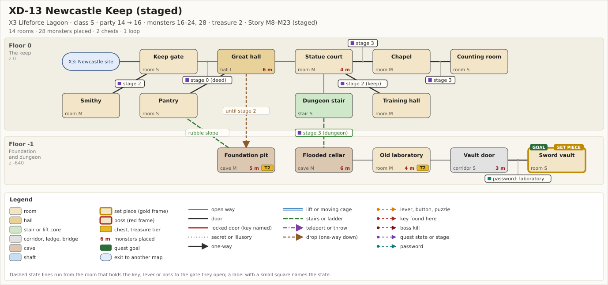
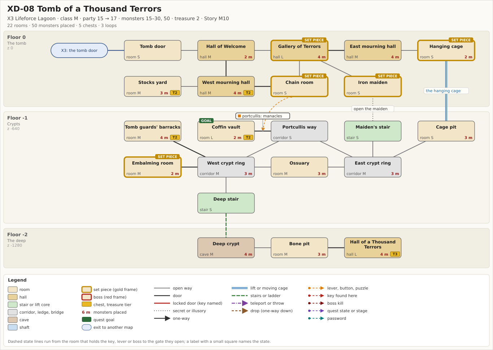
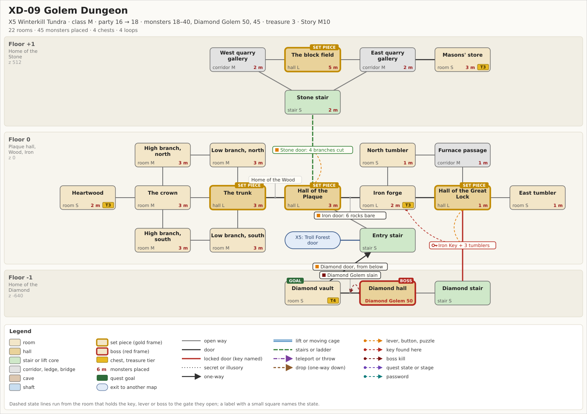
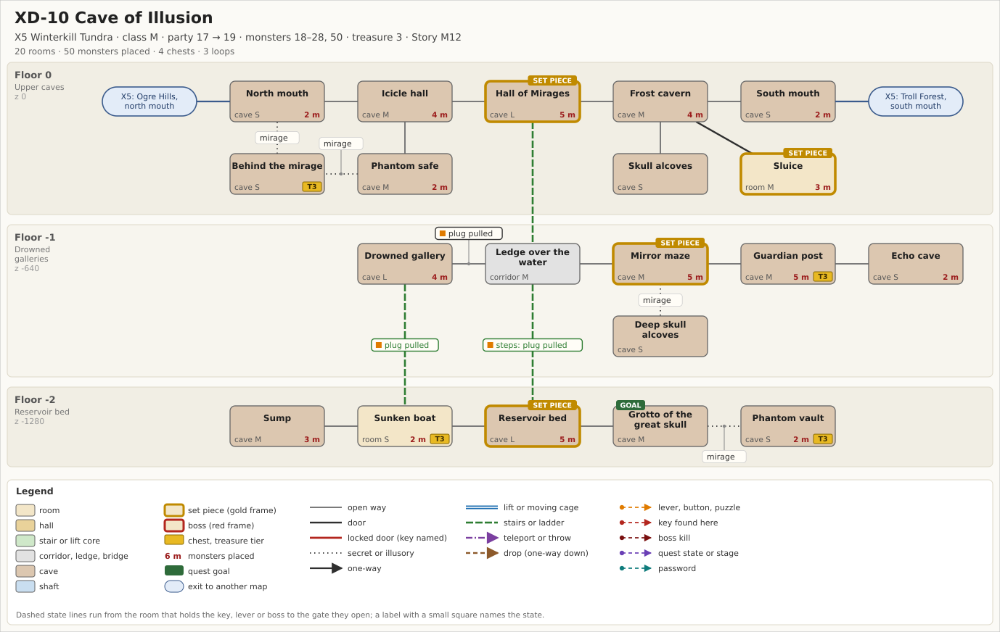
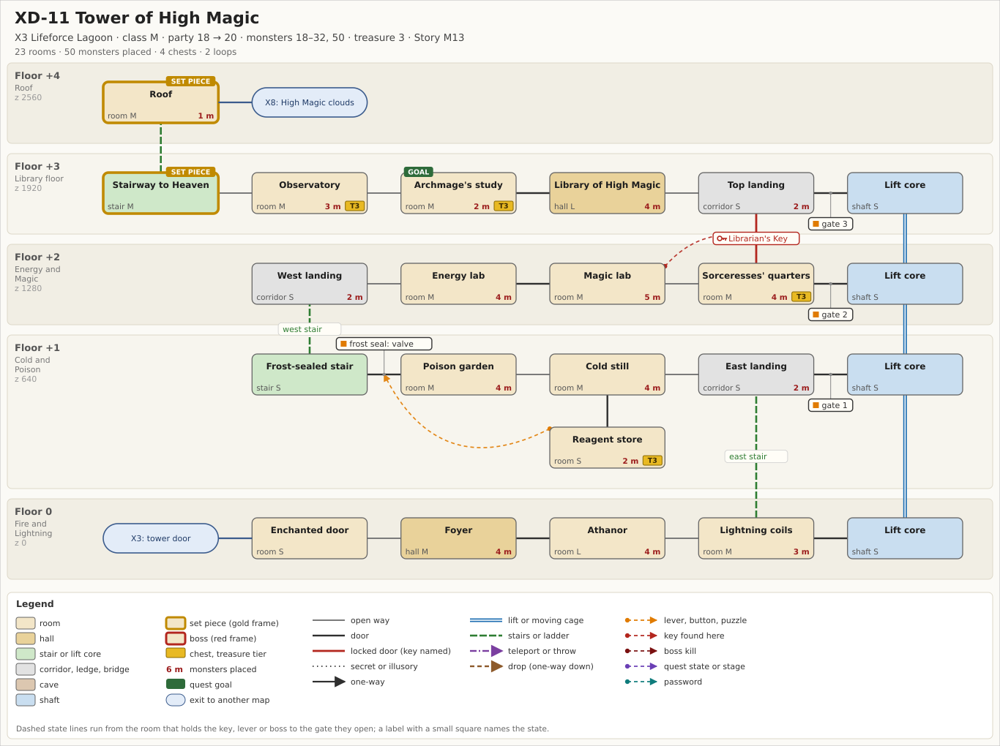

# Act II dungeon graphs (MU-6)

Review page for gate G1, 2026-11-20, lane A8. The eight new dungeons of Act II as room graphs and state graphs, before
any geometry. These are review documents, not briefs: A7 writes the briefs of XD-07, XD-08, XD-13, XD-25 and XD-26,
A8 those of XD-09, XD-10 and XD-11 (ROADMAP §6), and each L1 can start from its graph file.

**What MU-6 is.** PRODUCTION §4: per dungeon a room graph, a state graph (keys, levers, stages) and its size class, so
the user can approve loops, set pieces and length before a map is drawn. A room is roughly one sector.

**How to read the pictures.**
- One band per floor, the highest on top; the floor's height in game units is under its name.
- Inside a band the rooms run roughly left to right along the critical path.
- Box colour is the room's kind (room, hall, stair or lift core, corridor or ledge, cave, shaft).
  - Gold frame: set piece. Red frame: boss.
  - Green tag: quest goal. Red "6 m": monsters placed. Gold "T2": a chest of that treasure tier.
- Lines are connections, one style per kind: open, door, locked (red, with a key and the key's name), secret or
  mirage (dotted), one-way (arrow), lift (blue double line), stairs or ladder (green dashes), teleport or throw
  (purple), drop (brown arrow).
- A label with a small coloured square names the state that opens a connection: orange a lever, button or puzzle;
  purple a quest state or stage; teal a password.
- A dashed line of the same colour runs from the room that holds the lever, key or boss to the gate it opens.
- Blue pills are exits to other maps; a dashed arrow marks a one-way exit.

**Files.** Pictures and data in [act2_graphs/](act2_graphs/): `<key>.graph.yml` (rooms as `spaces`, connections as
`links`, `states`, `exits`, `critical_path`, `loops`, `lines`, `open_questions`; plan.yml's words where they fit) and
`<key>.svg`. Redraw with `python3 devdocs/xeen/mockups/act2_graphs/render_graphs.py`.

**Rules used for all eight.**
- Sizes and counts inside the class bands (MAPS, Dungeons). Monster levels, counts and treasure from MAPS §0.
- Every M dungeon has at least one loop; every dead end holds a chest, a lever, a skull or a goal.
- Every locked door's key is placed and named. Every password has an answer-giver in the world.
- Only engine words that exist: doors, lifts, levers, keys, qbits, stages, destructibles, ladders, step messages,
  chests. Anything else is an open question.
- Permanent rewards are rescaled to MM6–MM8 sizes (QUESTS rules): pools and juices +2, brews +5, no +levels.
- **Megacredits** (M9, M11, M22 need 15): Temple of Yak 6 (built), Tomb 5, Golem Dungeon 5, proposed. Order:
  Yak → walls (Stone of a Thousand Terrors) → Tomb → keep (Golem Stone) → Golem Dungeon.
- **XD-09 and XD-10 stand on X5**, which is set for party 24–28, while they are 16–19. Their doors should sit near
  X5's east edge (by X3), away from the cyclops corner. A6 should know before drawing X5.

| Dungeon | Map | Class | Rooms | Monsters | Loops | Set piece |
| --- | --- | --- | --: | --: | --: | --- |
| XD-07 Castle Burlock | X4 | M | 24 | 50 | 3 | Throne room, Crusaders' portcullis, the throwing throne, dragon pit |
| XD-25 Asp Undercroft | X4 | S | 12 | 28 | 2 | The transformer behind a field of light |
| XD-26 Gargoyle Eyrie | X4 | S | 12 | 28 | 2 | Vertical cave of ledges, ladders and a rope bridge |
| XD-13 Newcastle Keep | X3 | S, staged | 14 | 28 | 1 | Four stages; the sword vault |
| XD-08 Tomb of a Thousand Terrors | X3 | M | 22 | 50 | 3 | Working torture devices; seven tomb juices |
| XD-09 Golem Dungeon | X5 | M | 22 | 45 | 4 | Four halls, three material puzzles, the Diamond Golem |
| XD-10 Cave of Illusion | X5 | M | 20 | 50 | 3 | Mirages, the drain plug, the talking skulls |
| XD-11 Tower of High Magic | X3 | M | 23 | 50 | 2 | Alchemy floors round a lift core; Stairway to Heaven |

---

## XD-07 Castle Burlock

| Map | Class | Party | Monsters | Count | Treasure | Role | Set piece |
| --- | --- | --- | --- | --: | --- | --- | --- |
| X4 Burlock Savannah | M (20–45 sectors, 30–90 M units², 45–75 monsters, 3–7 chests) | 12 → 14 | 10–24; caged Fire Dragon 75 optional | 50 | 2 (hoard 3) | Story M5–M7; Emerson M9/M11/M22; Roxanne Q-C3 | Throne room, Crusaders-only portcullis, the old throne, dungeon with ice trolls and a caged dragon |

**Monsters.** The court is peaceful: King's Guard 40 are friendly. The 50 hostiles are in the parts the court has
given up:
- Mad Fools 8 (the court's fools, the source's) in the west tower.
- Gargoyles 16/22 roosting under the west tower's roof.
- Ice Trolls 18 loose in the dungeon.

**Rooms.**

| Id | Room | Size | Floor | Monsters | Chest | What it is |
| --- | --- | :-: | --: | --: | :-: | --- |
| `old_throne` | Old King's throne (set piece) | M | +2 | 4 |  | Burlock's grandfather's throne under a broken roof. Sit on it: the party is thrown into the air outside the tower. |
| `gargoyle_loft` | Gargoyle loft | M | +2 | 8 | T2 | The roosts under the west tower's roof; a chest of shiny things the gargoyles took. |
| `royal_bedroom` | Royal bedroom (goal) | M | +2 |  | T3 | Roxanne's chest: her reward for the tiara (Q-C3) opens when she says so. |
| `fools_hall` | Fools' hall | M | +1 | 8 |  | The jesters' quarters: motley, broken lutes, mad fools. |
| `west_gallery` | West tower gallery | M | +1 | 6 |  | Arrow slits and the joke plaques; gargoyles at the windows. |
| `roxanne_parlour` | Princess's parlour (goal) | M | +1 |  |  | Princess Roxanne (Q-C3): 'I'm not a damsel in distress'. |
| `west_tower_base` | West tower foot | S | 0 |  |  | Sign 'West Tower'; the stair up; the fools' noise above. |
| `great_hall` | Great hall | L | 0 |  |  | The court: banners, friendly King's Guard, petitioners. Plaque 'Don't worry, be happy.' |
| `throne_room` | Throne room (set piece, goal) | L | 0 |  |  | King Burlock on his throne, 'Prince Roland' at his side (M5). |
| `east_tower_base` | East tower foot | S | 0 |  |  | Sign 'East Tower'; the royal family's stair behind the throne; a guard. |
| `gatehouse` | Gatehouse (set piece) | M | 0 |  |  | Inside the castle door: the portcullis that lifts only for Crusaders; guards; the court seen through the bars. |
| `well_court` | Well court | S | 0 |  |  | A well: 'The water refreshes you.' |
| `armour_gallery` | Gallery of arms | M | 0 |  |  | King Burlock's and Prince Roland's ceremonial armour on stands, with plaques. |
| `advisor` | Royal Advisor's study (goal) | S | 0 |  |  | Artemus: Crodo and Darzog (M6), the Pyramid Sigil (M7), the Dungeon Key, the permit (M22). |
| `kitchens` | Kitchens | M | 0 | 2 |  | Servants' way from the gate; two fools raiding the larder; the cellar stair. |
| `library` | Library | M | 0 |  |  | The Book of Languages and the Book of Astrology (Linguist, Astrologer, free). |
| `builder` | Master Builder's office (goal) | S | 0 |  |  | Emerson: walls, keep and dungeon for Newcastle (M9, M11, M22). |
| `cellar` | Wine cellar | M | -1 | 3 |  | Racks and barrels; the iron dungeon door, sealed since the trolls broke out. |
| `cell_block` | Cell block | L | -1 | 6 | T2 | Broken cells, frost on the bars; the warden's strongbox; beds and a bucket of sludge. |
| `pit_gallery` | Pit gallery (set piece) | M | -1 | 2 |  | A railed walk over the dragon's cage: the dragon is seen below; the cage lever and the warden's warning. |
| `postern` | Postern tunnel | S | -1 |  |  | A sally port to the moat, barred on the inside: the way out after the dungeon. |
| `troll_den` | Troll den | M | -1 | 6 | T2 | Where the ice trolls sleep on frozen straw; their pile of loot. |
| `frozen_cistern` | Frozen cistern | M | -1 | 5 |  | The castle cistern frozen over; the Black Liquid in a bucket on the ice (+2 Might, once each). |
| `dragon_pit` | Dragon pit (boss) | L | -2 | dragon 75, opt. | T3 | The caged Fire Dragon on its hoard (hoard tier 3). Optional: the cage opens only by the lever. |

**Critical path (story).** Gatehouse (portcullis, Crusaders) → great hall → throne room (King: M5) → gallery of arms
→ Royal Advisor (Artemus: M6, M7 Pyramid Sigil) → Master Builder (Emerson, used from M9 on). Everything else is
optional: the east tower (Roxanne), the west tower (fools, gargoyles, the throne), the dungeon.

**State graph.**
- Portcullis: opens for the party award Crusaders (M4). A non-Crusader party sees the court through the bars and hears
  "Only Crusaders are allowed to enter Castle Burlock."
- Dungeon door (cellar → cell block): locked, the **Dungeon Key** from Artemus after the audience ("the trolls broke
  out of their cells; the King will not hear of it").
- Troll den → cellar: a bar on the den side; lifting it closes the dungeon ring.
- Cage lever (pit gallery): lowers the dragon's cage like a lift and frees the dragon. Optional, with the warden's
  sign "Do not pull."
- Roxanne's chest (royal bedroom): opens when Q-C3 is done.
- The old throne: sitting on it throws the party out over X4 (one-way exit, high above the west tower).

**Loops.**
- The court ring: great hall, well court, library, gallery of arms, throne room.
- The dungeon ring: cellar, cell block, frozen cistern, troll den, once the bar is lifted.
- Through X4: thrown out by the throne, back in at the gate.

**Set piece placement.**
- The throne room is the court floor's centre, seen from the great hall.
- The portcullis is the gatehouse's inner wall.
- The old throne is at the top of the west tower, 1,280 up.
- The dragon pit is 1,152 down, seen from the railed pit gallery above it.

**Original lines.** "Only Crusaders are allowed to enter Castle Burlock." (aaze0014:8, gatehouse); "The plaque reads:
Don't worry, be happy." (aaze0064:8, great hall); "The plaque reads: Prince Roland's ceremonial armor." (aaze0064:7,
gallery); "NO MIRROR?!? Get out of my sight!" (aaze0064:13, the King); "Peasant's choice award--Best Ruler of the Year
(597)" and "Speak softly, but carry a large magic sword." (aaze0065:0, 3, west gallery); "You teleported into the air
outside the tower!" (aaze0065:7, old throne); Roxanne's "Don't look so disappointed. I'm not a damsel in distress …"
(aaze0066:0); "Remember, eat less and think thin." (aaze0066:6); "The water refreshes you." (aaze0064:29); "Black
Liquid" (aaze0063:3, +2 Might instead of +10).

**Open questions.**
1. Hostiles in a friendly castle: fools and gargoyles in the abandoned west tower, ice trolls in the dungeon, the court
   peaceful. Agreed?
2. Mad Fool is level 8, under the band's 10: keep as light filler, or add a Madmen tier at 12?
3. Ice Troll at 18 (the Trolls A row renamed for this map) or a row of its own?
4. The caged Fire Dragon (75) at party 12–14: optional behind a lever with a warning, like X2's lake dragons. Keep the
   fight, or make the cage a sight only?
5. The throne throws the party into the air over X4 (the source). Or into X8 Cloudreach?

## XD-25 Asp Undercroft

| Map | Class | Party | Monsters | Count | Treasure | Role | Set piece |
| --- | --- | --- | --- | --: | --- | --- | --- |
| X4 Burlock Savannah (under Asp) | S (at most 15 sectors and 20 M units², 15–30 monsters, 0–3 chests) | 14 → 16 | 14–26 (Snake men 16/20/26) | 28 | 2 (hoard 3) | Q-C5 Asp liberated; Q-C11 the crystals | The transformer machine |

**Rooms.**

| Id | Room | Size | Floor | Monsters | Chest | What it is |
| --- | --- | :-: | --: | --: | :-: | --- |
| `stair` | Cellar stair | S | 0 |  |  | Down from Asp's square by the well; sloughed skins on the steps. |
| `cistern` | Old cistern | M | 0 | 4 |  | The town's dry cistern, now the snake men's hall; hissing in the dark. |
| `moulting` | Moulting room | M | 0 | 4 | T2 | Shed skins hung like washing; a chest of townsfolk's belongings. |
| `hidden_cache` | Hidden cache | S | 0 |  | T2 | Behind a loose cistern slab: a townsman's hidden savings. |
| `pens` | Holding pens | M | 0 | 3 |  | Three cages of half-turned townsfolk (freed when the machine dies); the drain grate in the floor. |
| `brood` | Brood hall | L | 0 | 7 |  | The new snake men, fresh from the machine; the stair down. |
| `drain` | Drain tunnel | S | -1 |  |  | The machine's run-off channel; a ladder up to the grate in the pens (the way back). |
| `machine_hall` | Transformer hall (set piece, goal) | L | -1 | 4 |  | The transformer: brass coils, a glass chamber, an empty socket shaped like a scarab, the crystals glowing in its crown. Destroy it. |
| `field_gate` | Field gate | S | -1 |  |  | A wall of humming light across the way: 'The machine repels you.' The pedestals' rhyme is cut over it. |
| `coil` | Coil passage | M | -1 | 4 |  | A ring passage round the machine hall, warm and humming. |
| `crystal_niche` | Crystal housing (goal) | S | -1 |  |  | The Crystals of Piezoelectricity, loose once the machine is broken (Q-C11). |
| `keeper` | Keeper's cell | S | -1 | 2 | T3 | The keeper's straw bed and his hoard (one step up). |

**Critical path.** Cellar stair → old cistern → moulting room → brood hall → (stair down) coil passage → field gate
→ transformer hall (destroy the machine) → crystal housing. Back: transformer hall → drain tunnel → up the grate into
the holding pens → cistern → stair.

**State graph.**
- Field of light (field gate → transformer hall): drops when the colour pedestals round Asp's well on X4 are set. The
  stone gives the rule: start at the south-west corner, begin with red, alternate the colours round the well. One
  cross-map qbit. Inside, the field shows the second rhyme, so the party knows where to look.
- "You have found the transformer! Do you wish to destroy it?": yes ends the curse (Q-C5), opens the cages in the
  pens and the crystal housing (Q-C11).
- Drain grate: lifted from below, then both ways (the way back).
- Hidden cache: a cistern slab that sinks (secret).

**Loops.**
- Round the cellars: cistern, moulting room, brood hall, holding pens.
- The return: down the brood stair, back up the drain; closed until the grate is lifted.

**Set piece placement.** The transformer hall is the machine level's centre, 640 below the cellars. It is seen first
through the field of light from the field gate. The coil passage runs round its back.

**Original lines.** "You have found the transformer! Do you wish to destroy it?" (aaze0031:4); "A message appears in the
stone: Alternate the colors around the well Then the machine can no longer repel" (aaze0031:7, at the field); "There
is nothing on, in, or under the bed." on the keeper's straw bed (aaze0031:12, 15); Adam's "Thank you for saving us!"
from the freed townsfolk (aaze0031:22).

**Open questions.**
1. The pedestals on X4 drop the field inside (one cross-map qbit). Or move the pedestals inside, round the cistern,
   so the dungeon is whole in itself?
2. Are the pedestal rhymes plain enough under the no-riddles rule, or should Adam or Eve say the rule outright?
3. Guardian Asps (Cobras 30) are over the band: leave them out of the undercroft?
4. The caged half-turned townsfolk are ours (after XD-04's children). Keep?
5. A door of light needs translucent mover faces: check the studio can mark them.

## XD-26 Gargoyle Eyrie

| Map | Class | Party | Monsters | Count | Treasure | Role | Set piece |
| --- | --- | --- | --- | --: | --- | --- | --- |
| X4 Burlock Savannah (Gargoyle Range) | S (at most 15 sectors and 20 M units², 15–30 monsters, 0–3 chests) | 15 → 17 | 16–28 (Gargoyles 16/22/28) | 28 | 2 (hoard 3) | Q-C10 Scarab of Imaging | Vertical cave with ledges and ladders |

**Rooms.**

| Id | Room | Size | Floor | Monsters | Chest | What it is |
| --- | --- | :-: | --: | --: | :-: | --- |
| `roost` | Matriarch's roost (set piece, goal) | L | +4 | 6 | T3 | The biggest nest under the shaft's top: the Scarab of Imaging among stolen silver (hoard tier 3). |
| `sky_crack` | Sky crack | S | +4 |  |  | Daylight through a split in the peak: the quick way out. |
| `hidden_ledge` | Hidden ledge | S | +3 |  | T2 | Behind the moss: a dead climber's pack. |
| `high_ledge` | High ledge | M | +3 | 3 |  | A narrow shelf; the roost ladder; hanging moss along the wall. |
| `ledge_w` | West ledge | M | +2 | 3 |  | Where the climb from below arrives; the rope bridge starts. |
| `bridge` | Rope bridge (set piece) | M | +2 | 3 |  | Across the open shaft, 1,024 above its floor; step off and you fall. |
| `ledge_e` | East nests | M | +2 | 3 |  | Nests of sticks and bones; the drawn-up ladder to the high ledge hangs above. |
| `fence_cache` | The fence's cache | S | +2 | 1 | T2 | A dry cave of crates tagged for buyers; the winch that lowers the ladder. |
| `ledge_low` | First ledge | M | +1 | 3 |  | The first shelf up the wall. |
| `low_nests` | Low nests | M | +1 | 3 |  | Young gargoyles; a rock ramp climbs on to the west ledge. |
| `mouth` | Cave mouth | S | 0 |  |  | From the bare peaks of the Gargoyle Range; droppings and bones. |
| `shaft_floor` | Shaft floor (set piece) | L | 0 | 3 |  | The bottom of the vertical cave, 2,300 high: every ledge seen from here, the roost a shadow at the top. |

**Critical path.** Cave mouth → shaft floor → ladder → first ledge → ladder → west ledge → rope bridge → east nests →
the fence's cache (winch) → east nests → ladder → high ledge → ladder → matriarch's roost (scarab). Out through the
sky crack, or jump.

**State graph.**
- The winch in the fence's cache lowers a rope ladder from the east nests to the high ledge.
- Everything else is open; the gargoyles fly across the open shaft, so the climb is the fight.
- Two drops make the way back quick: off the rope bridge to the shaft floor (1,024), and from the high ledge to the
  west ledge (512). Fall damage applies.
- The sky crack is a one-way exit onto a ledge high on the same peak on X4.

**Loops.**
- Two ways up from the first ledge: a ladder, or the low nests and their rock ramp.
- Off the bridge and back up: the fall is the quick way down.

**Set piece placement.** The shaft floor is the set piece's base: every ledge and the roost are seen from it, about
2,300 up. The bridge crosses the shaft at 1,024; the roost sits under the top at 2,048.

**Original lines.** XD-26 has no source map; the source's scarab lies outdoors on the Gargoyle Range (C1 15,11).
Lines: Carlawna's "I know not why they took it, only that gargoyles are hired to steal things for people."
(aaze0010:9) echoed on a tag in the fence's cache; her thanks "Oh, thank you so much for recovering my Scarab."
(aaze0010:11); the stock "The chest is empty." (as aaze0081:8).

**Open questions.**
1. Only Carlawna's and stock lines are available. Accept, or ask A5 for a Gargoyle Range line?
2. The fence's tags ("Deliver to Asp: one scarab") tie the theft to the transformer (Falagar's lore, Q-C11). Ours;
   keep?
3. Check that flying monsters path across an open shaft between ledges.

## XD-13 Newcastle Keep (staged)

| Map | Class | Party | Monsters | Count | Treasure | Role | Set piece |
| --- | --- | --- | --- | --: | --- | --- | --- |
| X3 Lifeforce Lagoon (Newcastle site) | S (at most 15 sectors and 20 M units², 15–30 monsters, 0–3 chests), staged | 14 → 16 (stage 3 at about 33–36) | 16–24: Wood Golem 18, Swamp Thing 20, Guardian 24 | 28 | 2 | Story M8, M9, M11, M22, M23 | A ruin that becomes a castle; the sword vault |

**Rooms.**

| Id | Room | Size | Floor | Monsters | Chest | What it is |
| --- | --- | :-: | --: | --: | :-: | --- |
| `gate` | Keep gate | S | 0 |  |  | Stage 0 a rubble-choked doorway; from stage 2 a new gate with Newcastle's banner. |
| `great_hall` | Great hall | L | 0 | 6 |  | Stage 0 roofless: woodpile, rubble, bones, note 'la'. Stage 2 the lord's hall. |
| `statue_court` | Statue court | M | 0 | 4 |  | The statue 'Built in honor of Great Adventurers.'; note 'ra'; from stage 3 YOUR well. |
| `chapel` | Chapel | M | 0 |  |  | Stage 3: the temple (house door). |
| `counting` | Counting room | S | 0 |  |  | Stage 3: the bank (house door). |
| `pantry` | Pantry | S | 0 |  |  | 'Food. Fill pack?'; note 'bo' under a sack. |
| `smithy` | Smithy | M | 0 |  |  | Stage 2: the smith by the gate (house door). |
| `dungeon_stair` | Dungeon stair | S | 0 |  |  | Until stage 3: 'A short distance down the stairs you find the way blocked with rubble.' |
| `training` | Training hall | M | 0 |  |  | Stage 2: training (house door). |
| `foundation_pit` | Foundation pit | M | -1 | 5 | T2 | Stage 0-1 only: where the hall floor fell in; wood golems grown out of the old beams; the scientists' strongbox. |
| `cellar` | Flooded cellar | M | -1 | 6 |  | Lagoon water seeped in; swamp things; note 'to' on a shelf. |
| `old_lab` | Old laboratory | M | -1 | 4 | T2 | The scientists' wrecked workshop (Crodo's dreams came here); note 'ry'; their notebooks. |
| `vault_door` | Vault door | S | -1 | 3 |  | A steel door with a speaking grille: 'What is the password?' |
| `sword_vault` | Sword vault (set piece, goal) | S | -1 |  |  | The pedestal and the experimental Xeen Slayer Sword (M23). |

**Stages** (QUESTS §4.1). One graph; each gated connection carries its stage.

| Stage | Qbit (proposed) | Opens | Closes |
| --- | --- | --- | --- |
| 0 deed (M8) | newcastle_deed | The keep gate: hall, statue court, pantry, foundation pit (wood golems: hall 6, court 4, pit 5) | — |
| 1 walls (M9) | newcastle_walls | Nothing inside (walls are on X3) | — |
| 2 keep (M11) | newcastle_keep | Smithy, training hall (house doors) | The pit (floored over), its slope; the golems |
| 3 dungeon (M22) | newcastle_dungeon | Chapel (temple), counting room (bank), YOUR well, the dungeon stair; brings the cellar's monsters | The rubble in the stair |

**Critical path (stage 3, M23).** Keep gate → great hall → statue court → dungeon stair → flooded cellar → old
laboratory → vault door ("What is the password?") → sword vault (Xeen Slayer Sword).

**State graph.** The stages above. The vault door wants **"laboratory"**. Its answer-givers:
- five notes with its syllables: "la" in the hall, "bo" in the pantry, "ra" in the statue court, "to" in the cellar,
  "ry" in the laboratory;
- Elona in Shangri-La says it outright;
- proposed: Crodo says it too when freed (M21).

**Loops.** Stage 0–1 only: down through the hall's broken floor into the foundation pit, up the rubble slope into the
pantry. An S map needs no more.

**Set piece placement.** The great hall shows the stages most: a roofless ruin with woodpiles and bones at stage 0, the
lord's hall at stage 2. The sword vault is the deepest room, 640 down, behind the vault door.

**Original lines.** "Woodpile", "Rubble", "Bones" (aaze0072:1, 3, 5); the "la", "bo", "ra" notes (aaze0073:1, 4, 2)
and "to", "ry" (aaze0074:0, 1); "Food. Fill pack?" (aaze0073:0); "A plaque at the base of the statue reads: Built in
honor of Great Adventurers." (aaze0073:3); "A short distance down the stairs you find the way blocked with rubble …"
(aaze0073:7); "YOUR well" / "Even your well's water is cool and refreshing." (aaze0073:8, 9); "What is the password?"
/ "Incorrect!" (aaze0073:15, 16); "The pedestal is cool to the touch." (aaze0073:12).

**Open questions.**
1. Stage 3 comes after M21, at party about 33–36, while the map is set at 14–16 with monsters 16–24. Raise the stage-3
   groups to the Act IV band (about 30–45), or make the dungeon a quiet walk to the sword?
2. Elona in Shangri-La comes in Act V, after M23, and two of the five notes are only reachable at stage 3. Add Crodo
   saying the word when freed (M21)? Proposed yes.
3. Number the syllable notes (1 la … 5 ry) so their order is plain?
4. The keep's services as house doors inside a BLV: check the engine opens houses from BLV doors; otherwise they
   move outdoors on X3.
5. YOUR well: the source's +20 AC; proposed a day-long AC buff of MM6–MM8 size (A2).

## XD-08 Tomb of a Thousand Terrors

| Map | Class | Party | Monsters | Count | Treasure | Role | Set piece |
| --- | --- | --- | --- | --: | --- | --- | --- |
| X3 Lifeforce Lagoon | M (20–45 sectors, 30–90 M units², 45–75 monsters, 3–7 chests) | 15 → 17 | 15–30: Grave Ghoul 18, Polter-Fool 18, Tomb Guard 26 | 50 | 2 (hoard 3) | Story M10 (5 Megacredits) | Torture devices as mechanisms; coloured juices |

**Rooms.**

| Id | Room | Size | Floor | Monsters | Chest | What it is |
| --- | --- | :-: | --: | --: | :-: | --- |
| `door` | Tomb door | S | 0 |  |  | Inside the door the Stone of a Thousand Terrors opened. |
| `welcome` | Hall of Welcome | M | 0 | 2 |  | The statue and its plaque: 'Insanity is our fame, undead is our game.' |
| `gallery` | Gallery of Terrors (set piece) | L | 0 | 4 |  | A long hall of devices on plinths, each named on a plaque; three of them do something. |
| `east_mourning` | East mourning hall | M | 0 | 4 |  | Biers and tomb guards. |
| `cage_room` | Hanging cage (set piece) | S | 0 | 2 |  | An iron cage on a chain over a dark hole. Step in and pull the chain: it lowers to the crypts. |
| `stocks` | Stocks yard | M | 0 | 3 | T2 | Rows of stocks with skeletons still in them; a chest under the last. |
| `west_mourning` | West mourning hall | M | 0 | 4 | T2 | Coffins ('The coffin is empty.'); ghouls; a chest. |
| `chain_room` | Chain room (set piece) | S | 0 |  |  | Manacles on long chains running into the floor. Pull them: below, a portcullis grinds up. |
| `maiden_niche` | Iron maiden (set piece) | S | 0 |  |  | An iron maiden on a dais. Open it: its back is a door, and a stair goes down behind the spikes. |
| `barracks` | Tomb guards' barracks | M | -1 | 4 | T2 | Racks of rusted halberds; the guards' pay chest. |
| `coffin_vault` | Coffin vault (goal) | L | -1 | 2 | T2 | Heavy coffins ('You are not strong enough to open the coffin.'); in the largest, the King's Megacredits. |
| `portcullis` | Portcullis way | S | -1 |  |  | The portcullis before the coffin vault, raised by the chains above. |
| `maiden_stair` | Maiden's stair | S | -1 |  |  | The stair from behind the iron maiden. |
| `cage_pit` | Cage pit | S | -1 | 3 |  | Where the cage lands; ghouls waiting for it. |
| `embalming` | Embalming room (set piece) | M | -1 | 2 |  | Seven basins of tomb juice: red, blue, orange, green, yellow, purple, white. One drink each per character. |
| `crypt_ring_w` | West crypt ring | M | -1 | 3 |  | The ring's west side; the deep stair. |
| `ossuary` | Ossuary | M | -1 | 3 |  | Skull walls; bone piles that rise. |
| `crypt_ring_e` | East crypt ring | M | -1 | 3 |  | Wall niches of bones round the crypts. |
| `deep_stair` | Deep stair | S | -1 |  |  | Down to the deep; cold air. |
| `deep_crypt` | Deep crypt | M | -2 | 4 |  | Raw rock and old graves; grave ghouls. |
| `bone_pit` | Bone pit | M | -2 | 3 |  | A pit of bones crossed on a ledge. |
| `terror_hall` | Hall of a Thousand Terrors | L | -2 | 4 | T3 | The tomb's heart: a throne of skulls, tomb guards, the hoard (tier 3). |

**Critical path.** Tomb door (the Stone of a Thousand Terrors opens it on X3) → Hall of Welcome → Gallery of Terrors →
chain room (pull the manacles) → gallery → east mourning hall → hanging cage (ride down) → cage pit → east crypt ring
→ portcullis way → coffin vault (Megacredits). Back up behind the iron maiden.

**State graph.**
- Manacles (chain room): pulling them raises the portcullis 640 below ("Far below, iron grinds upward.").
- Iron maiden: opened, its back is a door to a stair down (secret, but its plaque names it).
- Hanging cage: a lift between the cage room and the cage pit; step in and pull the chain.
- Great coffin (coffin vault): wants Might ("You are not strong enough to open the coffin."). A Might potion is in the
  barracks chest.
- The tomb door on X3 needs the Stone of a Thousand Terrors from Ebenezer (M9).

**Loops.**
- Round the chain room: Hall of Welcome, gallery, chain room, west mourning hall.
- Down in the cage, up behind the maiden.
- Round the crypts: east ring, ossuary, west ring, portcullis way.

**Set piece placement.**
- The Gallery of Terrors is the upper floor's spine. Its three working devices (manacles, maiden, cage) each have a
  room off it, and the stocks stand in their own yard.
- The embalming room with the seven juices is a dead end off the west crypt ring.
- The deep (1,280 down) ends in the Hall of a Thousand Terrors and its hoard.

**Original lines.** "A plaque at the base of the statue reads: Welcome to the Tomb of a Thousand Terrors. Insanity is
our fame, undead is our game." (aaze0080:0); "Manacles", "Cage", "Iron Maiden", "Stocks" (aaze0080:11–13, 25); "The
coffin is empty." (aaze0080:1); "You are not strong enough to open the coffin." (aaze0080:10); "King's Megacredit!"
(aaze0080:26); "Red Tomb Juice" … "White Tomb Juice", "The liquid is powerless." (aaze0080:2–9); "Leave the Tomb of a
Thousand Terrors?" (aaze0080:24).

**Open questions.**
1. Tomb Terror (Spirits C, 40) is over the band's 30. Leave it out, or one optional guard at the hoard?
2. Tomb juices: +5 per colour in the source; proposed +2 once per character (A2).
3. Megacredits here: 5 (the source has 8). A3's call.
4. The cage as a lift that carries a cage model: check the studio's lifts can.

## XD-09 Golem Dungeon

| Map | Class | Party | Monsters | Count | Treasure | Role | Set piece |
| --- | --- | --- | --- | --: | --- | --- | --- |
| X5 Winterkill Tundra (Troll Forest) | M (20–45 sectors, 30–90 M units², 45–75 monsters, 3–7 chests) | 16 → 18 | 18–40: Wood 18, Stone 26, Iron 40; Diamond Golem 50 | 45 (groups 1–2) | 3 (hoard 4) | Story M10 (5 Megacredits), Master of Golems | Four halls, three material puzzles |

**Rooms.**

| Id | Room | Size | Floor | Monsters | Chest | What it is |
| --- | --- | :-: | --: | --: | :-: | --- |
| `quarry_w` | West quarry gallery | M | +1 | 2 |  | A gallery above the block field; you see which blocks are pushed. |
| `quarry` | The block field (set piece) | L | +1 | 5 |  | Nine stone blocks on a grid of slots; pushing one slides it into the empty slot beside it; six cover glowing rocks. |
| `quarry_e` | East quarry gallery | M | +1 | 2 |  | The other side of the field. |
| `mason` | Masons' store | S | +1 | 3 | T3 | Chisels and a chest. |
| `stone_stair` | Stone stair | S | +1 | 2 |  | Up from the plaque hall's Stone door. |
| `branch_hn` | High branch, north | M | 0 | 3 |  | A branch-end: a living bough across the wall. 'Cut?' |
| `branch_ln` | Low branch, north | M | 0 | 3 |  | A branch-end bough to cut; a canopy walk to the high branch. |
| `tumbler_n` | North tumbler | S | 0 | 1 |  | Tumbler lever 1; through a slot you see its bolt in the great lock. |
| `furnace` | Furnace passage | M | 0 | 1 |  | Hot iron pipes behind the lock hall. |
| `heartwood` | Heartwood | S | 0 | 2 | T3 | The tree's heart: a seed chest. |
| `crown` | The crown | M | 0 | 3 |  | Where the trunk splits into the high branches. |
| `trunk` | The trunk (set piece) | L | 0 | 3 |  | Home of the Wood: a long hall carved like a tree's trunk; branches off both sides. |
| `hub` | Hall of the Plaque (set piece) | L | 0 | 3 |  | The statue and its rhyme; four plaque doors: Wood (open), Stone, Iron, and Diamond, which opens from the vault's stair by the entry. |
| `forge` | Iron forge | L | 0 | 2 | T3 | Home of the Iron: anvils and a cooling trough; the Iron Key in the forge chest. |
| `lock_hall` | Hall of the Great Lock (set piece) | L | 0 | 1 |  | A lock as big as a door in the floor, three bolts in view; tumbler lever 2 here. |
| `tumbler_e` | East tumbler | S | 0 | 1 |  | Tumbler lever 3. |
| `branch_hs` | High branch, south | M | 0 | 3 |  | A branch-end bough to cut. |
| `branch_ls` | Low branch, south | M | 0 | 3 |  | A branch-end bough to cut; a canopy walk to the high branch. |
| `entry` | Entry stair | S | 0 |  |  | Down from the door the Golem Stone opened; the Diamond door's stair arrives here. |
| `diamond_vault` | Diamond vault (goal) | S | -1 |  | T4 | The hoard (tier 4) with the Megacredits; the plaque 'Master of Golems I now dub thee.' |
| `diamond_hall` | Diamond hall (boss) | L | -1 | Diamond Golem 50 |  | Crystal pillars; the Diamond Golem; its death opens the vault. |
| `diamond_stair` | Diamond stair | S | -1 |  |  | Below the great lock. |

**Critical path.** Entry stair (the Golem Stone opens the door on X5) → Hall of the Plaque → the Wood: trunk, four
branches, crown → back to the statue → Stone door → stone stair (+512) → the block field → back → Iron door → forge
(Iron Key) → north tumbler → furnace passage → lock hall → east tumbler → lock hall → the great lock → diamond stair
(−640) → Diamond hall (boss) → Diamond vault. Back up the Diamond door's stair to the entry.

**State graph** (the plaque's own order: "Solve the wood … Next is stone … Last is iron").
- **Wood:** four boughs to cut (indoor destructibles); the plaque counts ("Three branches remain."). Then touch the
  statue: the Stone door opens.
- **Stone:** nine blocks on a grid of slots; a pushed block slides into the empty slot next to it. Six of the slots
  hide glowing rocks ("Stone Block - Glowing Rock"). Each bare rock lights a lamp over the Iron door, seen from the
  galleries; six lamps open it.
- **Iron:** the Iron Key in the forge chest, plus three two-way tumbler levers (north tumbler, lock hall, east
  tumbler). A right lever draws its bolt back, seen from the lever. Key and three bolts: the great lock opens.
- **Diamond:** the Diamond Golem's death raises the vault door. The vault's stair comes up through the Diamond door
  by the entry stair, opened from below (the way out).

**Loops.**
- North canopy and south canopy (trunk, low branch, high branch, crown).
- Round the block field.
- Round the forge (forge, north tumbler, furnace passage, lock hall).

**Set piece placement.**
- The Hall of the Plaque is the hub: four plaque doors (Wood, Stone, Iron, Diamond). Wood is open from the start;
  each hall is solved and the party returns to the plaque.
- The block field is seen whole from its two galleries.
- The great lock lies in the lock hall's floor, over the diamond stair.

**Original lines.** The plaque "Solve the wood, it's like a tree / Cut the branches and return to me / Next is stone,
it's full of blocks / Push them around, expose six rocks / Last is iron, there is a key / Set the tumblers and you'll
be free." (aaze0081:0); "Home of the Wood / Stone / Iron / Diamond" (aaze0081:2–5); "Stone Block - Glowing Rock"
(aaze0081:12); "All is set, it is plain to see / Master of Golems I now dub thee." (aaze0081:1); "King's Megacredit!"
(aaze0081:11); "Exit Golem Dungeon?" (aaze0081:10).

**Open questions.**
1. The source's +1 level for Master of Golems: proposed a party award (the title) plus quest experience instead.
2. Kill XP with 23 wood, 14 stone, 7 iron and the boss is about 10.8k per member, 12 % over MAPS's 9.6k (inside the
   15 % rule). Trim the iron golems to 5?
3. The block field as a sliding puzzle needs one mover per block and slot pair. Fallback: every block slides aside and
   six of nine hide rocks (a search, not a puzzle). Which?
4. The boughs as destructibles and the tumblers as two-way levers use existing words. Confirm.
5. X5 is set for 24–28; keep the door near X5's east edge.

## XD-10 Cave of Illusion

| Map | Class | Party | Monsters | Count | Treasure | Role | Set piece |
| --- | --- | --- | --- | --: | --- | --- | --- |
| X5 Winterkill Tundra (two mouths) | M (20–45 sectors, 30–90 M units², 45–75 monsters, 3–7 chests) | 17 → 19 | 18–28: Flying Feet 18, Guardian 24, Water Golem 28 | 50 | 3 | Story M12 (Enchanted Key) | Mirage walls, the drain plug, stat-selling skulls |

**Rooms.**

| Id | Room | Size | Floor | Monsters | Chest | What it is |
| --- | --- | :-: | --: | --: | :-: | --- |
| `north_mouth` | North mouth | S | 0 | 2 |  | Ice at the lip; the cave's breath is warm and wet. |
| `icicle_hall` | Icicle hall | M | 0 | 4 |  | Hanging ice; a side passage that ends in a safe. |
| `mirage_hall` | Hall of Mirages (set piece) | L | 0 | 5 |  | Walls that shimmer like heat; two of them are mirages ('The mirage dissipates with your touch.'); the stair down to the ledge. |
| `frost_cavern` | Frost cavern | M | 0 | 4 |  | Between the hall and the south mouth; the sluice door. |
| `south_mouth` | South mouth | S | 0 | 2 |  | Out into the Troll Forest. |
| `mirage_cache` | Behind the mirage | S | 0 |  | T3 | The real treasure behind the phantom safe's wall; a Potion of Might among it (for the plug). |
| `false_passage` | Phantom safe | M | 0 | 2 |  | A safe at the end: 'Your hand passes through the safe as though it were not there.' The wall behind it is a mirage. |
| `skulls_1` | Skull alcoves | S | 0 |  |  | Talking skulls: +2 to a stat for 10 gems each. |
| `sluice` | Sluice (set piece) | M | 0 | 3 |  | A great bronze plug on a chain over the lower water. Pull it (Might): the water drains, the lower caves open. |
| `drowned` | Drowned gallery | L | -1 | 4 |  | Water to the roof until the plug is pulled; then a wet gallery, water golems left in its pools. |
| `ledge` | Ledge over the water | M | -1 |  |  | Overlook: the flooded reservoir below and, once drained, its floor, a wreck and a grotto. |
| `mirror_maze` | Mirror maze (set piece) | M | -1 | 5 |  | Ice walls that show the party themselves; one is a mirage. |
| `guard_post` | Guardian post | M | -1 | 5 | T3 | Guardians round a chest. |
| `echo_cave` | Echo cave | S | -1 | 2 |  | The cave answers in the party's own voices; a cache of gems (for the skulls). |
| `skulls_2` | Deep skull alcoves | S | -1 |  |  | Behind the maze's mirage: skulls selling +3 for 20 gems and +5 for 50. |
| `sump` | Sump | M | -2 | 3 |  | Where the water went: a roaring hole and the last water golems. |
| `wreck` | Sunken boat | S | -2 | 2 | T3 | A boat on the drained floor, its strongbox intact. |
| `reservoir` | Reservoir bed (set piece) | L | -2 | 5 |  | The drained floor: weed, shells, stranded water golems. |
| `grotto` | Grotto of the great skull (goal) | M | -2 |  |  | The great skull: the key to the Tower of High Magic for gems (M12); +5 to Endurance, Accuracy or Might for 200. |
| `phantom_vault` | Phantom vault | S | -2 | 2 | T3 | Behind a mirage in the grotto: the cave's hoard. |

**Critical path.** North mouth → icicle hall → Hall of Mirages → frost cavern → sluice (pull the plug) → frost cavern
→ Hall of Mirages → stair down to the ledge (−640) → steps to the reservoir bed (−1,280) → grotto of the great skull
(buy the Enchanted Key). Back: reservoir → sunken boat → drowned gallery → ledge → up → frost cavern → out at the
south mouth.

**State graph.**
- **The plug** (sluice): wants Might ("You aren't strong enough to pull the plug."); a Potion of Might lies behind the
  mirage by the north mouth. Pulled, the water falls over a few seconds, seen from the ledge. It opens the drowned
  gallery, the steps to the reservoir bed and the stair from the gallery to the wreck.
- **Mirages** (dotted): wall-textured doors that vanish at a touch ("The mirage dissipates with your touch."). Two
  near the north mouth, one in the mirror maze (the deep skulls), one in the grotto (the phantom vault). None is on
  the critical path.
- **Skulls** (gems): +2 for 10 gems (upper alcoves), +3 for 20 and +5 for 50 (deep alcoves), the key for gems and +5
  for 200 (grotto).
- Both mouths are open; the cave is a through-route between two places on X5.

**Loops.**
- Two mirages: north mouth, icicle hall, phantom safe, behind the mirage.
- The drained ring: ledge, reservoir bed, sunken boat, drowned gallery; closed until the plug is pulled.
- Through the cave and back over X5.

**Set piece placement.**
- The Hall of Mirages is the upper cave's centre.
- The sluice sits above the lower water.
- The ledge overlooks the reservoir before and after the draining.
- The grotto is at the bottom, reached only on the drained floor.

**Original lines.** "The mirage dissipates with your touch." (aaze0042:24); "Your hand passes through the safe as
though it were not there." (aaze0042:72); "You aren't strong enough to pull the plug." (aaze0042:23); "For 10 gems
I'll increase your luck," the skull says. (aaze0042:26); "For 300 gems I'll give you a key, the skull says.
(aaze0045:48); "The skull gives you the key to the tower of High Magic." (aaze0045:54); "Leave the Cave of Illusion?"
(aaze0042:49).

**Open questions.**
1. Mirages as doors that vanish when clicked (existing words), or walk-through walls (translucent, no collision; a new
   studio and engine word)?
2. Draining: a water face lowered as a mover, with the flooded passages closed until it is down. Check the engine draws
   and collides a moving indoor water face; fallback: a qbit swap of two face sets with a fade.
3. The plug's Might check: the source wants 50; proposed one member's Might at least 30, or the potion.
4. Gem prices and stat rises (source +2/+3/+5/+10, key 300 gems) are A2's; gem payment needs E13.
5. Which mouth is the arrival? Proposed north (Ogre Hills).
6. X5 is set for 24–28; keep both mouths near X5's east edge.

## XD-11 Tower of High Magic

| Map | Class | Party | Monsters | Count | Treasure | Role | Set piece |
| --- | --- | --- | --- | --: | --- | --- | --- |
| X3 Lifeforce Lagoon | M (20–45 sectors, 30–90 M units², 45–75 monsters, 3–7 chests; one stacked BLV) | 18 → 20 | 18–32: Flying Feet 18, Guardian 24, Sorceress 30 | 50 | 3 | Story M13 (Skeleton Key); roof to X8 | Alchemy floors with brews; Stairway to Heaven |

**Rooms.**

| Id | Room | Size | Floor | Monsters | Chest | What it is |
| --- | --- | :-: | --: | --: | :-: | --- |
| `roof` | Roof (set piece) | M | +4 | 1 |  | Open sky over the lagoon; the stair climbs on into the clouds. |
| `stairway` | Stairway to Heaven (set piece) | M | +3 |  |  | 'Stairway to Heaven. Climb?' A spiral up through the roof. |
| `observatory` | Observatory | M | +3 | 3 | T3 | A brass orrery; a Pandorian box (a trapped chest). |
| `study` | Archmage's study (goal) | M | +3 | 2 | T3 | 'You found a skeleton key in the chest.' (M13) |
| `library` | Library of High Magic | L | +3 | 4 |  | Two books to read: The Art of Magic (a skill) and Mysteries of Light (Prismatic Light). |
| `landing3` | Top landing | S | +3 | 2 |  | The library door; the core's top gate and its lever. |
| `core3` | Lift core | S | +3 |  |  | The brass cage's top stop. |
| `landing2` | West landing | S | +2 | 2 |  | Up from the cold floor. |
| `energy_lab` | Energy lab | M | +2 | 4 |  | Energy Brew (+Energy resistance). |
| `magic_lab` | Magic lab | M | +2 | 5 |  | Magic Brew (+Magic resistance); the Head Sorceress with the Librarian's Key. |
| `quarters` | Sorceresses' quarters | M | +2 | 4 | T3 | Beds ('There is nothing on, in, or under the bed.'), a chest; the stair up and the core gate lever. |
| `core2` | Lift core | S | +2 |  |  | A stop. |
| `landing1w` | Frost-sealed stair | S | +1 |  |  | The west stair up, behind a door frozen shut. |
| `poison_garden` | Poison garden | M | +1 | 4 |  | Nightshade in pots; Poison Brew. |
| `still` | Cold still | M | +1 | 4 |  | A frosted still; Cold Brew. |
| `landing1` | East landing | S | +1 | 2 |  | Up from the fire floor; the core gate lever. |
| `core1` | Lift core | S | +1 |  |  | A stop. |
| `reagents` | Reagent store | S | +1 | 2 | T3 | A Pandorian box; the steam valve that thaws the frost seal (pipes along the wall to it). |
| `door` | Enchanted door | S | 0 |  |  | Inside the door the Enchanted Key opened. |
| `foyer` | Foyer | M | 0 | 4 |  | Flying feet hop about the tiles. |
| `athanor` | Athanor | L | 0 | 4 |  | The great furnace; Fire Brew. |
| `coils` | Lightning coils | M | 0 | 3 |  | Crackling coils; Electric Brew; the east stair. |
| `core0` | Lift core | S | 0 |  |  | A brass cage in a shaft through all four floors; it stops only where a gate is open. |

**Critical path.** Enchanted door (the Enchanted Key from XD-10) → foyer → athanor → lightning coils → east stair →
east landing → cold still → reagent store (steam valve) → cold still → poison garden → frost-sealed stair → west
landing → energy lab → magic lab (the Head Sorceress drops the Librarian's Key) → sorceresses' quarters → top landing
→ library → Archmage's study (Skeleton Key). Then observatory → Stairway to Heaven → roof → X8, or down the lift.

**State graph.**
- **Frost seal** (floor 1, west stair): the steam valve in the reagent store melts it; pipes run along the wall
  between them.
- **Librarian's Key**: dropped by the Head Sorceress in the magic lab; opens the stair from the quarters to the top
  floor.
- **Core gates 1–3**: a lever on each floor's landing opens that floor's gate on the lift core. The brass cage stops
  only where a gate is open, so each opened gate is a shortcut down to the door.
- The stairs alternate sides (east, west, east), so each floor must be crossed.

**Loops.** Up the stairs and down the core, once a floor's gate is open (one loop per floor; two drawn).

**Set piece placement.**
- One brew per lab: Fire (athanor), Electric (coils), Cold (still), Poison (garden), Energy and Magic (floor 2).
- The library and the study are on floor 3 (1,920).
- The Stairway to Heaven climbs from floor 3 through the roof (2,560) into X8's High Magic clouds; a fall from X8
  lands on X3.

**Original lines.** "Fire Brew", "Electric Brew", "Cold Brew" (aaze0055:1–3); "Poison Brew", "Energy Brew", "Magic Brew"
(aaze0057:1–3); "Pandorian Box", "The box is empty." (aaze0055:4, 5); "The Art of Magic", "Mysteries of Light"
(aaze0058:1, 2); "You have learned the spell Prismatic Light!" (aaze0058:8); "You found a skeleton key in the chest."
(aaze0058:7); "Stairway to Heaven. Climb?" (aaze0058:6); "Leave the Tower of High Magic?" (aaze0055:6).

**Open questions.**
1. Brews: +10 resistance per brew in the source; proposed +5 once per character (A2).
2. The Art of Magic teaches Prestidigitation, which MMerge lacks: a ruleset skill instead, or a readable only?
3. Carnage Hand (35) is over the band's 32 and stays for Darzog's Tower; Sorceress 30 is the top here. Agreed?
4. One lift with four stops: check the studio's lift can stop at more than two heights; fallback: three short lifts.
5. The source's fire dragon on the top floor is left out (over the band). Agreed?

---

## A7's notes on its five (2026-11-20)

Lane A7 builds XD-07, XD-08, XD-13, XD-25 and XD-26 from these graphs. Points to settle at G1 or before the L1s, from
what Act I's five taught (their NOTES.md):

- **XD-07 Castle Burlock.**
  - A peaceful court beside hostile fools, gargoyles and trolls needs the King's Guard (Burlock knights family) kept
    peaceful by a row of the world's `relations.yml` or a map relation (A2), since every Xeen family is hostile by
    default.
  - The King, Artemus, Emerson and Roxanne are best house doors (A4 rows, as Castle Harmondale's throne room), not
    placed actors: placed actors cannot hold topics.
  - The throne's throw goes to X4, which is built in the same phase; no X8 exit until X8 exists.
  - The dragon pit at 75 needs the same treatment as X2's lake dragons: the lever's warning sign before it.
- **XD-25 Asp Undercroft.** Open question 1: prefer the pedestals inside the undercroft (round the old cistern), so the
  dungeon is whole and the rule's answer-giver is on the way; Adam or Eve can still say the rule outright (question 2:
  yes). A door of light: XD-04's ward used translucent faces and worked.
- **XD-26 Gargoyle Eyrie.** The studio and the engine have climbable ladders (`objects.yml ladders`,
  `devdocs/INDOOR_ROTATING_MOVERS_AND_LADDERS.md`); the rope bridge is a platform with rails. Flying monsters across a
  2,300 shaft: test early with a spawn on each ledge (XD-02's bats once stuck in shelf openings). The sky crack exit
  goes to X4 (same phase).
- **XD-13 Newcastle Keep.** Question 4 is answered: a BLV door opens a house (`evt.EnterHouse`), checked in XD-02's Red
  Dwarf Smithy door (house 4851), so the keep's services stay inside. Question 1: proposed a quiet stage 3 with one or
  two Act IV groups at the vault (the sword is the point), not a full re-population.
- **XD-08 Tomb of a Thousand Terrors.** The great coffin's Might check is on the critical path (the Megacredits): the
  Might potion must be a fixed item in the barracks chest, not random loot, or the coffin needs a second way (a lever,
  a crowbar). The cage as a lift carrying a cage: the studio's lifts carry platforms; the cage's bars are a mover too.
- **All five:** the user's dressing rule (`devdocs/xeen/formats/DRESSING.md`) from the first L3: storerooms and cellars
  are the only clumps (XD-07's wine cellar, XD-08's barracks); every room's walking lines kept clear.
