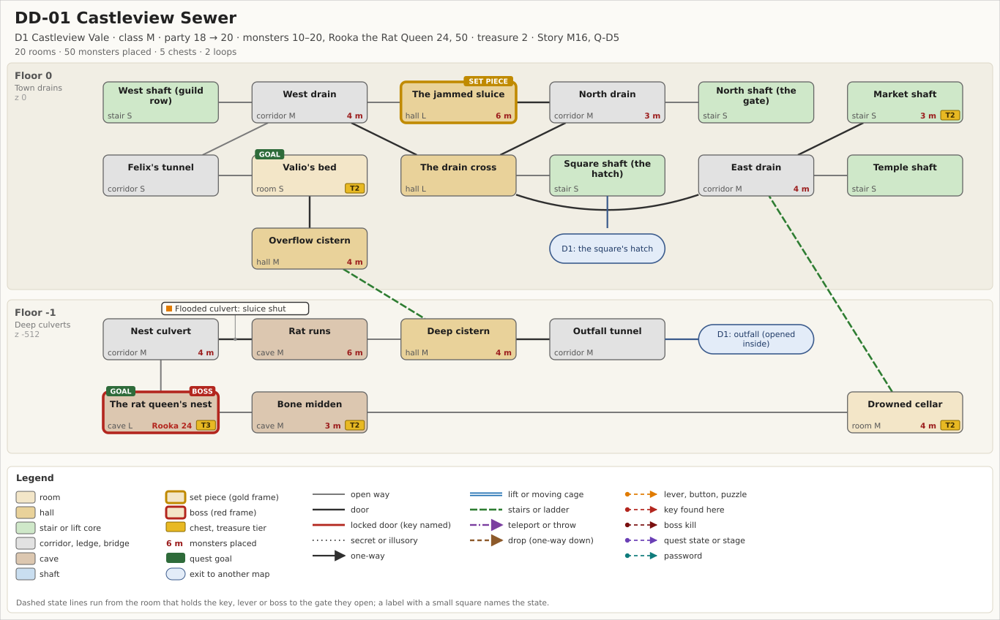
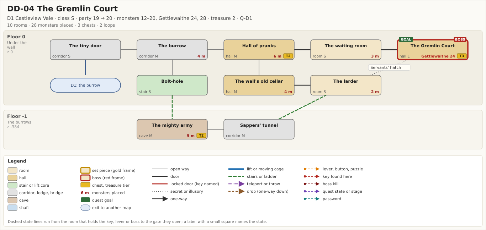
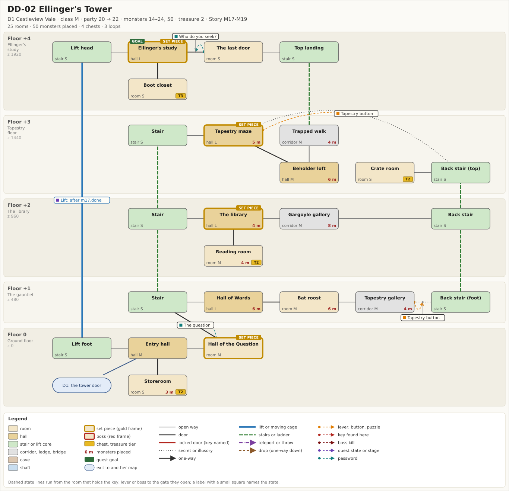
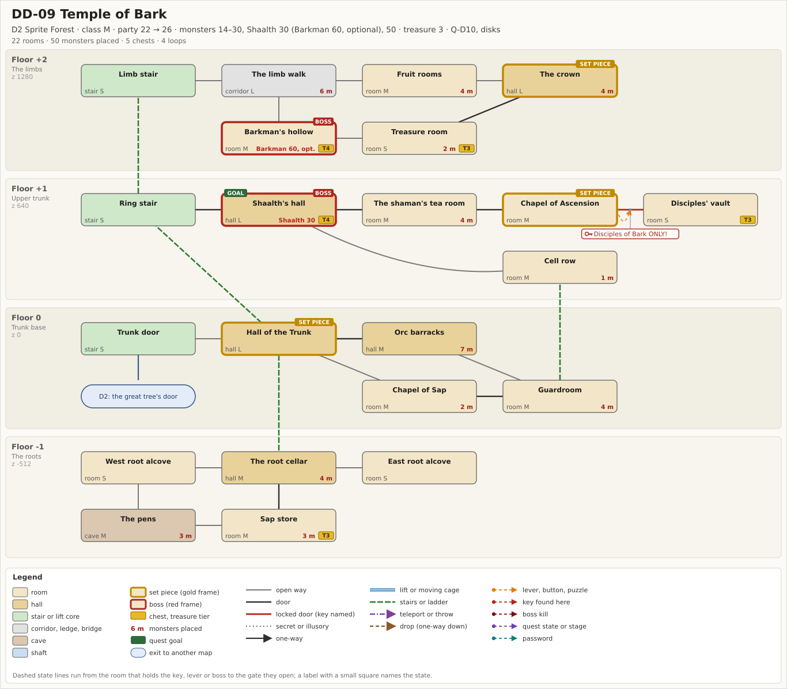
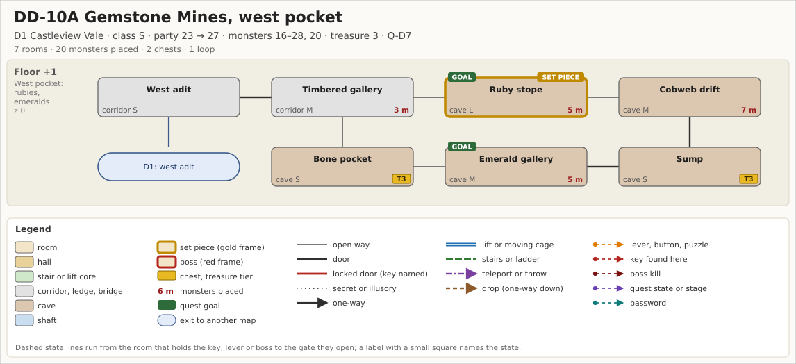
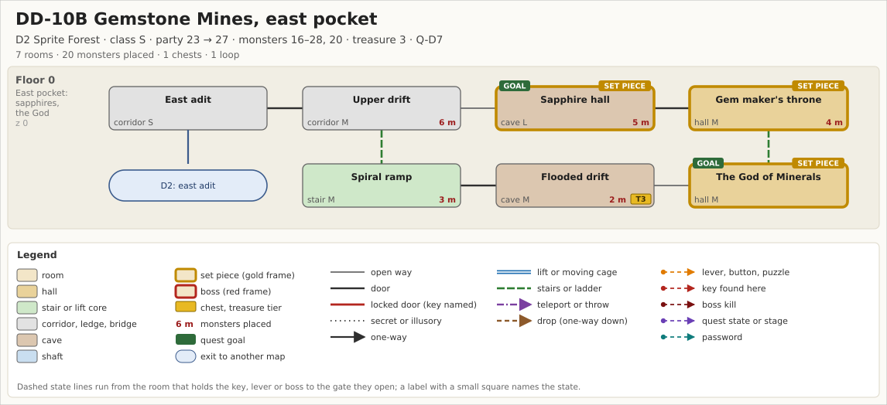
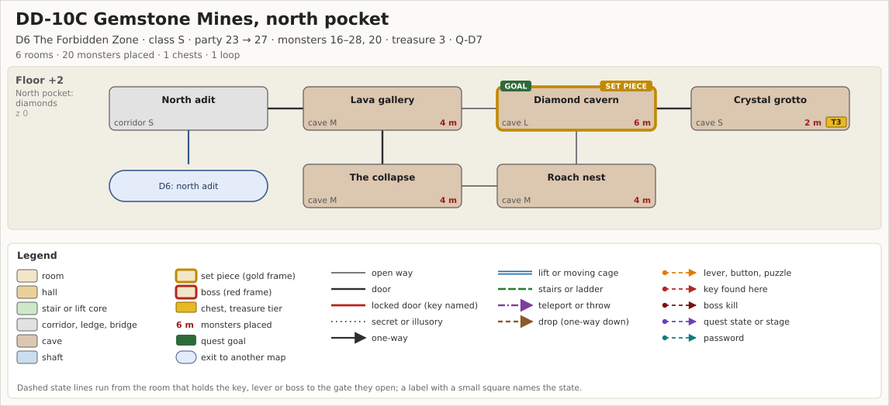
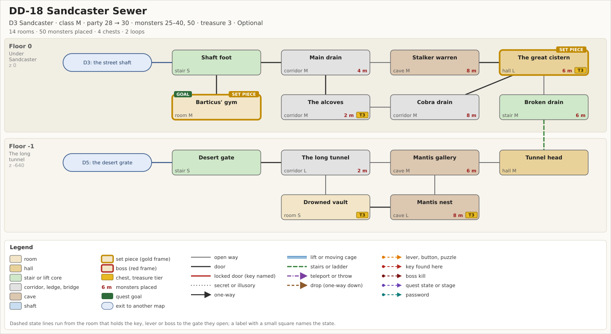
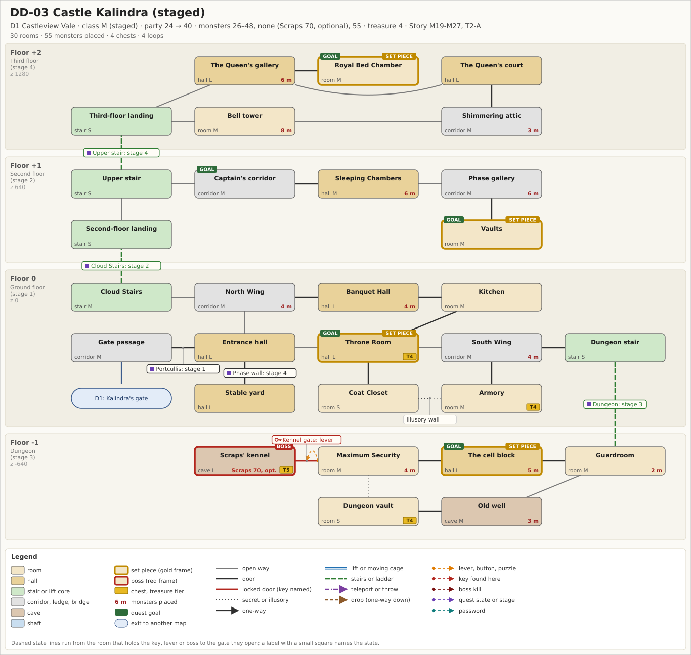

# Act III dungeon graphs, lane A8 (MU-6)

Review page for phase 3, 2026-11-20, lane A8 (`xeen-a8`). A8's seven Act III dungeons (nine maps) as room graphs and
state graphs before any geometry: DD-01 Castleview Sewer, DD-04 The Gremlin Court, DD-02 Ellinger's Tower, DD-09
Temple of Bark, DD-10A, B and C Gemstone Mines, DD-18 Sandcaster Sewer, DD-03 Castle Kalindra (staged). These are
review documents, not briefs; each L1 can start from its graph file. A7's Act III graphs share the folder
([notes_cloudside.md](act3_graphs/notes_cloudside.md), [notes_d2.md](act3_graphs/notes_d2.md)).

**Reading the pictures:** as on the Act II page ([act2_dungeon_graphs.md](act2_dungeon_graphs.md), "How to read the
pictures"). One band per floor (DD-03: one band per stage's floor), rooms left to right along the critical path, box
colour by kind, gold frame set piece, red frame boss, "6 m" monsters placed, "T2" a chest of that tier, one line
style per connection kind, labelled gates with the state that opens them.

**Files:** [act3_graphs/](act3_graphs/): `<key>.graph.yml` (spaces, links, states, exits, hooks, critical path,
loops, lines, textures, open questions; `monsters.mix` lists the placed rows with their ids) and `<key>.svg`.
Redraw with `python3 devdocs/xeen/mockups/act3_graphs/render_graphs.py dd01 dd02 dd03 dd04 dd09 dd10a dd10b dd10c
dd18` (naming the keys leaves A7's pictures alone).

**Rules used for all nine** (the Act II page's, plus the decisions since):
- Sizes and counts inside the class bands (MAPS, Dungeons); monster levels, counts and treasure from MAPS §0, with
  A2's rows by id. Kill XP per member is L(L+10) per kill over four. Optional bosses far over the band (Barkman 60,
  Scraps 70) and Valio's level-45 trap are counted with a later act (D-1.2).
- Every M dungeon has at least one loop; every dead end holds a chest, a find, a lever or a goal.
- Every password has an answer-giver in the world (Oorla for Ellinger; Dimitri, the Queen and Guido for the safes; the
  Book of Ascension on its lectern for the Bark dials).
- Two-state mechanisms only (D-4): levers, lifts, the sluice water as a sinking door mover (XD-10's word, D-18).
  Dials are map variables, not movers.
- Permanent rewards at MM6–MM8 size (D-4): flasks, brews and potions +2 to a stat, fountains and books +5 to a
  resistance, once per character.
- Every exit is the `exit` preset; no plain "Leave X?" question before it (D-24). The source's "Exit the Sewer?"
  lines stay in the ledger as the exit's meaning.
- Hooks: every A3 hook naming these maps is placed (each graph's `hooks`). DD-18 has none.

| Dungeon | Map | Class | Rooms | Monsters | Kill XP per member (MAPS) | Chests | Loops | Set piece |
| --- | --- | --- | --: | --: | --- | --: | --: | --- |
| DD-01 Castleview Sewer | D1 | M | 20 | 50 | 4.03k (3.7k, +9 %) | 5 | 2 | Five shafts, the jammed sluice, the rat queen's nest |
| DD-04 The Gremlin Court | D1 | S | 10 | 28 | 2.83k (2.5k, +13 %) | 3 | 2 | The court of stolen things, three rounds of talk |
| DD-02 Ellinger's Tower | D1 | M | 25 | 50 | 6.19k (5.7k, +9 %) | 4 | 3 | Five storeys, the question, tapestries, the study and its lift |
| DD-09 Temple of Bark | D2 | M | 22 | 50 | 6.48k (group DD-06+09+13: 17.5k of 17.1k with A7's) | 5 | 4 | Root and limb alcoves, Shaalth's hall, the Disciples' dials |
| DD-10A Gemstone Mines, west | D1 | S | 7 | 20 | 3.07k | 2 | 1 | Ruby and emerald veins |
| DD-10B Gemstone Mines, east | D2 | S | 7 | 20 | 3.44k | 1 | 1 | Sapphire veins, the God of Minerals |
| DD-10C Gemstone Mines, north | D6 | S | 6 | 20 | 4.15k (group DD-10+11: 23.2k of 22.1k with A7's) | 1 | 1 | Diamond veins |
| DD-18 Sandcaster Sewer | D3 | M | 14 | 50 | 15.32k (14.6k, +5 %) | 4 | 2 | Barticus' gym, the long tunnel to D5 |
| DD-03 Castle Kalindra | D1 | M, staged | 30 | 55 | 21.48k (20.6k, +4 %): Act III 6.8k, Act IV 14.7k | 4 | 4 | Four stages, three safes, the liches, Scraps |

Rooms are review rooms (about one sector each); the L1 splits long drains and tunnels, so DD-18's 14 rooms come to the
M band's 20 or more sectors.

---

## DD-01 Castleview Sewer

D1 · M · party 18 → 20 · 10–20, Rooka the Rat Queen 24 · 50 · treasure 2 (hoard 3) · Story M16, Q-D5

- **Monsters:** Bat Queen 10 (21), Vampire Bat 14 (8), Gremlin 14 (10), Gremlin Saboteur 18 (3), Rooka 18 (7), Rooka the
  Rat Queen 24. Valio is a talking actor (NPC 4957); opened early, his chest turns him into monster 11193 (45).
- **Path:** the square's hatch, the drain cross, west to the jammed sluice (its lever drains the flooded culvert),
  Felix's tunnel to Valio's bed, the overflow stair down, the rat runs, the culvert, the nest; back up through the
  bone midden and a drowned cellar into the east drain. Four more shafts end at grates bolted from above, each with a
  find (Red and Green Liquid +2, a dropped-things chest, a guard's bones).
- **Hooks:** `m16.necklace`, `q-d5.rooka` (the nest); `q-d5.valio_chest`, `q-d5.valio_angry` (Valio's bed).
- **Textures:** MM6 Shadow Guild Hideout 6d03 (the sewers family for "a big town's sewer with five shafts"), about 24
  of 45, 0 new.
- **Lines:** aaze0030 (Valio, the diploma, the rats, the liquids, Felix), aaze0029:0 on D1's hatch.

## DD-04 The Gremlin Court

D1 · S · party 19 → 20 · 12–20, Gettlewaithe 24 · 28 · treasure 2 (hoard 3) · Q-D1

- **Monsters:** Gremlin 14 (22), Gremlin Saboteur 18 (2), the court guards Gremlin Guard 22 (3), Gettlewaithe 24 (a
  talking actor, NPC 4955, until he fights).
- **Path:** the tiny door, the burrow, the hall of pranks (Castleview's missing gears, ropes and rings), the waiting
  room, the court. A loop through the wall's old cellar, the larder and a servants' hatch; a second through the army's
  barracks below and the sappers' tunnel.
- **States:** A3's three rounds; `court_hostile` turns the guards; their deaths allow "Submit or die" (peace);
  Gettlewaithe's death wins it the other way and opens the throne chest's three disks.
- **Hooks:** `q-d1.court_guards`, `guards_beaten`, `gettlewaithe`, `throne` (the court).
- **Textures:** proposed Castleview's grey castle stone and MM7 Tularean Caves earth; about 16 of 30, 1 new (the
  Mayor with a moustache).
- **Lines:** Gettlewaithe's challenge and answers, aaze0029:83–98.

## DD-02 Ellinger's Tower

D1 · M · party 20 → 22 · 14–24 · 50 · treasure 2 (hoard 3) · Story M17–M19

- **Monsters:** Vampire Bat 14 (14), Beholder Bat 20 (10), Gargoyle 16 (10), Gargoyle Lord 22 (6), Flying Feet 18 (8),
  Guardian 24 (2): Ellinger's wards, waking statues and MAPS's beholder bats.
- **Path:** the entry hall, the question at the stair door (answers 1 or 2 pass, 3 puts the party outside), the
  gauntlet floor, the library (Book of Fire, Book of Electricity: +5 Fire, +5 Air), the tapestry floor (buttons
  behind tapestries, the beholder loft, a trapped walk), the last door ("Who do you seek?" Ellinger), the study.
  The servants' stair behind the tapestries joins floors 1–3.
- **D-9.2:** one lift in a closed shaft from the ground floor to the study, both ways, called from either end by
  `m17.tower_lift` (refuses before Ellinger has spoken). No stops between.
- **Hooks:** `m17.question`, `question_right`, `question_wrong`, `password`, `password_wrong`, `book_of_boots`,
  `tower_lift`; `m18.sources_note`; Ellinger (NPC 4954) in the study.
- **Textures:** MM6 Agar's Laboratory 6d19 (towers family), about 26 of 45, 0 new.
- **Lines:** aaze0053–0056 (the question, the dead mirror, tapestries, the books, the password, the Book o' Boots).

## DD-09 Temple of Bark

D2 · M · party 22 → 26 · 14–30, Shaalth 30 (Barkman 60 optional) · 50 · treasure 3 (hoard 4) · Q-D10, disks

- **Monsters:** Orc Elite 16 (16), Orc Shaman 20 (10), Orc Captain 26 (5), Shaalth 30; Arachnoid 14 (10), Arachnoid
  Hunter 18 (8); Barkman 60 hidden until a limb alcove is fed.
- **Path:** the trunk door (Nibbler's key), the Hall of the Trunk (the voice), down to the roots (two alcoves, a gem
  each, a disk each), up the ring stair to Shaalth's hall (the princess's cage opens with his key). Optional: the
  shaman's tea room and the Chapel of Ascension (dials 1-2-3, the lever, the Crystal Water: the Disciples' vault),
  the limbs (Barkman's hollow and bound chest), the crown's four fountains (+5 Fire, Air, Water, Body).
- **Hooks:** `q-d10.voice`, `root_west`, `root_east`, `limb_alcoves`, `shaalth`, `cage`; Sheewana (NPC 5107) in the cage.
- **Textures:** MM7 The Hall under the Hill 7d22 with D2's bark (D-23), about 30 of 45, 2 new (heartwood floor,
  alcove mouth).
- **Lines:** aaze0073–0077 (the voice, "Feed me! Give gem?", Barkman's diary and bound chest, the Disciples, the
  orcs' tea, Alicia's warning, Nathan's "Orcs can't jump", the Yak and Moo ceremony).

## DD-10A, B, C Gemstone Mines

D1 (west), D2 (east), D6 (north) · S each · party 23 → 27 · 16–28 · 20 each · treasure 3 · Q-D7, repeatable

- **Monsters:** west: arachnoids, Beholder Bats, Electrapedes; east: Electrapedes, Lava Roaches, Beholder Bats, Sand
  Golems; north: Lava Roaches, Sand Golems, Arachnoid Queens (Act III numbers).
- **Each pocket:** an adit, a loop of drifts and caves, five veins per gem (one rock each; "You've got all this vein
  has to offer."), a false vein or exploding bones; the east pocket's bottom holds the Gem maker's throne and the God
  of Minerals, who refills the veins for 10,000 gold.
- **Hooks:** `q-d7.ruby_veins`, `emerald_veins` (A), `sapphire_veins`, `god_of_minerals` (B), `diamond_veins` (C).
- **Textures:** proposed MM7 Nighon Tunnels 7d35 in all three, about 14 of 30 each; 4 new vein textures (A 2, B 1, C 1).
- **Lines:** aaze0039 (the veins, the exploding gem and bones, the throne, the God).

## DD-18 Sandcaster Sewer

D3 · M · party 28 → 30 · 25–40 · 50 · treasure 3 · optional

- **Monsters:** Sewer Stalker 25 (16), Stalker Matriarch 35 (4), Guardian Asp 30 (10), Killer Cobra 38 (4), Mantis
  Warrior 30 (12), Mantis Queen 38 (4).
- **Path:** the street shaft, Barticus' gym off its foot, the drains round a great cistern, a broken drain down to
  the long tunnel, a mantis nest across it, the desert grate to D5.
- **Hooks:** none (open question 1).
- **Textures:** MM6 Shadow Guild 6d08 (the sandstone sewers family) and MM8 d33 sand rock for the tunnel, about 24 of
  45, 0 new; A6's `xstraining` sign on the gym.
- **Lines:** aaze0032 (the gym, its price, the brews, "Exit to the desert?"), aaze0031:1 and :33 on D3.

## DD-03 Castle Kalindra (staged)

D1 · M, staged · party 24 → 40 · 26–48 (Scraps 70 optional) · 55 · treasure 4 (hoard 5) · Story M19–M27, T2-A

- **Stages** (A3's `Xeen.Stages.kalindra`): 1 (5 disks) the gate, ground floor and throne room; 2 (10) the Cloud
  Stairs and the second floor (Dimitri, Megan, the observatory, the disk safes); 3 (15) the dungeon (Guido, the
  liches, Scraps); 4 (20) the upper stair, the Queen's floor (bedchamber, five services), the stable yard and the
  mirror. A part not in phase is closed by shimmering walls; its stair says "Your foot passes through the stairs as
  though they were mist."
- **Monsters by stage:** 1 Tomb Guard 26 (8), Ghost Rider 27 (4); 2 Ghost Rider (4), Tomb Guard (4), Tomb Terror 40 (4);
  3 Lich 35 (5), Tomb Terror (6), Bone Dragon 45 (3), Scraps 70 optional; 4 Vampire 40 (8), Gnome Vampire 32 (4), Tomb
  Terror (5). Act III 24 monsters, about 6.8k per member; Act IV 31, about 14.7k.
- **Safes:** the throne room's two (stage 1, `m19.safes`, two disks), the vaults' disk safes (64-52-31, `m24.disk_safes`),
  the Queen's crown safe (3-31-62, `m27.crown_safe`), two optional tougher safes (10-11-12, Guido).
- **Hooks:** `m19.first_entry`, `m19.safes`, `m24.disk_safes`, `m26.mirror_switch`, `m27.crown_safe`, `t2-a.cells`; A4's
  houses 4501–4512 by stage.
- **Textures:** the royal kit restored with Kalindra's crest and banner, the out-of-phase wings and the dungeon in MM7
  Castle Gryphonheart 7d33; about 38 of 45, 1 new (the phase wall).
- **Lines:** aaze0041–0044 (the signs, the mist stairs, the brews, "Activate Mirror Portals?", the Scraps notes,
  Guido's 10-11-12, the prisoner list).

---

## D1's plan against the graphs (A6's `briefs/d1/L1/`, `phase3/d1/board_d1.png`)

| Dungeon | D1's door | Graph | Match |
| --- | --- | --- | --- |
| DD-01 | `entrance:dd01_hatch` (66, 57), the square's south-east corner, one hatch | one working shaft (the hatch) and four bolted shaft feet; an outfall exit to the mill gorge | **Mismatch:** D1 has no outfall point; MAPS's "five town shafts" are four dead ends unless A6 adds grates (DD-01 question 1) |
| DD-02 | `entrance:dd02_tower` (70, 47), facing west, the round tower in the north-east quarter | entry hall with the door on the west | **Mismatch:** D1 gives the tower no height; the graph has five storeys (about 2,300 inside) and a lift: the outside should read as five storeys with windows and a slate cone |
| DD-03 | `entrance:dd03_gate` (44, 70) facing east on the forecourt; arrival `kalindra_gate` (47, 70) | gate passage inside the east gate | Match. Stage 1's "gate and first floor solid" is the graph's stage 1. The stables (stage 4) are inside the BLV's yard, so D1 needs no stable building at the castle |
| DD-04 | `entrance:dd04_burrow` (68, 43), facing north, under the wall east of the north gate, outside the walls | the tiny door, the court under the wall | Match |
| DD-10A | `entrance:dd10a_adit` (45, 22), facing south above the gemsmiths | the west adit | Match |

D2 (A6's `briefs/d2/L1/`): DD-09's door (42, 76) facing north in the bark glade, arrival at the foot of the first stair,
and DD-10B's adit (34, 31) match; `project.yml` labels DD-10B "A7/A8": it is A8's. Not yet planned: D3 (DD-18's shaft,
A5), D5 (DD-18's far grate, phase 5) and D6 (DD-10C's adit, phase 5).

---

## Open questions, by map

Each graph file holds its questions with the options; the recommendation is marked "proposed".

**DD-01**
1. Five shafts against D1's one hatch: one working shaft and four bolted shaft feet plus an outfall to the mill gorge
   (proposed); four more working grates on D1; or one shaft only.
2. A2's rat rows collide in name (Rooka 6 and Rooka 18, two Sewer Stalkers); a level 10–12 sewer rat to replace most
   of the 21 Bat Queens (proposed).
3. Rooka the Rat Queen at 24 over the band's 20 (keep, proposed) or 20.
4. Felix the Tinker as a flavour NPC with his compass line, no skill (proposed), or dropped.
5. The sluice's water as a sinking door mover (proposed) or a plain grate.

**DD-04**
1. Court guards at 22, over the band's 20: keep (proposed) or Saboteurs 18.
2. A petitioning party and the hostile gremlins: all hostile (A3's note); the court side peaceful until
   `court_hostile`, the army below hostile (proposed); all peaceful.
3. Gettlewaithe's source challenge (aaze0029:83) as a one-time step message before the throne (proposed; A3's text).
4. Textures: Castleview's grey stone and Tularean Caves earth (proposed), or A6's family.
5. No link from the sappers' tunnel into DD-01 (proposed).

**DD-02**
1. Book of Sorcerer's Knowledge: +2 Intellect for a reader with Intellect 20+, the source's headache below (proposed),
   or +2 for anyone.
2. Monster mix: wards (Flying Feet, Guardians), gargoyles, bats (proposed), or bats and gargoyles only.
3. The tower's outside on D1 as five storeys (request to A6).
4. The dead mirror: flavour (proposed) or a Darkside mirror stop at stage 4.
5. The lift with no stops between the ground floor and the study (proposed).

**DD-09**
1. Only the red and blue flasks (+2 Might, +2 Personality); the seven-potion room left out as XD-08's repeat (proposed).
2. The black barrel: +1 to all stats and a year of age once per character (proposed), or none.
3. The Disciples' chapel: dials as map variables, the Dark Water poisons (no death), the reward the vault and an award
   (proposed); or no chapel.
4. Four caged prisoners freed by a lever, 500 XP each by an A3 hook (proposed), or two.
5. The orcs' tea as a clicked kettle that poisons (proposed).
6. Barkman hidden and shown by the first fed limb, his chest freed by his death, his XP in a later act (proposed).
7. Arachnoids (proposed) or D2's wolves in the roots and limbs.

**DD-10A, B, C**
1. DD-10C on D6 (Act V) at Act III's band: keep it on D6 at D6's lower band, diamonds as Act V gear, its 20 monsters
   moved to Act V (proposed); move its adit to D1's mine hills; or a D6 adit at the end of D1's road.
2. q-d7's one refill bit and five-rock hooks: five veins of one rock each, three refill bits set by the God (proposed;
   A3).
3. False veins and exploding bones as small traps (proposed), or crumbling bones only.
4. The Gem maker's throne as flavour (proposed) or a once-per-character gift.
5. A 'Rock Golem' name for the mines' Sand Golem row (A2), or keep.
6. Textures: Nighon Tunnels 7d35 for all three plus four vein textures (proposed), or A6's family.

**DD-18**
1. No quest names it: an optional dungeon with MAPS's role corrected (proposed), an A3 reason to go, or S.
2. Barticus' gym: training stays in Sandcaster (A4's house 4607); the sewer room is a paid members' room with the two
   brews, +2 Endurance and +2 Might once per character, 5,000 gold (proposed).
3. The tunnel to D5 (Act V): open both ways; bolted on the desert side, a later shortcut back (proposed); or sealed.
4. Monsters: stalkers, cobras, mantis ants (proposed), or hornets in the tunnel.

**DD-03**
1. Monsters by stage and act: stages 1–2 at 26–40 in Act III (24 monsters), stages 3–4 in Act IV (31) (proposed); or
   28–48 throughout.
2. Spirits in the out-of-phase parts, liches and bone dragons in the dungeon, Blackfang's vampires on the Queen's floor
   (proposed).
3. The five liches as plain Liches 35 with the source's names, and a `t2-a.liches` hook for the cell block's kills (A3).
4. Safes: the stage-1 safes as trapped chests any party opens; two optional tougher safes at 10-11-12 (proposed).
5. The throne room walkable, the throne itself the door of house 4501 (proposed; A4).
6. One new phase-wall texture (proposed) or XD-25's `xufield`.
7. Scraps behind a kennel portcullis too narrow for him, his XP in a later act (proposed).
8. The stable yard as an open-sky yard inside the castle with the stables and the mirror (proposed).
9. James the Spy's Roland line left out (A3's story order) (proposed).
