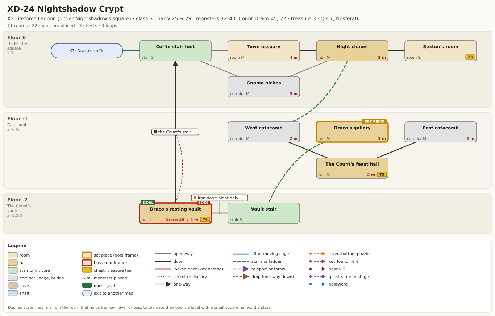
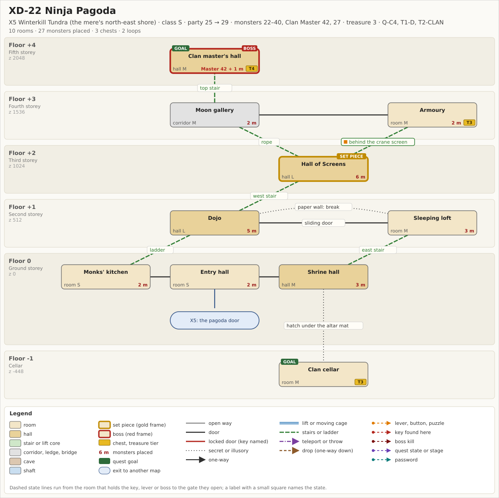
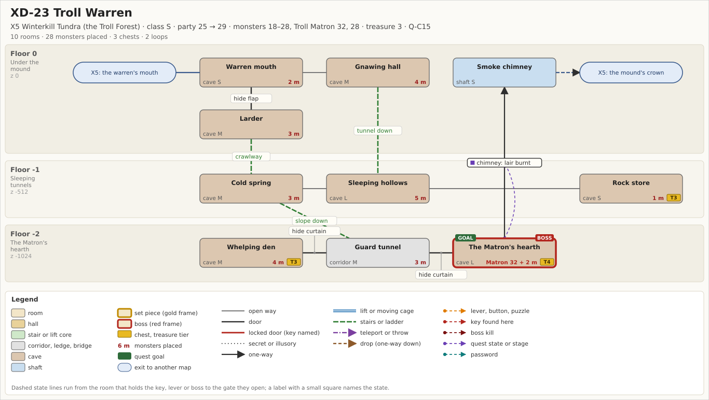

# Act III Cloudside dungeon graphs: XD-24, XD-22, XD-23 (MU-6)

Review notes for gate G1, 2026-11-20, lane A7 (agent `xeen-a7-graphs-cloudside`). Graph files and pictures beside
this file: `xd24`, `xd22`, `xd23` (`.graph.yml`, `.svg`), drawn with `render_graphs.py` (no overlaps). The format and
reading guide are the Act II page's ([act2_dungeon_graphs.md](../act2_dungeon_graphs.md)); the lessons of
[act2_dungeon_decisions.md](../act2_dungeon_decisions.md) are applied up front (no monster over the band except the
boss, Might checks not used, two-state mechanisms only, permanent rewards none here).

**The three together** (MAPS §0 row "XD-22, XD-23, XD-24": party 25 → 29, 18–40, Count Draco 45, treasure 3, 84
monsters, 17.9k kill XP per member):

| Dungeon | Map | Class | Rooms | Monsters | Kill XP per member | Loops | Set piece | Exits |
| --- | --- | --- | --: | --: | --: | --: | --- | --- |
| XD-24 Nightshadow Crypt | X3 | S | 11 | 22 (Draco 45) | 8.5k | 3 | Draco's vault, open only by night | Draco's coffin (both) |
| XD-22 Ninja Pagoda | X5 | S | 10 | 27 (Clan Master 42) | 6.2k | 2 | Five storeys, the Hall of Screens | Pagoda door (both) |
| XD-23 Troll Warren | X5 | S | 10 | 28 (Troll Matron 32) | 4.7k | 2 | Burning the warren from inside | Mouth (both), chimney (out) |
| **Total** | | | 31 | 77 | 19.4k (+8 %) | | | |

Kill XP is L(L+10) per kill, bosses at their level, divided by four. 77 monsters for MAPS's 84: XD-24's band (30–40)
is heavy, so it holds fewer; the total stays inside the 15 % rule. Every exit is the `exit` preset (D-24: the game's
leave window, no "Leave …?" question); only the burn ("Destroy the lair?") is a question, a real choice.

---

## XD-24 Nightshadow Crypt

| Map | Class | Party | Monsters | Count | Treasure | Role | Set piece |
| --- | --- | --- | --- | --: | --- | --- | --- |
| X3 Lifeforce Lagoon (under Nightshadow's square) | S (at most 15 sectors and 20 M units², 15–30 monsters, 0–3 chests, 3–8 doors) | 25 → 29 | 32–40 (Gnome Vampire 32, Vampire 40), Count Draco 45 | 22 | 3 (hoard 4) | Q-C7, Nosferatu (Du Monay on X3) | Draco's resting vault |

**What it is.** The crypt under the square, entered down the stair in Draco's own coffin (D-11.3). The town's crypt on
top (ossuary, niches of gnome-sized coffins, the burial chapel turned to the moon), the Count's catacombs below with
the gallery of his portraits and his feast hall, and his resting vault at the bottom. One texture family: the grey
stone of X3's coffin (`cwb`/`cnb`) throughout; the Count's floor is the same stone dressed with portraits, banners
and plate (decorations, not a second family).

**Rooms.** 11 (sectors about 12), 3 chests, 7 doors.

| Id | Room | Size | Floor | Monsters | Chest | What it is |
| --- | --- | :-: | --: | --: | :-: | --- |
| `stair_foot` | Coffin stair foot | S | 0 |  |  | Foot of the coffin's stair; no monsters (D-11.3). |
| `ossuary` | Town ossuary | M | 0 | 4 |  | Nightshadow's dead; gnome vampires among the bones. |
| `niches` | Gnome niches | M | 0 | 5 |  | Small coffins, lids ajar: "The coffin is empty". |
| `chapel` | Night chapel | M | 0 | 3 |  | Black altar, painted moon window; the stair down. |
| `sexton` | Sexton's room | S | 0 |  | T3 | Dead end: the sexton's lockbox. |
| `cata_w` | West catacomb | M | −1 | 2 |  | Loculi; the chapel stair arrives. |
| `gallery` | Draco's gallery (set piece) | M | −1 | 1 |  | The same face in every portrait; the vault stair. |
| `cata_e` | East catacomb | M | −1 | 2 |  | Older loculi. |
| `feast_hall` | The Count's feast hall | M | −1 | 2 | T3 | A table laid for guests who never left. |
| `vault_stair` | Vault stair | S | −2 |  |  | The iron door with the Count's symbol. |
| `draco_vault` | Draco's resting vault (set piece, boss, goal) | L | −2 | Draco + 2 | T4 | The great sarcophagus on a dais; the hoard. |

**Critical path.** Coffin stair foot → town ossuary → night chapel → stair → west catacomb → Draco's gallery → vault
stair → iron door (night) → Draco's resting vault (Count Draco). Back up the Count's own stair to the stair foot.

**State graph.**
- Entrance (X3, A3's `q-c7.coffin`): the three dials at nine (`q-c7.dials_set`) and night open the coffin's stair
  (`q-c7.coffin_opened`, 112143); it stays open.
- Iron vault door: a door whose click reads `Xeen.isNight()` (21:00–6:00); by day the coffin's refusal line (DECIDE 1).
- Draco's death (a kill timer): A3's `q-c7.draco` sets `q-c7.done` (112141, +10k XP); the secret stair behind the dais
  opens, one way up to the stair foot. On X3 the load event lifts Nightshadow's mist (D-11.1).

**Loops.** Round the town's crypt (ossuary or niches to the chapel); round the catacombs through the feast hall; down
through the crypt and back up the Count's stair once he is dead.

**Set piece placement.** The vault is the deepest room, 1,280 below the square, seen through the iron door's grille
from the vault stair; the gallery leads to it and shows the Count before he is met.

**Original lines.** "The coffin is empty" (aaze0029:3, the niches); "Only at night can you put up a fight."
(aaze0029:6, over the iron door); "The lid refuses to budge. A symbol etched on the surface of the lid flashes pale blue
whenever you try to move it." (aaze0029:24, the iron door by day); "Open his coffin and bid him farewell; only then can
you use the magic of the well." (aaze0029:8, on the sarcophagus's foot).

**Doors to X3.** One exit, both ways: `thing:coffin_open` on Nightshadow's square (click face 17664, −4608, 992)
leads to XD-24's start in the stair foot; XD-24's exit arrives at (17664, −5120, 992) facing south (1536)
(`briefs/x3/DOORS.md`). When XD-24 is installed, X3 replaces the sealed message with `into` and drops `listed_only`
from `door:xd24` (X3 L4 NOTES).

**DECIDE.**
1. *Night inside.* X3's coffin stays open after its first night (`q-c7.coffin` is once), so the crypt can be walked by
   day. Options: (a) the vault's iron door is night-only too, with the coffin's refusal line; (b) Draco can be fought
   at any hour. Evidence: the source's rule is "Only at night can you put up a fight"; resting in a dungeon is normal
   MM play. **Default (a).**
2. *Kill XP.* XD-24 alone is 8.5k of the three's 17.9k; the three are 19.4k (+8 %). Options: (a) accept; (b) swap the
   five Vampires 40 for Gnome Vampires (about 7.7k, three's total 18.6k). **Default (a)**, inside the 15 % rule.
3. *Gnome Vampires 32 over the party's 25–29.* MAPS's band is 30–40. Options: (a) keep; (b) open with the town's
   Beholder Bats 20 in the ossuary and niches. **Default (a)**; the quest is level 25 and the party can come back.
4. *The Count's stair* back to the stair foot uses the dungeon's only arrival (no second exit). **Default yes.**

---

## XD-22 Ninja Pagoda

| Map | Class | Party | Monsters | Count | Treasure | Role | Set piece |
| --- | --- | --- | --- | --: | --- | --- | --- |
| X5 Winterkill Tundra (the mere's north-east shore) | S (at most 15 sectors and 20 M units², 15–30 monsters, 0–3 chests, 3–8 doors) | 25 → 29 | 22–40 (Ninja 22, Shadow Ninja 30, Ninja Master 40), Clan Master 42 | 27 | 3 (hoard 4) | Q-C4 (T1-D), T2-CLAN (Shinobu) | Five storeys of paper screens |

**What it is.** Kai Wu's pagoda, taken by the ninja clan: five storeys stacked as X5's model shows them (each smaller
than the one below), stairs alternating sides so each storey is crossed, paper screens as indoor destructibles, the
clan master under the top roof and the clan's cellar under the shrine. One texture family per area: the storeys in
the X5 pagoda's dark timber (`hkm2b`/`hkm2d`) with one new paper-screen texture; the cellar in plain stone.

**Rooms.** 10 (sectors about 13 with the stair wells), 3 chests, 6 doors plus the paper walls.

| Id | Room | Size | Floor | Monsters | Chest | What it is |
| --- | --- | :-: | --: | --: | :-: | --- |
| `master_hall` | Clan master's hall (set piece, boss, goal) | M | +4 | Master + 1 | T4 | Dais, gong, banner; the clan's strongbox. |
| `gallery` | Moon gallery | M | +3 | 2 |  | Railed walk under the eaves, sky over the mere; the rope down. |
| `armoury` | Armoury | M | +3 | 2 | T3 | Blades, bows, shuriken. |
| `screens` | Hall of Screens (set piece) | L | +2 | 6 |  | Lit paper maze; shadows move behind it; the crane screen. |
| `dojo` | Dojo | L | +1 | 5 |  | Straw targets; west stair up, kitchen ladder down. |
| `dorm` | Sleeping loft | M | +1 | 3 |  | Mats; a sliding door and a paper wall to the dojo. |
| `kitchen` | Monks' kitchen | S | 0 | 2 |  | Smashed rice jars; ladder up into the dojo. |
| `porch` | Entry hall | S | 0 | 2 |  | Kai Wu's bell and the broom he dropped. |
| `shrine` | Shrine hall | M | 0 | 3 |  | The defiled altar; the east stair; a draught under the mat. |
| `cellar` | Clan cellar (goal) | M | −1 |  | T3 | The clan's stores; Shinobu after `q-c4.done`. |

**Critical path.** Entry hall → shrine hall → east stair → sleeping loft → dojo → west stair → Hall of Screens →
behind the crane screen → armoury → moon gallery → top stair → clan master's hall (the clan master). Back down the
clan's rope to the screens, the west stair and the kitchen ladder.

**State graph.**
- Crane screen (Hall of Screens): the stair up shows through the lit paper behind the screen painted with a crane;
  striking it (an indoor destructible) drops it. Plain to see, no riddle.
- Paper wall between loft and dojo: a destructible shortcut; ninjas wait behind it.
- Cellar hatch (shrine): a secret trapdoor under the altar mat, its click "A draught comes up between the
  floorboards." and it lifts.
- Clan master's death (a kill timer): A3's `q-c4.clan_master` sets `q-c4.clan_master_slain` (112081). Kai Wu then
  pays and promotes Monks to Initiates (on X5).
- Stage `q-c4.done` (112082): on load the cellar shows Shinobu (4530, a talking actor) and the clan's survivors
  (T2-CLAN, Initiate to Ninja once `m20.started`).

**Loops.** Up the east stair, down the kitchen ladder (ground and second storey); up behind the crane, back down the
clan's rope (third and fourth storey).

**Set piece placement.** The Hall of Screens fills the third storey, the pagoda's middle; the clan master's hall is the
fifth storey under the steep top roof, 2,048 up; the moon gallery is the only room open to the sky.

**Original lines.** "You have dishonored the Ninjas by entering the Pagoda. They surely will not return to reclaim
it." (aaze0003:5, the clan master's death); Kai Wu's "I am a peace loving old monk driven from my sacred home …"
(aaze0003:15), "There are still Ninja in my Pagoda …" (aaze0003:16) and "You have destroyed the Ninja Clan …"
(aaze0003:17) on X5, echoed by his bell and broom in the entry hall.

**Doors to X5.** One exit, both ways: the pagoda's north door (`thing:pagoda`, storey_1's north wall, cells about
[62.5, 43.5], floor 1,000); the arrival 400 north of it, facing north (A6 reads the face from the build export as for
XD-09 and XD-10). X5's sealed message "The pagoda's door is barred from within …" gives way to `into`.

**DECIDE.**
1. *The clan master has no row.* Options: (a) a boss in the Ninjas' block (11123, "Clan Master", 42, look C, blink on
   hit like Draco); (b) the Ninja Master 40 placed as the boss. **Default (a)** (A2).
2. *Shinobu's survivors.* Ninjas are hostile by default. Options: (a) a placed-only peaceful tier (Ninjas D "Clan
   Survivor", party friendly, as the King's Guard); (b) Shinobu alone. **Default (a)**, four survivors.
3. *Inside and outside.* X5's ground storey is 1,536 × 1,024, the top 832 × 320. Options: (a) twice the outside in
   plan (the shipped convention: an interior is not measured against its shell); (b) the outside's size with fewer,
   smaller rooms. **Default (a)**; the storeys still narrow upwards.
4. *Paper screens.* A destructible face with a translucent paper texture lit from behind (one new texture). A1 checks
   that a destructible can be translucent and that monsters wait behind an unbroken screen. **Default: as drawn;
   fallback opaque screens.**
5. *Shuriken.* All Ninja tiers have attack2 (Arrow, 30 %). Options: (a) keep; (b) drop it for the A tier inside.
   **Default (a).**

---

## XD-23 Troll Warren

| Map | Class | Party | Monsters | Count | Treasure | Role | Set piece |
| --- | --- | --- | --- | --: | --- | --- | --- |
| X5 Winterkill Tundra (the Troll Forest) | S (at most 15 sectors and 20 M units², 15–30 monsters, 0–3 chests, 3–8 doors), one stage | 25 → 29 | 18–28 (Troll 18, Troll Guard 28), Troll Matron 32 | 28 | 3 (hoard 4) | Q-C15 (Thickbark; "Civilized One" for Leafpoint) | Burn the warren from inside |

**What it is.** Tunnels dug under X5's barrow mound, three levels down to the Troll Matron's hearth. The source's lair
is an outdoor click ("Destroy the lair?"); here it is the warren's last hall, after its Matron. One texture family:
X5's mouth shell (`7dirttyl`, MM7 dirt cave) throughout, with hides, straw and bark as decorations and
destructibles; charred faces for the burnt stage. Ice Troll 38 is left out (over the band).

**Rooms.** 10 (sectors about 11), 3 chests, 5 doors.

| Id | Room | Size | Floor | Monsters | Chest | What it is |
| --- | --- | :-: | --: | --: | :-: | --- |
| `mouth` | Warren mouth | S | 0 | 2 |  | Inside the bone-and-hide barricade; the stench. |
| `bone_hall` | Gnawing hall | M | 0 | 4 |  | Gnawed bark (Thickbark's complaint); the tunnel down. |
| `larder` | Larder | M | 0 | 3 |  | Frozen carcasses behind a hide flap; a crawlway down. |
| `chimney` | Smoke chimney | S | 0 |  |  | The hearth's chimney top in the mound's crown. |
| `spring` | Cold spring | M | −1 | 3 |  | Meltwater pool; the slope down. |
| `sleeping` | Sleeping hollows | L | −1 | 5 |  | Straw beds that burn; hides. |
| `rock_pile` | Rock store | S | −1 | 1 | T3 | Dead end: rocks, hides, bones, a dead hunter's pack. |
| `nursery` | Whelping den | M | −2 | 4 | T3 | Dead end: young trolls and their shiny things. |
| `guard_tunnel` | Guard tunnel | M | −2 | 3 |  | The Matron's guards; two hide curtains. |
| `hearth` | The Matron's hearth (set piece, boss, goal) | L | −2 | Matron + 2 | T4 | Fire pit, chimney stuffed with hides, her hoard. |

**Critical path.** Warren mouth → gnawing hall → tunnel down → sleeping hollows → cold spring → slope down → guard
tunnel → hide curtain → the Matron's hearth (the Matron; then "Destroy the lair?") → up the chimney, out on the
mound's crown.

**State graph.**
- The Matron's death (a kill timer, as XD-05's drums): until then the hearth is only the trolls' fire.
- The burn (yes to "Destroy the lair?"): A3's `q-c15.lair` sets `q-c15.lair_burnt` (112301). Its event breaks the
  warren's destructibles (beds, hide curtains, bark piles: `evt.DamageDestructible`), sets a grey smoke mist
  (`evt.SetMist`) that a timer thickens for about a minute, and burns the hide plug out of the chimney: a climbable
  ladder up to a one-way exit on the mound's crown.
- Stage `q-c15.lair_burnt` on every later load: charred faces shown, beds, curtains and bark gone, no smoke, no trolls.
  Thickbark then pays on X5 and sets `q-c15.done`.

**Loops.** Down the tunnel or down the larder's crawlway (the upper ring); out up the chimney once the lair burns, back
in at the mouth over X5.

**Set piece placement.** The hearth is the deepest hall, 1,024 down, its chimney rising straight to the mound's crown;
the smoke is seen from the guard tunnel and the curtains burning on the way in.

**Original lines.** "The stench of this cave tells you that Trolls have been living in it. It is filled with things
that Trolls find valuable: Bones, straw beds, fist-sized rocks and hides. Destroy the lair?" (aaze0008:2, the hearth;
its first sentence as the mouth's step message); "You burn everything you can, and what you cannot burn you throw
outside." (aaze0008:3, the hearth); Thickbark's "They gnaw on our bark to sharpen their teeth …" (aaze0007:6, echoed
by the gnawed bark) and "Thank you for killing the trolls, civilized ones." (aaze0007:8) on X5.

**Doors to X5.** The mouth, both ways: the barrow mound's mouth in the Troll Forest (`thing:warren`, cells about
[65.5, 94.5]); the arrival 400 in front of it, facing away. The chimney, out only: on the mound's crown by explicit
coordinates (no second arrival into the warren). The Holy Book of Elvenkind (Q-C18) stays outside by the mound.

**DECIDE.**
1. *The Troll Matron has no row.* Options: (a) a boss in the Trolls' block (11074, "Troll Matron", 32, look B,
   frenzy below half health like Hobstadt); (b) a Troll Guard 28 placed as her. **Default (a)** (A2).
2. *The burn's text.* The source's line and A3's hook text both exist. Options: (a) the source's first, then A3's; (b)
   A3's only. **Default (a).**
3. *Smoke.* Options: (a) a grey mist thickened by a timer, no damage; (b) a timer that hurts a little every few
   seconds until the party leaves the deep. **Default (a)**; the open chimney is the invitation.
4. *The chimney exit.* Options: (a) keep the one-way exit on the mound's crown (explicit coordinates); (b) leave only
   by the mouth. **Default (a).**
5. *X5's shut mouth* ("choked with bones and frozen hides from within"). Options: (a) its click with the map built:
   "You drag the frozen hides aside." and in; (b) a barricade destructible just inside. **Default (a)** (A6's door).
