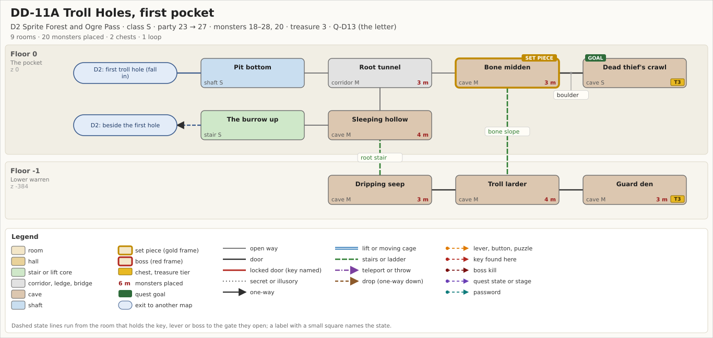
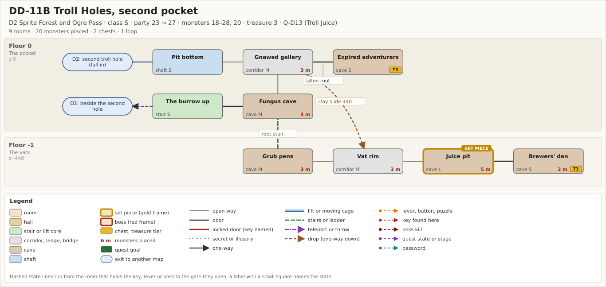
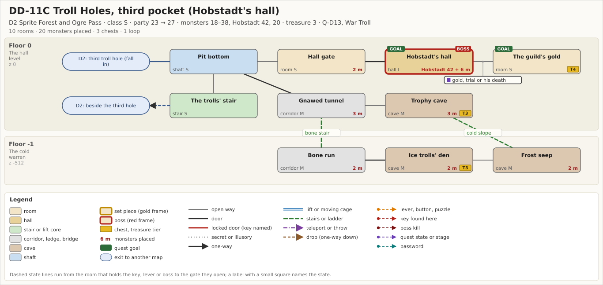
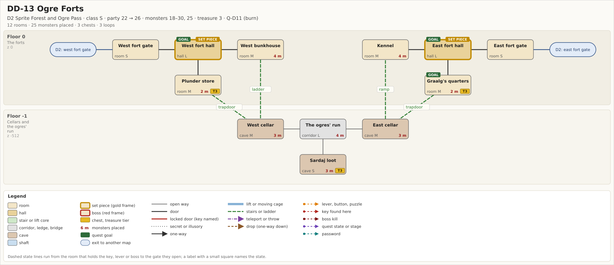
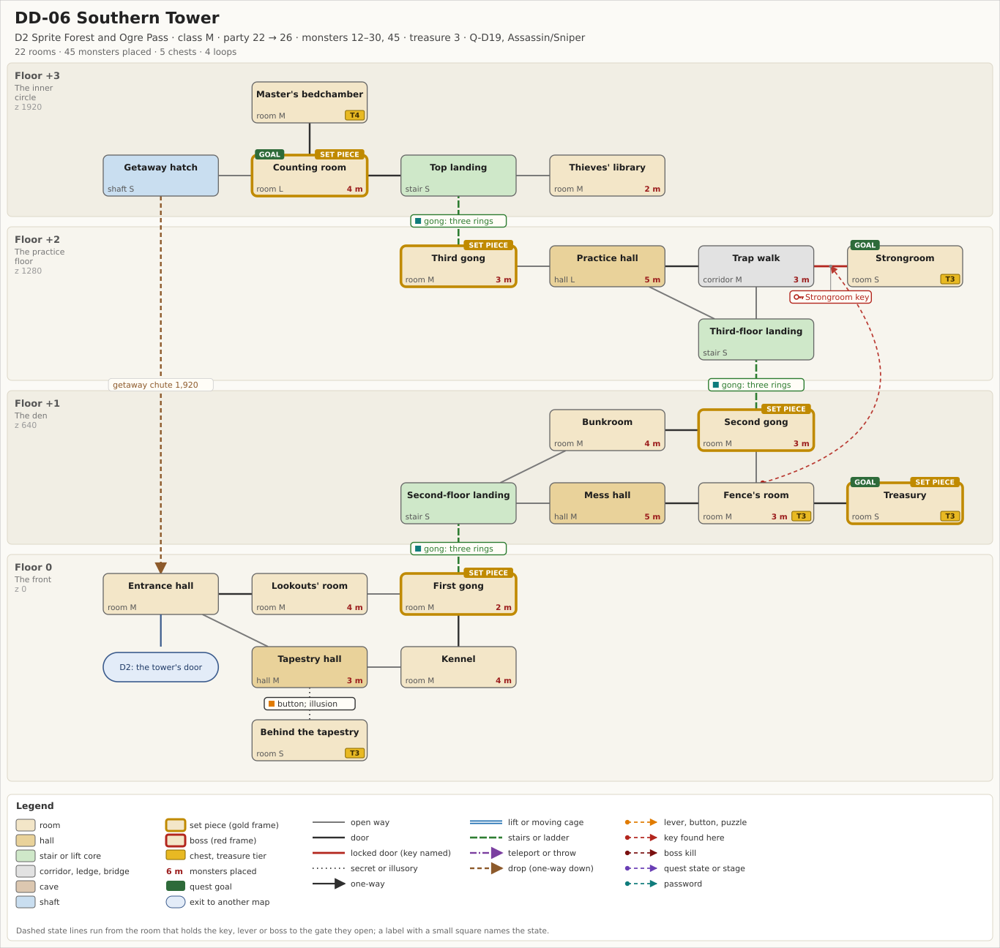

# Act III D2 dungeon graphs: DD-11A, DD-11B, DD-11C, DD-13, DD-06 (MU-6)

Review notes for gate G1, 2026-11-20, lane A7 (agent `xeen-a7-graphs-d2`). Graph files and pictures beside this file:
`dd11a`, `dd11b`, `dd11c`, `dd13`, `dd06` (`.graph.yml`, `.svg`), drawn with `render_graphs.py` (no overlaps). The
format and reading guide are the Act II page's ([act2_dungeon_graphs.md](../act2_dungeon_graphs.md)); the lessons of
[act2_dungeon_decisions.md](../act2_dungeon_decisions.md) are applied up front (named answer-givers for every
password, fixed items for fixed needs, two-state mechanisms, peaceful-court rules said outright, permanent rewards at
MM6–MM8 size). All five stand on D2 Sprite Forest and Ogre Pass; their doors are D2's L1 plan's entrances
(`devdocs/xeen/briefs/d2/L1/plan.yml`, `project.yml`), unchanged.

**The five together** (MAPS §0 rows "DD-06, DD-09, DD-13": party 22 → 26, 14–32, 120 monsters, 17.1k per member;
"DD-10, DD-11 (6 pockets)": 23 → 27, 16–38, Hobstadt 42, 120 monsters, 22.1k per member):

| Dungeon | Class | Rooms | Monsters | Kill XP per member | Chests | Doors | Loops | Set piece | Exits to D2 |
| --- | --- | --: | --: | --: | --: | --: | --: | --- | --- |
| DD-11A Troll Holes, first pocket | S | 9 | 20 | 3.4k | 2 | 4 | 1 | The bone midden | Fall in at the first hole; burrow out beside it |
| DD-11B Troll Holes, second pocket | S | 9 | 20 | 3.6k | 2 | 4 | 1 | The juice pit | Fall in at the second hole; burrow out beside it |
| DD-11C Troll Holes, third pocket | S | 10 | 20 + Hobstadt 42 | 5.5k | 3 | 4 | 1 | Hobstadt's hall | Fall in at the third hole; the trolls' stair out beside it |
| DD-13 Ogre Forts | S | 12 | 25 | 4.0k | 3 | 8 | 3 | Two fort halls to burn | West fort gate, east fort gate (both) |
| DD-06 Southern Tower | M | 22 | 45 | 6.9k | 5 | 14 | 4 | Three gongs, the Ali Baba chest, the counting room | The tower's door (both) |

Kill XP is L(L+10) per kill, bosses at their level, divided by four. With A8's graphs in this folder:
- **DD-06 + DD-09 + DD-13:** 27.7k + 25.9k + 16.2k = 69.8k, **17.5k per member against 17.1k (+2 %)**; 117 monsters
  for 120.
- **DD-10 + DD-11:** 42.7k + 50.0k = 92.7k, **23.2k per member against 22.1k (+5 %)**; 120 monsters plus Hobstadt.

Both inside the 15 % rule. Every exit is the `exit` preset (D-24). The troll holes' climb out is a real choice, so the
burrow's foot may ask "Exit the Troll Hole?" (the source's own line) before the exit. The burns in DD-13 ("Burn?") and
the passwords in DD-06 are questions too, all real choices.

**One texture family per area.**
- **The troll holes:** one family for all three pockets, a troll burrow of packed earth, roots and bone. MM8's Ogre
  Fortress cave floor and rock, as XD-05 uses them, are the nearest installed set; the L1 picks it.
- **DD-13:** XD-05's MM8 Ogre Fortress family throughout: timber posts, plank, hide, cave rock. It already has the
  burning and burnt-out timber pair the burn needs.
- **DD-06:** the towers family (dark timber and slate, `xtslate` / `xtslatew`), as D2's plan draws the tower outside.
  The Mok tapestry is a picture, not a second family.

---

## DD-11A, B, C Troll Holes (three pockets)

**What they are.** The source's split troll-hole pockets as three small BLVs (WORLD_DESIGN §6), each with a single way
in and out. D2's plan sets the rule, and the lane keeps it. The party falls in by the pocket's own troll hole (D2's
`q-d13.troll_holes`, "Troll Hole. Descend?") and lands at the pit's bottom. The pit is too sheer to climb. The pocket's
one exit is a burrow (C: the trolls' stair) that climbs to a sod hatch on D2, a few hundred units beside the same pit,
not on it. On D2 the hole's door (`door:dd11a` / `b` / `c`) therefore needs a second arrival point for the return: the
BLV's exit names it. Each exit is two rooms from the landing, so a party that only wants out is never trapped.

Their order follows the quest. A gives the letter (Q-D13 starts). B gives a permanent drink and the letter that names
the King's hole. C is Hobstadt.

### DD-11A Troll Holes, first pocket

| Map | Class | Party | Monsters | Count | Treasure | Role | Set piece |
| --- | --- | --- | --- | --: | --- | --- | --- |
| D2 (the first hole, [60, 76]) | S (at most 15 sectors and 20 M units², 15–30 monsters, 0–3 chests, 3–8 doors) | 23 → 27 | Troll 18 (14), Troll Guard 28 (6) | 20 | 3 | Q-D13 starts (the dead thief's letter) | The bone midden |

**Rooms.** 9 (sectors about 10), 2 chests, 4 doors.
- **Floor 0, the pocket:** pit bottom, root tunnel (3), bone midden (3, set piece), dead thief's crawl (goal, T3),
  the burrow up, sleeping hollow (4).
- **Floor −1, the lower warren (−384):** dripping seep (3), troll larder (4), guard den (3, T3).

**Critical path.** Pit bottom → root tunnel → bone midden → (the boulder) the dead thief's crawl: his pack and the
guild's letter (`q-d13.thieves_letter`: started, the autonote). Back: midden → root tunnel → sleeping hollow → the
burrow up.

**State graph.** Only the letter (a qbit, A3's hook). The boulder over the crawl is a door mover that rolls aside
when pushed; no key or lever.

**Loops.** Root tunnel → bone midden → bone slope down → larder → seep → root stair up → sleeping hollow → root tunnel.

**Set piece placement.** The bone midden is the floor's centre, two rooms from the landing. Its bone slope climbs to
the crawl's boulder high in one wall and falls to the larder in the other.

**Original lines.**
- "Troll Hole. Descend?" (dark/aaze0008:2, on D2).
- The guild letter "A message on thieves' guild letterhead reads: To all members: The Trolls have stolen our gold.
  Get it back no matter the cost!" (dark/aaze0040:5, the thief's crawl).
- "Chest" (aaze0040:0).
- "Exit the Troll Hole?" (aaze0040:12, the burrow's climb).

### DD-11B Troll Holes, second pocket

| Map | Class | Party | Monsters | Count | Treasure | Role | Set piece |
| --- | --- | --- | --- | --: | --- | --- | --- |
| D2 (the second hole, [70, 84], by the dead adventurer's pack) | S (at most 15 sectors and 20 M units², 15–30 monsters, 0–3 chests, 3–8 doors) | 23 → 27 | Troll 18 (12), Troll Guard 28 (8) | 20 | 3 | Q-D13 side pocket: Troll Juice, the second letter | The juice pit |

**Rooms.** 9 (sectors about 10), 2 chests, 4 doors.
- **Floor 0:** pit bottom, gnawed gallery (3), expired adventurers (T3, the second letter), the burrow up, fungus cave (3).
- **Floor −1, the vats (−448):** grub pens (3), vat rim (3), juice pit (5, set piece), brewers' den (3, T3).

**Critical path.** Pit bottom → gnawed gallery → (the fallen root) expired adventurers → gallery → clay slide down
(one way) → vat rim → juice pit (Troll Juice). Back: vat rim → grub pens → root stair → fungus cave → the burrow up.

**State graph.**
- Troll Juice: one drink per character, a permanent rise and the Poisoned condition (DECIDE 2).
- The clay slide is the only one-way link. The root stair is the way back up.

**Loops.** Gallery → slide → vat rim → grub pens → root stair → fungus cave → gallery.

**Set piece placement.** The juice pit is the lower level's large cave, reached along its rim ledge where the slide
lands. The brewers' den opens off its far side.

**Original lines.**
- "Troll Juice" and "This stuff is poisonous, but the experience improves you …" (dark/aaze0040:1–2, its +1 to all
  rescaled).
- "Expired Adventurer" / "Nothing here." (aaze0040:3–4).
- The second guild letter, a close paraphrase of the source's two letters of troll-hole squares (aaze0040:6–7): "To all
  members: Troll holes located by the Forbidden Fruit hut, by the dead adventurer's pack, and the wide one near the
  rim. The wide one is the King's." It names DD-11C, so a party in the wrong hole learns the right one. A map-lane row
  for ORIGINAL_LINES.
- "Exit the Troll Hole?" (aaze0040:12).

### DD-11C Troll Holes, third pocket (Hobstadt's hall)

| Map | Class | Party | Monsters | Count | Treasure | Role | Set piece |
| --- | --- | --- | --- | --: | --- | --- | --- |
| D2 (the third, widest hole, [67, 98], near the rim) | S (at most 15 sectors and 20 M units², 15–30 monsters, 0–3 chests, 3–8 doors) | 23 → 27 | Troll 18 (8), Troll Guard 28 (8, the court), Ice Troll 38 (4); Hobstadt 42 | 20 + boss | 3 (hoard 4) | Q-D13: gold, sacrifice or fight; War Troll | Hobstadt's hall |

**Rooms.** 10 (sectors about 11), 3 chests, 4 doors.
- **Floor 0:** pit bottom; hall gate (2 court guards); Hobstadt's hall (set piece, boss, goal: 6 court guards and
  Hobstadt); the guild's gold (goal, hoard T4); the trolls' stair; gnawed tunnel (3); trophy cave (3, T3).
- **Floor −1, the cold warren (−512):** bone run (2), ice trolls' den (2 Ice Trolls, T3), frost seep (2 Ice Trolls).

**Critical path.** Pit bottom → hall gate → Hobstadt's hall: "I am Hobstadt, Strongest of the Trolls. You are here.
You will:" (NPC 5110's topics, A3) → the guild's gold behind the throne. Out by the trolls' stair beside the pit.

**State graph.**
- **Give gold** (`tribute`, 2,000) or **Sacrifice one** (`trial`: a Troll member stays the night and comes back a War
  Troll). Either one makes Hobstadt a friend, opens the hoard and, by A2's relation, makes the trolls of all three
  pockets friendly.
- **Fight to the death** (`hostile`): Hobstadt (11073) and his eight court guards attack. His death
  (`hobstadt_slain`) opens the hoard. The vacant throne then promotes a Troll member who sits on it (`q-d13.throne`;
  others read "The throne is vacant.").
- **The hoard** (`q-d13.hoard`): open ground behind the throne. The hook gates the sacks: until a deal or his death
  they give its fail text, "Hobstadt is sitting in front of it, and looking at you."

**Loops.** The wild warren: gnawed tunnel → trophy cave → cold slope → frost seep → ice trolls' den → bone run → bone
stair → gnawed tunnel.

**Set piece placement.** The hall lies straight ahead of the landing, through the carved log doors, so nobody misses
the King. The court stands in two rows under root vaults; the throne of stacked boulders is at the far end with the
sacks behind it. The wild warren is a side branch behind a hide flap. Its cold half lies under the world's rim, which
is why the Ice Trolls live there (D2's plan also puts its Ice Trolls by this hole).

**Original lines.**
- Hobstadt's "I am Hobstadt, Strongest of the Trolls. You are here. You will:" and his three choices (dark/aaze0040:10–11,
  :13; in A3's topics).
- "Throne" / "The throne is vacant." (aaze0040:8–9).
- "Exit the Troll Hole?" (aaze0040:12).
- "Troll Hole. Descend?" (aaze0008:2, on D2).

### DECIDE (the troll holes)

1. **Hobstadt's court: peaceful or hostile at load?**
   - Options: (a) his eight guards (gate 2, hall 6) are a map group peaceful to the party until `q-d13.hostile`, with
     the warren's ten wild trolls hostile at load; (b) every troll hostile, so the party fights to his feet and then
     talks.
   - Evidence: Q-D13's whole point is a talk ("You fell in. Everyone falls in. Now you pay, or you stay."). XD-07's
     peaceful court beside a hostile wing was decided by a relation row and a closed door (D-4.1). Graalg uses a
     talking actor with a fight row (11064).
   - Proposed: (a). Hobstadt is a talking actor (NPC 5110) on row 11073, turned hostile with his court on `hostile`.
     The hide flap between the pit and the wild warren keeps the two groups apart.
2. **Troll Juice (DD-11B): what it gives.**
   - Options: (a) as the source, +1 to all seven statistics with poison; (b) +2 to one stat (Endurance) and Poisoned,
     the pools' size; (c) +2 Might and Poisoned.
   - Evidence: the brief's rule (pools +2, brews +5, no +levels); (a) is +7 in all, three and a half pools.
   - Proposed: (b), once per character.
3. **The second letter (DD-11B).** It is ours, a close paraphrase of the source's two letters of troll-hole squares,
   and it names the King's hole. Proposed: keep (the party can then find DD-11C without guessing; Q-D13's journal only
   says "the bottom of the troll holes").
4. **The pockets' strength.**
   - Troll Guards 28 in A (6, only in the lower warren off the critical path) and Ice Trolls 38 in C (4, only in the
     cold warren off the critical path), at party 23–27.
   - Proposed: keep. The group is +5 % with them; if the decider wants it nearer 0 %, B's two extra Guards become
     Trolls (−1.1k).
5. **The return arrival on D2.** One door per hole serves both ways. The BLV's exit sets the party about 300 beside
   the pit on D2's forest floor. Proposed: the D2 lane (A6) gives the three spots when it draws the holes, clear of
   the pit's lip and of D2's troll spawns (keep-clear 512).

---

## DD-13 Ogre Forts

| Map | Class | Party | Monsters | Count | Treasure | Role | Set piece |
| --- | --- | --- | --- | --: | --- | --- | --- |
| D2 Ogre Pass (the forts on their knolls, [72, 34] and [87, 45]) | S (at most 15 sectors and 20 M units², 15–30 monsters, 0–3 chests, 3–8 doors) | 22 → 26 | Ogre 18 (12), Ogre Brute 22 (7), Ogre Chief 30 (2); Sabertooth 22 (4) | 25 | 3 | Q-D11 war route: burn both forts (Kramer's bounty, Bounty Hunter); Graalg's strongbox (2 disks) | Two fort halls to burn |

**What it is.** Two forts in one BLV (MAPS). Each fort's blockhouse (the palisade and yard are D2's, with their yard
ogres outside) sits over a cellar dug into its knoll. The ogres' run, a timbered tunnel under the pass road, joins the
two cellars. Two doors on D2: the west fort's gate (`entrance:dd13_west`, facing the road) and the east fort's gate
(`entrance:dd13_east`). The east gate arrives by explicit coordinates until A1 adds a second arrival per dungeon, as
for XD-10's second mouth (D-4).

**Rooms.** 12 (sectors about 13), 3 chests, 8 doors.
- **The west fort:** gate, hall (set piece, goal), bunkhouse (4), plunder store (2, T3, Kramer's stolen cargo).
- **The east fort:** gate, hall (set piece, goal), kennel (4 sabertooths), Graalg's quarters (goal: 2 chiefs, the
  strongbox T3 with the disks).
- **Floor −1 (−512):** west cellar (3), the ogres' run (4), east cellar (3), Sardaj loot (3, T3).

**Critical path (war).** West fort gate → west hall ("Burn?") → bunkhouse → ladder → west cellar → the ogres' run →
east cellar → trapdoor → Graalg's quarters (the strongbox) → east hall ("Burn?") → east fort gate. Kramer pays on D1.
The peace route does not need the BLV: Graalg gives the disks at his fire on D2 and the forts' ogres are peaceful.

**State graph.**
- **Peace** (`q-d11.friends`): the forts' ogres and their sabertooths are peaceful (A2's relation). `q-d11.peace`
  bars the strongbox ("Graalg's strongbox. Graalg is your friend. Graalg would notice.").
- **Burn the west fort** (`q-d11.fort_west`, "Burn?" at the west hall's fire pit). It sets `q-d11.west_burned` and
  `q-d11.hostile` (D-12.3: burning stays possible after a peace and turns the ogres hostile). The burn itself is
  XD-05's drum method:
  - the hall's timber faces `set_texture` to XD-05's burning timber, with pulsing fire lights;
  - the hide hangings are destructibles that burn away;
  - about 4 s later the faces turn to the burnt-out timber with an ember light, and the hook's line shows ("The fort
    collapses in a heap of burning timbers and smoldering ash.").
- **Burn the east fort** (`q-d11.fort_east`): the same, for `q-d11.east_burned`.
- **The burned stage of each fort (D-23).** On every load with that fort's qbit, its rooms are the ruin, with the way
  in from D2 open:
  - charred faces by qbit;
  - the hall's roof down round the fire pit (rubble as a blocker that leaves a path);
  - that fort's monsters hidden.

  The east fort's strongbox stays searchable after its burning (`fort_search`; once taken, "The strongbox is empty."),
  so a party may come back for it. The run and the Sardaj loot cave belong to neither fort and keep their monsters
  until killed. D2 swaps each fort's outside to a charred ruin on the same two qbits (D-23); the yard ogres on D2 are
  unchanged.
- **The strongbox** (`q-d11.fort_search`): 2 Energy Disks once, unless `peace`.

Both stages are listed in the graph's `stages` and `states` (`state:burn_w`, `state:burn_e`, kind stage).

**Loops.**
- Round the west blockhouse: hall, bunkhouse, cellar, plunder store.
- Round the east blockhouse: hall, kennel, cellar, Graalg's quarters.
- Through D2: in at one gate, through the run, out at the other, back over the pass road.

**Set piece placement.** Each hall is its fort's centre, straight inside the gate: a fire pit under a smoke hole,
bone-and-hide hangings, a long table of stolen plates. The east hall is Graalg's own, with his antler seat and
Alamar's gold on a hook. The halls are empty ("the Ogres are out hunting"). The 25 are the stay-behinds (sleepers,
store guards, cellar hands, the run's brutes, Graalg's two chiefs) and the kennel's cats.

**Original lines.**
- "You've found an Ogre fort, but the Ogres are out hunting. Burn?" (dark/aaze0015:7, each hall).
- "The fort collapses in a heap of burning timbers and smoldering ash." (aaze0015:8, the experience dropped; A3's hook
  text).
- "You search the fort and find 2 energy disks." (aaze0015:23, the strongbox).
- Graalg's "We are Ogres! We take what we want. Yesterday, we took the Sardaj's Energy disks!" (aaze0015:16), scratched
  on the empty disk case in the Sardaj loot cave.

### DECIDE (DD-13)

1. **Where the party is while a fort burns.**
   - Options: (a) it stays in the hall while it burns (XD-05's drums: burning faces, fire lights, then charred; no
     damage), and the stage holds on later loads; (b) a fade, with the party set outside that fort's gate on D2.
   - Evidence: XD-05's drums are built and played (NOTES L4: `set_texture` to `xoburn`, then `xochar`).
   - Proposed: (a). It needs no new engine word and keeps the party inside to go on to the other fort through the run.
2. **The halls empty, the stay-behinds elsewhere.** Proposed yes. It matches the source's "out hunting", and the
   hunters are D2's yard ogres.
3. **The kennel's four sabertooths** (Wolves and cats, D2's family). They must follow the ogres' relation (peaceful
   with `friends`, hostile on `hostile`). Options: an A2 relation row that ties the kennel to the Ogres, or a map
   group. Proposed: the map group, set with the forts' ogres.
4. **A second arrival per dungeon** (the east gate). Proposed: explicit coordinates in D2's east-gate door until A1's
   feature, as D-4 set for XD-10.

---

## DD-06 Southern Tower

| Map | Class | Party | Monsters | Count | Treasure | Role | Set piece |
| --- | --- | --- | --- | --: | --- | --- | --- |
| D2 the Southern Woods ([95, 80], the tower's clearing) | M (20–45 sectors, 30–90 M units², 45–75 monsters, 3–7 chests, 6–16 doors) | 22 → 26 | Rogue 12 (6), Thief 18 (26), Master Thief 30 (9); Dark Wolf 16 (2), Sabertooth 22 (2) | 45 | 3 (hoard 4) | Q-D19: the ledger, the Ali Baba chest (Eastern Tower key), 2 disks (M18), the Master Thief (Assassin, Sniper) | Three gongs, the Ali Baba chest, the counting room |

**What it is.** A lone Mok tower in the Southern Woods, taken over by the Thieves' Guild. It is the source's
four-storey tower as one BLV with its floors stacked (WORLD_DESIGN §6), 640 apart:
- **Floor 0, the front:** lookouts, hounds, the tapestry.
- **Floor 1, the den:** mess, bunks, the fence, the treasury with the Ali Baba chest.
- **Floor 2, the practice floor:** practice hall, trap walk, strongroom.
- **Floor 3, the inner circle:** library, counting room, the Master Thief's bedchamber, under the slate cone.

Each floor's stair up is behind a gong door. The stairs alternate sides (west, east, west), so every floor is
crossed. The thieves' getaway chute runs down the inside wall from the top to the entrance hall's straw heap: the quick
way out. The door on D2 (`entrance:dd06_door`) needs the Southern Tower key from Thaddeus (D3). "NO THIEVES" is on its
brass plate.

**Rooms.** 22 (sectors about 25), 5 chests (four T3, the bedchamber's hoard T4), 14 doors.

**Critical path.**
1. Entrance hall → lookouts' room → first gong: read the memo, ring three times.
2. Up to the den: landing → mess → fence's room (the Strongroom key) → treasury ("open sesame": the Eastern Tower key)
   → fence → second gong.
3. Up to the practice floor: landing → trap walk → strongroom (2 Energy Disks) → trap walk → practice hall → third
   gong.
4. Up to the top: counting room (the ledger, the Master Thief).

Out by the getaway chute.

**State graph.**
- **The tower key** (item, D3): opens the D2 door (`q-d19.tower_door`).
- **Three gongs** (password): "Ring gong how many times?", answer 3 or three (`q-d19.gongs`). Each opens its floor's
  stair door. Answer-giver: the guild memo pinned beside the first gong (`q-d19.guild_memo`: "Ring each gong three
  times. Three's the charm. The Ali Baba chest's word is 'open sesame'. Do NOT write this down."). A wrong answer:
  "The gong booms, and the echo dies away." (proposed; no alarm, no spawn).
- **The Ali Baba chest** (password): "What's the password?", open sesame or opensesame (`q-d19.ali_baba`, A3 gives
  the key). The same memo answers it.
- **The Strongroom key** (item): a fixed item in the fence's lockbox on the den floor. It opens the strongroom's iron
  door on the floor above (`q-d19.l3_disks` inside).
- **The button** behind the tapestry (lever): the false wall vanishes ("An illusion!"), opening the stash.
- **The ledger** (`q-d19.ledger`) on the counting-room desk: the autonote and Thaddeus's hand-in.
- **The Master Thief** (talking actor, NPC 5109): his Inner circle topic promotes Rogues and Warrior Mages (Dark). He
  fights if attacked (`q-d19.master_thief`, `master_slain`). His four Master Thief bodyguards are peaceful until then
  (DECIDE 2).

**Loops.**
- Round the ground floor: entrance, lookouts, first gong, kennel, tapestry.
- Round the den: landing, mess, fence, second gong, bunkroom.
- On the practice floor: the practice hall or the trap walk.
- Up by the gong stairs, down by the getaway chute.

**Set piece placement.**
- The three gongs stand at the three stair doors, one per floor, each the room where that floor's stair starts.
- The treasury with the Ali Baba chest is a dead end off the fence's room, on its own dais.
- The counting room is the top floor's centre under the cone's beams, seen first from the top landing's door.
- The library and the bedchamber (the hoard) open off it.

**Original lines.**
- "Tapestry", "Button", "An illusion!" (dark/aaze0061:4–5, :7).
- "Ring gong how many times?" (aaze0062:2; answers :3–4).
- The ledger (aaze0062:1, prices dropped; A3's buyers).
- "Ali Baba Chest / What's the password?" (aaze0063:6; answers :7–8).
- "Energy Disc" (aaze0063:0).
- "Manual of Master Thievery" / "You learn nothing new" (aaze0064:0–1).
- "Prince Book" / "For the eyes of the prince only!" (aaze0064:3–4).
- "Bed" / "Nothing here." (aaze0064:7–8).
- "A note reads: Three's the charm." (aaze0064:9, inside A3's memo).

The source's "Exit the Great Southern Tower?" (aaze0061:0) is not used: the door is the plain `exit` preset (D-24).

### DECIDE (DD-06)

1. **The Master Thief's fight row.**
   - Options: (a) a boss row in the Outlaws block, 11114 "The Master Thief", level 30, hp ×3, Steal, his talking actor
     on it; (b) his talking actor on the Master Thief tier row (30), an ordinary kill.
   - Evidence: the tier and the NPC share a name. XD-21's Robber Boss (11113) is the block's precedent. Graalg and
     Hobstadt have boss rows under their talking actors.
   - Proposed: (a) (A2).
2. **His bodyguards.** Options: (a) four Master Thieves peaceful until he is attacked, so the talk comes first; (b)
   hostile, fought into the room. Proposed: (a), the same rule as Hobstadt's court. His greeting ("You got past the
   gongs and the chest. Impressive. Sit down …") assumes a talk.
3. **Rogue 12 under the band's 14.** Options: six Rogues as light filler on the ground floor (as D-4 mixed Mad Fools
   into XD-07), or Thieves 18 instead. Proposed: keep the six; the first floor is the lookouts, the weakest of the
   guild.
4. **Manual of Master Thievery** (source +500,000 experience). Options: (a) a lore book with a one-time 1,500
   experience per reader, inside Q-D19's budget (A2/A3); (b) a lore book only. Proposed: (a).
5. **Prince Book** (source +5 levels, readable only with the Clouds title "Prince of Thieves").
   - Options: (a) readable only by a member who sat on the Sphinx's Prince of Thieves throne (Q-C9 player bit 11292,
     XD-15, Act IV): +2 Luck once; others read "For the eyes of the prince only!"; (b) a lore book only.
   - Evidence: the source's own cross-face tie (MM5_DARKSIDE_CONTENT §2); Q-C9's per-character bits exist.
   - Proposed: (a). It is a reason to come back after Act IV.
6. **The source's L1 mirror** ("The mirror does not respond.").
   - Options: left out; or one of the Darkside mirrors, awake after M26.
   - Evidence: this world's mirrors are the towns' (WORLD_DESIGN §4). A mirror in one tower alone would need A3/A4
     rows.
   - Proposed: left out.
7. **A wrong gong answer.** Proposed: nothing but the line ("The gong booms, and the echo dies away."). An alarm or a
   summon would need an engine word the list lacks.

---

## For the other lanes

- **A2:**
  - the Master Thief boss row (DD-06 DECIDE 1);
  - Hobstadt's court and the Master Thief's bodyguards as peaceful map groups;
  - DD-13's kennel tied to the ogres' relation;
  - the Troll Juice value (+2 Endurance and Poisoned);
  - the Manual's 1,500 experience and the Prince Book's +2 Luck;
  - the fixed Strongroom key.
- **A3:**
  - DD-11B's second letter, a map line (ORIGINAL_LINES row from the map lane);
  - the Prince Book's check on player bit 11292;
  - no change to Q-D11, Q-D13 or Q-D19's hooks: every hook this page calls exists in `quest_hooks.yml`.
- **A6 (D2):**
  - the three return arrivals beside the holes (about 300 from each lip);
  - the east fort gate's explicit arrival;
  - the charred ruins on the forts' qbits (D-23, already decided).
- **A1:** a second arrival per dungeon (DD-13's east gate, as XD-10's south mouth).
