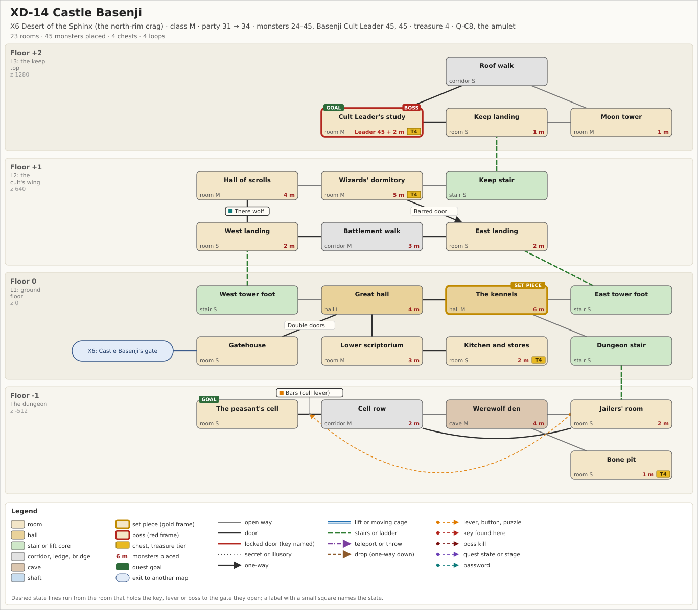
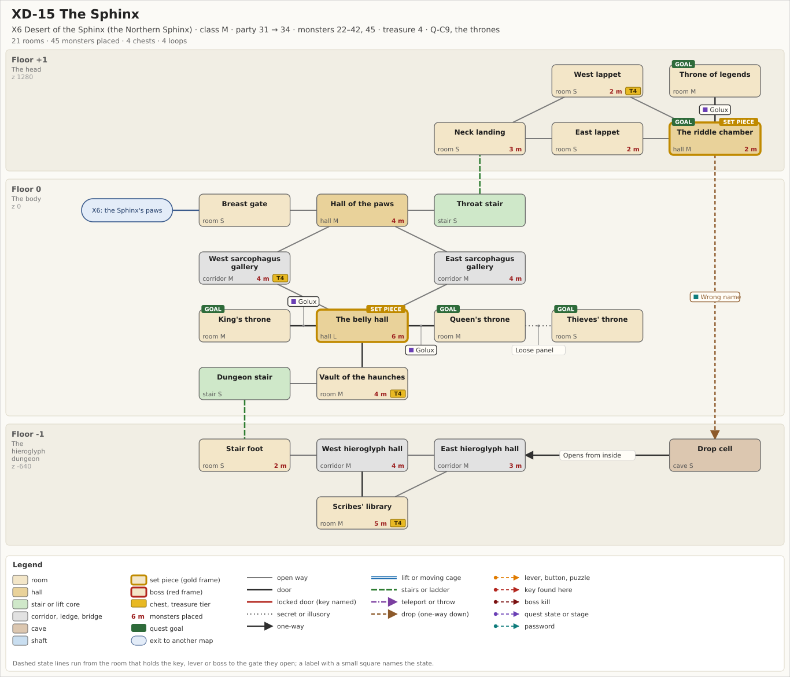
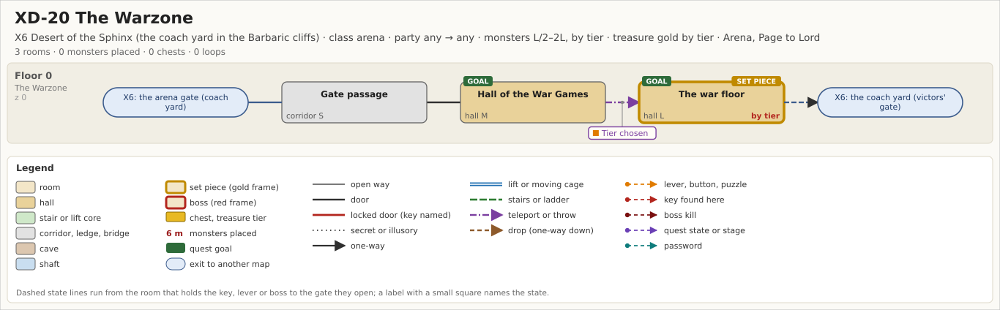
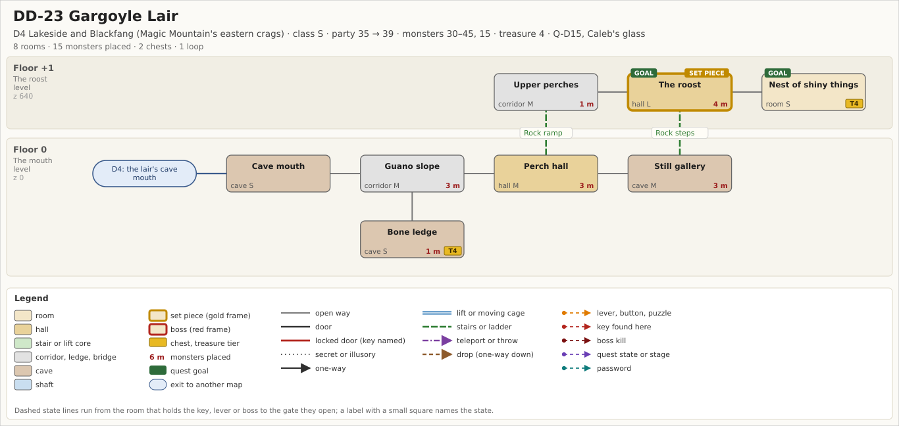
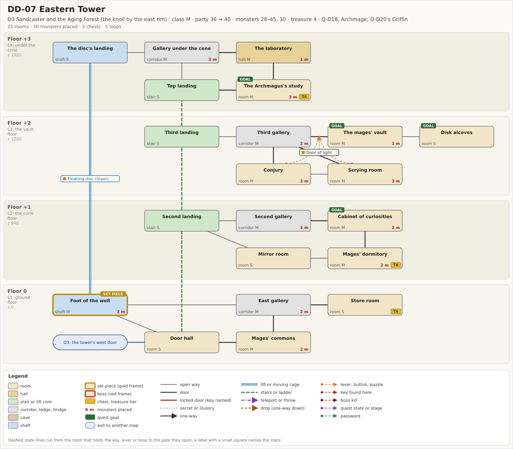

# Act IV dungeon graphs, lane A7 (MU-6)

Review page for phase 4, 2026-11-20, lane A7 (`xeen-a7`). A7's five Act IV maps (Unmasking, party 30 → 42) as room
graphs and state graphs before any geometry: XD-14 Castle Basenji, XD-15 The Sphinx, XD-20 The Warzone (all on X6
Desert of the Sphinx), DD-23 Gargoyle Lair (D4) and DD-07 Eastern Tower (D3, moved to Act IV by D-9.3). These are
review documents, not briefs; each L1 starts from its graph file once a decider has answered the DECIDE items below.
A8's Act IV graphs share the folder ([notes_dd05.md](act4_graphs/notes_dd05.md),
[notes_dd19.md](act4_graphs/notes_dd19.md), and since then [notes_dd12.md](act4_graphs/notes_dd12.md) and
[notes_dd20.md](act4_graphs/notes_dd20.md)).

**Reading the pictures:** as on the Act II page ([act2_dungeon_graphs.md](act2_dungeon_graphs.md), "How to read the
pictures"). One band per floor, the highest on top, its height in game units under its name; rooms left to right
roughly along the critical path; box colour by kind (room, hall, stair or lift core, corridor or ledge, cave, shaft);
gold frame set piece, red frame boss, green tag quest goal, red "6 m" monsters placed, gold "T4" a chest of that tier;
one line style per connection kind (open, door, locked, secret, one-way, lift, stairs, teleport, drop); a label with a
small square names the state that opens a connection (orange lever or puzzle, purple quest state, teal password), and a
dashed line of its colour runs from the room that holds the lever to the gate. Blue pills are exits; a dashed arrow is
a one-way exit.

**Files:** [act4_graphs/](act4_graphs/): `<key>.graph.yml` (spaces, links, states, exits, hooks, critical path,
loops, lines, textures, open questions with options and a recommendation; `monsters.mix` lists the placed rows with
their ids, `kill_xp` the sum) and `<key>.svg`. Redraw with
`python3 devdocs/xeen/mockups/act4_graphs/render_graphs.py xd14 xd15 xd20 dd23 dd07` (naming the keys leaves A8's
pictures alone); it prints no overlap for the five.

**Rules used for all five** (the Act II and III pages' rules, the decisions D-4, D-25 to D-37 and the user's rules of
2026-11-20 in `lanes/README.md`):
- Sizes and counts inside the class bands (MAPS, Dungeons) and the Act IV rows of MAPS §0: XD-14+15 a group of 90
  monsters at 22–45 and 25.3k; DD-05+20+23 a group of 100 at 24–45 and 30.5k; DD-07 30 at 28–48 and 11.2k (D-9.3);
  XD-20 by tier. Kill XP per member is L(L+10) per kill over four. A2's rows by id; a missing row is a request.
- Every M dungeon has a loop; every dead end holds a chest, a lever, a find or a goal.
- No riddle the game does not answer: "There wolf" is on Arie's note (autonote 4220) and in the trapped peasant's
  mouth; GOLUX is said by Arie after Q-C8, the Basenji peasant, Alexander in Shangri-La and the hieroglyph walls under
  the Sphinx itself. The Basenji scrolls show their names on hover, so reading one is the party's choice.
- Every locked door's key is placed and named; DD-07's vault has no key: its door of light is fed by two pylons.
- Only engine words that exist: doors (two leaves for every double door: the three X6 portals, Basenji's great hall),
  lifts (DD-07's disc, L4 and L1 only), levers, qbits, destructibles (DD-07's pylons, DD-23's roosting rocks), open sky
  over a BLV room (`sky: true`: Basenji's battlements and moon tower, the Warzone's floor, the gargoyles' roost), text
  prompts, step messages, chests, the engine's arena (`arena` scene block, topic 704). Anything else is a DECIDE item.
- Lamps on walls, ceilings or floors only; props by the walls, never on a walking line; one-off pictures (the Sphinx's
  hieroglyph plaques, the mirror) once per face; no monster here needs penning by a low opening (D-32).
- Permanent rewards at MM6–MM8 size: stats +2, resistances +5, no levels (the source's +5 stats, +10 resistances,
  +50 Intellect, +5 levels are rescaled or dropped; DECIDE items).
- Every exit is the `exit` preset (D-24); the source's "Leave Castle Basenji?", "Leave the Sphinx?", "Exit the
  Warzone?" and "Exit the Great Eastern Tower?" stay in the ledger as its meaning. Every inside entrance is named
  after the map it is entered from (`entrance:x6_gate`; lanes/README).
- The first room past each door is quiet (D-11.3), except the Warzone, which holds no monster until a challenge.
- Every hook A3 names for these maps is placed (each graph's `hooks`).

| Dungeon | Map | Class | Rooms | Monsters | Kill XP per member (MAPS) | Chests | Loops | Set piece |
| --- | --- | --- | --: | --: | --- | --: | --: | --- |
| XD-14 Castle Basenji | X6 | M | 23 | 45 | 14.00k (group XD-14+15: 26.85k of 25.3k, +6 %) | 4 | 4 | The werewolf kennels; the door that asks for the password |
| XD-15 The Sphinx | X6 | M | 21 | 45 | 12.85k | 4 | 4 | The riddle chamber in the head; the throne doors |
| XD-20 The Warzone | X6 | arena | 3 | by tier | not counted (repeatable) | 0 | 0 | The war floor in a crater of the Barbaric cliffs |
| DD-23 Gargoyle Lair | D4 | S | 8 | 15 | 5.13k (group DD-05+20+23 with A8's: 32.84k of 30.5k, +8 %) | 2 | 1 | The roost under a crack of sky |
| DD-07 Eastern Tower | D3 | M | 21 | 30 | 11.57k (11.2k, +3 %) | 3 | 5 | The levitation well and its floating disc |

Rooms are review rooms (about one sector each); the sizes in sectors and M units² are in each graph's `size`.

---

## XD-14 Castle Basenji

X6 · M · party 31 → 34 · 24–45, the Basenji Cult Leader 45 · 45 · treasure 4 · Q-C8 (the Scroll of Insight; Arie's
amulet for Q-C9)

The source's castle of a wizard cult (xeen maze0067–0070: three floors and a dungeon) as one BLV of four floors 640
apart (the dungeon −512). 23 review rooms, about 27 sectors, about 38 M units², 9 doors.

- **What it is.** The cult that killed Arie's master keeps werewolves as hounds. Their kennels fill the ground floor
  under the great hall; the cult's own wing on L2 is behind a door that asks for a password; the Cult Leader sits in
  the keep's top with the stolen Scroll of Insight on his desk.
- **Critical path.** The gatehouse; the great hall (double doors, two leaves); the west tower's stair; L2's west
  landing, where the door asks "STOP!  What is the password?" ("There wolf"); the hall of scrolls; the wizards'
  dormitory; the keep stair; the keep landing; the Cult Leader's study (the scroll, `q-c8.scroll`). Back: the
  dormitory's barred door (lifted from inside) to the east landing and down the east tower to the kennels.
- **Off the path.** The kennels (set piece) and the dungeon stair: the jailers' room (the cell lever), the werewolf
  den, the cell row and the peasant's cell (`q-c8.peasant`, the hint; freed, 500 experience), the bone pit (a chest,
  the curse scrolls of Death and Insanity). The lower scriptorium and the kitchen (chest). The battlement walk and the
  moon tower under open sky.
- **Loops (4).** Up one tower, over the battlements, down the other (open without the password); through the cult's
  wing and out by its barred door; round the dungeon; round the keep's top through the study's two doors.
- **Set piece.** The kennels: iron pens with open gates round a sunken feeding pit, straw beds with the source's
  "Werewolf Bed", collars on chains; and the password door with its grille.
- **Monsters and treasure.** Werewolf 30 (11421) × 18, Greater Werewolf 40 (11422) × 2, Wizard 36 (11190) × 6,
  Sorcerer 45 (11191) × 2, and two rows A2 adds: Cult Acolyte 24 (wizards D, 11197) × 16 and the Basenji Cult Leader 45
  (wizards boss, 11198). 45 monsters, **14.00k per member** (56,017 / 4). With XD-15's 12.85k the group comes to
  26.85k against 25.3k (+6 %), 90 monsters as MAPS. One peaceful prisoner (Trapped Peasant, madmen D 11233, not
  counted). Chests T4 × 4: the kitchen, the bone pit, the dormitory, the study.
- **Scrolls** (the source's readable scrolls, Linguist dropped; the name on hover): blessings once per character, Fire,
  Electricity, Magic, Energy +5 to Fire, Air, Mind, Earth (D-4's brew mapping), Intellect, Personality, Speed +2;
  curses every read, Depression, Confusion, Insanity, Weakness, Death, Aging as conditions and ten years (DECIDE 3).
- **Original lines.** xeen/aaze0068:14 "Leave Castle Basenji?" (the exit's meaning); aaze0069:10 "STOP!  What is the
  password?" and the answers :8, :16; aaze0067:2–4 the Trapped Peasant, "Thank you for saving me!", the cult leader's
  "There wolf"; the beds aaze0067:1, :10, aaze0068:1; the scroll names aaze0068:2–7, aaze0069:0–4, aaze0070:0–6;
  aaze0069:15 the aging line (rescaled). X6's "Castle Basenji.  Enter?" (aaze0001:19) is A5's.
- **Door to X6.** The gatehouse on the terrace at 2,592: X6's `thing:castle_basenji` door at (−13312, 15507, 2592),
  384 × 256, two leaves, facing south. **Inside arrival proposed for A5:** `entrance:x6_gate`, in the gatehouse about
  256 inside the leaves, facing north (512), the great hall's doors ahead. The way out returns to X6 (−13312, 15104,
  2592) facing south (1536), on the terrace before the gatehouse.
- **Hooks.** `q-c8.peasant` (the cell), `q-c8.l2_door` and `q-c8.l2_wrong` (the password door), `q-c8.scroll` (the
  study). Arie's note and `q-c8.done` are X6's.
- **Textures.** MM6 Castle Alamos cd1 throughout (dungeon_families castles names it for Basenji), matching X6's grey
  rubble and black plank cones; about 28 of 45, 0 new.

## XD-15 The Sphinx

X6 · M · party 31 → 34 · 22–42 · 45 · treasure 4 · Q-C9 (the name, the four thrones)

The source's Sphinx (xeen maze0082 body, 0083 head, 0084 dungeon) as one BLV, as MAPS asks: the body at the door's
level, the head 1,280 above it, the hieroglyph dungeon 640 below. 21 review rooms, about 26 sectors, about 40 M units²,
9 doors.

- **What it is.** Arie's amulet opens the breast between the paws (X6's `q-c9.door`). Inside the head the Sphinx asks
  its name; GOLUX opens the four thrones; anything else drops the party into the hieroglyph dungeon, whose walls spell
  the name and whose stair climbs back to the body.
- **Critical path.** The breast gate; the hall of the paws; the throat stair; the neck landing; a lappet; the riddle
  chamber (`q-c9.riddle`, GOLUX: `q-c9.name_right`); the throne of legends behind the door that opens with the name.
  Back down to the belly hall: the King's and Queen's thrones, the Thieves' throne behind a loose panel in the Queen's.
- **Off the path.** The two sarcophagus galleries along the flanks (the west one's great sarcophagus is a chest behind
  a Might check), the vault of the haunches (chest) and the dungeon stair; the dungeon (stair foot, the two hieroglyph
  halls, the scribes' library with its chest and the fifth clue, the drop cell). The dungeon is open by its stair
  without the drop.
- **Loops (4).** Round the body by the two galleries; round the head by both lappets; round the dungeon's halls
  through the library; and the wrong name's way: down by the floor, up by the dungeon stair, back to the head.
- **Set piece.** The riddle chamber behind the face: two bars of light from the eyes, two hieroglyph plaques, the sun
  disc on the floor that asks and sinks (`xeen_sphinx_stir`, AUDIO 62506, when the name is said and when the floor
  drops); below, the belly hall's three sealed throne doors carved with a crown, a veil and a mask.
- **Monsters and treasure.** Sand Golem 22 (11590) × 16, Stone Golem 26 (11581) × 18, Iron Golem 40 (11582) × 4,
  Tomb Mummy 42 (11270) × 7: the source's "Mummies, Stone and Earth Golems", no boss. 45 monsters, **12.85k per
  member** (51,400 / 4). Chests T4 × 4: the west gallery's sarcophagus, the haunch vault, the west lappet, the library;
  gem finds in the east lappet and the east gallery.
- **The thrones.** King (Might), Queen (Personality), Thieves (Accuracy; player bit 11302, which DD-06's Prince Book
  reads), Legend (Endurance, the source's five race thrones as one with the old names carved in it): once per
  character by player bits 11300–11303, needing `q-c9.done`. A3's file gives +5; the rule says +2 (DECIDE 1).
- **Original lines.** xeen/aaze0082:12 "Leave the Sphinx?" (the exit's meaning); aaze0082:1–6 the plaques, the voice,
  "golux", "Wrong!"; :8–10 the thrones; :7, :11, :15 the sarcophagi; :13–14 and aaze0084:9 the stair signs;
  aaze0083:0–4, :9–16 the race thrones, gems and books; aaze0084:2–6 the five clues; aaze0084:7–8, :11, :13 the
  dungeon's books.
- **Door to X6.** The breast between the forelegs: X6's `thing:northern_sphinx` door at (9216, 10240, 1408), 384 × 256,
  two leaves (egydrlgl), facing south. **Inside arrival proposed for A5:** `entrance:x6_paws`, in the breast gate
  about 256 inside the leaves, facing north (512), the paw hall ahead. The way out returns to X6 (9216, 9728, 1408)
  facing south (1536), between the paws' tips, clear of the obelisks' hoard mound by the east foreleg.
- **Hooks.** `q-c9.riddle`, `name_right`, `name_wrong` (the riddle chamber), `q-c9.hieroglyphs` (the clue walls),
  `throne_king`, `throne_queen`, `throne_thieves`, `throne_legend`, `throne_sat` (the throne rooms). `q-c9.door` and
  `obelisks.cloud_hoard` are X6's.
- **Textures.** MM6 Tomb of VARN (pyramid.blv) upper levels throughout (dungeon_families temples names it for XD-15):
  egy block walls, hieroglyph walls for the plaques and the dungeon, carved ceilings, egycol64 striped columns as X6's
  nemes; about 26 of 45, 0 new. FD-02 (phase 6) takes the darker lower set.

## XD-20 The Warzone

X6 · arena · any party · by tier · gold by tier · the arena (QUESTS: MM6–MM8 arena with four tiers, Page to Lord)

The source's Warzone (xeen maze0085: one round arena, waves chosen by the arena master, the party sent home after a
win) as the engine's MM6–MM8 arena (`game/gameplay/ArenaRuntime.cpp`; MM7's 7d05 is the model). Three review rooms,
about 6 sectors, about 9 M units², 3 doors.

- **What it is.** The party arrives by Gorm's coach in X6's walled coach yard (D-8.1) or over the desert once the
  yard's gate is open, and enters by the portal in the Barbaric cliff. In the lodge the Arena Master's booth window
  offers Page, Squire, Knight or Lord (topic 704); the engine draws the opponents and moves the party onto the floor.
  When every opponent is dead, the booth window pays gold and adds the tier's award; the party leaves by the victors'
  gate to the coach yard. One challenge per visit.
- **Critical path.** The gate passage, the lodge (the master), the war floor (by the master's move), the victors' gate.
- **Set piece.** The war floor: a round sand floor about 2,400 across in a crater of the Barbaric cliffs, open to the
  sky (`sky: true`, so Knight and Lord can draw dragons), a ring wall 512 high with four barred beast gates (dressing),
  the master's booth over the north gate, bones by the wall. The scene's `arena` block holds the party's mark in the
  middle facing north and at least 20 marks round the ring.
- **Monsters.** None placed. The engine's tiers by the party's highest level L: Page L/2–L, 6–8 opponents, 50 × L
  gold; Squire L/2–1.5L, 6–12, 100 × L; Knight L/2–2L, 10–20, 200 × L; Lord L–2L, 20, 500 × L. The pool is Xeen's rows
  11010–11699 less those A2 marks NoArena (DECIDE 1). Kill XP not counted in any act.
- **Original lines.** xeen/aaze0085:0 (the master's greeting), :1 (his dismissal), :2 (the step onto the mark), :3
  (the victory, adapted: "... Gorm's coach waits in the yard." for "back to Vertigo"), :4 (before the last opponent
  dies), :5–6 (the bones), :7 "Exit the Warzone?" (the victors' gate's meaning). X6's "Enter the War Zone?"
  (aaze0006:4) is A5's. MAPS's "No. Goodbye..." is not in aaze0085 (DECIDE 3).
- **Doors to X6.** The arena portal: X6's `thing:arena_gate` door at (12640, −15872, 1504), 384 × 256, two leaves,
  facing west into the coach yard. **Inside arrival proposed for A5:** `entrance:x6_yard`, in the gate passage about
  256 inside the leaves, facing east (0). Both ways out (the passage and the victors' gate) return to X6 (12128,
  −15872, 1504) facing west (1024), in the yard before the portal; `warzone_coach` (11264, −16384) stays the coach's
  point.
- **Hooks.** None (no quest names it). The yard gate's `x6.warzone_gate` is X6's.
- **Textures.** MM7 The Arena 7d05 (sand floor, sandstone ring wall, the stands' stone) for the floor and the lodge,
  X6's Barbaric red rock in the passage; about 14 of 30, 0 new.

## DD-23 Gargoyle Lair

D4 · S · party 35 → 39 · 30–45 · 15 · treasure 4 · Q-D15 (Caleb's Magnifying Glass)

The source has no lair map: Darkside F1 asks "Do you wish to destroy the Gargoyle Lair?" at a spot on the map
(dark/aaze0021:6–7). Ours is a small cave in Magic Mountain's eastern crags at D4's `entrance:dd23_lair` (46, 42), on
two levels 640 apart. 8 review rooms, about 11 sectors, about 13 M units², no doors (S: at most 15 sectors and 20 M
units²).

- **What it is.** The gargoyles that loiter round Caleb's tent roost here; they collect shiny things. The party climbs
  to the roost, pounds the roosting rocks to powder and takes Caleb's glass from the nest beside it.
- **Critical path.** The cave mouth; the guano slope; the perch hall; the rock ramp to the upper perches; the roost
  (`q-d15.roost`); the nest (`q-d15.glass`).
- **Off the path.** The bone ledge (a climber's pack, the chest); the still gallery, where three of the "statues" are
  gargoyles.
- **Loop (1).** Up by the ramp and the ledge walk, down by the rock steps and the still gallery.
- **Set piece.** The roost: a tall cave under a crack of sky (`sky: true`, D4's Darkside sky), snow sifting onto the
  droppings, a ring of roosting rocks worn smooth (indoor destructibles); the map's question breaks them and they stay
  broken.
- **Monsters and treasure.** D4's own gargoyles: Mountain Gargoyle 30 (11550) × 12, Gargoyle Sentinel 38 (11551) × 2,
  Gargoyle Overlord 45 (11552) × 1 on the highest rock. 15 monsters (the S floor, as A8 assumed for DD-20), **5.13k per
  member** (20,523 / 4). With A8's DD-05 (45, 14.29k) and DD-20 (45, 13.42k) the group comes to 105 monsters and
  32.84k against 30.5k (+8 %). Chests T4 × 2: the bone ledge, the nest.
- **Original lines.** dark/aaze0021:6 "Do you wish to destroy the Gargoyle Lair?" (the roost's question); :7 "With
  great effort, you pound roosting rocks to powder and scatter the dust to the wind." (A3's hook, experience dropped).
- **Door to D4.** The open cave mouth (no leaves, A6's plan) at (46, 42), about (−9216, 11264, 2700), facing south
  under the perches; `q-d15.lair_door`'s line on approach, then the entrance preset. **Inside arrival proposed for
  A6:** `entrance:d4_mouth`, about 256 inside the mouth, facing north (512). The way out returns to D4 (−9216, 10752,
  about 2,700) facing south (1536), at the goat path's end.
- **Hooks.** `q-d15.roost` (the roost), `q-d15.glass` (the nest); `q-d15.lair_door` is D4's.
- **Textures.** Proposed MM7 Thunderfist 7d07's grey mountain rock with MM6 straw on the nest and D4's snow under the
  crack, so it does not repeat XD-26's brown 7d36 (DECIDE 3); about 12 of 30, 0 new.

## DD-07 Eastern Tower

D3 · M · party 36 → 40 · 28–45 · 30 · treasure 4 · Q-D18 (the Jewel of Ages, the Archmage), Q-D20 (the Griffin)

The source's Great Eastern Tower (dark maze0065–0068, four levels) as one BLV of four floors 640 apart. 21 review
rooms, about 25 sectors, about 30 M units², 10 doors.

- **What it is, and how it differs from DD-05.** Its twin DD-05 (A8) is entered at the top by a rope and has two
  stairs between each pair of floors. DD-07 is entered at the foot by D3's west door with Q-D19's key. Its floors are
  galleries round an open **well** that rises from the ground floor to the cone. The mages float across the well, and
  one spiral stair climbs the wall. From L4 the **floating disc** rides the well back down to the door hall.
- **Critical path.** The door hall; the spiral stair to L3; the third gallery; the conjury and the scrying room (break
  the two ward pylons); the mages' vault behind its door of light (the Jewel, `q-d18.jewel`) and the disk alcoves
  (`q-d18.l3_disks`); on up to L4's top landing and the Archmagus's study (Ellinger's letter, `q-d18.letter`). Back
  by the laboratory and the gallery to the disc's landing; its lever sends the disc and the party down.
- **Off the path.** L1's gallery, commons and store room (chest); L2's gallery, the cabinet of curiosities (the Golden
  Griffin, `q-d20.griffin`), the dormitory (chest) and the dead mirror; L4's laboratory (the Fountain of Minimal
  Abilities, the Fountain of Life, the Bubbling Vat).
- **Loops (5).** Round each floor's well (L1, L2, L4); L3's pylon rooms joined by the passage in the wall; and the
  stair up, the disc down.
- **Set piece.** The levitation well with its four galleries, the light from the cone, the floating disc (a two-state
  lift, L4 and L1 only, as DD-02's; it rests at L4 and answers the foot's lever only once sent down).
- **Monsters and treasure.** Floating Adept 28 × 15 and Floating Magus 38 × 9 (two floating-mage tiers A2 adds,
  11203 and 11204), Mystic Mage 45 (11200) × 4, Floating Eye 40 (11570) × 2 for the source's Gamma Gazer. 30 monsters
  (D-9.3), **11.57k per member** (46,276 / 4) against 11.2k (+3 %). Chests T4 × 3: the store, the dormitory, the study.
- **L4's gifts** (rescaled, DECIDE 3): the Fountain of Minimal Abilities +1 to every statistic once per character;
  the Book of Fantastic Knowledge +2 Intellect once per character; the Book of Great Power refuses everyone; the
  Fountain of Life heals; the Bubbling Vat a dressing.
- **Original lines.** dark/aaze0065:0 "Exit the Great Eastern Tower?" (the exit's meaning); aaze0066:1–3 the mirror;
  aaze0067:0–2 "Jewel", "Disc", "Nothing here."; aaze0068:0–12 the vat, the fountains, the two books, the bittersweet
  water.
- **Door to D3.** The tower's west door (hkm1d, one leaf) on its knoll at (97, 46) = (16896, 9216, 1952),
  `q-d18.tower_door`. **Inside arrival proposed for A5:** `entrance:d3_door`, in the door hall about 256 inside the
  door at the foot of the spiral stair, facing east (0). The way out returns to D3 (16384, 9216, 1952) facing west
  (1024), on the knoll before the door.
- **Hooks.** `q-d18.jewel` (the vault), `q-d18.l3_disks` (the alcoves), `q-d18.letter` (the study),
  `q-d20.griffin` (the cabinet); `q-d18.tower_door` is D3's.
- **Textures.** The Towers of Mok family, MM8 Castle of Air d27, as DD-05, DD-06 and DD-08; DD-07's accent is the
  laboratory and study in MM7 School of Sorcery 7d14 (DECIDE 6); XD-04's light texture on the vault's door; D-37's
  `xkmirror` on the dead mirror; about 26 of 45, 0 new.

---

## The surface maps' doors against the graphs

| Dungeon | Surface door (lane's L4 or L1) | Graph | Match |
| --- | --- | --- | --- |
| XD-14 | X6 `thing:castle_basenji` (−13312, 15507, 2592), 384 × 256, two leaves, facing south (A5's DOORS.md) | gatehouse with two leaves, arrival facing north | Match. The studio's 256-high door until A1's paired-leaf word (A5's note) |
| XD-15 | X6 `thing:northern_sphinx` (9216, 10240, 1408), 384 × 256, two leaves egydrlgl, facing south between the forelegs | breast gate, arrival facing north | Match. The head is 1,280 over the body inside; X6's head top is about 2,400 over the ground (inside larger than the shell, as shipped interiors) |
| XD-20 | X6 `thing:arena_gate` (12640, −15872, 1504), 384 × 256, two leaves, facing west into the coach yard | gate passage, arrival facing east; the victors' gate leads to the same yard point | Match (D-8.1: no spawn in the yard) |
| DD-23 | D4 `entrance:dd23_lair` (46, 42), h 2,700, open cave mouth facing south (A6's L1) | cave mouth, arrival facing north | Match at L1 (D4 has no L3 yet) |
| DD-07 | D3 `thing:eastern_tower` door (97, 46), floor 1,952, one leaf hkm1d, facing west (A5's DOORS.md) | door hall at the stair's foot, arrival facing east | Match |

---

## DECIDE items, by map

Each graph file holds its questions with the options, the evidence and the dependencies; the proposed default is
marked "proposed".

**XD-14 Castle Basenji**
1. **Count and XP.** 45 monsters with 16 Cult Acolytes 24 (a new wizards tier): 14.00k, the XD-14+15 group 26.85k
   (+6 %) (proposed); Wolfman 20 for the acolytes (under the band's 22), 13.6k; or 38 without them, under the M floor.
2. **The Cult Leader.** A wizards boss row 11198 "Basenji Cult Leader" 45, look B, hp_x 3, blink on hit 0.2
   (proposed); the same name as DD-05's "Cult Leader" (two rows, one name); or an ordinary Sorcerer at the desk.
3. **The scrolls.** Blessings once per character: Intellect, Personality, Speed +2; Fire, Electricity → Air, Magic →
   Mind, Energy → Earth +5. Curses on every read: Depression → Afraid, Confusion → Drunk, Insanity → Insane, Weakness →
   Weak, Death → Unconscious, Aging → ten years, which Thaddeus's fountain on D3 takes back after Q-D18. Seven player
   bits (proposed). Or the source's 25 years and Death → Dead; or blessings only.
4. **The trapped peasant.** A peaceful row (madmen D 11233, Insane Beggar look, his own faction) behind bars that the
   jailers' lever raises; freeing him gives 500 experience per member once through a new A3 hook
   `q-c8.peasant_freed`, and he is hidden after (proposed). Or a chained decoration that only talks; or freeing
   without experience.
5. **The dormitory's barred door.** One-way, so the wing is entered only by the password (proposed), or an ordinary
   door.
6. **Inside against outside.** The interior larger than X6's castle (proposed), or A5 widens it.

**XD-15 The Sphinx**
1. **The thrones' size.** +2 per throne once per character, A3 edits the four texts (proposed); +5 as A3 wrote; or +3.
2. **The hieroglyph clues.** Five walls, one clue each (drop cell, west hall, east hall × 2, library), A3's whole
   text as the library's summary (proposed); or one wall with all five.
3. **The spell books.** Starburst and Divine Intervention spellbooks in the head (MM7 has both); the dungeon's Teleport
   and Item to Gold (no MM7 spells) dropped for gems (proposed); or Town Portal and Lloyd's Beacon for them; or lore
   books only.
4. **The sarcophagus' Might check.** Might 40 on the clicking member, potions counting, with a fixed Might potion in
   the haunch vault's chest (proposed); or no check.
5. **The drop.** The sun disc sinks, the party is moved to the drop cell with fall damage, the disc rises after 2 s
   (proposed); or the move alone.
6. **Monster levels.** MAPS's dungeon table says 28–45, its §0 group row 22–45: keep X6's Sand Golems 22 and the
   Stone Golems 26 and correct the dungeon row (proposed); or Water Golems 28 and more mummies (about +3k).

**XD-20 The Warzone**
1. **The pool.** All Xeen rows 11010–11699 with A2 marking NoArena on bosses, peaceful and placed-only tiers, the
   octopods and Kraken and rows too tall for the beast gates (proposed); or a Cloudside-only range.
2. **Its weight.** Kill XP not counted, gold by the engine's tiers, the engine's awards 46–49 with Xeen wording
   (proposed); or one win per tier.
3. **The arena master.** A4 adds "the Arena Master" (X6's NPC block, e.g. 4609) with topic 704 and the source's
   greeting; the lodge's and the floor's booth windows call him; MAPS's "No. Goodbye..." (not in aaze0085) replaced by
   aaze0085:0–4 (proposed); or keep it if A3 finds its source.
4. **Sounds.** No Xeen sound: the engine's MM7 heroism (14060) stays; the planned arena gong waits for an arena start
   hook from A1 (proposed); or a gong on the floor mark's step event.
5. **The floor's open sky.** A crater floor under `sky: true` faces so dragons fit (proposed), or a roofed hall about
   1,200 high with the tall rows NoArena.

**DD-23 Gargoyle Lair**
1. **Count and XP.** 15 monsters, 5.13k, the DD-05+20+23 group 105 and 32.84k (+8 %) (proposed); or 18, 6.19k, the
   group 108 and 33.9k (+11 %).
2. **The roost's elder.** One Gargoyle Overlord 45 (an ordinary tier over MAPS's 24–40, inside the group's 24–45)
   (proposed); a Sentinel 38; or a new boss row.
3. **Textures.** MM7 Thunderfist 7d07's grey rock with D4's snow (proposed), or XD-26's 7d36.
4. **Doors.** None, a natural cave with D4's open mouth (proposed), against the S band's 3–8; or a wicker screen at the
   nest and a rockfall slab at the bone ledge.
5. **After the roost is destroyed.** The rocks stay broken, the remaining gargoyles stay (proposed); or a stage that
   hides them on the next load and thins D4's markers by the mouth.

**DD-07 Eastern Tower**
1. **Rows.** Two lower floating-mage tiers from A2, Floating Adept 28 (11203) and Floating Magus 38 (11204), the
   Mystic Mage 45 on top, two Floating Eyes 40 for the Gamma Gazer: 11.57k, +3 % (proposed). Or Sandcaster's
   Sorceresses and Enchantresses as the lower ranks (walking); or Mystic Mages only (18.6k, +66 %).
2. **Count against class.** M by size with D-9.3's 30 monsters (proposed); 45 at the M floor (+55 %); S is too small
   for four floors and a well.
3. **L4's gifts.** The fountain +1 to every statistic, the Book of Fantastic Knowledge +2 Intellect, each once per
   character (two player bits); the Book of Great Power refuses; the vat is dressing (proposed). Or the vat ages ten
   years for +2 Endurance; or the fountain +2 to one statistic.
4. **The vault's lock.** A door of light fed by two destructible pylons in the rooms either side (proposed); a key
   on a Mystic Mage in the study; or an open vault.
5. **The dead mirror.** Flavour with `xkmirror`, "The mirror does not respond." (proposed); or left out as DD-06's.
6. **The accent.** MM7 School of Sorcery 7d14 for L4's laboratory and study (proposed); MM6 Agar's Laboratory 6d19
   (DD-02's, same face); or d27 throughout.
7. **Inside against outside.** The interior larger than D3's tower (proposed), or A5 widens it.

---

## Requests to other lanes (on the proposed defaults)

- **A2 (rows and values).**
  - Wizards: D tier 11197 "Cult Acolyte" (24, look A, Fire Bolt E) and boss 11198 "Basenji Cult Leader" (45, look B,
    hp_x 3, blink 0.2).
  - Madmen: D tier 11233 "Trapped Peasant" (4, Insane Beggar look, faction `basenji_prisoner`, friendly, placed only).
  - Floating mages: D 11203 "Floating Adept" (28), E 11204 "Floating Magus" (38), and `fly: Y` on the family. Add the
    Eastern Tower to the eyes' `where` and the Northern Sphinx to the pyramid mummies'.
  - XD-20: the NoArena kind on every boss row, every peaceful or placed-only tier, the octopods, the Kraken and rows
    too tall for the floor.
  - Fixed items: a Might potion in XD-15's haunch vault; the Starburst and Divine Intervention spellbooks in XD-15's
    head.
  - Act IV recount: XD-14+15 26.85k, DD-05+20+23 32.84k with A8's two, DD-07 11.57k. Values: the Basenji scrolls,
    the four thrones, DD-07's two gifts.
- **A3 (hooks and lines).**
  - `q-c8.peasant_freed` ("Thank you for saving me!", 500 experience per member, once).
  - Player bits: seven for XD-14's blessing scrolls and two for DD-07's fountain and book, from the free block after
    11317. Condition and age lines for the curses.
  - The four throne texts at the decided size. Award rows 46–49 (the engine's arena wins) worded for Xeen.
  - ORIGINAL_LINES rows for the lines listed in each graph: the five hieroglyph clues as map-local signs, the arena
    master's aaze0085:0–4, the adapted victory line.
- **A4.** The Arena Master NPC (X6's block) with topic 704 and the greeting aaze0085:0.
- **A5 (X6, D3).** The three X6 inside arrivals and return points above (`entrance:x6_gate`, `entrance:x6_paws`,
  `entrance:x6_yard`) and D3's `entrance:d3_door`; the doors stay sealed until each map is installed.
- **A6 (D4, kits).** DD-23's `entrance:d4_mouth` and its return point. dungeon_families lines: DD-23 MM7 7d07, DD-07's
  accent MM7 7d14, XD-20 MM7 7d05.
- **The orchestrator (MAPS).** XD-15's dungeon row 28–45 → 22–45 (as §0); line 439's XD-20 entry → aaze0085:0–4.
- **A1.** Nothing is required. An arena start hook is needed only if the gong is wanted (XD-20 DECIDE 4).
