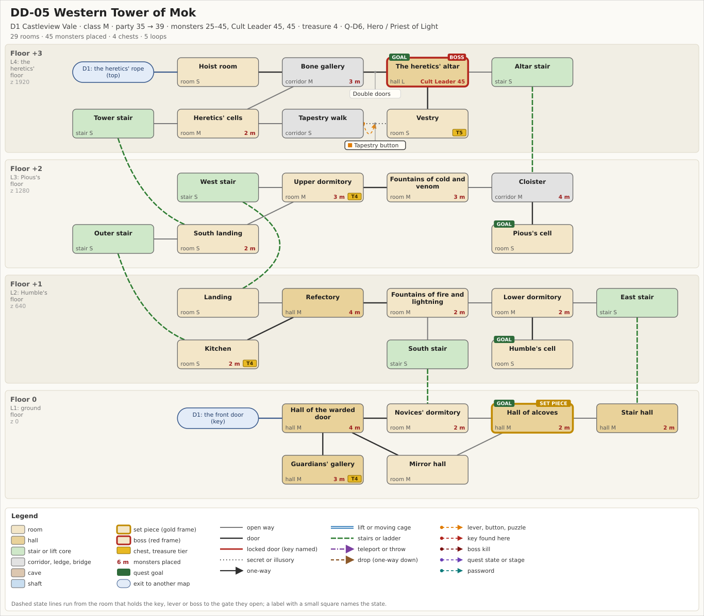
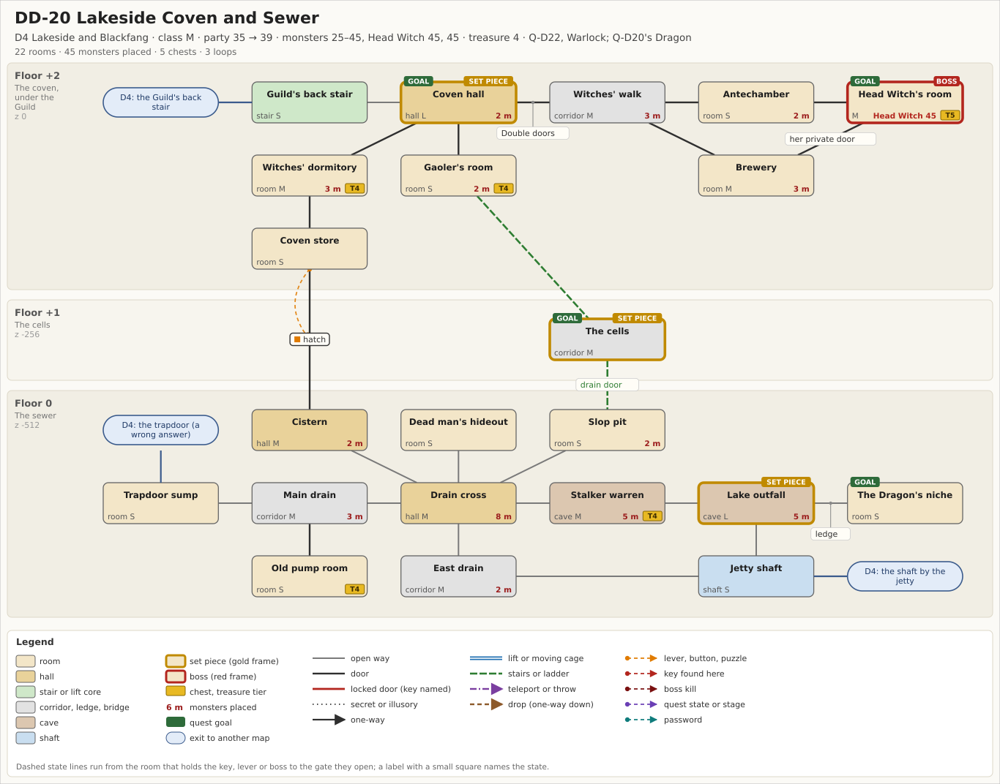
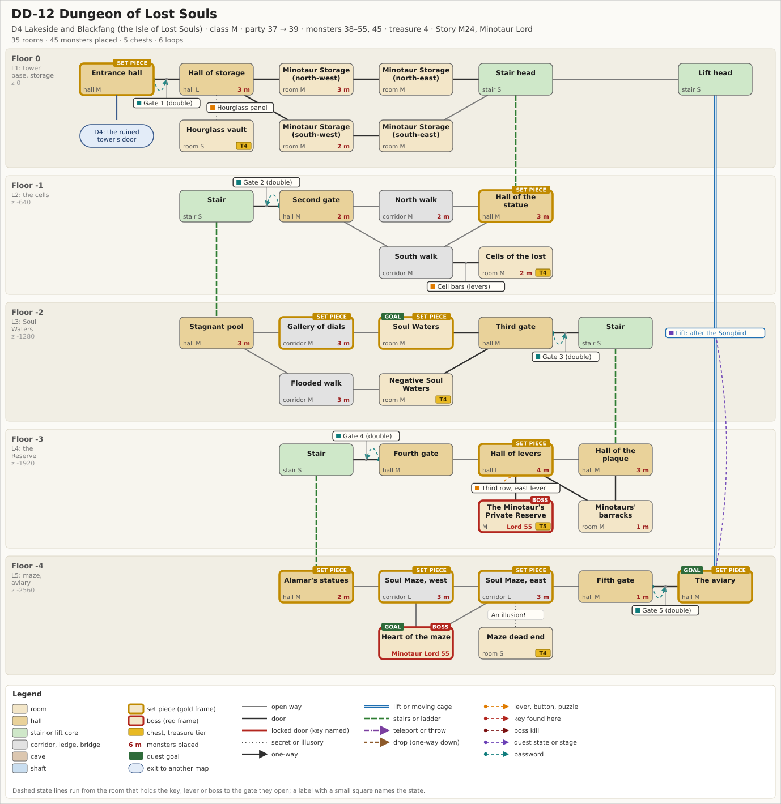
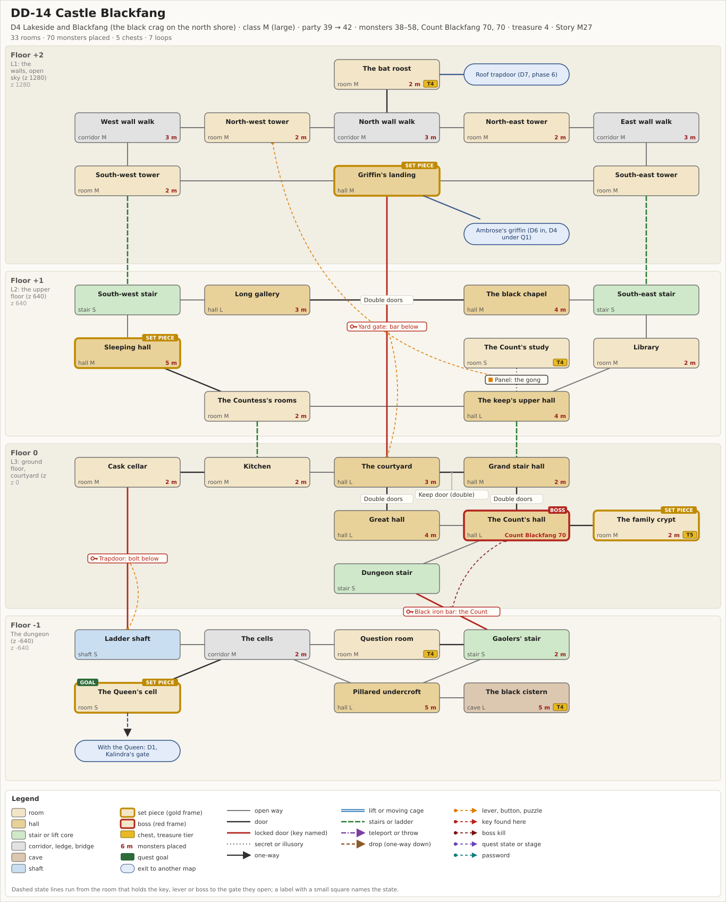
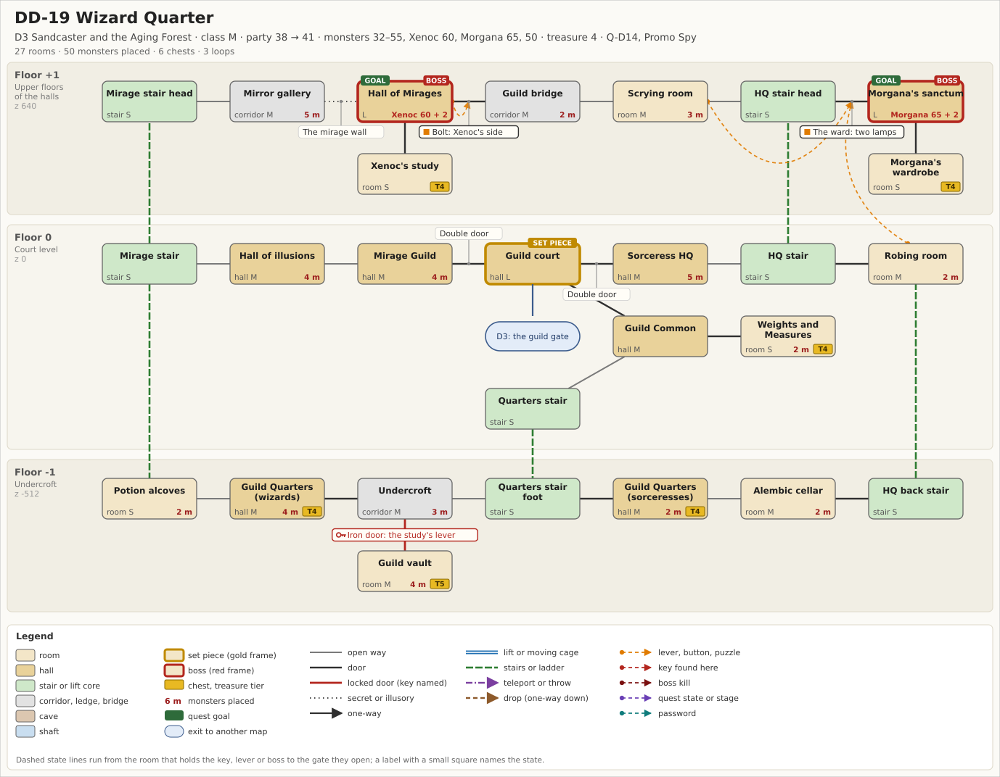

# Act IV dungeon graphs, lane A8 (MU-6)

Review page for phase 4, 2026-11-20, lane A8 (`xeen-a8`), for a decider. A8's five Act IV dungeons as room graphs and
state graphs before any geometry: DD-05 Western Tower of Mok, DD-20 Lakeside Coven and Sewer, DD-12 Dungeon of Lost
Souls, DD-14 Castle Blackfang, DD-19 Wizard Quarter. Review documents, not briefs; each L1 starts from its graph file.
A7's Act IV graphs may share the folder.

**Reading the pictures:** as on the Act III page ([act3_dungeon_graphs.md](act3_dungeon_graphs.md)): one band per
floor, rooms left to right along the critical path, box colour by kind, gold frame set piece, red frame boss, "6 m"
monsters placed, "T2" a chest of that tier, one line style per connection kind, gates labelled with the state that
opens them.

**Files:** [act4_graphs/](act4_graphs/): `<key>.graph.yml`, `<key>.svg` and `notes_<key>.md` (the sections below).
Redraw with `python3 devdocs/xeen/mockups/act4_graphs/render_graphs.py dd05 dd20 dd12 dd14 dd19`.

**Rules used for all five:** the Act III page's (class bands; kill XP per member L(L+10) per kill over four, within about
±10 % of MAPS; a loop in every M dungeon; every dead end holds something; every password has an answer-giver; two-state
mechanisms; rewards at MM6–MM8 size; every exit the `exit` preset, D-24; every A3 hook naming the map placed), plus
D-32 (big monsters kept in by low openings), the user's rules of 2026-11-20 (double doors as pairs, light fixtures where
they can hang, texture fit, no prop on a walking line) and, for DD-20, A2's coven rows 11170–11172 (peaceful once the
party has joined, 113449; hostile again when the Head Witch dies, 113447; her death sets 113447, the cauldron 113449),
which the build uses in place of any coven row the graph names.

**The DD-05 + DD-20 + DD-23 group** (MAPS: 100 monsters, 30.5k): DD-05 45 (14.29k) and DD-20 45 (13.42k), both at the
M class floor; with A7's DD-23 at its S floor (15, about 5.3k) the group is about 105 monsters and 33.0k (+8 %). The
decider says whether 45 each stands or the group is cut to MAPS (about 33 per M map, under the class floor).

| Dungeon | Stands on | Class | Rooms | Monsters | Chests | Loops |
| --- | --- | --- | --: | --: | --: | --: |
| DD-05 Western Tower of Mok | D1 | M | 29 | 45 | 4 | 5 |
| DD-20 Lakeside Coven and Sewer | D4 | M | 22 | 45 | 5 | 3 |
| DD-12 Dungeon of Lost Souls | D4 | M | 35 | 45 | 5 | 6 |
| DD-14 Castle Blackfang | D4 | M (large) | 33 | 70 | 5 | 7 |
| DD-19 Wizard Quarter | D3 | M | 27 | 50 | 6 | 3 |

---

## DD-05 Western Tower of Mok

D1 · M · party 35 → 39 · 25–45, the Cult Leader 45 · 45 · treasure 4 (hoard 5) · Q-D6, Hero / Priest of Light; Q-D20's
Pegasus

The source's four-level round tower (dark maze0057–0060) as one BLV of four floors, 640 apart (L1 0, L2 640, L3 1280,
L4 1920; the chapel rises into the cone). The party enters at the **top** by the heretics' rope (D-9.3) and fights down
to the front door. As in the source, each pair of floors has two stairs in different places, so every floor is
crossed and every pair of floors closes a loop. 29 review rooms, about 33 sectors; four floors of about 2,900 across,
about 32 M units².

- **Monsters:** Mok Heretic 25 (22), Heretic Priest 35 (11), Heretic Lord 45 (3), the Cult Leader 45 (a boss row A2
  adds, 11223 proposed). Mok's own guardians, set by the heretics on the warded door and the fountains: Stone Golem 26
  (5), Iron Golem 40 (3). The source's order is kept: strongest at the top (L4 10, L3 12, L2 10, L1 13), with the hoist
  room quiet. Humble and Pious stand on a peaceful row (11224 proposed) and are not counted.
- **Path:** D1's rope; the hoist room (the window, the windlass, the heretics' bread: a storeroom); the bone gallery;
  the double doors into the heretics' altar (the Cult Leader, the key); the altar stair to L3's cloister, the fountains
  of cold and venom (+5 Water, +5 Body), the upper dormitory (T4); the west stair to L2's refectory, the fountains of
  fire and lightning (+5 Fire, +5 Air, two stone guardians), the lower dormitory; the east stair to L1's stair hall,
  the hall of alcoves (2 Energy Disks, the Pegasus), the novices' dormitory, the hall of the warded door (a Heretic
  Lord and three iron guardians), and the front door opened from inside with the key.
- **Off the path:** Pious's cell (L3) and Humble's cell (L2), each behind a door; the heretics' cells and the tapestry
  walk (a button opens a panel into the vestry, where the hoard chest T5 stands); the kitchen (T4); the guardians'
  gallery (T4); the mirror hall (the dead mirror). There are finds in the beds and in the three bone heaps.
- **Loops (5):** round the top floor through the vestry; the two stairs of each pair of floors (L4–L3, L3–L2, L2–L1);
  on the ground floor, the dormitory and the mirror hall each lead from the alcoves to the door.
- **States:** the rope (`rope_climbed`, D1's event); the tapestry button (two-state panel); the Cult Leader's death;
  the key on the altar, which opens the front door from inside (`q-d6.front_door`) or from outside on D1; each cleric's
  "Slay him anyway?" (no: spared and gone; yes: the source's kill line; the bed's line by a map variable).
- **Exits (the `exit` preset, D-24):**
  - The rope window in the hoist room, both ways. The inside arrival is `entrance:d1_rope`, a step inside the window
    facing south. The way out returns to D1's (-16896, 16896, 1600).
  - The front door in the door hall, both ways once `tower_opened`. The inside arrival is `entrance:d1_door`, facing
    north. The way out returns to D1's (-16896, 14848, 1600).
  - The source's "Exit the Great Western Tower?" is the preset's meaning.
- **Hooks (all placed):**
  - `q-d6.tower_rope`: D1's event; this map holds its arrival.
  - `q-d6.cult_leader` and `q-d6.tower_key`: the chapel.
  - `q-d6.pious` and `q-d6.humble`: the cells.
  - `q-d6.l1_alcoves` and `q-d20.pegasus`: the hall of alcoves.
  - `q-d6.front_door`: the door hall. `q-d6.front_door_outside` is D1's.
- **Textures:** the Towers of Mok family, MM8 Castle of Air d27, as DD-06. DD-05's accent is the heretics' chapel and
  vestry in MM8 Temple of the Sun d22 (pale marble, a gold-blue mosaic), as A6's `dungeon_families` assigns it. About
  24 of 45 textures, 1 new: `xmoktap`, Mok's sun tapestry daubed with the heretics' sign, placed once per face.
- **Keeping it apart from DD-07, its twin:** DD-05 has clerics, the pale chapel under the cone, the top entry with the
  hoist room, fountains on two floors and the Pegasus. DD-07 (A7) keeps its floating mages, the Jewel of Ages and the
  Griffin, and should take another accent than d22.
- **Dressing and lights:**
  - Containers stand by the walls; the hoist room and the kitchen are stores.
  - The refectory table stands beside the line between its doors, not on it.
  - The chapel's chandelier hangs on chains from the cone's ring beam. Braziers stand on the floor either side of the
    altar, clear of the aisle. Elsewhere there are wall sconces and lamps.
  - The chapel's double doors are two leaves. The front door is one leaf (D1's door is a 110-wide `hkm3dr`).
- **Lines:**
  - aaze0057: the exit, the mirror, the statuette, the discs, the beds.
  - aaze0058 and aaze0059: the fountains, Humble's and Pious's pleas, the kill and the bed lines.
  - aaze0060: the tapestry, the button, the bones.
  - Dreyfus's thanks (aaze0060:8) is A3's, in town.

**Kill XP against MAPS §0.** MAPS's row is a group: DD-05, DD-20 and DD-23, with 100 monsters, 24–45, and 30.5k. A
third would be 33 monsters and 10.2k, under the M band's floor of 45 (the source tower holds 30). The graph takes the
M floor:

- 45 monsters: 22 × 875 + 11 × 1,575 + 3 × 2,475 + the Leader 2,475 + 5 × 936 + 3 × 2,000 = 57,155.
- That is **14.29k per member**: +4 % on DD-05's share by count (45 of 100 is 13.7k), +40 % on a third.
- With DD-20 at its M floor (45) and DD-23 at 15–20, the group would come to 105–110 monsters and about 32–34k
  (+5–10 %). A2 recounts Act IV (open question 1).

**Outdoor door check (D1 L4, `briefs/d1/L4/`).** The two ways in match: the rope `door:dd05_rope` (event 121) and the
front door `door:dd05_front` (event 118). Both have return points, and the door is a single leaf facing south.

- **Window above the rope.** The rope is 2,240 high. Inside, L4's floor is at 1,920, so the hoist window's sill is
  about 2,000 and its head 2,240. A6 should make sure a window (`hkm3elw`) sits on the north face directly above the
  rope's top; the mid storey's `windows: alternate` may not put one there.
- **Arrow slits.** A3's climbing text passes arrow slits. The windowless 1,280 base could carry a column of slits
  above the rope (optional).
- **Rope return facing.** The return point faces 1536, toward the wall the party just climbed down. 512, away from
  the wall, is an option for A6.
- **Size.** The outside is 1,280 across and about 2,700 to the eaves. Inside is 2.3 times as wide (open question 6).

**Open questions** (options and recommendations in the graph file):
1. Count and XP: 45 monsters and 14.29k (proposed; the group comes to 105–110 and ~32–34k, A2 recounts), or 33 under
   the M band.
2. A second family: Mok's guardians as golems (proposed), or heretics only.
3. The Cult Leader as a new boss row at 45 (proposed), or the source's 55 counted later (D-1.2).
4. Humble and Pious: a peaceful row in cells behind doors, hidden by either answer (proposed), or bed events only.
5. The discs: the first disc alcove calls `q-d6.l1_alcoves` for both disks (proposed), or A3 splits the hook.
6. The inside larger than D1's tower (proposed, as DD-02 and DD-06), A6 widening the tower, or a cellar.

**Requests:**
- **A2:** the boss row "Cult Leader" (heretics 11223, 45, look C, hp_x 3) and a peaceful "Penitent Cleric" (11224, 25,
  its own faction) for Humble and Pious. If the golems stay, the heretics and the golems need no relation between them.
  Recount the DD-05+20+23 group.
- **A6:** the window above the rope (optional: arrow slits). Register `xmoktap` in `textures.yml`.
- **A3:** none needed for (a) of questions 4 and 5. The fountains' and bones' lines are for the ORIGINAL_LINES ledger.

---

## DD-20 Lakeside Coven and Sewer

D4 · M · party 35 → 39 · 25–45, the Head Witch 45 · 45 · treasure 4 (hoard 5) · Q-D22, Warlock; Q-D20's Dragon

The source's Lakeside town (dark maze0033: the coven, the five prisoners, the cauldrons) and Lakeside Sewer (maze0034:
the stalkers, the statuette, two dead men's journals) as one BLV under D4's Lakeside. The map has three levels:

- the coven under the Guild (z 0, about 640 under the square);
- its cells half a storey lower (−256), so the Head Witch is "above them" as Naomi says;
- the sewer (−512), running east under the square to the shaft by the jetty and the lake's outfall.

There are three ways in, and each half leads to the other, so the riddle bars nothing. The map has 22 review rooms,
about 28 sectors, about 34 M units² (coven 12, cells 3, sewer 19), 12 doors and four cage fronts.

- **Monsters:**
  - The coven: Witch 32 (13) and Coven Witch 40 (4), the source's 18 witches of Lakeside. They are peaceful to
    members (`joined`) until the Head Witch dies (A2's relations).
  - The Head Witch 45: a coven boss row A2 adds, 11173 proposed. The source's Coven Leader is level 60, over the
    band. Her group is three.
  - Sewer stalkers: Sewer Stalker 25 (24) and Stalker Matriarch 35 (3). Five of the drain cross's eight are a hidden
    group that climbs out of the side drains on the first step (the journal's "they seem to come out of nowhere";
    D-18's method).
  - The Coven Mother 50 is over the band and stays on D4.
  - The four caged prisoners are peaceful named rows (11906–11909 proposed) and are not counted.
- **Rests:** sewer stalkers at Dif 5 (10 % Wererat 18, 50 % Stalker 25, 40 % Matriarch 35); the Wererat share is a
  named exception, D-46.
- **Path (right answer):**
  - The Guild's back stair down into the coven hall. The initiation cauldron stands two steps from the stair's foot,
    so a party can drink and join before a witch reaches it.
  - The double doors (two leaves, the Moon seal) to the witches' walk, the antechamber's wardens, and the Head
    Witch's room in the north-west corner: her death, her chest with the Necropolis pass, her mirror.
  - Back past the brewery to the hall, the gaoler's room, down to the cells, and the four cages: Camilla, Aretha,
    Isabella asleep, and Rhett at the drain door.
  - The drain stair to the slop pit, the drain cross (the ambush), the stalker warren, and the lake outfall.
  - The ledge to the Dragon's niche, with the dead man's bones two steps short of it.
  - Up the jetty shaft to D4.
- **Path (wrong answer):** the trapdoor drops the party into the sump under the square. From there: the main drain,
  the cross, the slop pit, up the drain stair to Rhett's cage first, the gaol, the hall, the walk and the Head Witch.
  The way out is by the Guild's stair, or back through the sewer to the shaft.
- **Off the path:**
  - The witches' dormitory (T4) and the coven store, a storeroom with the hatch bolt.
  - The brewery: three cauldrons, +2 Personality, Endurance and Speed once per character (D-4).
  - The gaoler's room (T4, the prisoners' confiscated things).
  - The cistern, the old pump room (T4), and the dead man's hideout (his journal, his pack).
  - The warren (T4).
- **Loops (3):**
  - Coven and sewer by the cells' drain door and by the store's hatch, once its bolt is drawn from above.
  - The Head Witch through her wardens or through the brewery and her private door.
  - The cross to the outfall by the warren or by the east drain past the jetty shaft.
- **States:**
  - `riddle_answered` (D4's) decides the arrival.
  - The initiation cauldron sets `joined` (Warlock for Great Druids; the coven turns friendly).
  - The Head Witch's death sets `head_witch_slain` (Naomi's stocks open on D4; the coven turns hostile again).
  - Her chest needs `joined` or her death.
  - Each cage opens once and its prisoner is hidden for good.
  - The store's hatch bolt is two-state (from below: "The hatch is bolted from above.").
  - The cross's ambush is a map variable, shown once and kept after reload.
- **Exits (the `exit` preset, D-24; map frame: origin under the Guild's centre, D4's axes, z 0 the coven floor):**

  | Inside arrival | Where (x, y, z), facing | D4 door | Out to |
  | --- | --- | --- | --- |
  | `entrance:d4_guild` | Foot of the Guild's back stair, (−640, 640, 0), north (512) | the Guild after `q-d22.guild_right`: A6's `door:dd20_guild`, or a back door (open question 4) | Exit preset at the stair's top landing, to `entrance:dd20_guild` (the square, facing east) or the back door's point |
  | `entrance:d4_trapdoor` | The sump, (1,280, 0, −512), east (0); one way | `q-d22.guild_wrong` at the Guild's double door: "Wrong! Begone fools!", then the map's move (direct, D-24) | none ("The trapdoor is shut fast above you.") |
  | `entrance:d4_shaft` | Ladder's foot, (2,816, 2,048, −512), west (1024) | `door:dd20_sewer`, the grate by the jetty's foot (69, 83), open from day one (D-36 (4)) | Exit preset up the ladder, to `entrance:dd20_shaft` (69, 83), facing north |

- **Hooks (all placed):**
  - The coven hall: `q-d22.initiation`.
  - The Head Witch's room: `q-d22.head_witch` and `q-d22.witch_chest`.
  - The cells: `q-d22.camilla`, `q-d22.aretha`, `q-d22.isabella` and `q-d22.rhett`.
  - The niche: `q-d20.dragon`.
  - This map holds the arrivals of `q-d22.guild_right` and `q-d22.guild_wrong`.
  - `q-d22.guild_door` and `q-d22.coven_gone` are D4's, listed only.
- **Textures:**
  - The sewer and cells are MM7 The Tidewater Caverns 7d17: wet rock, plank walks and the outfall pool (A6's
    `dungeon_families` sewers assignment for DD-20).
  - The coven is MM7 Temple of the Moon 7d06's dressed stone, the same assignment's accent. Its Moon seal is used as
    the walk's double doors, never laid in the floor as in XD-04.
  - The Guild's back stair is D4's t09 ashlar, matching the Guild outside.
  - About 27 of 45 textures, 0 new. The Head Witch's mirror reuses A6's `xkmirror` (D-37).
  - It is kept apart from XD-04 (no 7d12 laboratory; the wet lower half) and from the other sewers (6d03, 6d08,
    sewer.blv).
- **Dressing and lights:**
  - Cauldrons stand on hearths beside the walking lines. Broom racks, the gaolers' table and the dormitory beds stand
    by the walls. The store is a storeroom (`store: true`).
  - In the coven, an iron lamp hangs from the ceiling over the initiation cauldron, braziers stand on the floor by the
    double doors, and there are wall sconces and lamps elsewhere. Candles stand on the Head Witch's dresser.
  - In the sewer, daylight falls through two bolted street grates (ceiling lights, "Sewer Drain"), a lantern hangs on
    a hook at the shaft's foot, the outfall's light comes through the lake bars, and the sump, cistern and niche are
    dark.
- **Lines:**
  - aaze0033: the cages and the four prisoners' lines (Isabella's "(yawn)", the source's last), Naomi's (D4's), the
    cauldrons, the mirror's "You are the most beautiful one of all.", beds and shelf.
  - aaze0034: "Sewer Drain", "Alcove", both journal pages ("...still haven't a clue where that statuette is..." by the
    niche; "...witches won't find me under here..." in the hideout).
  - The riddle (aaze0033:4–8) is D4's, listed as context.
  - A3's cage order is kept: Isabella is third, Rhett fourth at the sewer end, since his line points down to the Dragon.

**Kill XP against MAPS §0.** MAPS's row is a group: DD-05, DD-20 and DD-23, with 100 monsters, 24–45, and 30.5k.
DD-05's graph took 45 monsters and 14.29k. A third for DD-20 would be about 33 monsters and 10k, under the M floor of 45.

- **The graph takes the M floor.** 45 monsters: 24 × 875 + 3 × 1,575 + 13 × 1,344 + 4 × 2,000 + the Head Witch
  2,475 = 53,672.
- **13.42k per member.** That is −2 % on DD-20's share by count (45 of 100 is 13.7k).
- **On the joined route** the witches are not fought: 6.43k.
- **The group (assumed).** With DD-23 at its S floor (15 monsters, about 5.3k, A7's), the group comes to 105
  monsters and about 33.0k, +8 % on 30.5k, inside ±10 %. A2 recounts Act IV.

**Outdoor door check (D4 L1, `briefs/d4/L1/`).**

- **The Guild.** D4 has one door on the Guild, 4651's carved double door at (63.5, 87), facing east. It is both the
  house and `door:dd20_guild`, but the arrival hint names two inside points (the stair and the trapdoor). The
  trapdoor needs no door of its own: it is `q-d22.guild_wrong`'s move to `entrance:d4_trapdoor`. The sump lies under
  the square just east of the double door. The back stair needs either a choice on the door or a back door (open
  question 4). For (b), A6 adds a single-leaf cellar door on the Guild's west wall near D4 (61.5, 87), with a return
  point outside it.
- **The jetty shaft.** `door:dd20_sewer` is still `listed_only`. D-36 (4) makes it real and open from day one, with
  "Climb down to the sewer?" as the preset's meaning. Its point (69, 83), facing north, matches `entrance:d4_shaft`.
  It sits 2,816 east and 2,048 north of the Guild in this map's frame.
- **Size.** The coven reaches beyond the Guild's 2,048 footprint, under the square and the houses to its west and
  north. The outfall sits under the jetty's root. All of it is underground, so nothing on D4 changes.
- **Street grates (optional).** The sewer's two bolted street grates could have plain grates on D4's square (no
  event, not POIs), as D1's for DD-01.

**Open questions** (options and recommendations in the graph file):
1. Count and XP: 45 monsters and 13.42k (proposed; the group comes to 105 and ~33.0k with DD-23 at 15), or about 33 under
   the M band.
2. The Head Witch as a new coven boss row 11173 at 45 (proposed), or the source's Coven Leader at 60 counted later.
3. The four prisoners as named peaceful rows in the cages, hidden when freed (proposed, as DD-09), or cage events only.
4. The Guild's two destinations: a back cellar door for the stair (proposed), or a choice on the double door after
   the right answer.
5. Joseph the Prayermaster: left out, his line to the ledger (proposed); a Meditation teacher (A4); or a flavour actor.
6. The brewery's three cauldrons at +2 Personality, Endurance and Speed once per character (proposed), or dressing.
7. The cross's ambush as a hidden group of five shown on the first step (proposed), or all visible.

**Requests:**
- **A2:**
  - The boss row "Head Witch" (coven 11173, 45, look C, hp_x 3, DrainSP).
  - Four named peaceful rows (Camilla the Captured, Aretha the Helpless, Isabella the Victim, Rhett the Wimp; the
    next free ids in 11900–11999, peasant stand-ins, immobile, friendly).
  - The +2 Personality, Endurance and Speed record.
  - Recount the DD-05+20+23 group.
- **A6 (D4):**
  - `door:dd20_sewer` made real.
  - The Guild's back door, or the door's choice (question 4).
  - The two arrival points above.
- **A3:**
  - Three player bits and texts for the brewery cauldrons (if question 6 holds).
  - `guild_right`'s text naming the back stair (if question 4 holds).
  - Joseph's line and the mirror's for the ORIGINAL_LINES ledger.

---

## DD-12 Dungeon of Lost Souls

D4 (the Isle of Lost Souls, by ferry) · M · party 37 → 39 · 38–55 (MAPS 35–55) · 45 · treasure 4 (hoard 5) · Story
M24; Q-D25, Minotaur Lord

The source's five-level dungeon (dark maze0078–0082, texts aaze0078–0082) becomes one BLV of five floors. The floors
go down 640 apart from the ruined tower's base: L1 at 0, L2 at −640, L3 at −1280, L4 at −1920, L5 at −2560. Each floor
has one of A3's five cheerful gates (`m24.gate1`–`gate5`, Yes opens). Each floor also keeps the source's own puzzle:
hourglasses, levers, dials and the Soul Waters, the lever riddle, and the Soul Maze with the birds. The map has 35
review rooms, about 38–42 sectors and about 40 M units², of which the maze is about 14.

- **Monsters:** only the minotaur family, as in the source (D37 Minotaur and D38 Gorgon, Lost Souls 1–5) and MM7's
  Maze: Minotaur 38 (30), Gorgon 45 (12), Minotaur Lord 55 (3). In the story they are the coven's rejects (q-d22's
  prisoner: "the rejects end up on the Isle of Lost Souls"). As in the source, the strongest are at the bottom: L1 8,
  L2 9, L3 9, L4 9, L5 10. The entrance hall (the arrival, D-11.3) and the third and fourth gate halls are quiet. A Minotaur Lord
  keeps the Reserve, another the maze's heart, and the third the fifth gate.
- **Path:**
  - **L1:** D4's double door; the entrance hall in the ruined tower's base (D4's hkm2 rubble, its broken roof open to
    the sky); the carved plaque and the first gate. Then the hall of storage and its four "Minotaur Storage" rooms
    (stores) to the stair head.
  - **L2:** the speaking statue; north or south walk round the cell block to the second gate.
  - **L3:** the stagnant pool; the gallery of dials and the Soul Waters, or the flooded walk and the Negative Soul
    Waters; then the third gate.
  - **L4:** the plaque's riddle; the hall of levers; the fourth gate.
  - **L5:** Alamar's four statues at the maze's mouth; the Soul Maze, west then east; the fifth gate (a Minotaur Lord);
    the aviary and the Songbird of Serenity.
- **Off the path:**
  - L1: the hourglass vault (T4), which opens once all four hourglasses are flipped.
  - L2: the cells of the lost. Three levers raise three cells' bars and the fourth lever is stuck: two finds and a T4
    chest.
  - L3: the Negative Soul Waters (T4; drinking costs a tenth of HP and SP, never kills).
  - L4: the Minotaur's Private Reserve (the hoard T5 and the second Soul Waters) behind the riddle's lever; the
    barracks (a find).
  - L5: the heart of the maze (the horned throne, Q-D25); the maze's dead end behind an illusory wall ("An
    illusion!", T4).
- **Loops (6):**
  - the two ways through Minotaur Storage;
  - north and south round L2's cells;
  - L3's dry and wet ways;
  - L4's barracks;
  - the maze's halves, which meet directly and again at the heart;
  - after the Songbird, the lift from the aviary to L1's lift head (open question 2).
- **States:**
  - **The key:** Megan's `lost_souls_key` on D4's door (D-12.1: the Isle's only gate).
  - **The gates:** Yes opens a gate's two leaves, and they stay open; No calls `gate_shut`, the gate stays shut and
    asks again, with no wave.
  - **The hourglasses:** four map variables, which open the vault panel.
  - **L2's levers:** three two-state cell bars.
  - **L3's dials:** four map variables. All at 4, then the lever, and the Soul Waters run; otherwise "The lever is
    stuck."
  - **L4's riddle lever:** row three of four from the north, the east lever. It opens the Reserve's door; the other
    eleven levers are stuck.
  - **The lift:** `m24.bird_freed` starts it.
  - **The throne:** `q-d25.done`.
- **Exits (the `exit` preset, D-24):**
  - One door, both ways: the inside face of the entrance hall's double door.
  - Inside arrival **`entrance:d4_isle` at (0, −352, 0)** in the map's frame. The frame has x east, y north and z 0 on
    L1's floor; the entrance hall is round, radius 512, centred on (0, 0), with the door in its south wall at y −512.
    The party faces north (MoveToMap 512), with the carved first gate ahead.
  - The way out lands at D4's `entrance:dd12_door` (72, 67), a step south of the tower's door, facing south (1536)
    down the path to the jetty (72, 73) and the ferry back (`poi:isle_boat`, house 4667). The exit means "leave for the
    Isle". D4's "Enter the Isle of Lost Souls Dungeon?" (aaze0022:0) is the entrance's meaning.
- **Hooks (all 11 placed):**
  - The entrance hall: `m24.arrival` (the first entry's message and the plaque's click) and `m24.gate1`.
  - The gate halls: `m24.gate2`–`gate5`; `m24.gate_open` and `m24.gate_shut` at every gate.
  - The aviary's last cage: `m24.songbird`.
  - The horned throne at the maze's heart: `q-d25.throne` and `q-d25.throne_again`.
- **Answer-givers:**
  - The gates: the carving ("Answer gladly and the way opens", `m24.arrival`) and Megan's M20 line ("all doors that
    ask you to cheer up").
  - The dials: L3's statue.
  - The lever riddle: L4's plaque.
- **Textures:** The Maze, MM7 d02, as A6's `dungeon_families` assigns it (eswamp, cwb1, cwb, cfb1, ceb1sa, t5s1c,
  c1d1, trim12_32). The entrance hall uses D4's towers kit (hkm2b, hkm2bw, hkm2d) to match the ruined tower. The Soul
  Waters are mm7 7wtrtyl, and the cages and cell bars XD-04's `xwcage`. About 22 of 45 textures, 3 new:
  - `xlsplaque`: the carved plaque, once.
  - `xlsgate`: one wing of a "think positive" gate, a smiling half-sun behind iron bars, mirrored on the other leaf.
  - `xlsglass`: the hourglass niche, once per face.
- **Dressing and lights:**
  - The entrance, the five gates and D4's door are double doors (two leaves). The storage doors, the Reserve and the
    barracks have single leaves.
  - L1's four storerooms are stores, with clumps by the walls and none on the line between their doors. The Reserve's
    casks stand in pairs.
  - L4's lever posts stand in four rows of three with clear aisles.
  - The maze has wall torches at its turns. Braziers stand on the floor beside the throne's dais and between Alamar's
    statues, clear of the maze's mouth. A lamp hangs in each aviary alcove's head.
  - Minotaurs are 200 high (radius capped at 60, D-32). The maze's corridors are 256 wide and 384 high, and nothing
    needs to be kept in.
- **Lines:**
  - aaze0078: the plaque, "Minotaur Storage", the hourglass.
  - aaze0079: the statue's lost-souls speech, the levers, "The lever is stuck."
  - aaze0080: the stagnant water, the Soul Waters, the dials and their statue, the Negative Soul Waters.
  - aaze0081: the lever riddle, "Minotaur's Private Reserve", the second Soul Waters.
  - aaze0082: Alamar's four verses, "An illusion!", the six stat birds, the Parrot of Prophecy, the Songbird.
  - The source's "How could you be so negative? Begone!" stays in the ledger. A3's `gate_shut` text is used.

**Kill XP against MAPS §0.** 30 × 1,824 + 12 × 2,475 + 3 × 3,575 = 95,145, which is **23.79k per member**, +1.2 % on
DD-12's row (23.5k).

**Outdoor door check (D4 L1, `briefs/d4/L1/`).** D4's `entrance:dd12_door` at cell (72, 67) faces south. Its door is
`door:dd12`, two leaves (hkm2d1/hkm2d2), with the condition `lost_souls_key`. This matches the graph's one door, both
ways. Points for A6:

- **The inside arrival.** `entrance:d4_isle` at (0, −352, 0) in DD-12's frame, facing north. D4's `door:dd12` names it
  as its `arrival` (D-37).
- **Where the tower stands.** The tower's door at (72, 67) is two cells north of the knoll's top (72, 69, 1,400), so
  the path from the jetty climbs over the top and down to the door. Either keep that, or stand the tower on the top
  with its door on the south face at about (72, 68.5).
- **A refusal without the key.** For example: "Locked. Two iron-bound leaves, and a keyhole." (A3's text if wanted.)
- **The tower's look.** The entrance hall is the tower's ground floor: round, about 1,024 across, roof broken open. The
  outside should show a ruined round tower of at least that width with no upper floors to enter.

**Open questions** (options and recommendations in the graph file):
1. Families: the minotaur family only, 30/12/3 (proposed), or a ghostly second family (Tomb Terror 40 or a new "Lost
   Soul" tier).
2. The way back: a two-stop lift from the aviary to L1 after the Songbird (proposed), walking back, or a second Isle
   door.
3. The Soul Maze spells SHELTEM in its walls on the automap, with the throne in the L (proposed), or a plain labyrinth.
4. The birds: six stat birds at +2 each for the party present, once each (proposed; +12 per member), three, or none.
5. The Soul Waters: experience once per member, L3 1,000 and L4 2,000 (proposed), +5 resistances, or flavour only.
6. A No at a gate: it stays shut and asks again, with no wave (proposed); a hidden pair shown; or "Begone!" back to the
   entrance.

**Requests:**
- **A6:**
  - Register `xlsplaque`, `xlsgate` and `xlsglass` in `textures.yml`.
  - On D4's `door:dd12`, name `arrival: entrance:d4_isle` (0, −352, 0, facing north).
  - The tower: its width, its place on the knoll and the refusal line.
- **A3:** two player bits and texts for the Soul Waters (if 5a). The birds', dials' and riddle's source lines go in the
  ORIGINAL_LINES ledger. Q-D25 is level 32 while DD-12 is 37–39; align it if wanted.
- **A2:** confirm the mix (11090–11092: 30/12/3, 23.79k). Record the birds' +2 × 6 (if 4a) and the Soul Waters'
  experience (if 5a) in the Act IV ledger.

---

## DD-14 Castle Blackfang

D4 · M (large) · party 39 → 42 · 36–58, Count Blackfang 70 · 70 · treasure 4 (hoard 5) · Story M27

The source's three castle levels and dungeon (dark maze0045–0048) as one BLV of four floors, 640 apart. In the source
the griffin sets the party down on level 1 and the Count waits at the top. A3's M27 makes it a descent:

- **L1, the walls (z 1280):** the griffin lands here, on the wall walk.
- **L2, the upper floor (z 640).**
- **L3, the ground floor (z 0):** the castle's ground floor on the crag top, with the Count's hall and an open-sky
  courtyard.
- **The dungeon (z −640):** cut into the crag, opened by the Count's death.

Four ranges stand round the open courtyard, with a tower at each corner. The keep is the north range. In all there are
33 review rooms, about 42 sectors and about 42 M units². The outer face is 3,584 × 3,072, inside the 4,096 × 3,328
castle on D4's crag.

- **Monsters (70):**
  - Vampires 40 (39) and Vampire Lords 50 (10), the rows DD-03's Act IV floor uses.
  - Count Blackfang 70 (11294) with three Royal Vampires 58, a row A2 adds (11295 proposed, the source's D79).
  - Gargoyle Sentinels 38 (10) and Overlords 45 (2) on the open walks and the courtyard. These are D4's Magic
    Mountain family. The walls belong to the gargoyles; the vampires keep indoors.
  - Five Octopods 50 in the black cistern, as in the source's dungeon.
  - Five of the 70 sleep in coffins: they are placed hidden and rise when their coffin is opened (D-18; counted at
    load).
  - By floor: L1 17, L2 20, L3 19, the dungeon 14. The landing is quiet (D-11.3).
  - The Queen (5001) is a talking actor in her cell and is not counted.
- **Path:**
  - The griffin's landing on the south wall, with coffins in rows, lids ajar, and the adventurer's bones and notes.
  - The south-west tower and its stair down to L2.
  - L2: the sleeping hall's six coffins (three sleepers), the Countess's rooms, and the keep's upper hall.
  - The grand stair down to L3's stair hall, then the Count's hall: the Count and his three Royal Vampires.
  - His death (`m27.blackfang`) lifts the black iron bar on the dungeon stair.
  - The dungeon: the gaolers' stair, the pillared undercroft (the source's twelve pillars), the cells, and the
    Queen's cell at the far end.
- **Off the path:**
  - The gong in the north-west tower opens a panel on L2 into the Count's study (T4, his ledger).
  - The bat roost at the keep's top (T4).
  - The family crypt behind the Count's hall. Its four named coffins are Dutchess, Countess, Count and Lady
    Blackfang; two sleepers rise, and the Count's own coffin holds the hoard (T5).
  - The question room (T4).
  - The black cistern, with the octopods and a chest on its far ledge (T4).
  - The trapped east walk: every second flagstone is a fire plate.
  - Finds: the long gallery's portraits (none has a reflection), the black chapel, the library's lineage, the kitchen,
    and the cask cellar (a store).
- **Loops (7):**
  - the wall walk;
  - L2's ring;
  - down one corner tower and up the other;
  - the keep door and the great hall into the Count's hall;
  - the grand stair and the back stair;
  - in the dungeon, through the question room or the undercroft;
  - once the trapdoor is unbolted from below, the ladder shaft up to the cask cellar, which closes the dungeon onto
    the ground floor.
- **The way back up:** cells, ladder, cellar, kitchen, then the courtyard. The courtyard stair's gate is unbarred from
  below and leads to the landing: a short return once the castle is cleared.
- **States:** all two-state.
  - `m25.done`: the flight in.
  - The gong: the study's panel.
  - The Count's death: the stair's bar (`blackfang_slain`, kept on reload).
  - The courtyard gate's bar, lifted from below.
  - The trapdoor's bolt, drawn from below.
  - One map variable per coffin.
  - The Queen's `queen_found`, `crown` and `done`. On `done` the map hides her.
- **Exits:**
  - **`entrance:griffin_walls`** at (0, −1152, 1280), facing north (512) over the courtyard, on the south wall walk's
    middle stretch. It is the arrival from D6's `m25.flight`, and under open question 1 also from D4's gate. On the way
    out (question 1 (a)), Ambrose by his griffin asks "Are you ready to leave this awful place, friends?" and sets the
    party down beside D4's gatehouse.
  - **The Queen's cell after `done`:** `m27.ambrose_return` moves everyone to D1's `kalindra_gate` (one way).
  - **The bat roost's roof trapdoor:** bolted in Act IV, for the D7 lane (open question 7).
- **Hooks (all placed):**
  - `m25.flight`: D6's event; this map holds its arrival.
  - `m27.landing`: the first arrival.
  - `m27.blackfang`: the Count's hall.
  - `m27.dungeon_stair`: the bar.
  - `m27.queen_cell` and `m27.ambrose_return`: the Queen's cell.
  - `m25.blackfang_gate` and `m25.bat_storm` are D4's.
- **Textures:**
  - The halls are MM7 Castle Navan 7d32, A6's `castles` assignment.
  - The crypt, the coffin niches, the dungeon and the cistern are MM7 Zokarr's Tomb 7d13.
  - The walks and tower tops use D4's towers kit (hkm3, hkm2, the skull frieze, xtslate), so they match the outside.
  - Every double door is DD-03's arched oak pair `chb1dl`/`chb1dr`: the chapel, the great hall, the keep door and the
    Count's hall, each as two leaves. Single iron doors in the dungeon are `t5d1`.
  - About 33 of 45 textures, 1 new: `xbfcrest`, Blackfang's arms, placed once over the throne and once in the great
    hall.
- **Dressing and lights:**
  - Coffins stand against the parapet, leaving 384 clear on the walk. Barrels stand in pairs in the kitchen; the cask
    cellar is a store.
  - The great hall's table stands beside the line between its doors, not on it.
  - Chandeliers hang on chains in the keep's upper hall, the great hall and the Count's hall.
  - Candelabra stand on the floor by the throne and the chapel altar, clear of the aisle. Braziers stand on the floor
    in the crypt.
  - Torches are in brackets on tower walls along the open walks, never on a parapet in mid-air.
  - The Queen's cell has no light inside it; a torch hangs outside its door.
- **Lines:**
  - aaze0045: Ambrose's "awful place", the two adventurers' notes (coffins, floor traps, "The Count's magic keeps us
    from descending"), the gong.
  - aaze0046 and aaze0047: the coffins, the wind at the stair, Zarkon's diary at the ladder's foot (Kloikus and the
    hands through the wall), the rat-eaten diary, the four crypt names.
  - aaze0048: the Queen (A3's topic adapts it).
  - aaze0021:3 and :9: D4's gate before and after M25.

**Kill XP against MAPS §0.**

- The calculation: 10 × 1,824 + 2 × 2,475 + 39 × 2,000 + 10 × 3,000 + 3 × 3,944 + 5 × 3,000 + 5,600 = 163,622.
- That is **40.91k per member** against MAPS's 39.2k: **+4.4 %**.
- The Count is counted in Act IV, because M27 asks for the kill (D-1.2).
- Without the Royal Vampire row (question 2 (b)), the total is 40.20k (+2.6 %).

**Outdoor door check (D4 L1, `briefs/d4/L1/`).**

- **Gate:** the castle has **no door on D4**. The squat gatehouse at the crag's west foot (78, 53), at
  `entrance:blackfang_gate` (79, 54), is a double gate that never opens (`m25.blackfang_gate`, "There seems to be no
  way in."). It has no inside in DD-14; no postern stair is drawn. D4's `scripted:blackfang` (`listed_only`) matches
  that.
- **Arrival from D6:** A6's `m25.flight` event moves the party to `xeen_dd14.blv` at (0, −1152, 1280), facing 512. That
  point may shift by up to a few hundred units at L1, inside the landing's clear middle.
- **If question 1 (a) is taken, D4 needs two things:**
  - A set-down point `entrance:dd14_griffin` on the north-shore track beside the gatehouse. Proposed: cell (76, 54),
    facing west (1024), down the track to Lakeside.
  - A second state on the gate's click after `m25.done`: "Would you like my griffin to fly you inside?" (aaze0021:9),
    which moves the party to `entrance:griffin_walls`.
- **The outside's south wall:** it is the one seen from the jetty, so it should read as a crenellated walk. The landing
  is its middle stretch.

**Open questions** (options and recommendations in the graph file):

1. The way out between the Queen and the crown. Proposed: Ambrose waits on the landing and flies both ways from D4's
   gatehouse, as the source does. The alternatives are a postern stair to the gate opened from inside, or spells only.
2. The band's top: a new Royal Vampire 58 for the Count's guards (proposed), or Vampire Lords 50.
3. A second family: D4's gargoyles on the walls (proposed), or vampires only.
4. The cistern's octopods: stationary in deep water (proposed), indoor swimmers if A1's water facts cover BLVs, or
   Vampire Lords instead.
5. Sleepers after the Count's death: they still rise when their coffin is opened; the slamming lids are flavour
   (proposed).
6. The dungeon stair's refusal: the source's "A force like wind pushes you back … You are unable to descend."
   (proposed), or A3's text reworded. A3's text has the Count "above", but he is on the same floor.
7. The keep's roof: a bolted trapdoor drawn now for D7 (proposed), or none.

**Requests:**

- **A2:** the Royal Vampire row (vampires 11295, 58, look C, Curse). Add DD-14's 70 to the Act IV count.
- **A3:** for question 1 (a):
  - m25.flight's text: Ambrose waits on the walls.
  - A hook for D4's flight in.
  - An Ambrose topic or event on the landing.
  
  Also:
  - Question 6's fail text.
  - Call `m27.ambrose_return` from the crown topic's `do`, as m25.flight is called from Ambrose's topic.
  - The study's ledger line: "Received from Lord Xeen's man: one queen, crowned. Crown kept by her people. No
    matter."
- **A4:** Ambrose (5512) shown on the landing after `m25.done`, if 1 (a) uses an actor.
- **A6:** for question 1 (a), D4's set-down point and the gate's second state. Give the D6 event its target. Register
  `xbfcrest`.

---

## DD-19 Wizard Quarter

D3 · M · party 38 → 41 · 32–55, Xenoc 60 (Morgana 65) · 50 · treasure 4 (hoard 5) · Q-D14, Promo Spy

The source has no wizard-quarter map of its own. The quarter was a corner of Sandcaster (dark maze0031). Its labels
were the Sorceress HQ, the Mirage Guild, ten Guild Quarters, two Guild Commons and Weights and Measures, and about 47
hostile casters lived there. The graph builds it as the precinct behind D3's guild gate:

- an open-sky guild court in the quarter's pink hc stone;
- Xenoc's **Mirage Guild** to the west and Morgana's **Sorceress HQ** to the east, two storeys each;
- a covered bridge between their upper floors;
- the guilds' quarters, alembic cellar and vault in an undercroft below the court.

Size: 27 review rooms on three levels (upper floors 640, court 0, undercroft −512), about 32–36 sectors. 13 doors.
The footprint is about 5,000 × 3,000, roughly 45 M units².

- **Monsters (50):**
  - Wizard 36 (16), Sorcerer 45 (4) and Xenoc 60 (11196) in and under the Mirage Guild.
  - Enchantress 40 (10), Grand Sorceress 55 (2) and Morgana 65 (11183) in and under the HQ. These rows use S's
    `xeen_sorc` model (D-32). Morgana wears her own skin, bound as `sorc_m` in actors.yml (D-32's "e.g. xsorc_m").
  - Carnage Hand 35 (12): the guilds' conjured servants, on `xeen_hand`.
  - Iron Golem 40 (4): the wardens of the vault.
  - Blastem the Wizard is a talking actor and is not counted.
  - Groups of 2–3. The court is empty (D-11.3).
- **Path:**
  - Through the court's west double door into the Mirage Guild.
  - The hall of illusions, then the stair up to the mirror gallery. The tall mirror shows a door in the blank wall
    opposite. That wall is the mirage (XD-10's illusory wall), and Xenoc's Hall of Mirages is behind it.
  - Xenoc's study holds a chest (T4) and the vault lever.
  - Draw the bridge bolt, cross over the court to the HQ's scrying room and snuff ward lamp 1.
  - Go down to the robing room and snuff ward lamp 2. The ward on Morgana's door fades.
  - Morgana's sanctum, then her wardrobe (T4). Back to the court by the HQ stair.
  - The two can be done in either order. From the HQ side the bridge door is bolted, and Xenoc's voice answers
    through it.
- **Off the path:**
  - The Guild Common: Blastem, and the font of spell points.
  - Weights and Measures: the tax chest (T4).
  - The undercroft:
    - the potion alcoves (Orange +2 Intellect, Purple +2 Speed, once per character);
    - the wizards' quarters, whose chest (T4) springs "Ambush!" (four hidden wizards shown, D-18's pattern);
    - the sorceresses' quarters (T4) and the alembic cellar;
    - the vault (four Iron Golems, the hoard T5), behind an iron door worked by the lever in Xenoc's study.
- **Loops (3):**
  - over the court by the bridge, once Xenoc's bolt is drawn;
  - under the court into the HQ by its back stair;
  - under the court into the Mirage Guild by its stair's foot.
- **States:**
  - the mirror and the mirage wall (no state; always passable);
  - the bridge bolt (two-state, Xenoc's side);
  - two ward lamps (two-state map variables): both out opens Morgana's door, one out "The ward thins, but holds.";
  - the vault lever (two-state);
  - the ambush (a map variable, once);
  - Blastem's two answers;
  - the two kills.
- **Exit (the `exit` preset, D-24):**
  - The guild gate's inside face, both ways.
  - The inside arrival is **`entrance:d3_guild_gate`**: the court's south side, about 384 inside the gate, **facing
    north** (MoveToMap 512), into the court, with the gate at the party's back.
  - The way out returns to D3 about 300 south of the gate, facing south (1536): about (−10496, 22150, 1728), A5's
    choice.
  - The gate is a fixed exit face, not a moving door, so the inside face takes MM6's `hclgdr` once (the double-door
    picture made for 256), as outside.
- **Hooks (all placed):**
  - `q-d14.xenoc`: the Hall of Mirages, on Xenoc's death (once).
  - `q-d14.morgana`: Morgana's sanctum, on her death (once).
  - `q-d14.quarter_gate`: D3's (A5's `thing:dd19_gate`, "Enter?", open from the start). This map holds its arrival.
- **Textures:** about 40 of 45, 0 new.
  - The court, the Common and both foyers: the town kit's MM6 hc set (pink ashlar, gothic windows, statue niches,
    `t1f1`/`t1f2` marble). The gate then opens onto the stone the quarter shows outside.
  - The Mirage Guild: MM6 Icewind Keep 6d15 (grey-blue brick with red bands, beam ceilings, the `orair32` shimmer).
  - The HQ and the undercroft: MM6 Corlagon's Estate 6d11 (dark brick, skull niches). The two halls read apart.
  - The two great-hall doors are double doors: two leaves, MM8 `t07c03c` and `t07c03d`, one wing picture each, in
    `hcw1le`/`hcw1re` pilaster frames.
  - The mirror is DD-02's `glass2`. The ward leaf is XD-25's `xufield`, reused.
- **Dressing and lights:**
  - Hanging lamps from the beams in the halls, sconces on the walls elsewhere.
  - The ward lamps are a floor brazier (scrying room) and a wall bracket (robing room).
  - Benches, robe chests and the alembic's still stand against the walls.
  - The court has no props on its lines between the four doors and the gate.
- **Lines** (dark/aaze0031):
  - Blastem's insult (:51), his two answers (:110) and his humble reply (:112).
  - Wrathmont's "Begone, children, lest I blast you to ash and scatter you to the winds." (:37), as Xenoc's voice
    through the bolted bridge door.
  - "Ambush!" (:56); the Orange and Purple Potions (:57–60, +10 rescaled to +2); "+2000 spell points." (:61); "Alcove",
    "Bed", "Nothing here." (:55, :52, :53).
  - The signs: Sorceress HQ, Mirage Guild, Guild Quarters, Guild Common, Weights and Measures (:82, :95, :89, :100,
    :98).
  - A3's hook texts for the two deaths.

**Kill XP against MAPS §0** (DD-19 23.8k per member):

- 16 × 1,656 + 4 × 2,475 + 10 × 2,000 + 2 × 3,575 + 12 × 1,575 + 4 × 2,000 + Xenoc 4,200 + Morgana 4,875 = 99,521.
- That is **24.9k per member, +4.5 %**.
- With Morgana at 60: 24.7k (+3.8 %). With Blastem fought (Sorcerer 45): 25.5k (+7.1 %).

**Outdoor door check (D3 L4, `briefs/d3/L4/DOORS.md`).**

- **Matches:**
  - The gate `thing:dd19_gate` is at (−10496, 22451, 1728), in the quarter's north wall, with its face to the south.
  - It is 256 × 256 with `hclgdr`, behind A3's `q-d14.quarter_gate`, open from the start.
  - The graph's arrival and exit fit it: A5 points the gate at `entrance:d3_guild_gate`, facing north (512).
- **Mismatch:** the quarter's north wall is also the city's outer wall (the terrace ends at y 20), so on D3 the gate
  leads to the open dunes. Proposed, for A5: north of the wall, between x 40 and 47, a walled guild precinct with two
  pink hc hall roofs (two storeys, gabled) and the bridge's roof over a court wall, if the dunes there are clear. The
  alternative is no change (open question 4).

**Open questions** (options and recommendations in the graph file):
1. Morgana 65 over the band: keep it, and MAPS writes "Xenoc 60, Morgana 65" (proposed), or 60.
2. Monsters: casters with Carnage Hands and four vault golems (proposed), or casters only.
3. The court under open sky (proposed), or a roofed court hall.
4. D3's outside behind the gate: A5 adds the guild precinct's roofs (proposed), or no change.
5. Blastem as a talking actor with the source's insult, a fight or a hint (proposed), or left out.
6. Morgana's door: a ward fed by two lamps with `xufield` reused (proposed), a new ward texture, or a key.
7. The font: a repeatable spell-point refill (proposed), once a day, or none.
8. After `q-d14.done`: no change inside (proposed), or peaceful survivors in the Common.

**Requests:**
- **A2:**
  - Confirm Morgana's level (question 1).
  - Wizards, sorceresses, constructs and golems must not fight each other in DD-19.
  - The sorceresses' family header still says `stand_in: Druidess`, while actors.yml binds `xeen_sorc` (D-32).
  - Recount Act IV.
- **A4:** Blastem the Wizard (NPC row and portrait; greeting aaze0031:51) if question 5 stands.
- **A3:** Blastem's topic with the two answers and the swap to 11191. The lines above go to the ORIGINAL_LINES ledger.
- **A5:** the inside arrival `entrance:d3_guild_gate` (facing north) for `door:dd19`; the return point; question 4.
