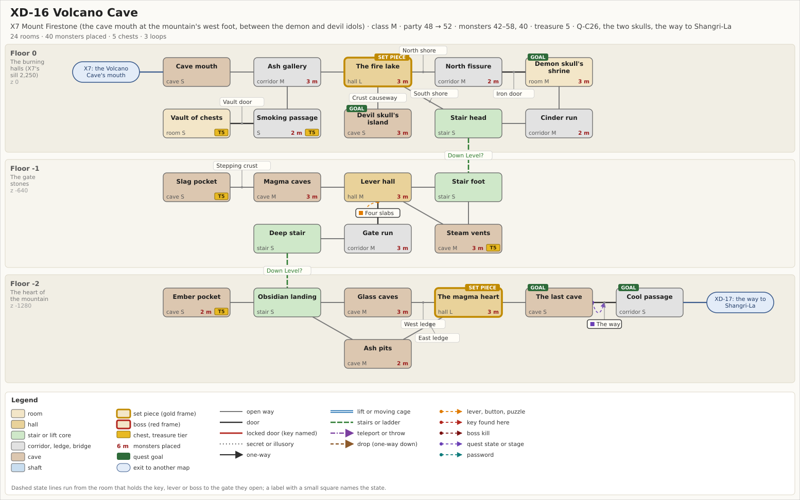
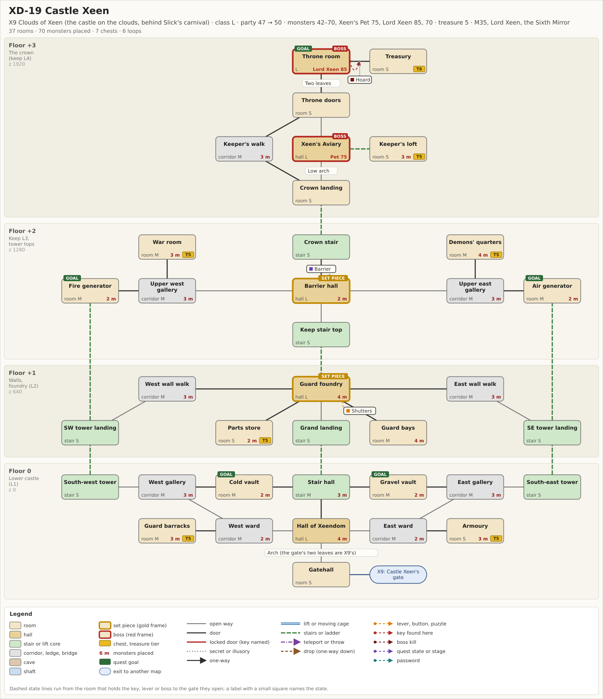
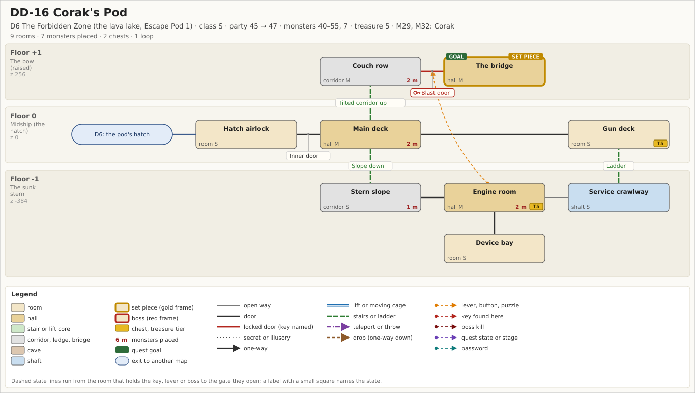
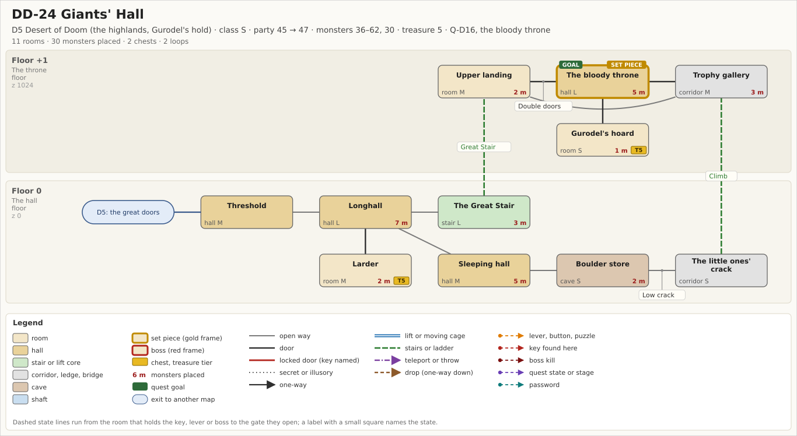

# Act V dungeon graphs, lane A7 (MU-6)

Review page for phase 5, 2026-11-20, lane A7 (`xeen-a7`). A7's four Act V maps (Two Thrones, party 42 → 55) as room
graphs and state graphs before any geometry: XD-16 Volcano Cave (X7 Mount Firestone), XD-19 Castle Xeen (X9 Clouds
of Xeen, class L), DD-16 Corak's Pod (D6 The Forbidden Zone) and DD-24 Giants' Hall (D5 Desert of Doom). These are
review documents, not briefs; each L1 starts from its graph file once a decider has answered the questions below.
**Every open question is numbered Q1–Q26 in one list** ("Open questions"), each with its options (the proposed
default first), the evidence and what depends on it.

**Reading the pictures:** as on the Act II page ([act2_dungeon_graphs.md](act2_dungeon_graphs.md), "How to read the
pictures"). One band per floor, the highest on top, its height in game units under its name; rooms left to right
roughly along the critical path; box colour by kind (room, hall, stair or lift core, corridor or ledge, cave, shaft);
gold frame set piece, red frame boss, green tag quest goal, red "6 m" monsters placed, gold "T5" a chest of that tier;
one line style per connection kind (open, door, locked, secret, one-way, lift, stairs, teleport, drop); a label with a
small square names the state that opens a connection (orange lever or puzzle, purple quest state, teal password), and a
dashed line of its colour runs from the room that holds it to the gate. Blue pills are exits.

**Files:** [act5_graphs/](act5_graphs/): `<key>.graph.yml` (spaces, links, states, exits, hooks, critical path,
loops, lines, textures, open questions; `monsters.mix` lists the placed rows with their ids, `kill_xp` the sum),
`<key>.svg` and `notes_<key>.md`. Redraw with
`python3 devdocs/xeen/mockups/act5_graphs/render_graphs.py xd16 xd19 dd16 dd24`; it prints no overlap for the four.
PNG copies for viewers without SVG: `output/studio_cal/a7/phase5_graphs/<key>.png` (headless Chrome; looked at).

**Rules used for all four** (the Act II–IV pages' rules, D-4, D-25 to D-45 and the user's rules of 2026-11-20 in
`lanes/README.md`):
- Sizes and counts inside the class bands (MAPS, Dungeons) and MAPS §0's Act V rows: XD-16 40 monsters at 42–58 and
  26.6k; XD-19 70 at 42–70 with Xeen's Pet 75 and Lord Xeen 85, 53.3k; DD-16 + DD-24 together 45 at 38–58 and 26.7k.
  Kill XP per member is L(L+10) per kill over four. A2's rows by id; a missing row is a request.
- Every M or L dungeon has loops; every dead end holds a chest, a lever, a find or a goal; L has four set pieces only.
- No riddle the game does not answer: DD-16's stasis phrase is shown plainly by the console (m29); XD-19's barrier
  pylons name the generator each one is fed by; XD-16's shut rock says "Two skulls in the cave behind you seem to be
  grinning about it", and X7's idols flank the mouth.
- Every locked door's key or opener is placed and named (XD-16's slabs by their four levers, DD-16's bridge door by
  the main power console, XD-19's barrier by the four generators, its treasury by Lord Xeen's death).
- Only engine words that exist: doors (two leaves for every wide door), levers, qbits, stages by qbit,
  destructibles, timers, text prompts, step plates, chests, open sky (`sky: true`, a preset, never `xeendark1`),
  `floors: lava`, actor scripts, `evt.PlayCinematic`, `evt.SpeakNPC` from a plate or an object. Anything else is an
  open question or an A1 request (XD-19's damage filter, Q12).
- Lamps on walls, ceilings or floors; props by the walls, never on a walking line; one-off pictures once per face;
  big monsters kept in by low openings (XD-19's Pet, D-32; DD-24's giants, Q26).
- Permanent rewards at MM6–MM8 size (stats +2, resistances +5, no levels): the source's +200,000 and +250,000
  experience, "all stats to at least 50" and the like are rescaled or dropped (Q15, Q18).
- Every exit is the `exit` preset (D-24); the source's "Leave …?" lines stay in the ledger as its meaning. Every
  inside entrance is named after the map it is entered from (`entrance:x7_mouth`, D-37).
- The first room past each map door is quiet (D-11.3).
- Every hook A3 names for these maps is placed (each graph's `hooks`), and D-38's two voiced Lord Xeen lines are
  bound (below).
- Map qbits: XD-16 118050–118059, XD-19 118060–118079, DD-16 118080–118089, DD-24 118090–118099.

| Dungeon | Map | Class | Rooms | Monsters | Kill XP per member (MAPS) | Chests | Loops | Set piece |
| --- | --- | --- | --: | --: | --- | --: | --: | --- |
| XD-16 Volcano Cave | X7 | M | 24 | 40 | 27.34k (26.6k, +2.8 %) | 5 | 3 | The fire lake with the devil skull's island; the magma heart |
| XD-19 Castle Xeen | X9 | L | 37 | 70 + Pet + Lord Xeen | 54.38k (53.3k, +2.0 %); 57.99k with the bosses (+8.8 %) | 7 | 6 | Four: the guard foundry, the barrier hall, the aviary, the throne room |
| DD-16 Corak's Pod | D6 | S | 9 | 7 | 4.79k (group DD-16+24: 25.73k of 26.7k, −3.6 %) | 2 | 1 | The bridge's stasis field |
| DD-24 Giants' Hall | D5 | S | 11 | 30 | 20.94k | 2 | 2 | The bloody throne under a smoke hole |

Rooms are review rooms (about one sector each); the sizes in sectors and M units² are in each graph's `size`. Act V's
A7 total: 107.4k per member against MAPS's 106.6k for these rows (+0.8 %), 111.0k with XD-19's two bosses.

---

## XD-16 Volcano Cave

X7 · M · party 48 → 52 · 42–58 · 40 · treasure 5 · Q-C26 (the two skulls, the way to Shangri-La)

The source's Volcano Cave (xeen maze0046–0048, three 16 × 16 levels, aaze0046–0048) as one BLV of three floors going
down into Mount Firestone, 640 apart (0, −640, −1,280). It has 24 review rooms, about 30 sectors, about 38 M units²
and 7 doors.

- **What it is.** A burning cave behind the demon and devil idols at the mountain's west foot. A demon skull and a
  devil skull keep the way to Shangri-La shut. Break both, and the rock at the bottom of the cave opens onto the
  hidden valley.
- **Critical path.**
  1. The mouth (`entrance:x7_mouth`, quiet), the ash gallery and the fire lake.
  2. Over the crust causeway to the devil skull's island (`q-c26.devil_skull`).
  3. The north shore, the fissure and the iron door to the demon skull's shrine (`q-c26.demon_skull`).
  4. The cinder run to the stair head, down to the stair foot and the lever hall.
  5. The four lever stones lower the four slabs; the gate run and the deep stair.
  6. The obsidian landing, the glass caves, the magma heart's west ledge and the last cave, whose rock stands open
     once both skulls are broken (`q-c26.done`).
  7. The cool passage, and its end into Shangri-La (`q-c26.way`).
- **Off the path.** These rooms lie off the critical path:
  - The smoking passage (a real chest, the source's (15,11)) and the vault of chests: six chests on a dais, five of
    them traps that burst in flame (DECIDE 2), one real.
  - The slag pocket (a chest by an old dwarf's pack) and the steam vents (a chest).
  - The ember pocket (a chest).
- **Loops (3).**
  - Round the fire lake: the north shore, the fissure and the shrine, back by the cinder run to the south shore.
  - Floor −1: the lever hall from the stair foot directly or through the steam vents.
  - Round the heart: in by the glass caves and the west ledge, out by the east ledge and the ash pits.
- **Set pieces.** The fire lake: a tall cavern round a lake of lava lit from below, with the devil skull's black altar
  on an island in the middle. The magma heart: a round pool of lava at the mountain's root with a ring ledge, and
  beyond it the last cave's wall of bare rock.
- **Monsters and kill XP.** Demon 42 (11630) × 20, Devil 50 (11631) × 14, Screamer 58 (11632) × 6: the source's
  demons and devils (its 25 placed) with the family's top tier on the lower floors.
  - XP: **27.34k per member** (109,344 / 4) against MAPS's 26.6k (+2.8 %).
  - Floor counts: floor 0 18 (Demon 12, Devil 6), floor −1 12 (Demon 6, Devil 5, Screamer 1), floor −2 10 (Demon 2,
    Devil 3, Screamer 5).
  - Each skull has the source's guard of three: three Demons in the shrine, three Devils on the island.
  - Quiet rooms (D-11.3): the mouth and the cool passage (XD-17's way back arrives there), the vault of chests.
  - Groups of 2–3. Rest encounters 10 % from the demons (D-39; DECIDE 6). 40 is under M's floor of 45 (MAPS §0's
    count, DECIDE 1).
  - No boss (MAPS §0).
- **Treasure.** Five real chests at T5: the smoking passage, the vault's real chest, the slag pocket, the steam vents
  and the ember pocket. The five trap chests hold nothing (the source's).
- **Original lines.** These are used as follows:
  - aaze0046:0 and :1: the two altars' questions ("… you have a sudden desire to smash it.  Destroy?").
  - aaze0046:4 "You smash the skull." (the 250,000 experience dropped; A3's hook texts follow it).
  - aaze0046:6 "The chest explodes!" and :2 "The chest is empty.": the trap chests.
  - aaze0046:5 "Leave the Volcano Cave?": the exit preset's meaning (D-24).
  - aaze0047:0–1 and aaze0048:0–1 "Down Level?" / "Up Level?": the stairs' signs.
  - X7's "Enter the Volcano Cave?" (aaze0017:1) is A5's door question.
- **Door to X7.** A5's `thing:xd16_mouth` (`door:xd16`) at [66.5, 45]: a 384 × 384 mouth in black rock between the
  demon and devil idols, front at (1024, 9728, 2250), facing west.
  - **Inside arrival proposed:** `entrance:x7_mouth`, in the cave mouth about 256 inside, facing east (0) into the
    cave.
  - **Return:** the exit preset to X7's `entrance:xd16_mouth` (512, 9728, 2250) facing west (1024).
- **Way to XD-17.** The cool passage's end calls `q-c26.way` (true with done) and moves the party to XD-17's
  proposed `entrance:xd16_way`, at the valley's cave mouth. XD-17's way back arrives at this map's proposed
  `entrance:xd17_way`, at the passage's far end facing down toward the last cave. Before done the rock's click is
  the hook's fail text: "Bare rock, hot to the touch. Two skulls in the cave behind you seem to be grinning about
  it." So the game itself points back to the skulls, as X7's idols do.
- **Hooks.** The graph places these:
  - `q-c26.demon_skull`: the shrine's altar.
  - `q-c26.devil_skull`: the island's altar.
  - `q-c26.way`: the rock's click before done (fail text) and the passage's end with done.

  `x7.idols` is X7's. Map qbits: 118050–118053 the four lever stones, 118054 the way's rock drawn open, 118055–118059
  the five trap chests.
- **Textures.** MM7 Thunderfist 7d07 (A6's line, D-45): its dark brown-black rock `c2b`, `cfb1` floors, `DIRT` and
  `7dirttyl` ash floors, 7d07's `Lava` (`floors: lava`), `Ch1b1` and `cwb1` worked stone in the shrines, `7solid01`
  and `t5d1` slabs and doors, `trim9_32` on the altars. About 16 of 45; at most one new (`xvskull`, the altars' carved
  face, optional). Music 7, map id 9142.

Open questions: Q1–Q6 below. Full notes with the requests:
[notes_xd16.md](act5_graphs/notes_xd16.md).

---

## XD-19 Castle Xeen

X9 · L · party 47 → 50 · 42–70, Xeen's Pet 75, Lord Xeen 85 · 70 + 2 bosses · treasure 5 (hoard 6) · Story M35

The source's Xeen's Castle (xeen maze0075–0078, four levels) as one BLV of four floors, 640 apart (0, 640, 1280,
1920). It has 37 review rooms, about 62 sectors, about 130 M units² and 21 doors. The three wide doors (the gate, the
great hall's north doors and the throne doors) are two-leaf pairs.

- **What it is.** Lord Xeen's castle on the clouds. Four elemental generators feed the pylons of one barrier before
  the crown stair. Guard-making machines in the keep keep turning out Xeen's Guards. Above the barrier are the aviary
  with Xeen's Pet, then Lord Xeen's throne with the Sixth Mirror behind it.
- **Critical path.** The route is:
  1. The gatehall (`m35.arrival`), the Hall of Xeendom, the west ward and west gallery.
  2. The cold vault (water generator), the stair hall, the gravel vault (earth generator).
  3. The east gallery and the south-east tower up to its top (air generator).
  4. The upper east gallery, the barrier hall, the upper west gallery, the south-west tower top (fire generator).
  5. Down the tower to the west wall walk, the guard foundry, the keep stair back to the barrier hall, where the field
     is now down.
  6. The crown stair, the crown landing, the aviary, the throne doors (`lord_xeen_sight`) and the throne room
     (`lord_xeen`, `scepter`).
- **Off the path.** These rooms lie off the critical path:
  - Dead ends with chests: the barracks, the armoury, the parts store, the war room, the demons' quarters and the
    keeper's loft (T5 each).
  - The guard bays: a gem find, opened when both machines are destroyed.
  - The treasury behind the dais: the hoard (T6), opened by Lord Xeen's death.
- **Loops (6).** West and east rings round the great hall; the west and east climbs (towers, wall walks, foundry, grand
  stair); the towers loop on floors 1–2; the crown loop round the Pet by the keeper's walk.
- **Set pieces (4).** These are:
  - The guard foundry: two machines, the hidden guard pool and the bays.
  - The barrier hall: four element pylons, each with hover text naming the tower or vault its conduit runs to, so the
    game itself answers the puzzle; one field.
  - The aviary: open sky (`xeencloud`), the Pet held in by two 256-high arches (D-32).
  - The throne room: the dais and the Sixth Mirror in its force field.
- **Monsters (70) and kill XP.** Demon 42 (11630) × 28, Devil 50 (11631) × 14, Screamer 58 (11632) × 4, Xeen's Guard
  60 (11603) × 14 (four hidden in the bays), Lesser Elementals 55 × 8 (fire 11620 and three new tiers 11624–11626,
  two per generator), Greater Elemental 70 (11622) × 2 at the barrier.
  - XP: **54.38k per member** (+2.0 % on 53.3k); with Xeen's Pet 75 (11644) and Lord Xeen 85 (11634) 57.99k
    (+8.8 %).
  - Floor counts: floor 0 27, floor 1 16, floor 2 19, floor 3 8.
  - Quiet rooms (D-11.3): the gatehall, the crown landing and the throne doors.
  - Groups of 2–3. Rest encounters 10 % from the hostile rows (D-39).
  - Flying Feet, Guardian and Carnage Hand are under the band and none is placed.
- **The generators.** Source cold → water and poison → earth, at the L1 north corners in the source and in the floor-0
  vaults here. Fire → fire and electricity → air, at the source's L4 south towers and the tower tops here.
- **Lord Xeen (E11).** The map needs four things:
  - His behaviour bound on load (`evt.SetActorBehavior`).
  - Immobility until the sight line ends (`evt.SetActorImmobile`, then `SetActorTarget` party).
  - An `onDeath` that calls `m35.lord_xeen`.
  - A damage filter that does not exist yet. `onDamaged` only observes (A1, DECIDE 6).
- **First sight.** A step plate across the throne doors' sill inside the leaves calls `m35.lord_xeen_sight` once
  (111709), with the throne straight ahead and lit. A 4 s timer then frees him and his two guards.
- **Original lines.** These are used as follows:
  - aaze0075:0–4 and aaze0078:0–2: the machines' and generators' "Destroy?" questions.
  - aaze0075:6: the exit's meaning.
  - aaze0078:4: the mirror cinematic's subtitles.
  - aaze0078:5: the force field.
  - aaze0027:8–9: X9's "Xeendom" and "Xeen's Aviary" signs.
  - aaze0027:44: after M35.
  - aaze0075:5 and aaze0078:3 ("+200,000 experience") are not used.
- **Door to X9.** A5's `thing:castle_xeen_gate`, two leaves, at the source's (16,29), opened by `m34.gate`.
  - **Inside arrival proposed:** `entrance:x9_gate`, in the gatehall about 256 inside the leaves at about
    (0, −2944, 0), facing north (512).
  - **Return:** the exit preset to the causeway about 512 south of the leaves (the source's (16,28)), facing south
    (1536).
- **Hooks.** The graph places these:
  - `m35.arrival`: the gatehall.
  - `gen_water`, `gen_earth`, `gen_fire`, `gen_air`: the four generator rooms.
  - `barrier`: the barrier hall, called on load and after each generator.
  - `pet`: the aviary.
  - `lord_xeen_sight`: the throne doors.
  - `lord_xeen` and `scepter`: the throne room.

  `m34.gate` is X9's. Map qbits: 118060–118061 the machines, 118062 the barrier down, 118063 the bays open; the rest
  of 118060–118079 are free.
- **Textures.** MM8 Escaton's Palace d35 (black stone, gold friezes, gnecdr1 leaf pairs) with the ancient kit's sw
  panels, xaenergy and xafield for the machines, the barrier and the mirror's field. About 38 of 70 textures; 7 are
  new: four generator cores, the sigil banner, the Sixth Mirror and its shattered frame. Music 22, map id 9144.

Open questions: Q7–Q16 below. Full notes with the requests:
[notes_xd19.md](act5_graphs/notes_xd19.md).

---

## DD-16 Corak's Pod

D6 · S · party 45 → 47 · 40–55 (few) · 7 · treasure 5 · Story M29, M32 (Corak)

The source's Escape Pod 1 (dark maze0087 + 0163, 32 × 16, aaze0087) has no monsters: a narrow bow with the stasis
field and its consoles, six couches midship, the phaser and photon controls at the waist, the round main hull with the
hatch, the main power console and two alien devices at the stern. Ours lies nose-up, half sunk in D6's lava: the hatch
midship, the bow 256 up, the stern 384 down and breached. 9 review rooms, about 11 sectors, about 8 M units², 5 doors
(S: at most 15 sectors and 20 M units²).

- **What it is.** Corak's crashed pod. The Pharaoh cooled the lava (m28); the party wakes Corak with the phrase the
  console shows in plain words, then brings him the Soul Box (M32).
- **Critical path.** The airlock; the main deck; down the slope to the engine room, where the Main Power Console opens
  the bridge's blast door (map qbit 118080); back up the tilted couch row; the bridge: the logs, the console, the field's
  prompt "To boldly go..." (`m29.stasis`). Later visit: Corak by his console (`evt.SpeakNPC(5513)`, m32).
- **Off the path.** The gun deck (phaser and photon "Fire anyway?" → "Nothing happens."; the weapons locker, T5); the
  device bay (the alien device, rescaled, DECIDE 2); the engine room's stores locker (T5).
- **Loop (1).** Main deck → stern slope → engine room → service crawlway (ladder) → gun deck → main deck.
- **Set piece.** The bridge: the stasis field (`xafield` column, pulsing light) with a figure hanging in it; after
  `m29.done` the field off and Corak standing (stage by qbit), hidden after `m32.done`.
- **Monsters and treasure.** Things that crossed the lava through the stern breach: Floating Eye 40 (11570) × 3,
  Terrible Eye 50 (11571) × 2, Lesser Elemental 55 (11620) × 2 (MAPS's "lava dwellers": A2 has no such row; the fire
  elementals stand in). 7 monsters, **4.79k per member** (19,150 / 4). With DD-24's 30 (20.94k) the group is 37 monsters
  and 25.73k against 45 and 26.7k (−3.6 %). The bridge and the airlock are quiet. Chests T5 × 2. Rest encounters 10 %
  from the eyes.
- **Original lines.** aaze0087:0 (the field), :6 "Exit Escape Pod 1?" (the exit preset's meaning, D-24), :7 the power
  console, :8/:5/:10 the device (rescaled), :11/:12/:9 phaser and photon, :22 the scanning console's X.E.E.N. readout,
  :13 and :25–31 the log entries (DECIDE 3), :24 "Stasis field deactivated." after M32. Corak's lines :2–4 are A3's.
- **Door to D6.** The hatch (D6's `m29.pod_door`, A6, not built) on the cooled crust of the lava lake. **Inside arrival
  proposed:** `entrance:d6_hatch`, in the airlock about 192 inside the hatch, facing into the pod. The way out returns
  to D6 on the crust about 384 before the hatch, facing away from it.
- **Hooks.** `m29.log1`, `m29.log2`, `m29.console`, `m29.stasis`, `m29.stasis_wrong` (the bridge); Corak's m32 topics
  (Soul Box, voiced `xeen_vo_corak_soulbox`, D-38; Sheltem) from his console; `m29.pod_door` is D6's.
- **Textures.** MM7 The Lincoln 7d23 (A6's assign): a3b/a2b/a2d/a3bs, sfw7b/sfw1a, sfw7a/a2j, sfw trims, a2c, a1b,
  sfpnlon/sfpnloff; the ancient kit's `xahullbn` (hatch, breach) and `xafield` (field); MM8 lava in the breach. About
  17 of 30, 0 new.

Open questions: Q17–Q21 below. Full notes with the requests:
[notes_dd16.md](act5_graphs/notes_dd16.md).

---

## DD-24 Giants' Hall

D5 · S · party 45 → 47 · 36–62 (MAPS 38–58, DECIDE 2) · 30 · treasure 5 · Q-D16 (the bloody throne)

No source maze: Darkside D1 has Gurodel's giants and the bloody throne outdoors (dark/aaze0013:7–8, 19, 33–34). Ours
is Gurodel's hall in the hillside behind his hold on D5: two floors 1,024 apart built for giants. 11 review rooms,
about 14 sectors, about 16 M units², 6 doors (the great doors and the throne hall's doors as hinged pairs).

- **Giant scale.** The stand-in is MM8's cyclops: drawn about 310 high (model 2.4 × 127.5), descriptor body 185 high,
  radius 100 (60 by D-32). Openings 384 wide × 512 high, halls 768–1,024 high, the Great Stair 640 wide with 1,024 of
  headroom and 96-high steps (the party steps 128). The little ones' crack is 128 × 256: it keeps giants out only if
  A2 raises their body height to about 300 (DECIDE 5).
- **What it is.** The People's hall. At peace it is open and its giants friendly; at war (Gurodel's "Your hall", or
  Q-D12's hostile/camp_burned) "the People will be waiting on the stair", and the bloody throne at the top holds two
  Energy Disks.
- **Critical path.** Threshold (`entrance:d5_hold`, quiet); longhall; the Great Stair; the upper landing; the throne
  hall's double doors; the bloody throne (`q-d16.throne`).
- **Off the path.** The larder (T5); the sleeping hall; the boulder store and the crack; the trophy gallery; Gurodel's
  hoard behind the throne (T5, refuses at peace: "Gurodel would notice.", DD-13's pattern).
- **Loops (2).** Up the Great Stair or up the crack to the trophy gallery; into the throne hall by its double doors or
  the gallery's side door.
- **Set piece.** The bloody throne: black wood big enough for four, stained dark, under a smoke hole (`sky: true` at
  least 1,280 above the floor, D5's Darkside day preset, never `xeendark1`).
- **Monsters and treasure.** The People as their own rows (D-25): Cyclops 36 × 9, Giant 50 × 17, Elder Giant 62 × 4
  (A2's new tiers, e.g. 11083–11085, faction `xeen_giants_people`). 30 monsters, **20.94k per member** (83,760 / 4).
  With DD-16's 4.79k the group is 37 monsters and 25.73k against 45 and 26.7k (−3.6 %). Chests T5 × 2. Rest
  encounters 0 (the only rows are peaceful at peace).
- **Original lines.** dark/aaze0013:34 the throne (A3's hook); :33 "We recognize you as enemies!  Prepare to defend
  yourselves!" at the threshold once per war; :26 (close) on the longhall's law stone; :19 "Greetings, little ones." is
  Gurodel's on D5.
- **Door to D5.** The great doors in the hillside behind Gurodel's fire (A6, D5 not built), two leaves 384 × 512.
  **Inside arrival proposed:** `entrance:d5_hold`, about 384 inside the leaves, facing into the hall. The way out
  returns to D5 about 512 before the doors, facing away, clear of Gurodel.
- **Hooks.** `q-d16.throne` (the throne hall); proposed `q-d16.hall_attacked` (a People giant struck at peace: map
  qbit 118091 by D-37's timer pattern, then war). Map qbits: 118090 the war line shown, 118091 struck.
- **Textures.** No family yet: proposed MM8 Cyclops Larder d14 (DECIDE 3): gcav1wal, gcst1bs1, gcst2flr, gston1fl,
  gcst2cel, gkp1ceil planks, trim9_32, furnishing; 2 new (`xdgiantd`, one giant door wing mirrored on the pair;
  `xdthrone`, black wood stained with old blood). About 16 of 30.

Open questions: Q22–Q26 below. Full notes with the requests:
[notes_dd24.md](act5_graphs/notes_dd24.md).

---

## The surface maps' doors against the graphs

None of the four surface maps' doors is open yet; each stays sealed until its dungeon is installed.

| Dungeon | Surface door (lane's L4 or plan) | Inside arrival proposed | Return | Match |
| --- | --- | --- | --- | --- |
| XD-16 | X7 `thing:xd16_mouth` (`door:xd16`) at [66.5, 45], front (1024, 9728, 2250), 384 × 384 cave mouth between the idols, facing west (A5's L4) | `entrance:x7_mouth`, about 256 inside the mouth, facing east | X7 `entrance:xd16_mouth` (512, 9728, 2250) facing west | Match (the interior larger than the mountain's foot, as shipped interiors) |
| XD-16 ↔ XD-17 | XD-17 Shangri-La (A5, no L1 yet) | XD-16 `entrance:xd17_way` (the cool passage's far end); XD-17 `entrance:xd16_way` (the valley's cave mouth) | each the other's | A5 to take both names into XD-17's L1 |
| XD-19 | X9 `thing:castle_xeen_gate` (A5, not built), two leaves at the source's (16,29), opened by `m34.gate` | `entrance:x9_gate`, gatehall about 256 inside the leaves, facing north | X9 causeway about 512 south of the leaves, facing south | A5 to place the gate at X9's L1–L3 |
| DD-16 | D6 hatch (`m29.pod_door`, A6, not built) on the cooled crust of the lava lake | `entrance:d6_hatch`, airlock about 192 inside, facing into the pod | D6 crust about 384 before the hatch, facing away | A6 to place the pod and hatch |
| DD-24 | D5 great doors in the hillside behind Gurodel's fire (A6, not built), two leaves 384 × 512 | `entrance:d5_hold`, about 384 inside the leaves | D5 about 512 before the doors, clear of Gurodel | A6 to place the doors at that size |

## D-38's voiced lines in XD-19

- `m35.lord_xeen_sight` (voice `xeen_vo_lord_xeen_sight`, 63030), once per save at the first sight of Lord Xeen: a
  step plate across the throne doors' sill inside the leaves, the throne straight ahead and lit; it sets 111709. He and
  his two guards stay immobile until 4 s after the line; his `onDamaged` also calls the hook if it has not run (Q13).
- `m35.lord_xeen` (voice `xeen_vo_lord_xeen_death`, 63031), at his death: his behaviour's `onDeath`, once.
- The text always shows (D-38). AU's two takes and A3's `sound:` fields are the only dependencies; the map calls the
  hooks either way.

---

## Open questions (Q1–Q26)

Each question gives the options with the proposed default first and marked, the evidence, and what depends on the
answer. The graph files hold the same questions under `open_questions`.

### XD-16 Volcano Cave

**Q1. Count and mix.**
- Options: (a, proposed) 40 of the demons family: Demon 42 × 20, Devil 50 × 14, Screamer 58 × 6, 27.34k (+2.8 %),
  a NOTES exception under M's floor of 45; (b) 45 (five more Demons on floor 0), 30.07k (+13 %); (c) 36 demons and
  four Lava Golems 55 (11593, X7's) in the lava rooms, 28.73k (+8 %).
- Evidence: MAPS §0 gives XD-16 40 monsters at 42–58 and 26.6k; the source has demons and devils only (25 placed);
  the demons family's `where` names the Volcano Cave; DD-07 was accepted at 30 under M's floor (D-39).
- Depends: A2's Act V recount and row 9142; the L1's placement.

**Q2. The exploding chests** (the source's six in the south-east corner: five burst for 250 damage, one real).
- Options: (a, proposed) five trap chests with a faint ember glow and smoke under each, fire damage 50 on each member
  once ("The chest explodes!"), then "The chest is empty."; one real T5 chest; (b) the same with no tell (the source's
  gamble); (c) six ordinary chests with the engine's chest traps and loot.
- Evidence: aaze0046:2, :6; the user's rule against riddles the game does not answer (a guess with no tell is close
  to one); event damage and map qbits exist (118055–118059).
- Depends: A3 (the two map-local texts); nothing in the engine.

**Q3. The gate stones** (the source's four wall switches round one cell on level 2, each moving a wall on the way
south).
- Options: (a, proposed) four lever stones round a pillar in the lever hall, each with hover text naming its slab,
  each lowering one of four slabs in a row across the gate run, one-way (D-43); (b) one lever, one slab; (c) no gates.
- Evidence: maze0047 events at (11–13, 11–13); D-43 (a lever whose undoing does nothing stays one-way); the four
  slabs are four of the map's seven doors (M's band 6–16).
- Depends: nothing (levers and doors exist).

**Q4. The way into Shangri-La** (A3: "a door or a lava bridge, A7's choice").
- Options: (a, proposed) a rock slab at the last cave's end that stands open whenever `q-c26.done` is set; a cool
  passage beyond, its end calling `q-c26.way` and moving the party to XD-17's `entrance:xd16_way`; XD-17's way back to
  `entrance:xd17_way`; (b) a crust bridge rising from the heart's pool on done (a lift) to a ledge exit; (c) no door:
  the exit at the bare wall, the hook's fail text until done.
- Evidence: A3's hook texts ("rock grinds on rock", "Beyond the last cave, cool air"); maze0048's (9,10) is the way,
  reading both skull flags; D-40 (3): the cleft on X7 opens only from inside, so this is the only first way in.
- Depends: A5's XD-17 (the two entrance names, its way back).

**Q5. Lava.**
- Options: (a, proposed) the lake, the river and the heart are `floors: lava` (they burn, as Gharik's Forge and
  XD-03), sunk 128 with crust edges; the causeway and stepping crust plain floor; (b) light and decoration only.
- Evidence: D-40 "lava is lava" on X7; XD-03 and the studio's `floors: lava` already burn.
- Depends: nothing.

**Q6. Rest encounters.**
- Options: (a, proposed) 10 % from the demons family; (b) 0.
- Evidence: D-39's rule (10 % from the map's own hostile rows); the map has no peaceful rows.
- Depends: A2 (row 9142).

### XD-19 Castle Xeen

**Q7. Guard-making machines.**
- Options: (a, proposed) two destructible machines in the foundry; while either stands, a 45 s timer shows one of
  four hidden placed guards from the bays (DD-14's hidden-actor word) and sets it on the party; both destroyed stop it
  and open the bays (a gem find); (b) `evt.SummonMonstersById` on the timer, capped by a map variable; (c) flavour
  only: a group of guards by each machine.
- Evidence: aaze0075:0–4 (the machines' "Destroy?"); a fixed pool keeps the count and the XP known (50.18k if the
  four are never released).
- Depends: A1 only if a hidden actor cannot be shown by a timer event (to confirm).

**Q8. Destroying a generator** (cold → water and poison → earth in the floor-0 vaults; fire → fire and electricity →
air in the tower tops).
- Options: (a, proposed) the source's "X Generator. Destroy?" question breaks the destructible by event, and blows and
  spells also break it; one `on_destroyed` calls the hook; (b) blows and spells only.
- Evidence: aaze0078:0–2; destructibles with `on_destroyed` exist since merge point 19.
- Depends: A3 (the four hooks' `where` texts with the renamed generators).

**Q9. The barrier.**
- Options: (a, proposed) one field before the crown stair, held by four pylons that go dark one by one (A3's single
  `m35.barrier`), each pylon's hover naming its generator; (b) four fields in series, one per generator.
- Evidence: A3's m35 has one `barrier` hook; the pylons' hover answers which generator feeds which.
- Depends: nothing.

**Q10. The generators' elemental guards** (the elementals family has fire tiers only).
- Options: (a, proposed) three new Lesser tiers at 55, 11624 Air, 11625 Water, 11626 Earth, with MM6's elemental
  looks; (b) fire Lesser Elementals in all four halls; (c) demons in the three non-fire halls.
- Evidence: monsters.yml elementals block 11620 (fire tiers 55/62/70 and the Sleeper's Guardian 11623).
- Depends: A2 (rows), S (bindings).

**Q11. Magic constructs under the band** (Flying Feet 18, Guardian 24, Carnage Hand 35 against 42–70).
- Options: (a, proposed) none placed; (b) four Carnage Hands 35 in the foundry as half-made work.
- Evidence: MAPS §0's band; D-19 makes Xeen's Guard 11603 the castle's own construct.
- Depends: nothing.

**Q12. Lord Xeen harmed only by the Xeen Slayer Sword (E11).**
- Options: (a, proposed with (b), A1's choice) A1 adds a shared damage hook (a behaviour `onDamage` that returns the
  amount, given the attacker's weapon and whether it is a spell); his behaviour zeroes everything but the sword's melee;
  the map binds it on load; (b) a row field `harmed_only_by: <item id>` read by the damage code; (c) no immunity
  (D-2.3's slaying: Demon only).
- Evidence: `devdocs/ACTOR_SCRIPTING_INVESTIGATION.md`, Limitations: `onDamaged` only observes; the row's note says
  "harmed only by the Xeen Slayer Sword (actor script, E11)"; (c) loses the story's point.
- Depends: A1 (engine, an E11 item), A2 (the row field if (b); the sword as an undroppable quest item).

**Q13. First sight of Lord Xeen** (D-38's voiced line).
- Options: (a, proposed) a step plate across the throne doors' sill (the throne straight ahead about 2,000 away and
  lit), once (111709); he and his guards immobile until 4 s after the line; (b) the doors' click event.
- Evidence: D-38 "first sight in XD-19 … once per save"; `evt.SetActorImmobile` and `SetActorTarget` exist.
- Depends: AU (the take), A3 (the `sound:` field); the map's side needs nothing new.

**Q14. After the scepter** (no map-collapse word).
- Options: (a, proposed) the cinematic (the mirror shatters, camera shake, falling dust, aaze0078:4 as subtitles) ends
  with a direct leave to X9's gate return point; X9 shows the castle gone by a stage on `m35.done` and the gate reads
  aaze0027:44; XD-19 is not entered again; the treasury opens at Lord Xeen's death so nothing is lost; (b) the mirror
  shatters, the castle stays, the party walks out; (c) the source: the party is set down in Vertigo (X1).
- Evidence: the source ends in Vertigo; MM6–MM8 have no collapse word; `evt.PlayCinematic` exists (MM9 cutscenes).
- Depends: A5 (X9's stage and gate line), A1 (confirm a leave can follow `evt.PlayCinematic`).

**Q15. Experience for the machines and generators** (the source's +200,000 each).
- Options: (a, proposed) none: the scepter's 35,000 carries M35; (b) 2,500 per member per machine and generator
  (15,000 in all).
- Evidence: aaze0075:5 and aaze0078:3 (not used); MM6–MM8 sizing.
- Depends: A3 (quest budget).

**Q16. Count.**
- Options: (a, proposed) 70 + the two bosses, 54.38k (+2.0 %), 57.99k with the bosses (+8.8 %); (b) four Demons
  fewer (66 + bosses, about +6.7 %).
- Evidence: MAPS's L line carries §0's 70 "plus their bosses".
- Depends: A2 (Act V recount).

### DD-16 Corak's Pod

**Q17. Count.**
- Options: (a, proposed) 7 in the pod (Floating Eye 40 × 3, Terrible Eye 50 × 2, Lesser Elemental 55 × 2), 4.79k;
  with DD-24's 30 the group is 37 and 25.73k (−3.6 %); a NOTES exception under S's 15; (b) 15 in the pod, about 9.8k,
  the group 45 and about 30.7k (+15 %); (c) an empty pod, all fighting in DD-24 (over S).
- Evidence: MAPS "40–58 (few)" for the pod; the source pod has no monsters; A2 has no lava-dweller row (the fire
  elementals stand in).
- Depends: A2 (Act V recount).

**Q18. The alien device** (the source: "all stats to at least 50, +50 years of age").
- Options: (a, proposed) +1 to every statistic and five years of age, once per character (a player bit), DD-09's
  barrel pattern (D-27) with the age joke kept larger; (b) exactly DD-09's barrel: +1 all, one year; (c) dressing only.
- Evidence: aaze0087:5, :8, :10; D-27's barrel; MM6–MM8 sizing.
- Depends: A3 (player bit, text), A2 (Act V values), A1 only if an event cannot add age.

**Q19. The pod logs.**
- Options: (a, proposed) a third log computer paging the source's entries 1–15 (CRON, VARN, Terra), abridged by A3
  into about five pages; (b) A3's two short logs only.
- Evidence: MAPS "DD-16, DD-22: the pod logs"; aaze0087:13, :25–31.
- Depends: A3 (abridged pages as ORIGINAL_LINES rows).

**Q20. Corak's body** (he talks by `evt.SpeakNPC(5513)` from his console).
- Options: (a, proposed) a peaceful placed-only row "Corak" (NoArena, not counted, a tall figure in a guardian's
  armour from S, a stand-in until made), shown on `m29.done`, hidden on `m32.done`; (b) a decoration figure only.
- Evidence: an NPC on a placed indoor monster is not a word (XD-22's Shinobu, DD-11C's Hobstadt talk from objects).
- Depends: A2 (row), S (look).

**Q21. Rest encounters.**
- Options: (a, proposed) 10 % from the eyes; (b) 0.
- Evidence: D-39's rule.
- Depends: A2.

### DD-24 Giants' Hall

**Q22. The hall at peace.**
- Options: (a, proposed) open: the People as their own rows and faction (`xeen_giants_people`), friendly at load,
  hostile on `q-d16.war`, `q-d12.hostile`, `q-d12.camp_burned` or a blow (`q-d16.hall_attacked`); Gurodel stays on
  D5; the throne and the hoard refuse at peace ("Gurodel would notice."); (b) shut until war, ordinary giant rows;
  (c) Gurodel inside on his throne, a Giant King boss row at war.
- Evidence: D-25's peaceful-group rule; DD-13's peace and war pattern; A3's q-d16 (`throne` requires war).
- Depends: A2 (rows, faction, relations), A3 (the new hook).

**Q23. Levels and count** (giants 36/50/62 against MAPS's 38–58; S holds at most 30).
- Options: (a, proposed) Cyclops 36 × 9, Giant 50 × 17, Elder Giant 62 × 4: 20.94k, the group 37 and 25.73k
  (−3.6 %); MAPS's DD-24 row 38–58 → 36–62; (b) Giant 50 × 30, 22.5k, the group +2.2 %, inside 38–58; (c) 38 in the
  hall to reach 45 (over S, about +12 %).
- Evidence: the giant family's tiers; the S band.
- Depends: A2 (Act V recount), the orchestrator (MAPS row).

**Q24. Texture family** (none assigned).
- Options: (a, proposed) MM8 Cyclops Larder d14 (the cyclopes' own home: brown cave rock, sandstone block, plank
  ceilings), 2 new (`xdgiantd` one giant door wing mirrored on the pair, `xdthrone` the stained black throne wood);
  (b) MM8 Barbarian Fortress d25 (shares XD-23's troll rock); (c) MM7 Stone City 7d24 (XD-09's hub).
- Evidence: our giants wear MM8's cyclops; one family per area; d25 and 7d24 are already seen elsewhere.
- Depends: A6 (dungeon_families line, the two textures).

**Q25. Rest encounters.**
- Options: (a, proposed) 0 (the hall's only rows are peaceful at peace); (b) 10 % at war only (a qbit-switched
  encounter: an A1 word).
- Evidence: D-33's and D-34's rule (no rest slot that reaches a peaceful row).
- Depends: A2.

**Q26. Giant body height** (the descriptor body is 185 high; the drawn model about 310).
- Options: (a, proposed) A2 sets about 300 on the giant rows, so the 128 × 256 crack keeps them out and the ceilings
  read right; (b) leave 185 (the crack is only a second way; giants follow through it).
- Evidence: D-32 (keep big monsters in by height); the stand-in MM8 cyclops' measurements.
- Depends: A2.

---

## What waits on the answers

- **L1 of all four maps** (A7): each starts from its graph and the decided options.
- **A1:** Q12 (a damage filter, E11) before XD-19's Lord Xeen can be finished; confirm Q7's hidden-actor timer and
  Q14's leave after a cinematic. XD-19 can be built without them and the fight wired last.
- **A2:** rows 9142 (XD-16), 9144 (XD-19), 9169 (DD-16), 9177 (DD-24); Q10's three elemental tiers; Q20's Corak row;
  Q22's three People tiers and faction; Q26's body height; Q12 (b)'s row field if chosen; the Xeen Slayer Sword as an
  undroppable quest item; the Act V recount (A7's maps 107.4k, 111.0k with XD-19's bosses).
- **A3:** the texts and bits of Q2, Q8, Q15, Q18, Q19, Q22 (`q-d16.hall_attacked`); `m35.barrier`'s text; the
  ORIGINAL_LINES rows each notes file lists; D-38's `sound:` fields on `m35.lord_xeen_sight` and `m35.lord_xeen`.
- **A5:** X7's `door:xd16` into `entrance:x7_mouth`; XD-17's `entrance:xd16_way` and its way back to XD-16's
  `entrance:xd17_way` (Q4); X9's gate, `m34.gate`, the return point and, on Q14 (a), the castle-gone stage and the gate
  line aaze0027:44; the "Xeen's Aviary" sign on the aviary's outer wall.
- **A6:** D6's pod hatch (`entrance:d6_hatch` and its return), D5's great doors (`entrance:d5_hold`, two leaves 384 ×
  512, and its return); DD-24's dungeon_families line (Q24); registering the new textures (XD-19's seven, DD-24's two,
  XD-16's optional `xvskull`).
- **S:** the `xeen_guard` model before XD-19's placement (D-19); Q10's elemental bindings; Q20's Corak look.
- **AU:** XD-19's generator hums, the machines' stamping, the barrier's crackle, the mirror's shatter and the castle's
  groan; D-38's two Lord Xeen takes; DD-16's stasis hum (optional).
- **The orchestrator:** MAPS's DD-24 row 38–58 → 36–62 on Q23 (a); XD-16's 40 under M's floor noted on Q1 (a).
