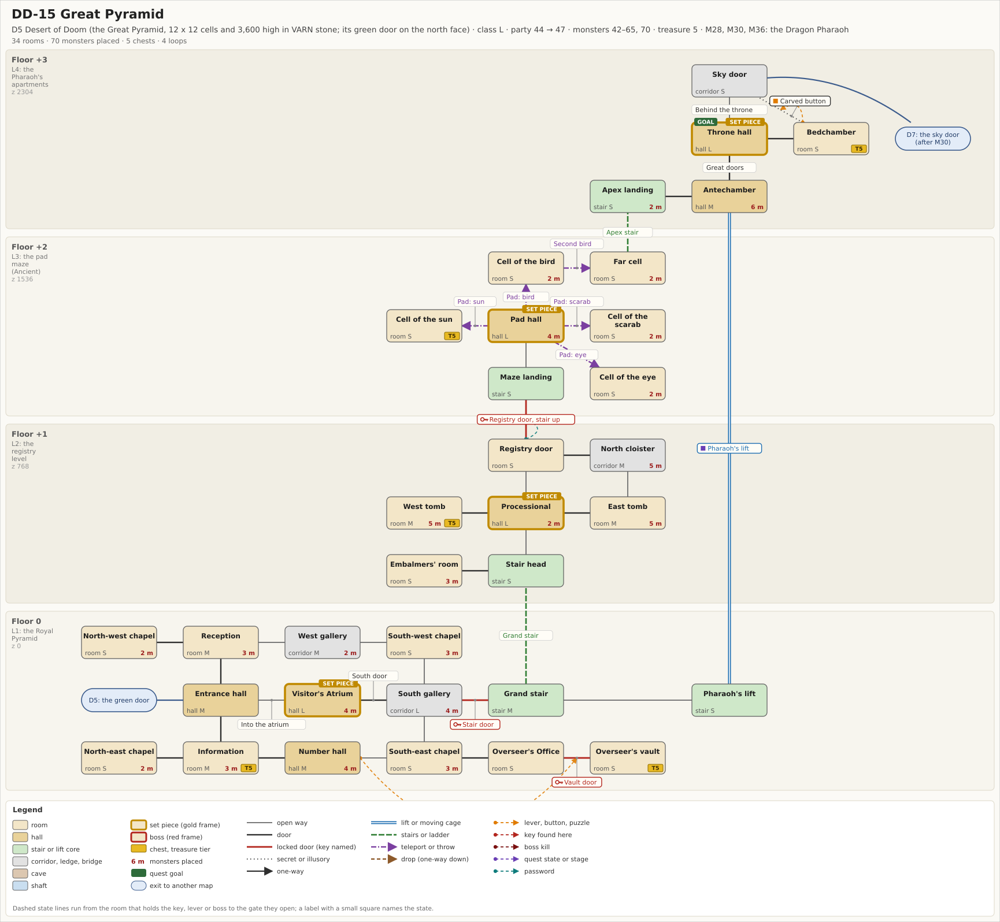
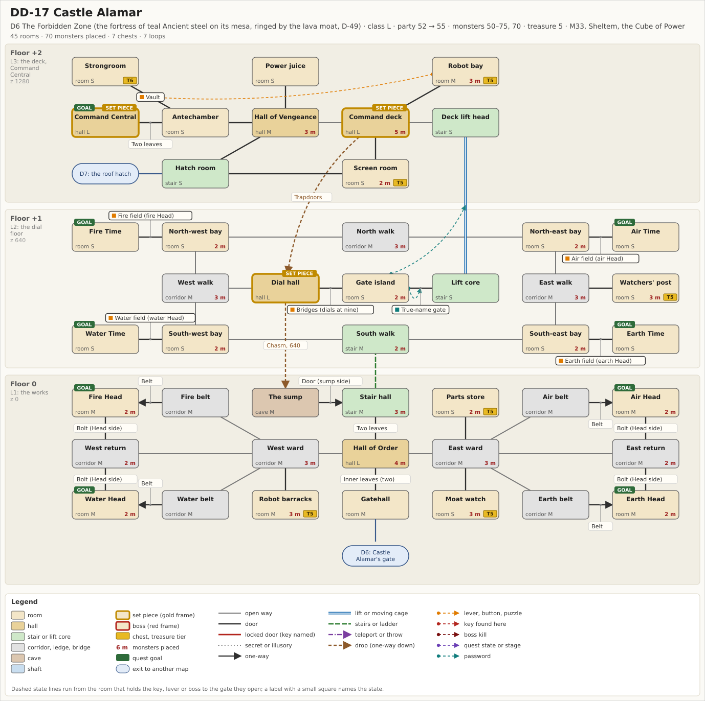
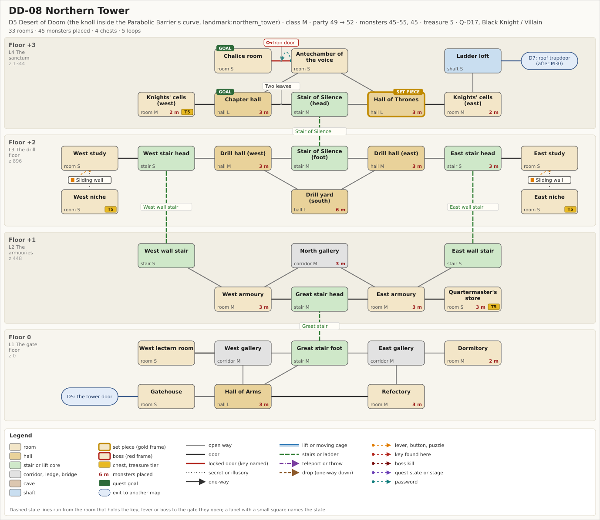

# Act V dungeon graphs, lane A8 (MU-6)

Review page for phase 5, 2026-11-21, lane A8 (`xeen-a8`, session 10), for a decider. A8's phase-5 maps as room graphs
and state graphs before any geometry. Review documents, not briefs; each L1 starts from its graph file once the
questions below are answered. **DD-15 the Great Pyramid comes first**: it is the story's critical path (segment 69,
M28) and can be decided on its own. **Every open question is numbered once on this page** (Q1–Q31, "Open
questions"), each with its options (the proposed default first), the evidence and what depends on it.

**Reading the pictures:** as on A7's Act V page ([act5_dungeon_graphs_a7.md](act5_dungeon_graphs_a7.md)): one band
per floor, the highest on top, its height under its name; box colour by kind (room, hall, stair or lift core,
corridor, cave, shaft); gold frame set piece, red frame boss, green tag quest goal, red "6 m" monsters placed, gold
"T5" a chest of that tier; one line style per connection kind (open, door, locked, secret, one-way, lift, stairs,
teleport, drop); a gate's label names the state that opens it, and a dashed line of the state's colour runs from the
room that holds it. Blue pills are exits.

**Files:** [act5_graphs/](act5_graphs/) (A7's XD-16, XD-19, DD-16, DD-24 share the folder): `<key>.graph.yml`,
`<key>.svg`, `notes_<key>.md`. Redraw with `python3 devdocs/xeen/mockups/act5_graphs/render_graphs.py dd15 dd17 dd08`
(no overlap printed); PNG copies `output/studio_cal/a8_s10/png/<key>.png` (headless Chrome, looked at). This page is
assembled by `output/studio_cal/a8_s10/make_act5_page.py` from the notes files.

**Rules used for all** (the Act II–IV pages' and A7's Act V rules): sizes and counts inside the class bands (MAPS,
Dungeons) and MAPS §0's Act V rows, kill XP per member L(L+10) per kill over four within about ±10 %; A2's rows by id;
loops in every M and L map, four set pieces in an L map; every dead end holds a chest, a lever, a find or a goal; no
riddle the game does not answer (every answer has a giver, named); every locked door's opener placed; only engine
words that exist (doors in two leaves for wide openings, levers, qbits, stages by load events, hidden placed actors,
step plates with in-map moves, lifts, `monsters[].npc`, the damage hook, cinematics); lamps where they can hang; props
by the walls; rewards at MM6–MM8 size; every exit the `exit` preset (D-24); inside entrances named after the map they
are entered from (D-37); the first room past each map door quiet (D-11.3); every A3 hook naming the map placed.
Map qbit blocks (provisional, A3 to register): DD-15 117560, DD-17 117600, DD-08 117640, DD-25 117680, DD-21 117720,
DD-22 117760 (40 each); DD-10C keeps 117240.

| Dungeon | Stands on | Class | Rooms | Monsters | Kill XP per member | Chests | Loops |
| --- | --- | --- | --: | --: | --- | --: | --: |
| DD-15 Great Pyramid | D5 | L | 34 | 70 | 51.92k per member | 5 | 4 |
| DD-17 Castle Alamar | D6 | L | 45 | 70 | 68.85k per member | 7 | 7 |
| DD-08 Northern Tower | D5 | M | 33 | 45 | 31.14k per member | 4 | 5 |

---

## DD-15 Great Pyramid

D5 · L · party 44 → 47 · 42–65 · 70 · treasure 5 · Story M28, M30, M36 (the Dragon Pharaoh); D-58's sky door to D7

The source's Great Pyramid (dark maze0083–0086, aaze0083–0086) has four levels, each a smaller square than the one
below (32, 24, 16 and 8 cells). L1 is "the Royal Pyramid" for visitors: Reception, the Overseer's Office, the Visitor's
Atrium and Information, five talking statues, six torch levers and eight number niches. L2 has four verse statues and
the registry lock (NCC-1701). L3 is a teleport maze. L4 holds the Dragon Pharaoh's apartments: his throne, the Brew of
Pure Power, an ornate bed, a tapestry, a combination wall safe, the Prime Directive book, and a button to Skyroad D2.

Ours is one BLV of four stepped floors, 768 apart (0, 768, 1,536, 2,304). The floors are 10,240, 8,192, 6,144 and
4,096 square, the inside independent of D5's 6,144-square pyramid (D-49 Q6). It has 34 review rooms, about 58 sectors
and about 138 M units², with 21 doors. Class L: 50–75 sectors, 120–200 M units², up to 25 doors.

- **What it is.** The Dragon Pharaoh's pyramid, still kept as the source's tourist monument with its old wardens. The
  party climbs four floors and three puzzles to give the Pharaoh his orb (M28). They come back twice: for the Chosen
  Ones (M30), and after M33/M35 for the finale's errands (M36).
- **Critical path.** The steps are:
  1. The green doors (`entrance:d5_door`, quiet; the welcome statue).
  2. The four torch chapels round the atrium, lit in any order. The plaque by the first, in the north-east chapel,
     says it plainly (`m28.torch_plaque`). The fourth calls `m28.torches`.
  3. The south gallery's stair door, then the grand stair.
  4. On L2, the processional of the four verse statues to the registry door. Its plaque gives "1701" plainly
     (`m28.registry_plaque`); the lock (`m28.registry_lock`) opens the stair up.
  5. On L3, the pad hall (`m28.maze` on the first arrival). The bird pad leads to the bird cell, its second pad to the
     far cell, then the apex stair.
  6. On L4, the apex landing, the antechamber (the Prime Directive book, `m28.prime_directive`) and the great doors
     to the throne hall. There the Pharaoh talks: npc 5453, The orb (M28).
  7. Later visits: the Pharaoh's lift from the grand stair to the antechamber after `m28.done` (Q4). The
     Pharaoh's "Chosen Ones" (M30) and the M36 topics. The sky door behind the throne opens after `m30.done`.
- **Off the path.** These rooms lie off the critical path:
  - The number hall: eight niches, 3 to 10, opening the Overseer's vault (T5, Q3). The answer-givers are the
    two rule statues and the Overseer's note.
  - Information's strongbox (T5); the west tomb's grave goods (T5); the embalmers' find.
  - L3's sun cell (T5), and the eye cell with the Overseer's lost map of the pads, which is the maze's answer-giver.
  - The scarab cell's guard post.
  - L4's bedchamber: the wall safe at 20-30-1, from the tapestry (T5, Q7); the bed; a carved button that opens
    a secret way to the sky corridor.
- **Loops (4).** The ring round the atrium on L1. The atrium's two doors. L2's processional, east tomb, cloister and
  registry. L4's throne hall, bedchamber, secret door and sky corridor.
- **Set pieces (four).** These are:
  - The Visitor's Atrium: a tall sunken court, its four braziers lit one by one with the torches.
  - The processional: four statues speaking the verses, ending at the bronze registry door and its brass plaque.
  - The pad hall: Ancient steel under small ceiling lights, five glyph pads, Ghost Mummies drifting.
  - The throne hall under the apex: green stone and gold, the Pharaoh at his throne, the Brew of Pure Power bubbling
    beside the dais.
- **Monsters and kill XP.** The Pyramid mummies only: Tomb Mummy 42 (11270) × 34, Pyramid Guard 52 (11271) × 24, Ghost
  Mummy 62 (11273, tier D) × 6, Royal Mummy 65 (11272) × 6.
  - XP: **51.92k per member** (207,666 / 4) against MAPS's 50.4k (+3.0 %).
  - Floors: L1 30 (eight of its Tomb Mummies hidden in the torch chapels' niches until their torch is lit, Q2),
    L2 20, L3 12, L4 8.
  - Groups of 2–3. No boss (MAPS §0).
  - Quiet rooms: the entrance hall, the throne hall, the bedchamber and the sky corridor (D-11.3 for both map doors).
  - The Pharaoh is A2's peaceful placed-only row 11919 (npc 5453, D-56): unkillable, not counted.
  - Rest encounters 10 % from the mummies (Q10).
- **Treasure.** Five T5 chests: Information, the Overseer's vault, the west tomb, the sun cell and the wall safe. The
  vault also holds the visitors' fees (gold).
- **Original lines.** These are used as follows:
  - aaze0083:0, "Exit the Great Pyramid?": the exit preset's meaning (D-24).
  - aaze0083:6, :7 and :8: the welcome, the torches ("light six torches" becomes four) and the history statues.
  - aaze0083:9–10 and :13–38: the rule statues and the eight niches.
  - aaze0083:12 and :39: "Access denied!" and "The lever is stuck.".
  - aaze0084:1–4 and :7: the four verses and "Incorrect!".
  - aaze0086:0: the Pharaoh's warning at the Brew of Pure Power.
  - aaze0086:3, :19 and :20–29: the bed and the safe's prompts.
  - aaze0086:30–31: the Prime Directive book (Q8).
  - aaze0086:5, "Access Denied!": at the sky door before M30.
  - The source's spelling "Pharoah" stays only inside quoted statue lines.
- **Door to D5.** The green double door on the pyramid's north face (A6's `xdpyrdor` leaves, `m28.door` with the Key to
  the Ancient Pyramid 12348).
  - **Inside arrival proposed:** `entrance:d5_door` at (0, 4736, 0), in the entrance hall about 384 inside the doors
    (the north wall at y 5,120), facing south (1536). This is D-49's "the green door, facing south" and the name D5
    assumes.
  - **Return:** the exit preset to D5's installed `entrance:dd15_door` (0, -7168, 1248) facing 512 (north, away from
    the door). It matches; nothing for A6 to change.
- **Sky door to D7 (D-58).** Behind the throne, a short Ancient corridor ends at a door in the pyramid's face near the
  apex. It reads "Access Denied!" before `m30.done`; after that `d7.sky_door_dd15` ("Step out onto the Skyroads?")
  leads on to the exit preset to D7's `entrance:dd15_sky`. D7's way in arrives at **`entrance:d7_sky`**, in the
  corridor about 256 inside, facing the throne. Sealed with its line until D7 installs.
- **Hooks.** These are placed as follows:
  - `m28.torch_plaque`: the north-east chapel.
  - `m28.torches`: the fourth torch, any chapel.
  - `m28.registry_plaque` and `m28.registry_lock`: the registry door.
  - `m28.maze`: the pad hall, first arrival.
  - `m28.prime_directive`: the antechamber.
  - `d7.sky_door_dd15`: the sky corridor.
  - The Pharaoh's topics (M28 The orb, M30 Chosen Ones, M36) through `monsters[].npc: 5453` in the throne hall.
  - `m28.door` is D5's.
  - Map qbits (block 117560–117599, provisional): 117560 arrived_once, 117561–117564 the torches, 117565–117572 the
    niches, 117573 the vault, 117574 the safe, 117575 the button, 117576 the maze's first arrival.
- **Textures.** MM6 Tomb of VARN (A6's assign).
  - The VARN set: `egybigb`/`egybiga` blocks, `egywla`/`egywld` hieroglyph walls, `egyflore`/`egyflorc`,
    `egyceila`/`egyceilb`, `egytrma`/`egytrmc`, `egywlj` and `egycol32` pillars, `egydrlgl`/`egydrlgr` great-door
    pairs, `egydrsml`/`egydrsmr`, `egyswbof`/`egyswbon` for the torch levers, `egymeda`/`egymedb`.
  - It reads apart from XD-15 and FD-02, which use the same set, through A6's `xdpyrdor` inside, `xngold5` gilding in
    the throne hall, and the ancient kit's sw set on L3 and the sky corridor (A6's "lower Ancient levels").
  - About 40 of 70, with one new texture: `xdregplq`, the brass registry plaque, a sign placed once.
  - Music 46, map id 9168.

Open questions: Q1–Q10 below. **State and next steps.** Graph, picture and notes written 2026-11-21 (A8 session 10). Nothing is built. Next: the
decider answers the DECIDE items, then the L1. PNG: `output/studio_cal/a8_s10/png/dd15.png` (headless Chrome, looked at).

---

## DD-17 Castle Alamar

D6 · L · party 52 → 55 · 50–75 (no boss row) · 70 · treasure 5 (hoard 6) · Story M33 (and Q-D26's roof hatch from D7,
D-58)

The source's Castle Alamar Levels 1–3 (dark maze0049–0051) as one BLV of three floors, 640 apart (0, 640, 1280). Maze
52, "Castle Alamar Dungeon", is FD-01 Alamar Depths (phase 6), not this map. It has 45 review rooms, about 66 sectors,
about 146 M units² and 24 doors (four of them field leaves), plus four bridge slabs. The inner gate, the stair hall's
doors, the true-name gate and Command Central's doors are two-leaf pairs.

- **What it is.** Sheltem's fortress of teal Ancient steel. On L1, four conveyor belts carry the party one way to four
  Lava Heads, and each Head powers an energy field on L2. Behind the fields are four element sundials. Set to nine,
  they raise four bridges over the ring chasms to the true-name gate. Behind the gate a lift rises to L3: the trapdoor
  deck and Command Central, where Corak comes out of the Soul Box to face Sheltem.
- **Critical path.** The route is:
  1. The gatehall (`m33.arrival`) and the Hall of Order.
  2. The west ward. Ride the fire belt to the Fire Head and shut it down. Come back through the west return, then do
     the same with the water belt.
  3. The east ward: the air and earth belts and their Heads, out by the east return.
  4. The stair hall up to the south walk. Round the outer walk, the four sundials behind their dropped fields, each set
     to nine.
  5. The west walk, the dial hall's four bridges and the gate island (`true_name_gate`: Sheltem). The lift core up to
     the deck.
  6. The deck, the Hall of Vengeance, the antechamber and Command Central. The dais plate asks first, then
     `m33.sheltem`, the cinematic and the leave to D6.
- **Off the path.** These rooms lie off the critical path:
  - Dead ends with chests (T5): the robot barracks, the moat watch, the parts store, the watchers' post, the robot bay
    (also the vault lever) and the screen room.
  - The strongroom: the hoard (T6), opened by the robot bay's lever.
  - The power juice: a find (Q19).
  - The sump under the chasm: a find. It is reached only by falling, and its door opens from inside.
  - The hatch room: Q-D26's hatch to D7.
- **Loops (7).** These are:
  - The four belt loops. The belt goes in, and the Head-side bolted door comes out; after that the loop works both ways.
  - The dial floor's outer walk round the chasm.
  - The chasm loop: a fall to the sump, then back up by the stair hall.
  - The deck loop by the hatch room.
- **Set pieces (4).** These are:
  - The conveyor works: four belts, four Lava Heads ("Fire power field operational."), two elementals of its element at
    each Head.
  - The dial hall: four ring chasms under the deck. Each ring has one bridge slab on the west line, standing level only
    while its sundial reads nine. The ring lips are lit in the elements' colours. The crackling statue and the gate
    stand on the island.
  - The trapdoor deck: a chequer of teal and hatched plates over the chasm; the hatched ones drop to the sump.
  - Command Central: the empty throne, the screens, the Soul Box, Corak and Sheltem, the self-destruct.
- **Monsters (70) and kill XP.** Patrol 50 (11610) × 30, Annihilator 62 (11611) × 20, Autobot 75 (11612) × 6, the
  Lesser Fire, Air, Water and Earth Elementals 55 (11620, 11624–11626) × 2 each at their Heads, and Gamma Gazer 65
  (11572) × 6 in the posts and windows.
  - XP: **68.85k per member** (275,380 / 4) against MAPS's 67.9k: **+1.4 %**.
  - Floor counts: floor 0 33, floor 1 24, floor 2 13.
  - Quiet rooms (D-11.3): the gatehall and the hatch room, the two map doors. The belts, the dial alcoves, the lift,
    the antechamber and Command Central are empty too.
  - Groups of 2–3. Rest encounters 10 % from the robots (Q21).
  - Sheltem is not a fight (QUESTS M33). He is a placed figure shown by the cinematic (Q15). Corak is DD-16's row
    11912, placed hidden. Neither is counted.
- **Puzzle answers in the world.**
  - Nine: Atlas in Olympus (npc 5611, topic Nine: "Alamar's birth number is nine"), and each slab rising when its dial
    reads nine.
  - Sheltem: Soul Storage's plaque in Olympus (`m31.true_name_plaque`) and the Pharaoh's M28 line. The crackling statue
    on the island says plainly that a true name is asked for, then crackles.
  - The fields: each Head names its field, and the fields stand in front of the sundials of the same element.
  - The trapdoors: hatched seams, with a hover on the first one.
- **Original lines.** These are used as follows:
  - aaze0049:0: the exit's meaning.
  - aaze0049:2–4: the three propaganda statues, one per floor.
  - aaze0049:5: the crackling true-name statue.
  - aaze0049:6–10: the Lava Heads.
  - aaze0050:0: the lift before the gate opens.
  - aaze0050:1–21: the sundials and the gate.
  - aaze0051:0–3: the Power Juice label, "Come to ME!" and "Command Central".
  - aaze0051:4 ("You Fools!") and the +5 levels are not used.
- **Door to D6.** A6's `door:dd17`, the double gate on the approach (two leaves, the `swdoora` family, D-49). It is
  sealed with a line until DD-17 exists, and is rubble after `m33.done`.
  - **Inside arrival proposed:** `entrance:d6_gate`, in the gatehall about 256 inside the leaves at about
    (0, −3328, 0), facing north (512).
  - **Return:** the exit preset to D6's installed `entrance:dd17_gate` (−6656, 4608, 2208), facing south (1536). This
    matches D6, and FD-01's stair point is the same spot. The refusal and the leave after the cinematic land there too.
- **Hatch to D7.** The hatch arrives at `entrance:d7_roof`, at the ladder's foot in the hatch room, about
  (−2304, 1280, 1280), facing east (0). D7's `entrance:dd17_roof` is at (−18688, 8448, 1536), facing west (D7 L1
  NOTES). Before `roof_unlocked` the hatch reads "Bolted from above."
- **Hooks.** The graph places these:
  - `m33.arrival`: the gatehall (and the hatch arrival, Q14).
  - `m33.sundials`: the four dial alcoves (`Xeen.alamarSundial`, no hook call).
  - `true_name_gate` and `true_name_wrong`: the island's text prompt.
  - `m33.sheltem`: the dais plate.
  - `q-d26.alamar_hatch`: the hatch room.

  `m33.castle_door` and `m33.robots_gone` are D6's. Map qbits:
  - 117600 `dd17_arrived_once`;
  - 117601–117604 the Heads off (fire, air, water, earth);
  - 117605 the vault open;
  - 117606 "Come to ME!" heard;
  - 117611–117614 each dial at nine (from A3's helper).

  The rest of 117600–117639 is free.
- **Textures.** MM6 Control Center's main sw set (A6's assignment): teal `swll4dk` walls, green grids, `swr2dk`/`swr4dk`
  belt beds, `trekscrn` screens, `swdoora`/`swdoorb` leaves, `xafield` fields (0.5) and `xaenergy` panels. About 36
  of 70 textures; 5 are new: the Lava Head lit and dark, the sundial face, the glyph gate and the trapdoor plate. It
  reads apart from DD-22 (red accents), FD-01 (darker and burnt), DD-16 (Lincoln) and XD-19 (black and gold). Music 50,
  map id 9170.

Open questions: Q11–Q21 below. **State and next steps.** The graph, the SVG, the PNG and these notes are written. The render printed no warnings, and
the PNG (`output/studio_cal/a8_s10/png/dd17.png`) was checked by eye. Five state lines are drawn as labels only (the
four fields, the bridges), because their lines would cross the floor bands' boxes. Nothing is built or installed.
Next: the decider answers the DECIDE items, then L1.

---

## DD-08 Northern Tower

D5 · M · party 49 → 52 · 45–55 (band 40–62) · 45 · treasure 5 · Q-D17 (the Chalice of Protection), Promo Black Knight / Villain

The source's Northern Tower (dark maze0069–0072, four 16 × 16 levels round a central cell; aaze0069–0072) is the
Voweless Knights' tower. Ours is one BLV of four floors stacked round a central stair core, 448 apart (0, 448, 896,
1344). It has 33 review rooms, about 38 sectors, about 32 M units² (each floor about 2,816 square inside D5's
1,024-square tower, larger inside than outside as DD-02, DD-05 and DD-06), 15 doors (the gate and the chapter hall's
doors as two-leaf pairs, two sliding walls, the roof trapdoor).

- **What it is.** The knights who leave the vowels out of everything. Seven books on lecterns show a proverb without
  its vowels and ask for it. On the top floor a voice asks what you seek, and the Chalice of Protection lies behind
  it. Bosco wants the Chalice; the knights will take it back if you swear their oath.
- **Critical path.**
  1. The gatehouse (`entrance:d5_tower`, quiet), the Hall of Arms, the great stair in the core up to L2.
  2. The west armoury, the west wall stair up to L3, the drill hall's west arm, the core's upper flight (the Stair
     of Silence) up to L4.
  3. The chapter hall, the antechamber: the voice's prompt "Wht d y sk?", **Chlc** (`q-d17.voice`), the iron door,
     the chalice room (`q-d17.chalice`).
  4. Dark route: back to the chapter hall's plaque, "Swear the Voweless oath?" (`q-d17.oath`). Light route: out and
     to Bosco (DD-25).
- **Way back.** The Stair of Silence, the drill hall's east arm, the east wall stair, the east armoury, the great
  stair: a different way down. The core is split on purpose: the source's stairs alternate, so L2 and L3 are crossed
  both ways (Q29).
- **Off the path.** These rooms lie off the critical path:
  - Dead ends with books: the west lectern room and the dormitory (L1), the west and east studies (L3); two more
    books stand on the wall-stair landings of L2 and one at L3's east stair head.
  - Dead ends with chests (T5): the quartermaster's store (L2), the west and east niches behind sliding walls (L3,
    opened by step plates as the party walks up, the source's grinding walls), the west knights' cells (L4).
  - The Hall of Thrones (set piece) and the east cells with the ladder loft.
  - Three wall finds (a T5 shield, helm and cuirass) in the Hall of Arms and the two armouries.
- **Loops (5).** L1's ring round the core; L2's armouries round the core's head; the wall-stair loop across L2 and
  L3; the drill hall's three arms round the core; L4's sanctum ring (chapter hall, antechamber, thrones).
- **Set piece.** The sanctum on L4: the chapter hall with the order's plaque and banners, the voice's mask beside
  the iron door, and the Hall of Thrones. Four thrones of the lows (each gives its condition) stand round the
  Euphoria Throne, with the Throne of the Dunce in an alcove. The L1 pillow note gives the order: "to appreciate the
  highs one must experience the lows" (Q26).
- **Riddles and their answer-givers.**
  - The voice: Bosco's topic ("C, H, L, C"), autonote 4570, the knights' books on every floor.
  - The seven books: the proverb or its vowels are accepted. The vowels are on the Cliff Notes under L4's seven
    pillows (aaze0072:14–20); the books stay answerable on the way down. The whole proverbs are in Librarian Ormond's
    bound compilation in Castleview (4928, "We sell the Voweless Knights' answers, bound."; the source's Olympus
    scroll aaze0037:5). Ormond has only that greeting so far: A3/A4 request.
  - The thrones: the L1 pillow note.
  - The sliding walls answer themselves: they open as the party walks up.
- **Monsters (45) and kill XP.** Slayer Knight 45 (11150) × 33 and Death Knight 55 (11151) × 12, the source's knights
  only (its 23 + 11), the Death Knights' share rising by floor (L1 0, L2 3, L3 4, L4 5). By floor: 8, 12, 15, 10.
  - XP: **31.14k per member** (124,575 / 4), 78.6 % of the DD-08 + DD-21 row (39.6k). With DD-21 at about 15 +
    Sandro and about 10k (assumed), the group is about 60 + Sandro and **41.1k, +3.9 %**.
  - The source's Doom Knight 75 is over the band and is not placed (Q23).
  - Groups of 2–3; the drill yard holds two groups. Quiet: the gatehouse (D-11.3), the antechamber, the ladder loft.
  - Rest encounters 10 % from the two knight rows (D-39).
- **Treasure.** Four chests T5 (M: 3–7), three wall finds T5, the Chalice (12525). The source's two Energy Discs on
  L4's walls are not placed: the tower's two are the quest's (Q30).
- **Original lines.** aaze0069:0 (the exit preset's meaning, D-24); :2 the plaque (the founder's statue on L1 and the
  oath plaque); :3/:5 the dead mirror; the seven books aaze0069:8, :11, aaze0070:2, :5, aaze0071:2, :5, :7 with :18
  and :10 (the slam); :15 the pillow note; aaze0072:2 the voice, :5 "Very Good! Lv Lng nd prspr!" (proposed for
  `q-d17.voice`'s text), :6 (= `voice_wrong`), :7 "Study your lessons."; :8–12 and :21–25 the thrones (rescaled);
  :14–20 the Cliff Notes. Not used: the +500,000 experience lines and "+2 Levels (perm). +5 to all 7 Stats".
- **Door to D5.** D5's `door:dd08`: the tower's south door, two `hkm1dl` leaves, `q-d17.tower_door` with Bosco's key.
  - **Inside arrival proposed:** `entrance:d5_tower` (as D5 assumed), in the gatehouse about 256 inside the leaves at
    about (0, −1152, 0) in the map's frame (tower centre 0, 0; the gate in the south wall at y −1408), facing north
    (512). The leaves' inner face is the same mirrored `hkm1dl`/`hkm1dr` pair.
  - **Return:** the exit preset to D5's installed `entrance:dd08_door` (2560, 11776, 3008), facing 1536. It is 384
    south of the door's centre (the tower spans x 1920–3200, south face y 12160), facing away. **It matches**; D5
    changes only the door's arrival name and drops its placeholder effect when DD-08 is built.
  - **Roof:** the ladder loft's trapdoor, `d7.roof_dd08`, one way up to D7 `entrance:dd08_roof` after `m30.done`;
    "The trapdoor is shut fast." before (D-58). D7's `d7.hatch_dd08` refuses from above.
- **Hooks.** These are placed:
  - `q-d17.voice` and `q-d17.voice_wrong`: the antechamber's mask (the text prompt).
  - `q-d17.chalice`: the chalice room's stand.
  - `q-d17.oath` and `q-d17.oath_again`: the chapter hall's plaque.
  - `d7.roof_dd08`: the ladder loft.

  `q-d17.tower_door` is D5's and `d7.hatch_dd08` D7's. Map qbits:
  - 117640: `dd08_arrived_once`.
  - 117641–117647: the seven books.
  - 117652–117653: the sliding walls.
  - 117654–117656: the wall finds.
  - The rest of 117640–117679 are free; the thrones use map variables.
- **Textures.** The Towers of Mok family, MM8 Castle of Air d27, as DD-05, DD-06 and DD-07. DD-08's accent is the
  knights' rooms in MM7 Castle Gryphonheart 7d33's dark cobble (`dchb1`, `7tfb1`, `7trimd`): the chapter hall, the
  Hall of Thrones and the cells (A6 decides). It also uses the gate pair `hkm1dl`/`hkm1dr` (D-49), `xkmirror` (D-37)
  on the dead mirror, and A6's `xdvowel` once over the chapter doors. About 25 of 45 textures; 2 are new: `xvkban`
  (the Voweless banner, once per face) and `xvkmask` (the voice's mask, once).

Open questions: Q22–Q31 below. **State and next steps.** The graph, the SVG and these notes were written on 2026-11-21 (phase 5, graphs only;
nothing is built or installed). The render printed no warnings; the PNG
(`output/studio_cal/a8_s10/png/dd08.png`, headless Chrome) has been checked. Next: the decider answers the DECIDE
items, then L1.

---

## The surface maps' doors against the graphs

Outside points from the installed `xeen_d5.studio.yml` and `xeen_d6.studio.yml` (A6); inside arrivals proposed here (D-37 names).

| Map | Door | Inside arrival (proposed) | Outside |
| --- | --- | --- | --- |
| DD-15 | D5: the green door | entrance:d5_door: (0, 4736, 0) in the entrance hall about 384 inside the green doors (the north wall at y 5,120), facing south (1536) into the pyramid (D-49's 'the green door, facing south') | D5 (A6, installed): m28.door (the Key to the Ancient Pyramid 12348) on the green double door of the pyramid's north face; out by the exit preset ('Exit the Great Pyramid?', aaze0083:0) to entrance:dd15_door (0, -7168, 1248) facing 512, north, away from the door: matches the installed point |
| DD-15 | D7: the sky door (after M30) | entrance:d7_sky: in the sky corridor about 256 inside the door, facing into the pyramid (toward the throne) | D7 (A6, not built): entrance:dd15_sky, D7's side 'pyramid_door' (D-58: both ways after m30.done; hook d7.sky_door_dd15 'Step out onto the Skyroads?'); the exit preset after the hook; sealed until D7 installs |
| DD-17 | D6: Castle Alamar's gate | entrance:d6_gate: in the gatehall about 256 inside the leaves at about (0, -3328, 0), facing north (512), the Hall of Order ahead | D6 (A6) door:dd17, the double gate on the approach (two leaves, swdoora family, D-49), m33.castle_door's question; out by the exit preset ('Exit Castle Alamar?', aaze0049:0 as its meaning) to D6's installed entrance:dd17_gate (-6656, 4608, 2208) facing south (1536): matches. The refusal (m33.arrival false) and the leave after the cinematic land there too |
| DD-17 | D7: the roof hatch | entrance:d7_roof: at the ladder's foot in the hatch room, about (-2304, 1280, 1280), facing east (0) | D7 (A6) poi:hatch_dd17 and entrance:dd17_roof (-18688, 8448, 1536) facing west (1024), D7's L1 NOTES; up only after roof_unlocked 113521 ('Bolted from above.' before, q-d26.alamar_hatch), then both ways while the castle stands (DECIDE 4) |
| DD-08 | D5: the tower door | entrance:d5_tower: in the gatehouse about 256 inside the leaves, at about (0, -1152, 0) in the map's frame (tower centre at 0,0; the gate in the south wall at y -1408), facing north (512) | D5 door:dd08 (thing:northern_tower's south door, two hkm1dl leaves, q-d17.tower_door with Bosco's key; its placeholder effect goes when DD-08 is built); out by the exit preset ('Exit the Knight's Tower?', aaze0069:0) to D5's installed entrance:dd08_door (2560, 11776, 3008) facing 1536: 384 south of the door's centre (the tower spans x 1920-3200, its south face at y 12160), facing away from it. Matches; D5 changes only the door's arrival name and effect |
| DD-08 | D7: roof trapdoor (after M30) | none in this map: one way up (D-58); D7's hatch d7.hatch_dd08 refuses | D7 entrance:dd08_roof beside poi:hatch_dd08 (D7 lane, phase 6) |

## Open questions (Q1–Q31)

Each gives the options with the proposed default first and marked "(a, proposed)", the evidence and what depends on it. The graph files hold the same questions under `open_questions`.

### DD-15 Great Pyramid

**Q1.** **Count and mix.** (a, proposed) 70 Pyramid mummies (Tomb 34, Guard 24, Ghost 6, Royal 6), 51.92k (+3.0 %); (b) (a) plus two optional Cloud Dragons 70 (11650, the Darkside dragons' row names the pyramid) in a dragon gallery off L2, 54.72k (+8.6 %); (c) ten Royal Mummies, about 53.9k (+7 %). Evidence: MAPS §0; the source's L1 held 40 of two kinds; D-1.2. Depends: A2's recount.

**Q2.** **The torches.** (a, proposed) four torch levers in the four corner chapels (A3's four). Each lit torch lights its brazier in the atrium and wakes two Tomb Mummies from the chapel's niches (hidden placed actors shown by the lever, DD-14's word). The fourth opens the stair door. (b) Four torches, the eight Tombs placed openly. (c) The source's six, with A3's text changed. Evidence: aaze0083:7, A3's m28 hook text "The fourth torch catches"; the source's levers also bring monsters.

**Q3.** **The number lock** (the source's eight niches, 3–10). (a, proposed) Kept as an optional puzzle opening the Overseer's vault. The answer is given by the rule statues (eight in a row, total 52) and plainly by the Overseer's note. (b) On the critical path, with the torches (the source's order). (c) Dropped. Evidence: QUESTS M28 names "a number lock", which A3 reads as L2's registry; the user's no-unanswered-riddle rule.

**Q4.** **The return visits** (M30 and M36 bring the party back twice). (a, proposed) The Pharaoh's lift from `m28.done`: two stops, the grand stair and the antechamber, both ways. (b) After `m28.done` the first pad goes straight to the far cell. (c) Nothing: the party climbs each time, through cleared floors. Depends: nothing (lifts and qbit gates exist).

**Q5.** **The wardens after M28.** (a, proposed) They stay hostile, as the source's mindless wardens. The map does not refill, so a cleared pyramid stays quiet. (b) A pyramid faction turns peaceful on `m28.done` (relations by qbit, as DD-20's coven). Depends: A2 for (b).

**Q6.** **The Brew of Pure Power.** (a, proposed) The Pharaoh's warning only; the vat is a set piece. (b) The warning, then a second click drinks it: fire damage, "He did warn you.". (c) A once-per-character +2 to a statistic. Evidence: aaze0086:0; the vat's source event is unclear.

**Q7.** **The wall safe** (the source's 20-30-1; its event was never finished, aaze0086:10). (a, proposed) A T5 chest behind the source's three Left/Right prompts, the numbers woven into the tapestry's border (its click shows them). (b) A plain locked chest. (c) No safe.

**Q8.** **The Prime Directive text.** (a, proposed) The source's three directives (aaze0086:30) without the +1,000,000 experience; A3 changes `m28.prime_directive`'s text. (b) A3's current text ("No guardian shall interfere with the world it guards."). Evidence: MAPS names the book as DD-15's original line.

**Q9.** **The sky door's place** (D-58). (a, proposed) Behind the throne on L4, a door near the apex (the source's L4 button leads to Skyroad D2). (b) A pad in the L3 maze. Depends: A6 (D7's `entrance:dd15_sky` and its height against the apex at 3,600).

**Q10.** **Rest encounters.** (a, proposed) 10 % from the mummies (D-39), none in the Pharaoh's rooms; (b) 0.

### DD-17 Castle Alamar

**Q11.** **Conveyor halls.** No floor-current word exists. - (a, proposed) A plate at the belt's mouth moves the party in-map to the far end, and a plate there carries it forward again. Bolted Head-side doors close the loops. - (b) A chain of plates about 512 apart (the source's cell-by-cell carry). - (c) A1 adds a floor-current word. Depends on: A1 for (c).

**Q12.** **Energy fields.** - (a, proposed) Four `xafield` leaves before the L2 sundials, each dropped by shutting its L1 Lava Head (one-way, D-43). - (b) The fields close the Head rooms instead. - (c) As (a), and the robots also carry `shields.yml` energy shields while their Head stands (needs an A1 word).

**Q13.** **Rings and bridges.** - (a, proposed) One two-state slab per ring on the west line, level only while its dial reads nine. This needs per-dial qbits from A3's helper. - (b) The source's 12 slabs per ring (48 slabs). - (c) No rings. Depends on: A3, and A1 for a horizontal slab as a door.

**Q14.** **After `m33.done`, and the two-way hatch into a castle that self-destructs.** Q-D26 is level 60 and M33 is 53, so most parties open the hatch after the castle is gone. - (a, proposed) DD-17 is entered only before `m33.done`. The hatch works both ways while the castle stands, and its arrival also calls `m33.arrival`. After `m33.done`, D7's hatch stays shut with a new line. - (b) After `m33.done` the hatch leads into FD-01. - (c) A ruin stage of DD-17. Depends on: A3, A6 (D7), the FD-01 lane, and an amendment to D-58 D-5.

**Q15.** **Sheltem.** - (a, proposed) A placed peaceful row 11924 "Sheltem", hidden until the cinematic, with his own look (S). Corak 11912 is placed hidden. - (b) The cinematic only, with no figures. - (c) A boss fight (against M33's story).

**Q16.** **The confrontation's start.** - (a, proposed) A dais plate asks "Before the throne. Open the Soul Box?", so the room, the strongroom and the chests stay reachable first. - (b) The hook fires on entering the room.

**Q17.** **Where the cinematic sets the party down.** - (a, proposed) D6's `entrance:dd17_gate`. - (b) A new `entrance:dd17_escape` about 1,024 down the ramp, facing the ruin. Depends on: A1 (a leave after `evt.PlayCinematic`, as XD-19).

**Q18.** **Trapdoor deck.** - (a, proposed) Six hatched `trap` plates drop through the chasm to the sump (1,280), with a hover on the first. - (b) A drop to a 640 ledge. - (c) A plain deck.

**Q19.** **XEEN Power Juice** (the source's +5 levels). - (a, proposed) 2,500 experience once per character. - (b) +2 Might once per character. - (c) Dropped.

**Q20.** **Monsters.** - (a, proposed) Robots 56, eight Head elementals and six Gamma Gazers: 68.85k (+1.4 %). - (b) Robots only: 69.50k (+2.4 %).

**Q21.** **Rest encounters.** - (a, proposed) 10 % from the robots, one slot. At Dif 5 about 40 % are Autobots (D-46). - (b) 0.

### DD-08 Northern Tower

**Q22.** **Count.** (a, proposed) 45: 33 Slayers and 12 Death Knights, 31.14k; the group about 41.1k (+3.9 %) with DD-21 at about 10k. (b) 50, the group +11.7 %. (c) 40 under M's floor, −3.9 %. Depends: A2's recount, DD-21's graph.

**Q23.** **The Doom Knight 75.** (a, proposed) Not placed (D-4: none over the band); a Death Knight in his place. (b) One in the Hall of Thrones, +0.70k (+5.7 %). (c) A knight-commander boss row at 62 (A2, S).

**Q24.** **One family.** (a, proposed) Knights only, as the source. (b) Four Onyx Sentries 62 as animated armour in the armouries, +1.99k.

**Q25.** **The seven books.** (a, proposed) Once per book for the party (map qbits), 1,000 experience per member (7k in all). The answer is the proverb or its vowels. (b) The same, once per character (seven player bits). (c) +1 to a different statistic per book. (d) Lore only.

**Q26.** **The thrones.** (a, proposed) The four lows give Weak, Drunk, Afraid and Insane. The Euphoria Throne after all four gives +1 to all seven statistics, once per character (a player bit); the Dunce deals 50 damage. (b) +2 to all seven. (c) Dressing only.

**Q27.** **The voice.** (a, proposed) "Chlc" calls `voice`; "Chalice" calls `voice_wrong` (the source's reply to the word with its vowels); anything else gets aaze0072:7. (b) As (a), and the source's own "aie" also calls `voice`. (c) Everything but Chlc calls `voice_wrong`.

**Q28.** **The knights and the oath.** (a, proposed) DD-08's knights and rests get their own faction `xeen_voweless_knights`: hostile, friendly from `oath` on (D-37's pattern). Four hidden peaceful "Voweless Knight" figures (placed only, uncounted) are shown in the chapter hall's niches by the oath, matching its text "The knights come out of the walls". (b) The figures only. (c) Neither.

**Q29.** **The stair core.** (a, proposed) Split: the great stair L1–L2 and the Stair of Silence L3–L4, with the two wall stairs between (the source's alternation). (b) One continuous core.

**Q30.** **The loose Energy Discs.** (a, proposed) Not placed: the tower's two disks are the quest's (M18). (b) Two loose disks as finds.

**Q31.** **Rest encounters.** (a, proposed) 10 % from the two knight rows. (b) 0.

## Requests by lane

**A1**
- DD-15: nothing new. Hidden actors shown by events, levers, step plates with in-map moves, lifts and `monsters[].npc` all exist.
- DD-17: confirm these: an in-map `evt.MoveToMap` from a step plate, keeping the facing given (Q11); a horizontal floor slab as a two-state door (3); a `trap` lift dropping through two floors of open air (8); hidden placed actors shown by the cinematic, and a leave after `evt.PlayCinematic` (5, 7; shared with XD-19).
- DD-08: nothing. A faction changed by a qbit is D-37's pattern; step plates, prompts and stages exist.

**A2**
- DD-15: row 9168's slot (lock and trap at D5's 12/6, perception, music 46, a Pyramid mummies slot); the Act V recount: 70 at 51.92k; the Pharaoh 11919 placed here as well as on P5 (D-56).
- DD-17: the row 11924 "Sheltem" (peaceful, placed only, unkillable); Castle Alamar in the `where` of the elementals (11620, 11624–11626) and the eyes (11572); the robots' rest slot; the Act V recount: DD-17 68.85k; the Power Juice in the Act V ledger.
- DD-08: the Act V recount (DD-08 45, 31.14k). For 7 (a): the faction `xeen_voweless_knights` for DD-08's placed knights and its rests, and a peaceful placed-only "Voweless Knight" row (the characters block is full at 11923: an id from A2). A row only if 2 (c) is chosen.

**A3**
- DD-15: register map qbits 117560–117576; the Prime Directive text (Q8); map-local lines for the niches, the rule statues, the Overseer's note, the tapestry, the safe, the eye cell's map of the pads and "Access Denied!" at the sky door; confirm `m28.torches` fires from whichever torch is lit last.
- DD-17: `Xeen.alamarSundial` also sets map qbits 117611–117614 while each dial reads nine; the Heads' question "Shut the field down?" and an "offline" line; `m33.arrival`'s `where` adds the hatch arrival, and `m33.sheltem`'s `where` becomes the dais plate's question; the D7 hatch's line after `m33.done` for Q14 (a), and `q-d26.hatch` reads `m33.done`; the Power Juice's player bits and texts; ORIGINAL_LINES rows for aaze0049:0–10, aaze0050:0–21 and aaze0051:0–4.
- DD-08: Map-local texts: the seven books (abridged from aaze0069–0071), aaze0072:7 for the voice. Player bits: the Euphoria Throne (5) and, under 4 (b), the books. `q-d17.voice`'s text could take aaze0072:5. ORIGINAL_LINES rows for the lines above. The disk ledger (9). With A4: Ormond's compilation.

**A4**
- DD-15: nothing; 5453's topics are A3's.
- DD-17: none. Atlas's topic Nine (5611) already answers the dials.
- DD-08: Librarian Ormond (4928) sells or reads the compilation of the seven proverbs: a topic, or a book sold at the library (the source's aaze0037:5).

**A6**
- DD-15: `entrance:d5_door` confirmed, and the outside point matches; D7's `entrance:dd15_sky` near the apex, for `entrance:d7_sky`; register `xdregplq` when made.
- DD-17: D6's `door:dd17` names `arrival: entrance:d6_gate`; the return point stays as installed; D7's hatch after `m33.done` (Q14); register the five new textures (`xalavahd`, `xalavahdx`, `xasundial`, `xaglyph`, `xatrapplt`).
- DD-08: nothing on D5 (the outside point matches). Register `xvkban` and `xvkmask` (proposed names). Add DD-08 to `xdvowel`'s and `xkmirror`'s maps. Confirm the 7d33 accent.

**AU**
- DD-15: a torch ignition, the pads' teleport whoosh, the vat's bubbling; VARN beds with `pan: false` (D-48).
- DD-17: the belt rumble, the four Head hums and the field crackle; the dial clank and slab grind, the gate's two chimes and the trapdoor clang; the self-destruct klaxon and the castle's groan; D-38's `xeen_vo_sheltem_refusal` and `xeen_vo_sheltem_corak`.
- DD-08: optional: a low rumble under the voice's text. The slam and the stone grind are shipped.

**S**
- DD-15: the Pharaoh's figure (D-56): standing at the throne with a held book; idle only, no attacks. The Lizardman stand-in until then.
- DD-17: Sheltem's look on an existing caster body (Q15); one Alamar propaganda statue decoration (four uses: three statues and the crackling one, teal metal). D6's ruined gatehouse.
- DD-08: the dark knights' bodies (`mm6_kni` black and red tiers, MONSTERS_AND_ITEMS). The Voweless Knight figure's skin (7 (a)). Five thrones and the Dunce's from shipped throne decorations.

