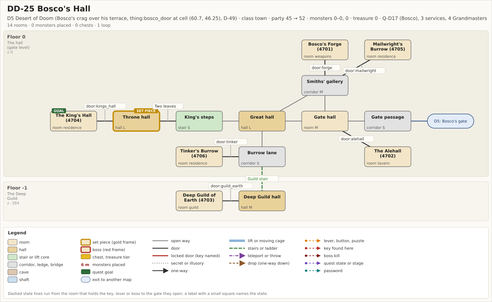
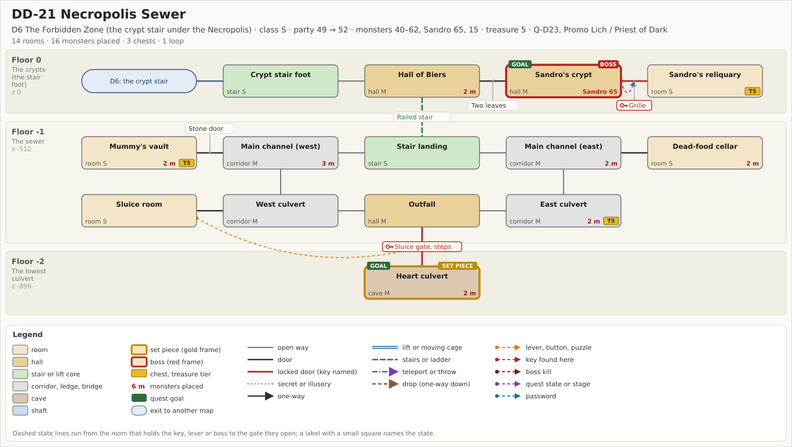
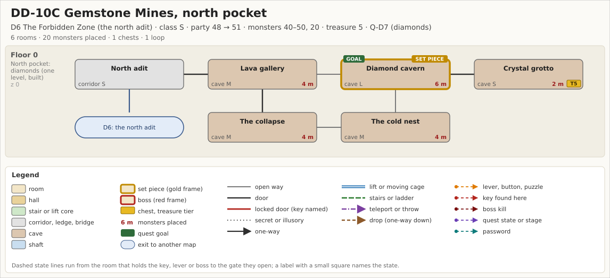
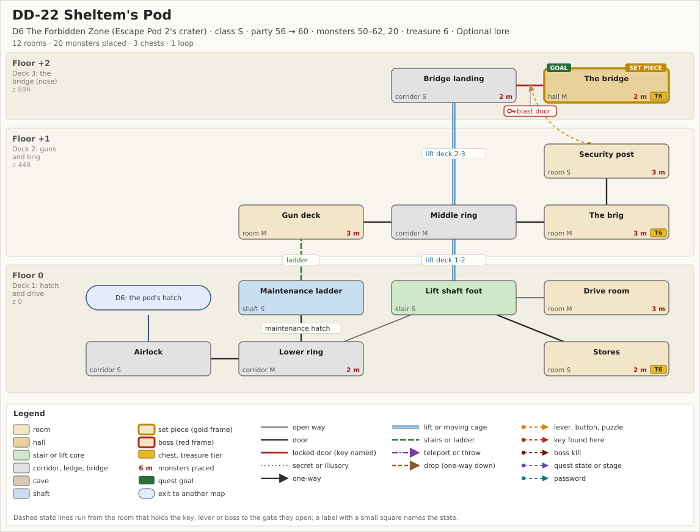

# Act V dungeon graphs, lane A8, second page (MU-6)

Review page for phase 5, 2026-11-21, lane A8 (`xeen-a8`, session 11), for a decider. It holds the rest of A8's
phase-5 maps after [act5_dungeon_graphs_a8.md](act5_dungeon_graphs_a8.md) (DD-15, DD-17, DD-08; Q1–Q31, decider
D-61): **DD-25 Bosco's Hall** (the dwarf town BLV), **DD-21 Necropolis Sewer** (Sandro), **DD-10C's Act V update**
(the built north pocket of the Gemstone Mines, D-27) and **DD-22 Sheltem's Pod** (a phase-6 map, drawn now). Review
documents, not briefs; each L1 starts from its graph file once the questions below are answered. **Every open
question is numbered once, continuing the first page** (Q32–Q55, "Open questions"), each with its options (the
proposed default first), the evidence and what depends on it. The maps can be decided one by one; DD-21's count
depends on DD-08's (Q22 on the first page), DD-22's on DD-26's graph (phase 6).

**Reading the pictures:** as on the first page and A7's Act V page ([act5_dungeon_graphs_a7.md](act5_dungeon_graphs_a7.md)):
one band per floor, the highest on top, its height under its name; box colour by kind (room, hall, stair or lift
core, corridor, cave, shaft); gold frame set piece, red frame boss, green tag quest goal, red "6 m" monsters placed,
gold "T5" a chest of that tier; one line style per connection kind (open, door, locked, secret, one-way, lift,
stairs, teleport, drop); a gate's label names the state that opens it, and a dashed line of the state's colour runs
from the room that holds it. Blue pills are exits.

**Files:** [act5_graphs/](act5_graphs/) (shared with the first page and A7's maps): `<key>.graph.yml`, `<key>.svg`,
`notes_<key>.md`. Redraw with `python3 devdocs/xeen/mockups/act5_graphs/render_graphs.py dd25 dd21 dd10c dd22` (no
overlap printed); PNG copies `output/studio_cal/a8_s11/png/<key>.png` (headless Chrome, looked at). This page is
assembled by `output/studio_cal/a8_s11/make_act5b_page.py` from the notes files.

**Rules used for all** (the first page's): sizes and counts inside the class bands (MAPS, Dungeons) and MAPS §0's
rows, kill XP per member L(L+10) per kill over four within about ±10 %; A2's rows by id; loops in every M and L map;
every dead end holds a chest, a lever, a find or a goal; no riddle the game does not answer; every locked door's
opener placed; only engine words that exist; lamps where they can hang; props by the walls; rewards at MM6–MM8 size;
every exit the `exit` preset (D-24); inside entrances named after the map they are entered from (D-37); the first
room past each map door quiet (D-11.3); every A3 hook naming the map placed. Map qbit blocks (provisional, A3 to
register): DD-25 117680, DD-21 117720, DD-22 117760 (40 each); DD-10C keeps 117240.

| Dungeon | Stands on | Class | Rooms | Monsters | Kill XP per member | Chests | Loops |
| --- | --- | --- | --: | --: | --- | --: | --: |
| DD-25 Bosco's Hall | D5 | town | 14 | 0 | 0 | 0 | 1 |
| DD-21 Necropolis Sewer | D6 | S | 14 | 15 | 10.70k per member | 3 | 1 |
| DD-10C Gemstone Mines, north pocket | D6 | S | 6 | 20 | 11.50k per member | 1 | 1 |
| DD-22 Sheltem's Pod | D6 | S | 12 | 20 | 17.20k per member | 3 | 1 |

---

## DD-25 Bosco's Hall

D5 · town BLV · party 45 → 52 · no monsters · no chests · Q-D17 (Bosco gives the Northern Tower's key, takes the Chalice) · 3 services, 4 Grandmasters

The source has no hall. Bosco the Dwarf King stands out on the Desert of Doom (dark maze0013, cell (1,8); aaze0013:13–17).
WORLD_DESIGN §5.2 and MAPS's D5 sheet give him "a dwarf hall dug into the highlands (small BLV)" with a smith, a tavern,
an Earth guild and two residences. A4's `source/towns/dd25.yml` names six doors (4701–4706). This is the first town BLV
among the graphs.

The graph shows 14 boxes: 8 rooms (about 12 sectors) and 6 house screens. A house screen is the MM6–MM8 house dialog
behind a clicked door face; it has no geometry. The floor is about 9.9 M units². There are 8 doors: the gate and the
throne hall's doors are two-leaf pairs, and the six house doors are clicked faces with no movers.

- **What it is.** A short underground street, one axis from the gate west into the crag:
  - the gate hall, with the Alehall's door first;
  - the great hall round its hearth;
  - the King's steps up to the throne hall, with the King's Hall door behind the dais.
  - Side ways: the Forge and the Mailwright side by side on the smiths' gallery (open at both ends: the loop); the
    Tinker on the burrow lane; one stair down to the Deep Guild of Earth.
- **Critical path.**
  1. The gate passage (`entrance:d5_bosco`, quiet). The gate hall, the great hall, the King's steps, the throne hall's
     two leaves.
  2. Bosco's door behind the dais (house 4704). His A3 topics give the key: started 113340, key 113341, autonote
     4570. Q-D17's hand-in takes the Chalice later (done 113343).
- **Way back.** Round the hearth, then out through the smiths' gallery past the Forge and the Mailwright to the gate.
- **Off the path.** Every dead end holds a door:
  - the Alehall: the gate hall's south wall, about 800 from the arrival;
  - the Tinker's Burrow: the burrow lane;
  - the Deep Guild of Earth: the guild hall at z −384, one stair down from the lane's west end. TOWN_FEEL puts guilds
    and temples apart or raised; "Deep" puts it below.
- **Loop (1).** Gate hall → great hall → smiths' gallery → gate hall.
- **Set piece.** The throne hall at z 128:
  - Bosco's empty throne on a three-step dais under his banner (`xdbosban`, once per face);
  - the long tasting table on the north wall, with its cups and the taster's stool;
  - braziers on the floor by the dais;
  - the King's Hall door behind the dais.

  This follows Stone City's Throne Room: an EnterHouse bound inside a walk-in hall (Q33). The great hall's round
  hearth (`7cdb`) is the town square. It is a dressing set piece, and the walking lines pass 512 clear on either side.
- **Size, argued.** There is no town-BLV precedent in the graphs:
  - **MAPS D5:** "dwarf hall, small BLV".
  - **WORLD_DESIGN §5.2:** 3 services, 2 residences plus the King.
  - **ROADMAP §5.5:** `towns.py` holds residences to §5's numbers. A4 counts the King's Hall as a third residence.
  - **TOWN_FEEL 5c (`--small`):**
    - Services 5–25 and residences 6–56. DD-25 has 3 and 3; WORLD_DESIGN's numbers win, and both are kept as "Town
      feel exceptions" lines in the map's NOTES.
    - Service-to-service median 854–2,424. Ours is about 2,300 (Alehall to Forge 2,290; Deep Guild to Forge about
      3,950).
    - The tavern among the first doors from the arrival (rank 0.05–0.33): the Alehall is the first.
    - Weapon and armour shops next to each other: the Forge and the Mailwright, 768 apart.
    - `town_feel.py` reads ODMs only; these rules are applied by hand.
  - **The shipped measure:** MM7 Stone City `7d24`'s town quarter. Its octagon of 2,176 has timber house fronts, the
    approach and the Throne Room behind (sectors 4, 5, 11, 12, 15, 27–29, 31–34). It holds 18 doors (9 services, 8
    residences, the Throne Room) in 12 sectors and 13.95 M units².
  - **Ours:** six doors and a walk-in throne hall in about 12 sectors and 9.9 M. That is inside S's figures (6–15
    sectors, 7–20 M, 3–8 doors) (Q32).
  - **Footprint:**
    - great hall 2,048 × 1,536 (vault 768);
    - throne hall 1,536 × 1,280;
    - Deep Guild hall 1,280 × 1,024;
    - smiths' gallery 2,048 × 512;
    - gate hall 768 × 1,024;
    - burrow lane 1,280 × 512;
    - King's steps 512 × 768;
    - guild stair 512 × 768;
    - gate passage 512 × 384.
- **Monsters and kill XP.** None: a town. The MAPS row DD-25 has "—" and maps.yml has `monsters: "0"`.
  - No kill XP, and nothing goes into Act V's kill budget.
  - No rest encounters: there is no hostile row to draw from (D-39), so resting is allowed and quiet. The Alehall sells
    food (D-29, price 20).
  - Peaceful dwarves stand in the halls, uncounted (Q34): two gate guards, two throne guards, four townsfolk.
- **Treasure.** None: no chests and no finds (maps.yml treasure "-"). The shops are the treasure: the Forge at
  quality 4, axes and maces. Q-D17's reward is A3's: 2 Energy Disks, 5,000 gold, 14,000 experience, award 457.
- **Lights and props** (lanes/README):
  - Light: sconces on the walls and pillars, two chandeliers hung from the great hall's vault, braziers standing on
    the throne hall's floor, the forge bay's glow inside its wall opening, lamps on the guild hall's floor. None on a
    leaf or in a doorway.
  - About 30 light sources (7d24 has 3.86 per M) and about 25 decorations (7d24 2.77 per M).
  - Props by the walls only:
    - a pair of ale barrels beside (not before) the Alehall's door;
    - an anvil beside the Forge's door;
    - benches along the great hall;
    - the guild hall's crystal vein.
  - Kept clear: 384 either side of every walking line and 256 before every door.
- **Original lines.**
  - aaze0013:13, "Bosco / The Dwarf King": his name and title.
  - :14, the seer and the Chalice: A3's opening topic and A4's greeting.
  - :15, "Please get the Chalice. I live in fear for my life.": the started state.
  - :16, "Oh, thank the Gods! ... I dub thee royal taste tester...": the hand-in, MAPS's original line. The +1,000,000
    experience is A3's 14,000.
  - :17, "Ah, the taste testers! Please, please, sit down and drink with me for awhile! My halls will always be open
    to you.": proposed for after `done` (Q36). A3 and A4 do not use it yet.
  - New lines (A3): the first arrival, "The hall rings with hammers. A dwarf at the gate looks you over, then your
    boots, and waves you in." (map qbit 117680); the well, "Cold and clean. The King had it tasted this morning."
- **Door to D5.** D5's `door:dd25` (`thing:bosco_door` at cell (60.7, 46.25), about (−1,690, 9,088)) is a 384 × 320
  doorway in the crag with two `t09a03a` leaves, mirrored. It is sealed with a message until DD-25 is built.
  - **Inside arrival:** `entrance:d5_bosco`, confirmed as D5 assumed it (D-37). It stands in the gate passage 256
    inside the leaves at (2,048, 0, 0) in the map's frame, facing west (1024), into the hall. The frame: great hall
    centred on 0, 0; the leaves in the east wall at x 2,304; z 0 = D5's sill. The leaves' inner face is the same
    mirrored `t09a03a` pair.
  - **Return:** the `exit` preset (D-24; the source has no "Leave" line) to D5's installed `entrance:dd25_door`
    (−512, 9,216, 2,688), facing 0 (east). That point is at the end of `link:bosco_lane` on the terrace, about 1,050
    east of the leaves, facing away. **It matches.** Keep it: D5's town-buffer figure (2,700) is measured from it.
    D5 changes only the door: drop the sealed message and add `into: {map: xeen_dd25.blv, arrival:
    entrance:d5_bosco}`.
- **Doors.** All six of A4's door ids are confirmed and drawn:

  | Door | House | Kind | Resident | Where |
  | --- | --- | --- | --- | --- |
  | `door:forge` | 4701 | weapon shop | Durgan, Axe GM | smiths' gallery |
  | `door:alehall` | 4702 | tavern | Brunna | gate hall |
  | `door:guild_earth` | 4703 | Earth guild | Stonebeard, Earth GM | Deep Guild hall |
  | `door:kings_hall` | 4704 | residence | Bosco | behind the throne |
  | `door:mailwright` | 4705 | residence | Hilde, Chain GM | smiths' gallery |
  | `door:tinker` | 4706 | residence | Gimble, Repair GM | burrow lane |

- **Hooks.** None. `quest_hooks.yml` names no hook on DD-25 (checked). Q-D17 lives in Bosco's topics (house 4704). The
  flavour topics are Brunna's, Stonebeard's and Gimble's (`npcs/flavour/dd25.yml`). `q-d17.tower_door` belongs to D5;
  `voice`, `chalice` and `oath` belong to DD-08. Map qbits: 117680 `dd25_arrived_once`; the rest of 117680–117719 is
  free.
- **Textures.** MM7 Stone City `7d24`'s town quarter (Q35), about 24 of S's 30, 1 new:
  - walls and vaults: dressed `cwb` walls under `cwb1` rock vaults;
  - floors: `7tfb1`, `cfb1`;
  - trim: the `trim1_32` frieze, `7trimd`/`7trimda`;
  - the six house fronts: `hdr1b`, `hdm2b`, `hdp1b`, `hdp1er` under `hhm1rf`. No Xeen map uses them; XD-09 took only
    7d24's rock;
  - the hearth: `7cdb`;
  - the throne hall's two leaves: `hdr1dl`/`hdr1dr`, each its own wing;
  - the gate: `t09a03a` mirrored (D-49);
  - signs: `sgweapon`, `7sgtvrn`, `sgearth`;
  - the well: `7wtrtyl`;
  - new: `xdbosban` (Bosco's banner, once per face).

  Distinct from XD-02 (6d05/6d09, the Cloudside dwarves), XD-03 (7d34/6d18), XD-09 (7d24's rock hub, the other face)
  and every D5 dungeon.

Open questions: Q32–Q39 below. **State and next steps.** The graph, the SVG and these notes were written on 2026-11-21 (A8 session 11, phase 5,
graphs only; nothing is built or installed). The render printed no warnings. The PNG
(`output/studio_cal/a8_s11/png/dd25.png`, headless Chrome) has been checked. Next: the decider answers the DECIDE
items, then L1.

---

## DD-21 Necropolis Sewer

D6 · S · party 49 → 52 · 40–62, Sandro 65 · 15 + Sandro · treasure 5 · Q-D23 (Sandro's Heart), Promo Lich / Priest of Dark

The source's Necropolis Sewer (dark maze0036, 16 × 16, aaze0036) lies under the Necropolis (maze0035). It has a cross
of sewage channels and three ladders up to the city ("Descend to the sewer?", aaze0035:17). Twelve barrels are signed
"Food for the dead, keep warm."; seven hold Dead Food (a Might test, two monsters, +1 level). There are twelve sewer
drains, an alcove, a trapped box and the "Mummy's Secret Treasure", and 11 Lava Roaches (level 40). Sandro stood in
the Necropolis itself (aaze0035:25–29); only his heart was in the sewer. Ours puts both in one BLV of three floors:
Sandro's crypt at the stair foot (0), the sewer below it (−512) and the lowest culvert (−896). It has 14 review rooms,
about 14 sectors, about 11 M units² and 8 doors (S: at most 15 sectors and 20 M units²).

- **What it is.** A lich's crypt over a sewer. Master Morbius (5506) sends the party down the crypt stair in the
  Necropolis's south-east corner. Sandro fights, falls and rises again; his heart beats in a jar in the lowest
  culvert. Bring it back and he is released, with the Key to the Dungeon of Death; casters may ask for his ritual
  first (the Lich and Priest of Dark promotion).
- **Critical path.**
  1. The crypt stair foot (`entrance:d6_stair`, quiet), the Hall of Biers, Sandro's crypt. On the first entry his
     name and "And now my hunger for the living compels me to attack you." (aaze0035:25, :26). He falls once:
     `q-d23.sandro` (beaten, autonote 4630), and the risen Sandro stands by his bier (Q41).
  2. Down the railed stair to the sewer; the main channel's west arm, the west culvert. In the sluice room the wheel
     lifts the culvert gate (one way, D-43).
  3. The outfall, the steps down, the heart culvert: the jar (`q-d23.heart`, Sandro's Heart 12353).
  4. Back by the east culvert and the main channel's east arm (the ring), up to the crypt. On the dais's step plate,
     with the heart: "Give Sandro his heart?", then "Ask Sandro for his ritual first?" (`q-d23.ritual`), then
     `q-d23.release` (the key 12354). Sandro is gone and the reliquary grille opens.
- **Off the path.** These rooms lie off the critical path:
  - The mummy's vault (behind a stone door at the west arm's end): two Ghost Mummies and the source's "Mummy's Secret
    Treasure" (T5).
  - The dead-food cellar: the barrels and the one that can be pried (Q43).
  - The east culvert's niche with the source's trapped "Box" (T5), and three sewer drains with small finds.
  - Sandro's reliquary (T5 and his statuette, Q45), on the way out.
- **Loop (1).** The sewer ring: stair landing, west arm, west culvert, outfall, east culvert, east arm.
- **Set piece.** Sandro's heart: the lowest culvert falling into a black cistern, the jar of green glass on a ledge,
  a green light in it and a slow heartbeat heard from the steps. Sandro's crypt (the boss) is the second goal.
- **Riddles and their answer-givers.**
  - Where the heart is: Master Morbius (5506, "He lives in the sewer under us"), Digby the gravedigger (5510, "Something
    under the city keeps its heart in a box"), Sandro himself at his first fall, and autonote 4630.
  - The sluice gate: its click says the wheel is upstream; the wheel's click says what it opened.
- **How Sandro rises (Q41).** Proposed with existing engine words only:
  - Two bodies. The hostile Sandro (11283) falls for real, once; a timer with a kills condition (XD-19's
    `evt:lord_dead` pattern) calls `q-d23.sandro` and shows a hidden risen Sandro by the bier.
  - The risen Sandro is a peaceful placed-only figure (A2 row). A load event keeps him unkillable
    (`SetMm9ActorCanReceiveDamage(false)`) and shows him while `beaten` is set and `released` clear.
  - He talks through the dais's step plate and the bier's click (he has no NPC id). Without the heart he says the
    beaten text; with it, the heart text and the two prompts. After the release he crumbles to dust (a shipped
    effect) and stays hidden.
  - There is no second fight. A3 trims two lines of the hook text, as Q41 says.
- **Monsters (15 + Sandro) and kill XP.** These are placed:
  - Cinder Roach 40 × 10 (a new giant-crawler tier D, A2 request; the source's Lava Roach D33 at 40). Two of them are
    hidden in the Dead Food barrel and shown when it is pried.
  - Greater Lich 50 (11281) × 3, Sandro's household: two in the Hall of Biers, one at the heart.
  - Ghost Mummy 62 (11273, placed only, D-57) × 2 in the vault.
  - Sandro 65 (11283) once.

  Groups are 2–3. The stair foot, the landing, the sluice room, the outfall and the reliquary are quiet. XP:
  - **10.70k per member** (42,803 / 4): the 15 at 9.48k, Sandro 1.22k.
  - **Sandro counts once.** Under Q41 (a) he dies once and rises as a figure that is never fought; under (b) he
    never dies (no kill XP; the release's 12,000 stands in).
  - With DD-08's 45 (31.14k) the group is 60 + Sandro and **41.84k against 39.6k, +5.7 %**. Session 10 assumed DD-21
    at about 10k (+3.9 %); the exact share would be 8.47k (Q40 c).
  - Rest encounters 10 % from the Greater Liches and the Cinder Roaches (Q47).
- **Treasure.** Three chests T5 (S: 0–3): the reliquary (Sandro's "treasures in this room"), the mummy's vault and the
  trapped Box. Three drain finds at treasure 5, the Dead Food (Q43), the heart and the key.
- **Original lines.**
  - Sandro: aaze0035:25 (his name) and the last sentence of :26 on the first entry; :27 and :28 are A3's
    `q-d23.sandro` and `q-d23.release` texts (the "+2,000,000 experience" dropped); :29 "Don't even THINK about taking
    my statuette!" on the reliquary grille.
  - The sewer: aaze0036:4/:5 the signed barrels; :7, :8 and :9 the Dead Food (rescaled); :3/:1 the drains; :10 the
    vault's door; :2 the Box; :0 the alcove.
  - aazex122:24 (Sandro's note "Gone to Necropolis ...") belongs to the Dungeon of Death, FD-04's lower half, which his
    key opens: not placed here.
- **Door to D6.** D6's `door:dd21`: `thing:dd21_crypt`, the crypt in the Necropolis's south-east corner, grille pair
  `gkp103a` in its north face, sealed with a line until DD-21 is built.
  - **Inside arrival proposed:** `entrance:d6_stair` (as D6 assumes, D-37), at the stair foot. In the map's frame it is
    about (0, 0, 0); the stair climbs north from y 256 to the grille pair at y 1,024, z 448. Facing south (1536), into
    the Hall of Biers. The grille's inner face is the same `gkp103a` pair, with the exit preset at the stair's top.
  - **Return:** the exit preset to D6's installed `entrance:dd21_stair` (17408, −11776, 1664), facing 512. It lies about
    280 north of the crypt's door (the crypt spans sketch x 97.25–98.75, its north face at about y −12,060), facing away.
    **It matches**; the door goes live by itself once DD-21's sidecar lists `entrance:d6_stair` (D6 NOTES).
  - The source's sewer had no way-up line. The exit preset's meaning is proposed map-local: "Climb up to the
    Necropolis?" (A3). "Descend to the sewer?" (aaze0035:17) suits D6's side of the door.
- **Hooks.** All four of Q-D23's DD-21 hooks are placed:
  - `q-d23.sandro`: Sandro's first fall, then the dais's step plate and the bier.
  - `q-d23.release` and `q-d23.ritual`: the two prompts at the dais.
  - `q-d23.heart`: the jar in the heart culvert.

  Map qbits:
  - 117720: `dd21_arrived_once`.
  - 117721: the sluice.
  - 117722: Sandro's first-entry line.
  - 117723: the Dead Food barrel pried.
  - 117724–117726: the three drains.
  - 117728: the statuette, only under Q45 (b).
  - The rest of 117720–117759 are free.
- **Textures.** The sewer is MM6 Free Haven Sewer `sewer.blv` (A6's assign for DD-21, another face than XD-01's): grey
  d1 stone walls (`d1wcntr`, `d1wldle2`, `d1wldle3`, `d1smbw`), `d7flor4` walkways, `swprrf3` sewage with the `swp`
  pipe mouths, `d1lggrt` grates, `d1mbea` beams. Sandro's crypt is MM6 Tomb of Ethric the Mad 6d14's niches (A6's
  crypts assign): `d2wlbctr`/`d2wlbpos` walls, `d2niche1/3/4`, `d2flor4`, `d2ceil3`, `d2lgdor` doors, `crsmdr1` on the
  vault, `cedsqrdk` posts. The stair's top uses D6's `gkp103a` inner face. About 24 of 30 textures; 1 is new: `xdsandro`
  (Sandro's seal, a heart pierced by a bone, once over the crypt doors).

Open questions: Q40–Q47 below. **State and next steps.** The graph, the SVG and these notes were written on 2026-11-21 (session 11, phase 5,
graphs only; nothing is built or installed). The render printed no warnings; the PNG
(`output/studio_cal/a8_s11/png/dd21.png`, headless Chrome) has been checked. Next: the decider answers the DECIDE
items, then L1.

---

## DD-10C Gemstone Mines, north pocket (Act V update)

D6 · S · party 48 → 51 · 40–50 · 20 · treasure 5 · Q-D7 (diamonds), repeatable · D-27

The pocket is **built** (phase 3, in scratch: `briefs/dd10c/L4/NOTES.md`, `output/studio_cal/dd10c/`) from the Act III
graph as D-27 approved it ("layout as drawn; moves to Act V"). It has 6 rooms = 6 sectors, 10.94 M units², 3 plank
doors, 1 chest and one loop, and its audit is 0 / 0. This update covers only what phase 5 adds: the monsters on
gen.py's 20 marked spots, the live exit to D6's adit and the Act V map row. It also gives the roach nest a story, now
that D-27 has taken the roaches out. The layout is not redrawn.

- **What it is.** The diamond quarter of the source's Gemstone Mines (dark maze0039, aaze0039), reached by its own
  adit in D6's southern crags. Hector's diamonds come only from here (D-27: "Few who go there come back.").
- **Critical path.** The north adit (`entrance:d6_adit`, quiet), the lava gallery, the diamond cavern's five veins
  (`q-d7.diamond_veins`).
- **Way back.** Through the cold nest and the collapse to the lava gallery, round the loop.
- **Off the path.** The crystal grotto: a dead end with the miner's chest (T5). The collapse's rubble. The cold nest.
- **Loop (1).** The lava gallery, the diamond cavern, the cold nest and the collapse (built).
- **Set piece.** The diamond cavern: five `xdvdiam` veins with white glints in black glittering rock, the seam's red
  light at its west end, and the false vein ("A gem exploded!", 28 fire to every member once; built and scaled to
  Act V).
- **Monsters (20) and kill XP.** Floating Eye 40 (11570) × 14, Terrible Eye 50 (11571) × 4 and Patrol 50 (11610) × 2,
  the three families MAPS §0 names. By room: lava gallery 3 + 1 Patrol, cavern 4 + 2, grotto 1 + 1, collapse 3 + 1
  Patrol, nest 3 + 1.
  - XP: **11.50k per member** (46,000 / 4), MAPS §0's 11.5k: **0.0 %**.
  - Groups of 2–4 on gen.py's spots, as built. Quiet: the adit (D-11.3). D-32: every opening is 320–400 high, and
    none of these is a big monster.
  - Rest encounters: 10 % from the two eye rows (D-39).
- **Treasure.** The grotto's chest is T5 (built). The map card's treasure level is 5.
- **Original lines.** "Exit the Gemstone Mines?" (aaze0039:0, the exit preset's meaning), "Diamond vein" (:1),
  "You've got all this vein has to offer." (:10), "A gem exploded!" (:11).
- **Door to D6.** D6's `door:dd10c`, `thing:dd10c_adit`: a cave mouth in its timber frame, asking "Enter the mine?".
  - **Inside arrival:** `entrance:d6_adit` (the name D6 assumes) at the map's start, (0, 192, 0) in the map's frame
    (the mouth at y 0), facing north (512).
  - **Return:** the exit preset in the adit's south wall, replacing the boarded panel and its line, to D6's installed
    `entrance:dd10c_adit` (−9216, −16384, 2688) facing 512. That point is one cell north of the mouth (mouth at sketch
    y 97, point at y 96), facing away from it. **It matches.** gen.py sets `D6_LIVE = True` and `D6_ARRIVAL` to this
    point; `playtest_exit.yml` measures it.
  - The height disagrees between sources: D6's NOTES write z 2624 and the installed sidecar writes 2688. The exit
    uses the sidecar's value; A6 confirms which is right.
- **Hooks.** `q-d7.diamond_veins` on the five veins (built). The refill reads `q-d7.refill_c` 113143 on entry
  (built). Map qbit 117240 `arrived_once` stays in DD-10C's own block, 117240–117279.
- **Textures.** As built: the mines family, MM7 7d35 with 6d18's black lava rock, `lavatyl`, d37 `gcrysc3` and
  `xdvdiam`. 16 of S's 30, 0 of 4 new.

Open questions: Q48–Q50 below. **State and next steps.** This update was written on 2026-11-21. The graph, the SVG and these notes are new; the PNG
`output/studio_cal/a8_s11/png/dd10c.png` (headless Chrome) has been checked. The map itself is unchanged in scratch.
Once the decider answers, phase 5 sets `PHASE5_ROWS` (and the third slot under 1 (a)), `PHASE5_MONSTERS`, `D6_LIVE`
and `D6_ARRIVAL` in `output/studio_cal/dd10c/tools/gen.py`, the map card slots, the playtests (hostility, exit), then
install, bake and 4 of 4 (`briefs/dd10c/L4/NOTES.md`, "What phase 5 adds").

---

## DD-22 Sheltem's Pod

D6 · S · party 56 → 60 · 50–62 (band 48–65) · 20 · treasure 6 · optional lore (Act VI; ROADMAP phase 6)

The source's Escape Pod 2 (dark maze0088, aaze0088) is the twin of Corak's pod (maze0087). It has the same plan and
no monsters, chests or stasis field. Its consoles are dead, its weapons disarmed and its two alien devices dormant.
The log computer still holds Sheltem's own account, from his break with the Ancients to the crash on Xeen.

On D6 the pod stands upright in its crater in the Ancient field (sketch (78, 38), `swll4dk` hull, round hatch at the
base facing south). Ours is therefore three decks stacked round a lift shaft, 448 apart, with the hatch on the lowest.
It is larger inside than outside, as DD-08 is: the hull is 1,280 across, each deck about 1,900. The map has 12 review
rooms, about 13 sectors, about 10 M units² and 8 doors (S: at most 15 sectors and 20 M units², 3–8 doors).

- **What it is.** The other ship's log (MAPS). Sheltem left the pod to conquer Xeen and left his guard machines in
  it (his "security systems", aaze0088:14–15). It is optional, for Act VI parties.
- **Critical path.**
  1. The airlock (`entrance:d6_hatch`, quiet), the lower ring, the lift to deck 2.
  2. The brig, the security post: "Security lockdown: bridge sealed. Release?" Yes opens the bridge's blast door,
     one way (D-43; map qbit 117761).
  3. The lift to deck 3, the blast door, the bridge: the log computer.
- **Way back.** The lift down to deck 2, then the gun deck's ladder down to the lower ring: a different way down.
- **Off the path.** The drive room (the dormant devices and the cold stasis generator, Q53). The stores, a dead
  end with a chest (T6). The gun deck (phaser and photon "Fire anyway?", "Nothing happens.", as DD-16 under D-47).
  The brig's two dark stasis cells, where Sheltem shut the Ancients' agents, one of them Corak (log XL70I), with
  the guards' locker (T6).
- **Loop (1).** Up by the lift and down by the ladder: two ways between decks 1 and 2.
- **Set piece.** The bridge in the nose: Sheltem's empty command couch under a domed viewport of dark steel ribs,
  the main and scanning consoles flickering red ("The computer seems to be malfunctioning."), and the log computer
  still paging his entries (Q54). His locker under the couch holds a T6 chest.
- **Monsters (20) and kill XP.** Patrol 50 (11610) × 14 and Annihilator 62 (11611) × 6: Alamar's machines, which
  are Sheltem's own (DD-17's rows). By deck: 7, 9, 4.
  - XP: **17.20k per member** (68,784 / 4). That is 51.3 % of the DD-22 + DD-26 row (40 at 48–65, 33.5k); half of
    the row is 16.75k, so DD-22 is +2.7 %. DD-26 (Olympus Sewer, phase 6, A8) keeps 20 monsters at about 16.3k.
  - Groups of 2–3. Quiet: the airlock (D-11.3), the middle ring, the lift shaft.
  - Rest encounters 10 % from the Patrol only (Q55).
  - D-32: nothing large is kept in by an opening (every door is 256 high or more).
- **Treasure.** Three chests T6 (S: 0–3): the stores, the brig's locker and Sheltem's locker.
- **Original lines.** "Exit Escape Pod 2?" (aaze0088:1, the exit preset's meaning, D-24); the dormant device (:0);
  Phaser and Photon Control (:2, :3); the main and scanning consoles (:5, :6); the log entries (:4, :7–17, abridged).
  No voiced line: D-38 gives Sheltem's two voiced lines to DD-17.
- **Door to D6.** D6's `door:dd22`, Escape Pod 2's hull door. Its effect is A3's `d6.sheltem_hatch` ("sealed from
  inside ... not answering the door").
  - **Inside arrival proposed:** `entrance:d6_hatch` (D-37: entered from D6), in the airlock about 192 inside the
    hatch at about (0, −832, 0) in the map's frame (lift shaft at 0, 0; the hatch in deck 1's south wall at y −1024),
    facing north (512). DD-16 also has an `entrance:d6_hatch`, but entrance names are per map, so the two do not
    clash. The brief's alternative `entrance:d6_hatch2` is not needed.
  - **Return:** the exit preset to D6's installed `entrance:dd22_hatch` (7168, 12288, 1952) facing 1536. The pod's
    centre is (78, 38) = (7168, 13312), so the point is 1,024 south of it and 384 off the 640-radius hull, facing away.
    **It matches.** D6 drops `listed_only` and names the arrival once DD-22 is built.
  - **Opening:** once `m33.done` (Q52); before that, the hook's sealed line.
- **Hooks.** `d6.sheltem_hatch` is D6's (listed for the pair). No quest hook names DD-22. Map qbits:
  - 117760: `dd22_arrived_once`.
  - 117761: `lockdown_released`.
  - The rest of 117760–117799 are free. The log's page is a map variable.
- **Textures.** A6's assignment in `dungeon_families.yml` (pods): MM6 Control Center (`sci-fi.blv`) in its **red
  accents** (`swrdk2`, `swared`, `swfloor5a`), with walls `swll4dk`/`swll5dk` matching the hull outside. Doors are
  `swdoora`/`swdoorb` (the blast door a mirrored pair), girders `swgirder`, consoles `trekscrn`/`swor2`. It reads
  apart from DD-16's green MM7 Lincoln and from DD-17's teal main set. About 18 of 30, 0 new.

Open questions: Q51–Q55 below. **State and next steps.** The graph, the SVG and these notes were written on 2026-11-21 (graphs only; nothing is built
or installed). The render printed no warnings, and the PNG (`output/studio_cal/a8_s11/png/dd22.png`, headless
Chrome) has been checked. Next: the decider answers the DECIDE items. DD-22 is a phase-6 map (ROADMAP §6), so its L1
follows DD-26's graph for the group split.

---

## The surface maps' doors against the graphs

Outside points from the installed `xeen_d5.studio.yml` and `xeen_d6.studio.yml` (A6); inside arrivals proposed here (D-37 names).

| Map | Door | Inside arrival (proposed) | Outside |
| --- | --- | --- | --- |
| DD-25 | D5: Bosco's gate | entrance:d5_bosco (as D5 assumed): in the gate passage 256 inside the leaves, at (2,048, 0, 0) in the map's frame (the leaves in the east wall at x 2,304, the great hall centred on 0, 0), facing west (1024), into the hall | D5 door:dd25 = thing:bosco_door (60.7, 46.25) = about (-1,690, 9,088), a doorway 384 x 320 in the crag, two t09a03a leaves mirrored, sealed with a message until DD-25 is built. Out by the exit preset (D-24; the game's 'Do you wish to leave Bosco's Hall?') to D5's installed entrance:dd25_door (-512, 9,216, 2,688) facing 0 (east): at the end of link:bosco_lane on the terrace, about 1,050 east of the leaves, facing away. Matches; keep it (D5's town-buffer figure, 2,700, is measured from it). D5 changes only the door: drop the sealed message, `into: {map: xeen_dd25.blv, arrival: entrance:d5_bosco}` |
| DD-21 | D6: the crypt stair | entrance:d6_stair (as D6 assumes, D-37): at the stair foot, about (0, 0, 0) in the map's frame (the stair climbs north from y 256 to the grille pair at y 1,024, z 448), facing south (1536) into the Hall of Biers | D6 door:dd21 (thing:dd21_crypt in the Necropolis's south-east corner, grille pair gkp103a, door in its north face); out by the exit preset at the stair's top to D6's installed entrance:dd21_stair (17408, -11776, 1664) facing 512: about 280 north of the crypt's door (the crypt spans sketch x 97.25-98.75, its north face at about y -12,060), facing away from it. Matches; D6 changes only the arrival name (the door goes live by itself once DD-21's sidecar lists entrance:d6_stair) |
| DD-10C | D6: the north adit | entrance:d6_adit (as D6 assumes): the map's start, (0, 192, 0) in the map's frame (the mouth at y 0), facing north (512), into the pocket | D6 door:dd10c (thing:dd10c_adit, the cave mouth in its timber frame, 'Enter the mine? (Yes/No)'); its placeholder text goes and the neighbour drops listed_only. Out by the exit preset ('Exit the Gemstone Mines?', aaze0039:0) to D6's installed entrance:dd10c_adit (-9216, -16384, 2688) facing 512: one cell north of the mouth (the mouth at sketch y 97, the point at y 96), facing away from it. Matches; gen.py D6_LIVE = True, D6_ARRIVAL = that point (D6's NOTES write z 2624, the installed sidecar 2688: A6 confirms; the exit playtest measures it) |
| DD-22 | D6: the pod's hatch | entrance:d6_hatch: in the airlock about 192 inside the hatch, at about (0, -832, 0) in the map's frame (the lift shaft at 0,0; the hatch in deck 1's south wall at y -1024), facing north (512). The name is D-37's (entered from D6); DD-16 has its own entrance:d6_hatch in its own map, so the two do not clash | D6 door:dd22 (thing Escape Pod 2's hull door, its effect XeenQuests.hook('d6.sheltem_hatch')): the hook opens and moves once m33.done, else its sealed line (A3). Out by the exit preset ('Exit Escape Pod 2?', aaze0088:1) to D6's installed entrance:dd22_hatch (7168, 12288, 1952) facing 1536: 1,024 south of the pod's centre (78, 38) = (7168, 13312), 384 off the 640-radius hull, facing away. Matches; D6 drops listed_only and names arrival: entrance:d6_hatch when DD-22 is built |

## Open questions (Q32–Q55)

Each gives the options with the proposed default first and marked "(a, proposed)", the evidence and what depends on it. The graph files hold the same questions under `open_questions`.

### DD-25 Bosco's Hall

**Q32.** **Size.** - (a, proposed) About 12 sectors, 9.9 M units², 8 doors, one loop, a walk-in throne hall, the guild one stair down: inside S's figures. - (b) Stone City's octagon alone: six house fronts round one hall, about 6 sectors and 6 M, no loop. - (c) About 18 sectors and 15 M, with four closed dwarf house fronts to reach TOWN_FEEL's 6 residences. - Evidence: the 7d24 quarter (18 doors in 12 sectors and 14 M). Depends: A4's residence check, L1.

**Q33.** **The King's Hall.** - (a, proposed) A walk-in throne hall (the set piece) with `door:kings_hall` behind the dais. Stone City binds EnterHouse 216 inside its walk-in Throne Room. The throne stands empty, and Bosco is in the house screen. - (b) A house front on the great hall like the other five. - (c) As (a), plus Bosco as a placed talking actor on the throne (`monsters[].npc` 5401: a row from A2, a body from S).

**Q34.** **Townsfolk.** - (a, proposed) Eight peaceful dwarves standing, uncounted: four guards on the engine's Dwarf A rows (MM7's allied dwarves) and four on the Peasant Dwarf rows, none on a walking line. - (b) The four guards only. - (c) None. - Xeen has no peaceful dwarf row, and the characters block is full at 11923. Depends: A2, A4.

**Q35.** **Textures.** - (a, proposed) 7d24's town quarter, with the house fronts no map uses. - (b) MM8 Dark Dwarf Compound `d41` (grey and black, unused in Xeen), with 7d24's fronts for the doors (two sources). - (c) 6d09, XD-02's kin. - Depends: A6.

**Q36.** **aaze0013:17** ("My halls will always be open to you"). - (a, proposed) Bosco's greeting once `q-d17.done` is set, if A4's format has a greeting by qbit; else (b). - (b) The first sentence of A3's done text. - (c) Not used.

**Q37.** **The Chalice on show.** - (a, proposed) From `q-d17.done`, a shipped goblet decoration on the tasting table (a stage by load event). - (b) Nothing.

**Q38.** **After the Voweless oath.** - (a, proposed) No change in the map: the King's Hall still opens, and his topic says "Get out." - (b) The throne hall's leaves refuse from `oath` on: "The guards cross their axes. The King will not see you."

**Q39.** **The well.** - (a, proposed) A plain well against the great hall's south wall, no boon. D5 already has the Fountain of Might and the Last Water. - (b) No well. - (c) +5 Earth resistance once per character.

### DD-21 Necropolis Sewer

**Q40.** **Count.** (a, proposed) 15 + Sandro: 10 Cinder Roaches, 3 Greater Liches, 2 Ghost Mummies, Sandro once. That is 10.70k, and the group 41.84k (+5.7 %). (b) No mummies, 11 roaches and 4 Greater Liches: 9.72k, the group +3.2 %. (c) The exact share, 10 roaches, 3 Greater Liches and Sandro (13 + Sandro, under S's 15): the group 39.61k (+0.0 %). Depends: A2's recount, DD-08's Q22.

**Q41.** **How Sandro rises.** (a, proposed) Two bodies, one fight: the hostile Sandro dies once; a peaceful, unkillable risen Sandro (shown by the fall's event and by load events while `released` is clear) waits by the bier. A3 trims "Once again you must defeat me, or die." to a threat and fits "rises from the floor, slower this time" (the heart text). (b) He fights every time without the heart: the damage hook counts the blows against his row's HP, zeroes the killing blow, restores his HP with `evt.SetMapActorHp` and swaps in the figure. That means no kill XP for Sandro, and A1 must confirm that `hook.damage` is the HP taken. (c) A revive word from A1 (the source's behaviour).

**Q42.** **The sewer's vermin.** (a, proposed) A new ordinary giant-crawler tier D "Cinder Roach" 40 (11363, look C, Fire, where DD-21; ordinary so that rests can draw it). (b) The existing Lava Roach 26, under the band: the group 39.18k (−1.1 %). (c) Vampires 40 (11291) in their place, no new row.

**Q43.** **The Dead Food barrel.** (a, proposed) One barrel: Might at least 30 to pry (else aaze0036:7), two hidden roaches shown, then eaten once per character for +2 Endurance (a player bit; the +1 level line rescaled). (b) +1 Endurance and +1 Might. (c) Dressing only, no roaches (13 monsters).

**Q44.** **The sluice gate.** (a, proposed) The culvert gate is opened by the sluice wheel in its room off the west culvert (one way, D-43); each answers the other's click. (b) No gate and no sluice room.

**Q45.** **Sandro's treasure and statuette.** (a, proposed) The reliquary behind the grille, opened by the release: a chest T5. The statuette is dressing, with aaze0035:29 kept on the grille (the source's statuette was Luna's Griffin, which is DD-07's here). (b) As (a), and the statuette a T5 find. (c) No grille.

**Q46.** **The vault's mummies.** (a, proposed) Two Ghost Mummies 62 (11273). (b) Two Pyramid Guards 52 (11271), −0.62k (the group +4.1 %). (c) None.

**Q47.** **Rest encounters.** (a, proposed) 10 % from the Greater Liches and the Cinder Roaches, never the placed-only Ghost Mummies or Sandro (D-39). (b) 0.

### DD-10C Gemstone Mines, north pocket

**Q48.** **The mix.** (a, proposed) Floating Eye × 14 on the 'a' spots. On the 'b' spots, Terrible Eye × 4 and Patrol × 2 (one in each drift nearest the adit): 11.50k, 0.0 %. gen.py gains a third slot for the two Patrol spots. (b) Eyes only, Terrible Eye × 6 on 'b', gen.py unchanged: 11.50k. (c) Floating Eye × 12 and Patrol × 8: 12.00k, +4.3 %. Evidence: MAPS §0 names all three families. Depends: A2's recount.

**Q49.** **The roach nest without roaches.** (a, proposed) Keep the built egg cases as the cold nest: cracked and empty, hover "Empty egg cases", the line "Split and cold. Whatever hatched here was eaten by whatever lives here now.", the warm ash glow made cold. (b) Drop the egg cases. (c) Keep them, no line. Depends: A3 (one map-local line).

**Q50.** **Rest encounters.** (a, proposed) 10 % from the two eye rows (D-39); the Patrols are placed only. (b) 0.

### DD-22 Sheltem's Pod

**Q51.** **Count.** (a, proposed) 20 robots, Patrol × 14 and Annihilator × 6: 17.20k, +2.7 % on half the group; DD-26 keeps 20 at about 16.3k. (b) 15 at S's floor (Patrol 10, Annihilator 5): 13.08k; DD-26 25 at about 20.4k. (c) 7, "few" like DD-16 (6.35k), with a NOTES line under S's floor; DD-26 33 at about 27.2k (M). Evidence: MAPS gives DD-22 no "few", and the source pod is empty. Depends: A2's recount and DD-26's graph.

**Q52.** **When the hatch opens.** (a, proposed) Once `m33.done`: Sheltem is beaten and his pod's lock dies with him. The hook moves the party in; before that, its sealed line. An Act V party cannot walk into Act VI's robots, and the log reads as an epitaph. (b) Always open once built. (c) Once `m35.done`. Depends: A3 (the hook), A6 (D6's door).

**Q53.** **The dormant devices.** (a, proposed) Dressing with the source's line, no reward: DD-16's device is the pods' one (D-47 Q18). (b) DD-16's +1 all and five years again. (c) They wake on the lockdown release: +5 to the four resistances, once per character. Depends: A2/A3 only under (b) or (c).

**Q54.** **The log.** (a, proposed) The log computer pages A3's abridgement in about six pages ("Entry N of 6", wraps round; D-47 Q19's pattern). Lore only; the last page sets an autonote "Sheltem's log". (b) The same, and the first full read gives 5,000 experience to every member once. (c) All twelve entries unabridged. Depends: A3.

**Q55.** **Rest encounters.** (a, proposed) 10 % from the Patrol only, at a difficulty that cannot roll the Autobot 75 (D-47 Q21's way). (b) 0. Depends: A2's encounter row.

## Requests by lane

A number such as "2 (a)" in a request is the map's own DECIDE item and option: DD-25 1–8 = Q32–Q39; DD-21 1–8 = Q40–Q47; DD-10C 1–3 = Q48–Q50; DD-22 1–5 = Q51–Q55.

**A1**
- DD-25: nothing. House doors, stages by qbit and two-leaf doors exist. `town_feel.py` has no BLV mode; the rules were applied by hand.
- DD-21: nothing under 2 (a). Under 2 (b), confirm that `hook.damage` in the monster damage hook is the HP the blow takes, and that `evt.SetMapActorHp` works from studio wiring Lua. Under 2 (c), a word that revives a dead placed actor.
- DD-22: nothing. Lifts, one-way levers, load events by qbit and paged texts exist.

**A2**
- DD-25: the Act V recount, DD-25 0 monsters. For 3 (a): friendly stand-ins on the engine's Dwarf A and Peasant Dwarf rows (placed, not counted). A row and a body only under 2 (c).
- DD-21: The Act V recount (DD-21 15 + Sandro, 10.70k; the group 41.84k). The Cinder Roach tier (3 a). The risen Sandro, a peaceful placed-only row with Sandro's look, uncounted (the characters block is full at 11923: an id from A2). Add DD-21 to the Ghost Mummy's and the liches' `where`.
- DD-10C: The map row 9161 to Act V: party 48–51, levels 40–50, treasure 5, 20 monsters. `source/maps.yml`'s DD-10C row already says Act V; check `map_rows.yml`. The Act V recount: DD-10C 20 at 11.50k. The Act III group DD-10+11 no longer counts it (D-27).
- DD-22: the Act VI recount (DD-22 20 at 17.20k; the group with DD-26). The map card's encounter row (5). Map row 9175 is in `maps.yml` (Act VI, party 56–60, treasure 6, music 46).

**A3**
- DD-25: Register map block 117680–117719. Two map-local lines: the arrival and the well. aaze0013:17 under 5. ORIGINAL_LINES rows for aaze0013:13–17. The oath line only under 7 (b).
- DD-21: Under 2 (a), trim the two `q-d23.sandro` lines. Map-local lines: the first-entry line (aaze0035:25 and :26's last sentence), the sluice wheel and gate, the grille (aaze0035:29, "The grille is locked."), the exit's "Climb up to the Necropolis?". The Dead Food player bit and text (4). ORIGINAL_LINES rows for the lines above. Register map qbits 117720–117728.
- DD-10C: under 2 (a), the cold nest's line (map-local). Hector's D-27 line, if it is not in yet.
- DD-22: `d6.sheltem_hatch`: `requires: {qbit: m33.done}`, an opening line that moves the party to DD-22's `entrance:d6_hatch`, and the present text as its fail text (2). The log's six pages abridged from aaze0088:4, :7–17 as ORIGINAL_LINES rows, plus the autonote (4). Map-local lines: the security console's prompt, the sealed blast door and "Nothing happens.".

**A4**
- DD-25: The six door ids are confirmed. The residence count: WORLD_DESIGN's 2 plus the King's Hall, so `towns.py` should take 3 or count the King apart. Place the townsfolk under 3 (a). A greeting by qbit for 5 (a).
- DD-21: nothing (Morbius 5506 and Digby 5510 already point to the sewer).

**A6**
- DD-25: On D5, `thing:bosco_door`: drop the sealed message and set `into` to `entrance:d5_bosco`. The outside point stays. Add DD-25 (the 7d24 town quarter) to `dungeon_families.yml`. Register `xdbosban` (proposed name).
- DD-21: nothing on D6 (the outside point matches). Register `xdsandro` (a proposed name). Confirm the sewer.blv and 6d14 assigns as planned. Optionally, the crypt door's question "Descend to the sewer?" (aaze0035:17).
- DD-10C: Confirm `entrance:dd10c_adit`'s height (NOTES 2624, sidecar 2688). D6's `door:dd10c` names `arrival: entrance:d6_adit` and drops its placeholder text at DD-10C's install. Its `project.yml` neighbour already says D6's door lands at the start.
- DD-22: D6's `door:dd22` names `arrival: entrance:d6_hatch` and drops `listed_only` at DD-22's install. The outside point matches. Confirm the red-accent Control Center assignment.

**AU**
- DD-25: optional distant hammering. The anvil ring and the tavern murmur are shipped.
- DD-21: optional: a slow heartbeat loop at the jar. The sewer bed and the sluice grind are shipped.
- DD-22: nothing new: shipped sci-fi hums, an alarm and a computer chirp.

**S**
- DD-25: nothing under the defaults; the goblet and the dwarves are shipped.
- DD-21: the giant-crawler mesh (already planned as new) with an ash skin for the Cinder Roach, and a jar of green glass (a decoration, or a shipped jar or urn with a green light). The risen Sandro uses 11283's look.
- DD-10C: nothing new. The eyes and the Patrol are D6's bound rows.
- DD-22: nothing new. The Patrol and Annihilator are DD-17's and D6's bound rows.

