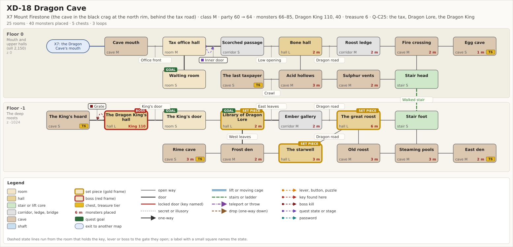
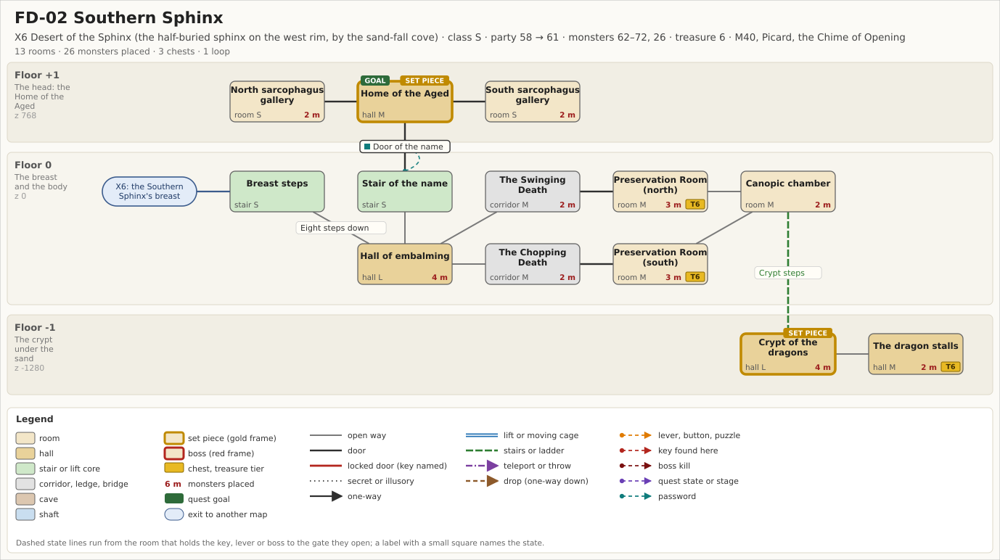
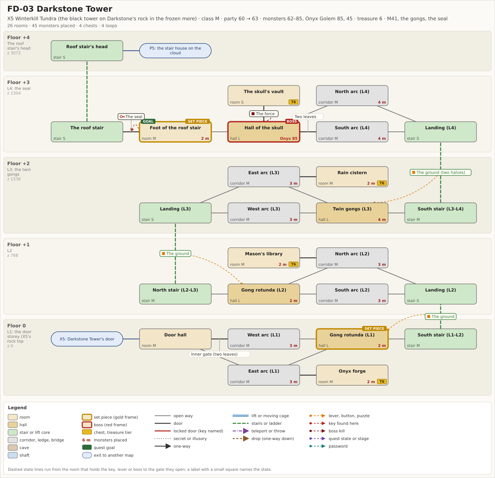
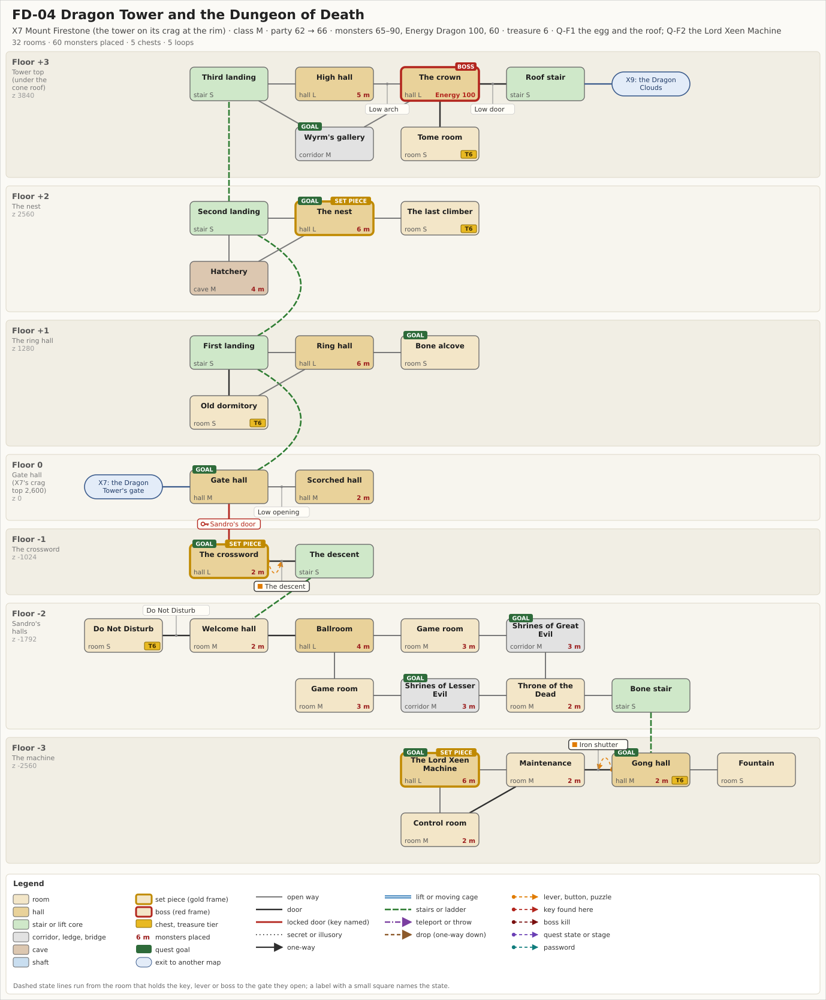

# Act VI dungeon graphs, lane A7 (MU-6)

Review page for phase 6, 2026-11-21, lane A7 (`xeen-a7`, sixteenth session). A7's four Act VI maps (One World and
the optional end content, party 58 → 66) as room graphs and state graphs before any geometry: **XD-18 Dragon Cave**
(X7, optional, the hardest optional dungeon), **FD-02 Southern Sphinx** (X6, M40), **FD-03 Darkstone Tower** (X5,
M41; P5's stair on its roof) and **FD-04 Dragon Tower and the Dungeon of Death** (X7, the optional finale, Q-F1 and
Q-F2). These are review documents, not briefs; each L1 starts from its graph file once a decider has answered the
questions below. **Every open question is numbered Q1–Q37 in one list** ("Open questions"), each with its options
(the proposed default first), the evidence and what depends on it. Q35–Q37 cross two maps or lanes.

**Reading the pictures:** as on the Act II page ([act2_dungeon_graphs.md](act2_dungeon_graphs.md), "How to read the
pictures"). One band per floor, the highest on top; rooms left to right roughly along the critical path; box colour
by kind (room, hall, stair or lift core, corridor or ledge, cave, shaft); gold frame set piece, red frame boss, green
tag quest goal, red "6 m" monsters placed, gold "T6" a chest of that tier; one line style per connection kind; a label
with a small square names the state that opens a connection, and a dashed line of its colour runs from the room that
holds it to the gate. Blue pills are exits.

**Files:** [act6_graphs/](act6_graphs/): `<key>.graph.yml` (spaces, links, states, exits, hooks, critical path,
loops, lines, textures, open questions; `monsters.mix` lists the rows by id, `kill_xp` the sum), `<key>.svg` and
`notes_<key>.md`. Redraw with `python3 devdocs/xeen/mockups/act6_graphs/render_graphs.py xd18 fd02 fd03 fd04`; it
prints no overlap for the four. PNG copies: `output/studio_cal/a7/phase6_graphs/<key>.png` (headless Chrome; looked
at). Brief of the two graph sub-agents: `output/studio_cal/a7/phase6_graphs_brief.md`.

**Rules used for all four** (the Act II–V pages' rules, D-4, D-25 to D-56 and the user's rules of 2026-11-20 in
`lanes/README.md`):
- Sizes and counts inside the class bands (MAPS, Dungeons) and MAPS §0's rows: XD-18 40 at 65–100 with the Dragon King
  110, 64.6k; FD-01 + FD-02 together 60 at 55–80 and 68.0k (FD-01 is A8's, not drawn yet); FD-03 45 at 60–85, 58.9k;
  FD-04 60 at 65–100, 96.8k. Kill XP per member is L(L+10) per kill over four. A2's rows by id; a missing row is a
  request.
- Every M dungeon has loops; every dead end holds a chest, a lever, a find or a goal.
- No riddle the game does not answer: FD-02's name is spelled by the runes the party reads on the way up; FD-04's
  crossword uses only answers the main path names; FD-03's plaques read down to a line that FD-04's terminal answers
  (Q35); the source's skull riddle (120) stays dropped (A3).
- Only engine words that exist (merge point 23): doors and trapdoors (a ladder never against a trapdoor's hinge wall),
  door movers kept by qbits at load, levers, destructibles, step plates, text prompts, chests, timers, hidden actors
  and decorations shown by events, translucent leaves, open sky over a BLV room, `monsters[].npc` (Picard, Alister),
  the monster damage hook, `ActorIndex`, `{exit: <neighbour>}`, named arrivals, house doors. No A1 request comes out of
  the four graphs.
- Dragons (D-32): every party passage off a dragon hall is 288 high or lower; only "dragon roads" (768) join the halls
  one flight of dragons may range over; ceilings sized for bodies about 490–500 high.
- Lamps on walls, ceilings or floors; props by the walls; one-off pictures once per face; wide doors as two leaves.
- Permanent rewards at MM6–MM8 size (+2 stats once per character, fixed experience inside the act's budget): the
  source's +40 Endurance, "+5 levels perm" and +5,000,000 experience are rescaled or dropped.
- Every exit is the `exit` preset (D-24); every inside entrance is named after the map it is entered from (D-37);
  the first room past each map door is quiet (D-11.3).
- D-56 (P5) in FD-03: the roof stair's top step is `entrance:p5_stair` facing down the stair; the way up leads to P5's
  `entrance:fd03_roof` (4608, −3968, 0) facing 512; the gong floors stay raised once rung (qbits, raised at load).
- Map qbits (provisional, A3 to register): XD-18 118100–118109, FD-02 118110–118119, FD-03 118120–118129, FD-04
  118130–118149.

| Dungeon | Map | Class | Rooms | Sectors / M units² | Monsters | Kill XP per member (MAPS) | Chests | Loops | Set pieces |
| --- | --- | --- | --: | --- | --: | --- | --: | --: | --- |
| XD-18 Dragon Cave | X7 | M (few, strong) | 25 | ~33 / ~44 | 40 + Dragon King | 66.64k (64.6k, +3.2 %); 69.94k with the King (+8.3 %) | 5 | 3 | The great roost; the starwell; the library and the King's hall |
| FD-02 Southern Sphinx | X6 | S | 13 | 15 / ~12 | 26 | 31.07k (share 29.47k of 68.0k, +5.4 %) | 3 | 1 | The Home of the Aged (Picard); the crypt of the dragons |
| FD-03 Darkstone Tower | X5 | M | 26 | ~30 / ~38 | 45 incl. Onyx Golem 85 | 60.70k (58.9k, +3.1 %) | 4 | 4 | The gong well; the seal |
| FD-04 Dragon Tower and the Dungeon of Death | X7 | M | 32 | ~42 / ~58 | 60 incl. Energy Dragon 100 | 100.22k (96.8k, +3.5 %) | 5 | 5 | The nest; the crown; the crossword; the Lord Xeen Machine |

A7's Act VI total: 258.63k per member against MAPS's 249.77k for these rows (+3.5 %), 261.93k with the Dragon King
(+4.9 %). Act VI proper (FD-02, FD-03) is 91.77k against 88.37k (+3.8 %); XD-18 and FD-04 are optional.

---

## XD-18 Dragon Cave

X7 · M (few, strong) · party 60 → 64 · 66–85, Dragon King 110 · 40 + the King · treasure 6 · Q-C25 (the Dragon Tax,
the library of Dragon Lore, the Dragon King), optional

The source's Dragon Cave (xeen maze0050 with mazex130–132, one 32 × 32 level, aaze0050) as one BLV of two floors in
the black crag at X7's north rim, 1,024 apart (0, −1,024; z 0 is X7's mouth floor 2,150). It has 25 review rooms,
about 33 sectors, about 44 M units² and 7 doors.

- **What it is.** The dragons' cave behind the tax road. The Dragon Tax Office stands in its mouth before the first
  dragon (D-5.2). Scaldrith takes 2,000 gold and 20 gems once, and the inner door throws out anyone who has not paid.
  Beyond it are the upper halls, the great roost, the starwell open on the world's rim, and the library of Dragon
  Lore with the Dragon King's hall behind it.
- **Critical path.**
  1. The mouth (`entrance:x7_mouth`, quiet) and the tax office's hall. Scaldrith's door (house 4852) for the tax,
     and the waiting room's lectern (volume 1).
  2. The inner door (`q-c25.inner_door`), the scorched passage, the bone hall and the roost ledge.
  3. The fire crossing and the stair head. The stair is walked down to the stair foot.
  4. The great roost, the ember gallery and the library's east leaves (volumes 2–4, the ledger).
  5. The King's door with shelf 5 beside it, then the Dragon King's hall.
- **Off the path.** These rooms lie off the critical path:
  - The acid hollows and the last taxpayer: a knight's remains, his strongbox (a chest) and a tax receipt.
  - The sulphur vents (the floor-0 loop) and the egg cave (a chest).
  - The steaming pools, the east den (a chest) and the old roost.
  - The starwell, the frost den and the rime cave (a chest).
  - The King's hoard behind his dais, open at his death (a chest).
- **Loops (3).**
  - Floor 0: from the bone hall to the stair head by the ledge and the fire crossing, or by the acid hollows and the
    sulphur vents.
  - Floor −1 east: into the roost directly, or round by the steaming pools and the old roost.
  - To the library: by the ember gallery to its east leaves, or by the starwell and the frost den to its west leaves.
- **Set pieces.**
  - The great roost: a cavern 3,072 × 2,560, 2,048 high through both floors, with the upper floor's ledge along its
    wall and three pairs of dragons wheeling in it.
  - The starwell: a cold hall whose north wall breaks onto the void beyond X7's rim, a slot of stars 2,048 wide with
    its sill 640 above the floor, so nobody walks out (`sky: true` on the slot).
  - The library of Dragon Lore (d16's worked stone, shelves at claw height) and, behind it, the King on a dais of
    heaped gold under a 1,536 roof.
- **Dragons and their halls (D-32).** The cloud dragons' bodies are 487 high, radius 238, and they fly.
  - **Low openings.** Every party passage between two dragon halls is 256 wide and 288 high, and so are the library's
    two pairs of leaves and the King's door (two bronze leaves 512 × 288). A dragon does not pass any of them. This
    covers the scorched passage into the bone hall, the hollows, the vents, the den, the pools, the old roost, the
    frost den and the rime cave.
  - **Dragon roads.** Only the dragon roads are 768 high: bone hall to ledge, roost to ember gallery, roost to
    starwell. So the roost's flyers range over the roost, the ledge, the gallery and the starwell, and no further.
  - **Heights.** Hall heights fit the bodies: 896 (the egg cave), 1,024 (caves and dens), 1,280 (the bone hall, the
    old roost, the library), 1,536 (the starwell, the King's hall) and 2,048 (the roost).
  - **Office.** The stair is a low tunnel, so the floors keep their own dragons, and nothing big reaches the office.
- **Monsters and kill XP.** Acid Dragon 66 (11641) × 9, Fire Dragon 75 (11642) × 17, Frost Dragon 85 (11643) × 14 and
  the Dragon King 110 (11645). These are the source's 17 Fire and 14 Frost Dragons, with the Acid tier as the young
  near the mouth. There are no Water Dragons: 60 is under the band, and they are X2's lake dragons (D-54).
  - XP: **66.64k per member** (266,569 / 4) against MAPS's 64.6k (+3.2 %); **69.94k with the King** (+8.3 %).
  - Floor counts: floor 0 12 (Acid 9, Fire 3), floor −1 28 (Fire 14, Frost 14) and the King with two Frost Dragons.
  - Groups of 1–2: pairs, and a pair and one in the three-dragon rooms.
  - Quiet rooms (D-11.3): the mouth, the tax hall, the waiting room, the scorched passage and the King's door
    antechamber.
  - 40 is under M's floor of 45: a NOTES exception line (Q1). Rest encounters are 10 % from the dragons at Dif 5
    (Q5).
- **Treasure.** Five chests at T6: the last taxpayer, the egg cave, the east den, the rime cave and the King's hoard.
  The urn on the counter is dressing.
- **Original lines.** These are used as follows:
  - aaze0017:0 "The Dragon Cave smells pretty bad.  Are you sure you wish to enter?": X7's door (A5).
  - aaze0050:0 "Dragon tax!  2000 gold pieces and 20 gems fly from your packs and into the urn. …": the meaning of
    Scaldrith's payment.
  - aaze0050:1 "The urn is empty and powerless.": the urn's click once the tax is paid.
  - aaze0050:2 "Not having enough money to pay the Dragon Tax, you are teleported outside.": the meaning of the inner
    door's fail.
  - aaze0050:5–10: the hovers "Dragon Lore Volume 1" to "Volume 5" and "The Art of Taxation".
  - aaze0050:12–16, :18: the Loremaster titles to "Taxman Emeritus" (A3's six awards). The 50,000–500,000 experience
    is dropped.
  - aaze0050:3: the Intellect refusal, ledger only, because A3's hooks have none.
  - aaze0050:17 "Exit Dragon Cave?": the exit preset's meaning (D-24).
- **Door to X7.** A5's `thing:xd18_mouth` (`door:xd18`) at [56.5, 29] is a 768 × 640 mouth in the rim crag. Its
  front is at (−3840, 17408, 2150), facing south.
  - **Inside arrival proposed:** `entrance:x7_mouth`, about 384 inside the mouth, facing north (512) toward the
    office's front and the urn.
  - **Return:** the exit preset to X7's `entrance:xd18_mouth` (56, 31) = (−4096, 16896, 2150), facing south (1536).
- **Hooks.** The graph places these:
  - `q-c25.inner_door`: the inner door in the tax hall's north wall. With `tax_paid` (112500) it opens for good. Without
    it, the hook's fail_text plays and `{exit: x7}` moves the party to `entrance:xd18_mouth`. From inside the door
    always opens.
  - `q-c25.volume1`: the waiting room's lectern.
  - `q-c25.volume2` to `volume4` and `q-c25.taxation`: the library's shelves and its ledger stand.
  - `q-c25.volume5`: shelf 5 in the King's door antechamber.
  - Scaldrith (5702) is behind `door:tax_office` (house 4852) in the tax hall: the tax, the Great Wyrm promotion and
    the Dragon Grandmaster.

  Map qbits: 118100 the inner door drawn open; 118101 the King slain (the hoard's grate open). 118102–118109 are free.
- **Textures.** MM8 Dragon Cave d17, as A6 assigned. On the shipped BLV it is only three textures: `t68a02b` (walls,
  roofs, floors), `t68a02a` (worn floors, the dragon roads) and `solid01`.
  - The office, the waiting room, the library and the King's door form one worked area in MM8 Dragon Hunter's Camp
    d16: `gtrlwal3`, `gtrlflr`, `tfb11`, `gtrlrf2`, `gtrlrf3`, `gtrltrm2`, `t1books1`, `hhr1p`, `trim9_32`.
  - The steaming pools use `wtrtyl`.
  - About 15 of 45, with at most one new texture (`xdhoard`, heaped gold for the dais and the hoard; optional).
  - XD-10 on X5 uses the same `t68a02b` rock. XD-18 reads apart by its worked rooms, scorched floors and the hoard
    (Q6).
  - Music 13, map id 9143.

Open questions: Q1–Q6 below. Full notes with the requests: [notes_xd18.md](act6_graphs/notes_xd18.md).

---

## FD-02 Southern Sphinx

X6 · S · party 58 → 61 · 62–72 (MAPS 55–75; Q8) · 26 · treasure 6 · M40 (Picard, the Chime of Opening)

The source's three levels (dark mazes 125–127) as one BLV of three storeys in and under the half-buried sphinx on X6's
west rim: the body (z 0, the breast steps down to the halls at −256), the head (z 768, the Home of the Aged) and the
crypt under the sand (z −1,280, the dragon mummies). 13 review rooms, 15 sectors (the hall of embalming and the crypt
two each), about 12 M units², 5 doors. **S: at most 15 sectors and 20 M units².** The interior is larger than X6's
shell (3,072 × 2,048), as XD-14's and DD-07's (D-39 Q6/Q7).

- **What it is.** Picard the Aged's home. Runes in the Preservation Rooms spell his name; a voice at the stair asks it;
  behind the door of the name the old man in his very good chair trades the Chime of Opening for Halon's widget (Q-C14).
- **Critical path.** Breast steps (`entrance:x6_door`, quiet); the hall of embalming; one death run (Swinging or
  Chopping); the first Preservation Room (runes P, I, C); the canopic chamber; the second Preservation Room (A, R, D;
  the sixth stone calls `m40.runes`); the other death run back to the hall; the stair of the name ("Study the lessons to
  learn my name." on a plaque at its foot); "What is my name?" on the top landing and at the door (PICARD:
  `m40.name_right`, `name_said` 111800, the door opens in the same visit); the Home of the Aged (Picard 5704, A3's
  topic, `m40.done` 111801, 20,000).
- **Off the path.** The two sarcophagus galleries in the head's lappets (two Phase Mummies and a fixed find each); the
  crypt of the dragons and the stalls down the canopic chamber's steps (four and two Dragon Mummies, the embalmer's T6
  chest, the illusion heap).
- **Loop (1).** Round the body: out by one death run, through both Preservation Rooms and the canopic chamber, back by
  the other.
- **Set pieces (2).** The Home of the Aged: shelves to the vault (`xsshelf`), two bars of light through the eyes, four
  books on two lecterns by the walls, Picard at the far end by his chair (the source's Throne of Legends, hover only).
  The crypt of the dragons: a ribbed vault 2,304 × 1,536, 1,024 high.
- **Traps with tells.** The Swinging Death: four pendulum blades (rotating movers swung by a map timer) over a run
  1,280 × 384; the Chopping Death: three blades dropping from ceiling slots (linear movers on a timer). The blades are
  the tell, in plain sight from 3 m. A step plate under each blade's arc deals about 12 % of a level-59 member's HP
  once per crossing. Each run's carved mask (`egywlspb`) sells protection (Q9).
- **Dragons.** Dragon Mummy bodies about 512 high, radius about 300 (D-32, `levelRadiusLimit: 60`): the crypt is 1,024
  high; its only way out is the steps' arch, 384 high and 384 wide, so they stay in. The stalls open off the crypt
  through a wide, high opening (dragons in both); the two alcoves at their end are 256 high.
- **Monsters and treasure.** Ghost Mummy 62 × 16 (A2's new tier, e.g. 11273; the body), Phase Mummy 72 × 4 (new tier,
  e.g. 11274; the galleries), Dragon Mummy 65 × 6 (11672; the crypt and stalls). 26 monsters, **31.07k per member**
  (124,290 / 4). MAPS §0 gives FD-01 and FD-02 together 60 at 55–80 and 68.0k: by count FD-02's share of 26 is 29.47k
  (+5.4 %), leaving A8's FD-01 34 monsters and 36.93k (an average level of about 61; Q7). Picard is peaceful,
  placed-only, uncounted and unkillable (the load event's `SetMm9ActorCanReceiveDamage(false)`, as D-51 and D-56).
  Chests T6 × 3 (the two great sarcophagi behind a Might check, Q10; the embalmer's chest). Two fixed T6 finds in
  the galleries (A2). Rest encounters 10 % Ghost Mummies (Q13).
- **Original lines.** aazex125:0–2 signs ("Preservation Room", "Home of the Aged"); :3 the exit's meaning; :4–5 the
  sarcophagi; :9–15 the masks (sums rescaled); :16, :18–19 the name; aazex126:10 the chair's hover, :13–17 the books;
  aazex127:2–9 the runes, the stair's plaque and "Don't feed the dragons." at the crypt steps; :14 the illusion. To the
  ledger only: the embalming fluids, "+2,000,000 exper.", the Super Dragon Embalmer and "+5 levels perm"
  (aazex125:6–8, aazex127:12–13). Picard's topic lines (aazex126:0–9) are A3's.
- **Door to X6.** `door:fd02` (A5, built, listed only until FD-02 exists): two leaves (`egydrlgl`, 160 × 256 each) in
  the breast's east face of `thing:southern_sphinx` (cells 34–40, 82–86, ground 1,536), `m40.sphinx_door` (Roland's
  amulet 12372). **Inside arrival proposed:** `entrance:x6_door`, on the first step about 256 inside the leaves, facing
  west (1024) down into the body. The way out is the exit preset ("Exit the Southern Sphinx?") to X6's
  `entrance:fd02_door` (−12800, −10240, 1536) facing east (0).
- **Hooks.** `m40.runes` (both Preservation Rooms, the sixth stone); `m40.name_right` / `m40.name_wrong` (the stair of
  the name: the top landing's plate on every climb until named, and the door's click); `m40.stair` (the door of the
  name, open on every load with `name_said`); Picard's topic (npc 5704, the Home of the Aged); `m40.sphinx_door` is
  X6's (A5).
- **Map qbits 118110–118119.** 118110–118115 the six runes read; 118116 Swinging Death protection paid; 118117 Chopping
  Death protection paid; 118118 the illusion heap gone; 118119 spare.
- **Textures.** MM6 Tomb of VARN (`pyramid.blv`) upper, as A6 assigns, read apart from XD-15 by the set's other half:
  `egywlh` with `egywlhle`/`egywlhre`, `egywlj`, `egywalg1`, `egywalgm` and `egywld` over `egywla` footings, `egyflorf`
  and `egyflord` floors with drifted sand at the doors, `egyceila`/`egyceild`, `egytrma`/`egytrmas`, `egydrsmd` and the
  `egydrlgl`/`egydrlgr` pair, `egymedb` over the door of the name, `egywlspb` for the masks; no striped `egycol64`
  columns, no `egywle`/`egywlc` (XD-15's marks). 2 new (`xsshelf`, `xsrunes`; one picture for all six stones, the letter
  in the text). About 24 of 30.

Open questions: Q7–Q13 below. Full notes with the requests: [notes_fd02.md](act6_graphs/notes_fd02.md).

---

## FD-03 Darkstone Tower

X5 · M · party 60 → 63 · 62–85, Onyx Golem 85 (MAPS 60–85) · 45 · treasure 6 · M41 (the gongs, the seal)

The source's four levels (dark mazes 113–116) as one BLV of four storeys 768 apart (z 0, 768, 1,536, 2,304) and the
roof stair's head at 3,072. 26 review rooms, about 30 sectors (the four rotundas two each), about 38 M units², 11 doors.
**The interior is larger than X5's shell, said plainly:** outside the tower's base has radius 544 (896 high plus the
frieze) and its top storey 448; inside, each storey is a round plan of radius 2,048 (4,096 across), as XD-14's and
DD-07's interiors (D-39 Q6/Q7). Each storey: a rotunda (radius 896, 640 high) round an open well (radius 384, a parapet
192 high) that runs from L1 to the top, a ring gallery in two arcs, a side room and a stair flight round the outer
wall, alternating south and north.

- **What it is.** The last dungeon of the main story (P5 has no monsters, D-56 Q2). "No Sound No Ground!": on each
  storey a gong must be rung before the next flight has its top. On the top storey the Onyx Golem guards the roof
  stair, whose foot the invisible seal closes until the Chime of Opening breaks it; the stair leads to the Clouds of
  the Ancients (P5).
- **Critical path.** Door hall (`entrance:x5_door`, quiet); an arc; the L1 gong (`m41.gong_voice`); the south stair;
  L2's landing, an arc, the gong, the north stair; L3's landing, an arc, the twin gongs, the south stair; L4's landing,
  an arc, the hall of the skull (the Onyx Golem); the foot of the roof stair (`m41.seal`, the Chime); the roof stair;
  the roof stair's head and the exit to P5.
- **Off the path.** The onyx forge (L1, T6), the mason's library (L2, T6), the rain cistern (L3, T6, sunk 128 with an
  edge to step out of), the skull's vault (L4, T6 behind the force); the second arc of every storey (the plaques).
- **Loops (4).** Round each storey's rotunda by either arc (L4: into the hall of the skull by its two leaves or the
  open north side).
- **Set pieces (2).** The gong well: the rotundas round the open well, a bronze gong (`xngong`, XD-03's) on the wall;
  rung, the voice booms and the missing landing of the next flight grinds up out of the dark; from L1 the raised
  landings are seen stacked up the well. The seal: a tall room under a shaft of cloud light, the roof stair's mouth
  closed by a translucent leaf rippling like heat (Q21); the Chime's note cracks it like ice (A3's text).
- **The gongs (Q15).** Each flight (24 steps of 32) ends 640 short of the storey above at a dark slot. The ground
  is a 512 × 512 slab (a door mover) sunk below. A gong's click calls `m41.gong_voice`, shows the gong's two hidden
  guards in the wall niches beside it (Q16), and raises the slab into place (map qbits 118120 L1, 118121 L2; L3's
  twin gongs lift it 320 each, 118122 and 118123). The top step's plate gives the voice's line (aazex113:2, map text)
  before the gong, so the party knows what is missing. **The ground stays raised once rung** (D-56): the load event
  raises every slab whose bit is set. They are qbits, not map variables, so a rebuild of the map does not drop them, and
  a party that fell from P5 to X5 walks straight back up (the seal is open by `seal_broken`).
- **Monsters and treasure.** The source's onyx golems: Onyx Sentry 62 × 20 and Onyx Warden 72 × 16 (A2's new ordinary
  tiers, e.g. 11585–11586, recolours of `xgol_e` on `xeen_m254`; Q14), Sky Golem 75 × 8 (11594) on L3–L4 where the
  cloud light comes down, and the Onyx Golem 85 (11584, the boss row) once, the source's L4 "+1". 45 monsters, **60.70k
  per member** (242,819 / 4) against 58.9k (+3.1 %). By storey: L1 10, L2 10, L3 12, L4 13; 8 of them are the gongs'
  hidden guards (always met: every gong must be rung). Golems are about 300 high: the 640 rotundas and 384 openings fit
  them; none flies. Chests T6 × 4. Rest encounters 0: every row is a construct (D-47: never a construct).
- **Original lines.** aazex113:0 the exit's meaning; aazex113–116:1–2 the gongs and the voice (A3's hook); the plaques'
  rows aazex113:3–6, aazex114:3–6, aazex115:3–6 and L4's heads aazex116:3–6; :0 "A force repels you." at the vault;
  :7–8 the seal (A3's texts); :15 "The skull is silent." The skull's riddle (:9–14, answer 120) and the Gold ID Card stay
  in the ledger (A3 dropped the riddle). Read down the columns, the plaques say "NEW WORLD THANKS YOU FOR PLAYING MIGHT
  AND MAGIC" (L1), "SO END THE SAGA OF CORAK AND SHELTEM!" (L2), "1994 BEGINS THE NEXT MIGHT AND MAGIC SAGA!" (L3) and
  "TYPE "COMPUTER" ON LEVEL 4 OF THE DUNGEON OF DEATH. SEE YA SOON!" (L4's heads; FD-04's terminal, Q17).
- **Door to X5.** `thing:darkstone` (A6, built, sealed today with "Darkstone Tower is not open to you yet."): the door
  on the base's north face, front about (−4608, 2060, 1500) facing north, the tower centred at (−4608, 1536) on the rock
  top (1,500), `m41.tower_door` (`m39.darkstone_key`). X5 has no neighbour line for FD-03 yet. **Inside arrival
  proposed:** `entrance:x5_door`, in the door hall about 256 inside the door, facing south (1536) into the tower. **Return
  point proposed:** X5's `entrance:fd03_door` at (−4608, 2304, 1500) facing north (512): the spot of D-56's
  `entrance:p5_fall`, turned away from the door (768 of flat rock to the rock's north edge).
- **The roof (D-56).** The roof stair's top step is **`entrance:p5_stair`, facing down the stair** (P5's stair house:
  "Descend into Darkstone Tower?", aazex129:14). The hatch over the roof stair's head (`sky: true`, P5's cloud sky,
  Q20) is the exit preset up to P5's **`entrance:fd03_roof` (4608, −3968, 0) facing 512**. Nothing in FD-03
  changes for P5's stair house, which copies X5's crown.
- **Hooks.** `m41.gong_voice` (the gongs of L1, L2 and the twin gongs of L3); `m41.seal` (the seal's leaf, clicked or
  walked into: with the Chime it takes it, sets `seal_broken` 111820, 27,000 XP, and the leaf opens in the same visit
  and on every load); `m41.tower_door` is X5's (A6).
- **Map qbits 118120–118129.** 118120–118123 the grounds (L1, L2, L3 west and east halves); 118124 the vault's field
  down (the Onyx Golem dead); 118125–118129 spare. The plaques' reading uses map variables (no lasting state).
- **Textures.** MM8 Castle of Fire d29 (A6's towers.yml): `gston1wl` and `gtrlwal1` walls (`gtrlwal1` is the tower's
  outside too), `gkp2ceil` and `gcav1flr` floors, `gston1fl` and `gcst2cel` ceilings, `gcstdoor` leaves, `gkp4-bs`
  trim; d29's lava left out. X5's `hkm3b` skull frieze once round the door hall; XD-03's `xngong` for the gong panels. 3
  new (`xdplaque` one picture for the twelve plaques, `xdhead` one for L4's four heads, `xdseal` the seal's ripple).
  About 18 of 45. Apart from DD-24's d14 (shared ceilings) and XD-23's d13 (shared `gtrlwal1`) by the black ashlar
  walls and no cave rock.

Open questions: Q14–Q21 below. Full notes with the requests: [notes_fd03.md](act6_graphs/notes_fd03.md).

---

## FD-04 Dragon Tower and the Dungeon of Death

X7 · M · party 62 → 66 · 65–90, Energy Dragon 100 · 60 · treasure 6 · Q-F1 (Alister's egg, the roof to the Dragon
Clouds) and Q-F2 (the Dungeon of Death, the Lord Xeen Machine), optional finale

The source's Dragon Tower (dark mazes 117–120, aazex117–120) and Dungeon of Death (121–124, aazex121–124) as one BLV.
The tower has four round floors above X7's crag top: z 0, 1,280, 2,560 and 3,840, where z 0 is 2,600. The Dungeon of
Death, Sandro's old home, has three floors under it: z −1,024, −1,792 and −2,560. The two halves meet at Sandro's door
in the gate hall's floor. It has 32 review rooms, about 42 sectors, about 58 M units² and 11 doors.

- **What it is.** The black tower on the crag at the rim.
  - **The tower.** A druid named Alister in the gate hall wants a dragon egg. Dead adventurers' notes say he is a
    fraud and hint at the Eye's answer. The nest on floor 2 holds the eggs. The crown's Energy Dragon keeps the roof
    stair to X9's Dragon Clouds.
  - **The dungeon.** Below, Sandro's key opens his old home: a walk-in crossword, a ballroom and game rooms full of
    liches, four Shrines of Evil, the gongs, and the Lord Xeen Machine to destroy.
- **Critical path, Q-F1.**
  1. The gate hall (`entrance:x7_gate`, quiet, Alister).
  2. The spiral stair, walked: first landing, ring hall, second landing, the nest (the egg).
  3. Back down to Alister. Or on up: the third landing, the high hall, the crown (Energy Dragon), the roof stair,
     and out to X9.
- **Critical path, Q-F2.**
  1. The gate hall and Sandro's door (`q-f2.door`, item 12354).
  2. The crossword (twelve clues), the descent, the welcome hall and the ballroom.
  3. Either game room and its shrine gallery to the Throne of the Dead (Sandro's note), then the bone stair.
  4. The gong hall: four gongs, then the lever raises the iron shutter.
  5. Maintenance, then the machine (`q-f2.machine`).
- **Off the path.** These rooms lie off the critical path:
  - The scorched hall (the old stable, a find).
  - The bone alcove (two notes) and the old dormitory (a chest).
  - The hatchery, and the last climber (a note, the Endurance potion, a chest).
  - The Wyrm's gallery (Ashkaroth's door) and the tome room (the Tome, a chest).
  - Do Not Disturb (coffins, a chest).
  - The fountain and the control room (the terminal).
- **Loops (5).**
  - Floor 1: into the ring hall from the landing or through the dormitory.
  - Floor 2: the nest directly or through the hatchery.
  - Floor 3: to the crown through the high hall or along the Wyrm's gallery.
  - Sandro's halls: a ring from the ballroom through either game room and its shrine gallery to the thrones.
  - The machine floor: from maintenance directly or through the control room.
- **Set pieces (4).**
  - The nest: a round hall round a bowl of black rock with three warm eggs.
  - The crown: the top hall under the cone roof, light from its vent, with the Energy Dragon.
  - The crossword: a hall floored with pale and black tiles (`xfgrid`), clue plaques round the walls, and each solved
    word lighting across the floor (a hidden `xfword` strip shown, with a pulsing light under it).
  - The Lord Xeen Machine: a black and brass engine fed by four elemental cores, each with a terminal.
- **Dragons and their floors (D-32).**
  - **Low openings.** The spiral stair and every opening between a dragon hall and a landing, alcove or gallery is 256
    wide and 288 high, and so is the crown's low door to the roof stair. The bodies are 487 high for the cloud
    dragons and 500 for the dark ones, so each floor keeps its own dragons. The arrival from X9 is quiet.
  - **Size.** The inside is larger than X7's shell (1,024 across, 2,048 high, Q29): round floors about 3,072
    across, halls 1,152 high, and the crown 2,048 to the cone's apex.
  - **The dungeon.** Liches are 180, Doom Knights 152 and Autobots 228 tall: rooms 512–768 high, the machine hall
    1,024.
- **Monsters and kill XP.**
  - **Tower (26).** Acid Dragon 66 × 6, Fire Dragon 75 × 8, Frost Dragon 85 × 6, Phase Dragon 90 × 5 and the Energy
    Dragon 100 (11653, boss row). The Phase Dragons are the Dragon Clouds' dragons, come down under the roof.
  - **Dungeon (34).** Lich Lord 65 × 10, Power Lich 75 × 6, Skeletal Lich 85 × 8 (the source's L2 liches), Doom
    Knight 75 × 4 (the two thrones' and the control room's guard) and Autobot 75 × 6 (the source's L3 robots).
  - XP: **100.22k per member** (400,896 / 4) against MAPS's 96.8k (+3.5 %). The tower is 46.39k and the dungeon
    53.84k.
  - Floor counts: floor 0 2, floor 1 6, floor 2 10, floor 3 8 (with the Energy Dragon), floor −1 2, floor −2 20 and
    floor −3 12.
  - Groups of 1–3. Quiet rooms (D-11.3): the gate hall (Alister is peaceful) and the roof stair. Also quiet: the
    landings, the alcoves, the Wyrm's gallery, the descent, the crypt, the fountain and the bone stair.
  - Not used: Screamer 58 and Annihilator 62 are under the band (Q22 (b)); Vampire King (Q34).
  - The machine's guards: two Autobots, two Power Liches and two Skeletal Liches in its hall, with two Doom Knights in
    the control room.
  - Rest encounters 0 (Q31).
- **Treasure.** Five chests at T6: the old dormitory, the last climber, the tome room, Do Not Disturb and the gong
  hall. Opening the gong hall's chest before the shutter is up silences the gongs, the source's "Touch any treasure
  and you'll have to start over!".
- **Original lines.** These are used as follows:
  - aazex117:0–4: Alister and the tower's exit ("Exit Dragon Tower?", the exit preset's meaning).
  - aazex118:0–5: beds, bones, the two notes ("I don't trust that druid guy …", "… forever, or really, really big").
  - aazex119:2–7: the potion "+40 end. perm" (rescaled to +2), and the notes on the crystal balls and "The eye of
    the Dragon holds the Silver Key Card." (A3 renames the card to Q-F1's reward).
  - aazex120:1–5: the Tome of Great Experience, its "You learn nothing new from the Tome", the bed and the chest.
  - aazex121:1–2, :7–8: the descent's refusal and reward, and Wrong!/Correct!. Twelve of the clues :11–188 are kept
    (Q25).
  - aazex122:0–5, :7–18, :24: signs, coffins, the thrones, the four shrines and Sandro's note.
  - aazex123:0–5: the gongs, the lever and the voice, the fountain.
  - aazex124:0–13: the machine's question, the core terminals, the papers, the Goober terminal, the room signs.
  - dark/aazex128:0 "Descend into Dragon Tower?": X9's way down (A5).
- **Door to X7.** A5's `thing:fd04_gate` (`door:fd04`) at [29, 31.62] has two leaves 384 × 448 on the crag top. The
  gate is at (−17920, 16578, 2600), facing south.
  - **Inside arrival proposed:** `entrance:x7_gate`, about 256 inside the leaves, facing north (512).
  - **Return:** the exit preset to X7's `entrance:fd04_door` (29, 32) = (−17920, 16384, 2592), facing south (1536).
  - The tower's key is Q23.
- **Roof to X9 (the Dragon Clouds).**
  - **Out:** the roof stair's hatch is the exit preset to X9's `entrance:fd04_roof` (`roof:fd04` in X9's
    project.yml). Its point is (20864, 18304) at floor 2,048 in plan.yml and NOTES, facing south, but objects.yml
    marks [20352, 17280]: A5 confirms one.
  - **Back:** X9's way down is a stair in the dragon-head rock ("Descend into Dragon Tower?", aazex128:0) to this map's
    `entrance:x9_clouds`, on the roof stair's top step facing down the stair.
  - **On X9 (A5, with A3's Q-F1):** the Eye of the Dragon's riddle ("What is the secret of the Dragon?", answer
    Infinity; the source's "Die fools!" as event damage) and its artifact. Also the four Ancient Books of the Dragon
    with the runes IN/FI/NI/TY, the three crystal balls (Mind, Past, Future: rescaled, never lethal), the Well of
    Fantastic Skill and the Dragon Power Crystals, rescaled (D-4).
  - **In the tower:** the clues to the riddle: the two dead adventurers' notes and the "eye of the Dragon" note.
- **The halves' join.** Sandro's door is a black iron door in the gate hall's cellar well, over the stair down.
  - `q-f2.door` with item 12354 opens it for good (118130). The key is kept.
  - Without the key the party sees a clear refusal that names it (A3, for example "A black iron door with Sandro's
    mark, a skull with a keyhole for an eye. It answers only to his key.").
  - From below it always opens.
- **Hooks (none exist yet; proposed for A3's q-f1.yml and q-f2.yml).**

  | Hook | Room | What it does |
  | --- | --- | --- |
  | `q-f1.alister` | gate hall | Alister's topics (a placed talking monster, `monsters[].npc`); takes the Dragon Egg and pays; sets Alister gone (118147) |
  | `q-f1.note_fraud`, `q-f1.note_forever` | bone alcove | the two notes |
  | `q-f1.egg` | the nest | gives the Dragon Egg once (118146) |
  | `q-f1.note_eye`, `q-f1.endurance` | the last climber | the note; +2 Endurance once per character (a player bit) |
  | `q-f1.tome` | tome room | fixed experience once per character |
  | `q-f2.door` | gate hall | needs 12354 |
  | `q-f2.crossword` | the crossword, the descent | twelve prompts; all twelve set 118143 and the descent's reward |
  | `q-f2.shrine_minor`, `q-f2.shrine_lesser` | Shrines of Lesser Evil | destructibles' questions and `on_destroyed`, experience |
  | `q-f2.shrine_great`, `q-f2.shrine_ultimate` | Shrines of Great Evil | the same; the Ultimate's ejection (118148, Q26) |
  | `q-f2.note` | Throne of the Dead | Sandro's note |
  | `q-f2.machine` | the machine | Q-F2 done, 118145 |

  The gongs, the lever, the voice, the fountain, the coffins, the thrones, the terminals and the papers are
  map-local lines.

  Ashkaroth (5703) is behind `door:wyrm_hall` (house 4853) in the Wyrm's gallery on floor 3, flavour only.

  Map qbits:

  | Qbit | Meaning |
  | --- | --- |
  | 118130 | Sandro's door open |
  | 118131–118142 | the twelve words |
  | 118143 | the crossword done (the descent open) |
  | 118144 | the iron shutter up |
  | 118145 | the machine broken |
  | 118146 | the egg taken |
  | 118147 | Alister gone |
  | 118148 | the Ultimate shrine broken |
  | 118149 | free |

  The gongs are map variables.
- **Textures.** None is assigned (Q28). Proposed, one shipped family per area:
  - **The tower:** MM6 Hall of the Fire Lord 6d04 (`vlcwl2`, `vlcwl2b`, `vlcwl4`, `vlcwl4b`, `vlcflore`, `vlcflord`,
    `vlcflorc`, `vlctrm4`, `vlctrm6`, `vlctrm8`, `vlcdora`, `vlcdorb`). It is the black vlc block of X7's shell
    (`vlcwl3a`) and unused in Xeen.
  - **Sandro's halls and the crossword:** MM8 Necromancers' Guild d19 (`gnecwal1`, `gnecwal2`, `gnecwal3`, `gnecflr`,
    `gnecstpf`, `gnecstpt`, `gnecclg2`, `gn_mtl03`, `tws1h`, `tws1f`, `t1books1`, `t1beds2`, `trim9_32`).
  - **The machine floor:** MM6 Control Center sci-fi.blv (`swll4dk`, `swll5dk`, `swfloor2b`, `swceilf`, `swr2dk`,
    `swdoora`, `swgirder`, `trekscrn`), with XD-19's four core textures on the cores.
  - **New:** two (`xfgrid`, `xfword`). About 36 of 45.
  - Music 13, map id 9182.

Open questions: Q22–Q34 below. Full notes with the requests: [notes_fd04.md](act6_graphs/notes_fd04.md).

---

## Open questions (Q1–Q34)

Each question gives the options with the proposed default first, the reason for the proposal (with its evidence) and what depends on the answer. The graph files hold the same questions under `open_questions`; the notes files have them in short form.

### XD-18 Dragon Cave

**Q1.** Count and mix. MAPS §0: 40 at 65-100 with the Dragon King 110, 64.6k; M's floor is 45. The source: 17 Fire, 14 Frost, the King.
- Options:
  - (a) 40 cloud dragons: Acid 66 x 9, Fire 75 x 17, Frost 85 x 14: 66.64k (+3.2 %), 69.94k with the King (+8.3 %); a NOTES exception line for 40 under M's 45 (as XD-16, D-47 Q1) (proposed)
  - (b) as (a) with five Great Hydras 65 (11662, X7's) in place of five Acid Dragons in the upper hollows: 66.47k (+2.9 %)
  - (c) 45 (five more Acid Dragons): 72.91k (+12.9 %), over the ±10 % aim
- Proposed, and why: (a): the source's dragons, MAPS's count, inside 10 % with the King
- Depends: A2's Act VI recount

**Q2.** The tax and the ejection (A3's hook: the map moves the party back outside).
- Options:
  - (a) the inner door's click calls q-c25.inner_door: with tax_paid it opens for good (118100); without, the fail_text and {exit: x7} to X7's entrance:xd18_mouth (D-24's exit word from an event; no damage); the office in front of it stays open to all, so the party can always go back and pay (proposed)
  - (b) a step plate in the scorched passage that throws an unpaid party out (the door always opens)
  - (c) the door simply refuses ('Tax first.') with no ejection
- Proposed, and why: (a): the source's ejection on the door, one click, the office always reachable
- Depends: A3 (q-c25.inner_door's fail_text is written)

**Q3.** The Dragon King's look. Today 11645 wears cdr1_c on mm6_cdr1, the Fire Dragon's skin.
- Options:
  - (a) his own recolour skin on xeen_cdr1 (for example xcdr_king: black scales with gold edges), as Xeen's Pet's xcdr_pet (D-47); no Meshy (proposed)
  - (b) the Fire Dragon's skin, scaled 1.25
- Proposed, and why: (a): D-39/D-47's own skin for every boss
- Depends: S

**Q4.** The King's door and the dragons' reach (D-32).
- Options:
  - (a) every party passage between dragon halls is a low opening 256 wide and 288 high; the dragon roads (768) join only the great roost, the ember gallery, the starwell and the bone hall with its ledge; the library's two pairs of leaves and the King's pair are 288 high, so the King and his two Frost Dragons never leave his hall and the library's two live there; a headless playtest (as XD-07's) that a Fire Dragon stays in the roost (proposed)
  - (b) tall openings everywhere: dragons roam the whole floor
- Proposed: (a)
- Evidence: D-32 (big monsters kept in by low openings: XD-07's caged dragon, XD-19's Pet); the cloud dragons' bodies are 487 high with radius 238, so none passes 288.
- Depends: nothing (levelRadiusLimit 60 is in world.yml)

**Q5.** Rest encounters (map 9143).
- Options:
  - (a) 10 % from the cloud dragons at Dif 5 (Fire, Frost; never the Water Dragon under the band, never the King; D-47's rule) (proposed)
  - (b) 0
- Proposed: (a)
- Evidence: D-47's rule (rest encounters 10 % from the map's hostile rows in the band), used on XD-16 and XD-19.
- Depends: A2's row 9143

**Q6.** Textures: d17 is three textures (t68a02b, t68a02a, solid01), and its rock is XD-10's on X5.
- Options:
  - (a) d17's rock for the caves; the office, the waiting room, the library and the King's door as one worked area in MM8 Dragon Hunter's Camp d16 (gtrlwal3, gtrlflr, tfb11, gtrlrf2, gtrltrm2, t1books1); one optional new: xdhoard. About 15 of 45 (proposed)
  - (b) MM6 Caves of the Dragon Riders 6d20 (vlcwl1lg, vlcflora), the rock of X7's mouth shell, for the caves, with d16 for the worked area
  - (c) d17 alone, the library in plain d17 rock with t1books1 shelves
- Proposed, and why: (a): A6's assignment kept, the worked rooms read as the clerks' and the library, XD-10 is far away
- Depends: A6 (the dungeon_families line in detail, xdhoard registered if made)

### FD-02 Southern Sphinx

**Q7.** FD-02's share of 'FD-01, FD-02: 60 at 55-80, 68.0k' (A8's FD-01 not drawn).
- Options:
  - (a) 26: Ghost Mummy 62 x16, Phase Mummy 72 x4, Dragon Mummy 65 x6 = 31.07k (+5.4 % on a 26/60 share); A8's FD-01 keeps 34 and 36.93k (average level about 61) (proposed)
  - (b) 30 (S's top): Ghost 18, Phase 4, Dragon Mummy 8 = 35.74k; FD-01 30 and 32.26k
  - (c) 20: Ghost 12, Phase 4, Dragon Mummy 4 = 23.95k; FD-01 40 and 44.05k
- Proposed, and why: (a): the source's three families in its proportions, inside S, leaving A8 an M-sized 34
- Depends: A8 (FD-01's graph), A2 (Act VI recount)

**Q8.** Mummy tiers at the band (Tomb Mummy 42 and Pyramid Guard 52 are under 55-75).
- Options:
  - (a) two new pyramid_mummies tiers, the source's names: Ghost Mummy 62 (Age) and Phase Mummy 72 (DrainSP), e.g. 11273-11274, MM9 mummy recolours (no Meshy) (proposed)
  - (b) existing rows only: Royal Mummy 65 x16, Dragon Mummy 65 x6, Undead Dragon 55 x4 = 30.39k
  - (c) a capped band: Pyramid Guard 52 placed under the band
- Proposed: (a)
- Evidence: XEEN_SYSTEMS: the source's Southern Sphinx holds Ghost Mummies (17) and Phase Mummies (4); A2's Tomb Mummy 42 and Pyramid Guard 52 are under 55-75.
- Depends: A2 (rows), S (two skins)

**Q9.** The toll masks of the Swinging and Chopping Death (the source sells protection for 2 million and throws a refuser into the blades; a further million buys the 'clue' "There's one born every minute.").
- Options:
  - (a) kept at MM6-MM8 sums: each mask offers that run's protection for 2,000 gold (Yes: the blades stop for good, map qbit; No: "Begone, then!", no throw); after paying, a clue for 500 more answers "There's one born every minute." (the joke; the runes are the real answer-giver) (proposed)
  - (b) protection only, no paid clue
  - (c) no masks: the runs are traps with their tells only
- Proposed, and why: (a): the source's joke at a price that stings and does not break the economy; never a guess (the blades show)
- Depends: A3 (lines and sums), A2 (Act VI gold ledger)

**Q10.** The two great sarcophagi (the source's 'too weak').
- Options:
  - (a) Might >= 60 on the clicking member, potions and spells counting (XD-15's 40 at levels 31-34, D-39 Q4, scaled to 58-61); a T6 chest each (proposed)
  - (b) no check, two plain T6 chests
- Proposed: (a)
- Evidence: XD-15's sarcophagi used Might 40 at party 31-34 (D-39 Q4); the source's 'too weak' (aazex125:4-5).
- Depends: A2 (the check in the ledger)

**Q11.** Reading apart from XD-15 inside one family.
- Options:
  - (a) the pyramid set's other half (egywlh/egywlhle/egywlhre, egywlj, egywalg1/egywalgm, egyflorf), no striped columns, drifted sand, 2 new: xsshelf, xsrunes; 24 of 30 (proposed)
  - (b) all shipped: MM7's bookcase 7t1books for the library (a second family in one room)
  - (c) as XD-15
- Proposed: (a)
- Evidence: A6 gives XD-15 and FD-02 one family; XD-15 is built with egywle/egywlc and striped columns; the user's rule: one family per area, no Frankenstein.
- Depends: A6 (dungeon_families accent line, register two textures)

**Q12.** Picard's chair and the Throne of Legends (aazex126:10; XD-15 already has a throne of legends with two lecterns).
- Options:
  - (a) one: his very good chair hovers 'Throne of Legends', no reward (proposed)
  - (b) a separate throne with a once-per-character +2 (D-4 size)
  - (c) the line to the ledger only
- Proposed: (a)
- Evidence: aazex126:10; XD-15 already has a Throne of Legends with lecterns (D-39); a second +2 throne would repeat it.
- Depends: A3 (hover text), S (chair decoration)

**Q13.** Rest encounters.
- Options:
  - (a) 10 % Ghost Mummies (hostile, in band; D-47's rule) (proposed)
  - (b) 0
- Proposed: (a)
- Evidence: D-47's rule; the mummies are hostile rows in the band.
- Depends: A2 (row 9180)

### FD-03 Darkstone Tower

**Q14.** Rows: the source's onyx golems at 60-85 (Onyx Golem 11584 is a boss row at 85; Iron 40, Diamond 50 and Lava 55 are under the band).
- Options:
  - (a) two new ordinary onyx tiers, Onyx Sentry 62 and Onyx Warden 72 (e.g. 11585-11586, recolours of xgol_e), with Sky Golem 75 and the Onyx Golem 85 once: Sentry 20, Warden 16, Sky 8, Onyx 1 = 60.70k (+3.1 %) (proposed)
  - (b) existing rows only: Lava Golem 55 x24 (under the band), Sky Golem 75 x20, Onyx 1 = 55.34k (-6.0 %)
  - (c) Alamar's robots: Annihilator 62 x20, Autobot 75 x16, Sky Golem 8, Onyx 1 = 62.59k (+6.3 %), off the source's family
- Proposed, and why: (a): the source's one family, inside 10 %
- Depends: A2 (rows, Act VI recount), S (two recolour skins)

**Q15.** The gongs ('the gongs raise the next floor').
- Options:
  - (a) each stair's flight ends 640 short at a dark slot; the ground, a 512 x 512 slab (a door mover), rises from below into place when the gong is rung; the twin gongs of L3 lift it 320 each; kept up by map qbits 118120-118123 on every load (D-56) (proposed)
  - (b) a round lift platform in the well, rung up to the next storey and left there (a lift ride instead of a walked flight)
  - (c) the gong opens a door at the stair's head (DD-06's pattern)
- Proposed, and why: (a): the source's 'no ground' made literal and walked; distinct from DD-06; uses doors and qbits only
- Depends: nothing (door movers, qbits and the load event exist)

**Q16.** The gong guards (the source's gongs summon onyx golems).
- Options:
  - (a) two hidden guards in wall niches beside each gong, shown by its ring (eight of the 45, always met since every gong must be rung) (proposed)
  - (b) all 45 placed in sight; the gongs only raise the ground
- Proposed: (a)
- Evidence: The source's gongs summon onyx golems (aazex113-116); a hidden placed actor shown by an event exists (XD-19's pool, merge point 21); the count stays 45.
- Depends: nothing (showing a hidden actor by event, D-18)

**Q17.** The plaques (letter rows whose columns spell New World Computing's messages; L4's heads point at the Dungeon of Death's 'COMPUTER', FD-04).
- Options:
  - (a) the source's rows on click, and on the fourth plaque read on a storey one more line reading the columns down (the game gives the answer); no reward (proposed)
  - (b) the rows only, as the source
  - (c) dropped
- Proposed, and why: (a): no puzzle the game does not answer; the joke kept
- Depends: A3 (four summary lines as map-local text), A7's FD-04 sub-agent (whether 'COMPUTER' is a word there)
- Note: L4's summary and FD-04's terminal: Q35.

**Q18.** The skull's prize (A3 dropped the riddle 120: no answer-giver).
- Options:
  - (a) the skull silent ('The skull is silent.'); the vault's field ('A force repels you.') drops when the Onyx Golem dies; a T6 chest (the Gold ID Card is not in our quests) (proposed)
  - (b) the vault open, no field
  - (c) no vault
- Proposed: (a)
- Evidence: A3 dropped the riddle 120 (m41.yml); aazex116:0 'A force repels you.', :15 'The skull is silent.'; the Gold ID Card has no use in our quests.
- Depends: nothing

**Q19.** Interior size (X5's shell: base radius 544, the top storey 448).
- Options:
  - (a) radius 2,048 (4,096 across), storeys 768 apart, rotundas 640 high, about 38 M units² in all, larger than the shell as XD-14 and DD-07 (D-39 Q6/Q7) (proposed)
  - (b) radius 1,536: about 26 M units², under M's 30 with four storeys (a fifth storey needed)
  - (c) radius 2,560: about 55 M units², long walks between the gongs
- Proposed: (a)
- Evidence: M's band is 30-90 M units²; XD-14's and DD-07's interiors are larger than their shells (D-39 Q6/Q7).
- Depends: nothing

**Q20.** The roof stair's head and the way up to P5.
- Options:
  - (a) an open hatch over the top landing (`sky: true` with P5's cloud sky preset, D-56 Q9) and the exit preset up to P5's entrance:fd03_roof; P5's way down arrives at entrance:p5_stair on the top step facing down (proposed)
  - (b) a closed hatch (no sky), the same exit
  - (c) the stair's top step as a plain in-map exit with no landing
- Proposed: (a)
- Evidence: D-56: the top step is entrance:p5_stair, the way up goes to entrance:fd03_roof; A3's else_text 'Cloud light comes down it.' wants a lit opening.
- Depends: A5 (P5's door:fd03, entrance:fd03_roof), A3 (the up-exit's line), A1 (the preset's name for a BLV room if P5's differs)

**Q21.** The seal's look (it must be 'invisible' and still a readable tell).
- Options:
  - (a) a translucent leaf (opacity about 0.15, D-51's word) with a faint ripple texture, solid until seal_broken, then opened by the hook in the same visit and on every load (proposed)
  - (b) a fully clear leaf (no tell)
- Proposed: (a)
- Evidence: A3's fail text 'An invisible seal prevents passage.'; DD-16's field at 0.5 (D-51) shows translucent leaves read; the user's rule that a trap or block has a tell.
- Depends: A6 (xdseal)

### FD-04 Dragon Tower and the Dungeon of Death

**Q22.** Count and mix. MAPS §0: 60 at 65-100, groups 1-3, 96.8k.
- Options:
  - (a) the tower 26 dragons (Acid 66 x 6, Fire 75 x 8, Frost 85 x 6, Phase 90 x 5, the Energy Dragon 100), the dungeon 34 (Lich Lord 65 x 10, Power Lich 75 x 6, Skeletal Lich 85 x 8, Doom Knight 75 x 4, Autobot 75 x 6): 100.22k (+3.5 %) (proposed)
  - (b) as (a) with the source's Screamers as a new demons tier D (11635 'Screamer', 80, own recolour skin; a shared display name, D-42/D-47) for four Lich Lords (the welcome hall and the north shrines): 102.55k (+5.9 %)
  - (c) the tower with the Dragon Clouds' rows only (Cloud 70, Green 80, Phase 90, Energy 100) so the two X7 dragon maps share no tier: about the same XP
- Proposed, and why: (a): only rows in the band, the source's families, inside 10 %
- Depends: A2 (the Act VI recount; FD-04 added to the dark dragons', liches' and robots' `where`)

**Q23.** The tower's door. The source's key came from Castle Alamar's dungeon (FD-01); our quests give none.
- Options:
  - (a) a new item 'Key to the Dragon Tower' in FD-01 Alamar Depths (A8, the source's place, M39 on the main path), X7's door:fd04 needing it (A5's door; A3's hook with a refusal naming the key): FD-04 then opens after M39, as in the source (proposed)
  - (b) no key: X7's door opens with a question ('The Dragon Tower. Enter?'), the levels on the north of X7 being the only gate
  - (c) the key in XD-18's King's hoard: FD-04 after the hardest optional dungeon
- Proposed, and why: (a): keeps the finale's order without a new gate of our own; (b) if A8 cannot place it
- Depends: A8 (FD-01), A2 (item), A3 (hook), A5 (X7's door)

**Q24.** The join between the halves (Sandro's key, Q-D23).
- Options:
  - (a) a black iron door in the gate hall's cellar well over the stair down: q-f2.door with item 12354 opens it for good (118130), the key kept; without, a refusal naming Sandro's key; always opens from below (proposed)
  - (b) the same door, the key taken
- Proposed: (a)
- Evidence: Q-D23: Sandro's key 'opens the way to my old home'; a key stays with the party when its door opens for good (D-4).
- Depends: A3 (q-f2.door)

**Q25.** The crossword (the source's 89 clues, '+5 Level Perm', gating the descent).
- Options:
  - (a) twelve clues whose answers the main path names, the source's wording: 1 Across King's Staff (Scepter), 5 Across Count Blackfang (Vampire), 6 Across Imprisoned Queen (Kalindra), 13 Across Freed from spaceship (Corak), 21 Across Castle beyond the Forbidden Zone (Alamar), 24 Across City of the undead (Necropolis), 40 Across City of sorcerers (Sandcaster), 42 Down Tower located in Troll Forest (Darkstone), 44 Down Ellinger's Tower is located here (Castleview), 47 Down You need an amulet to gain entry (Sphinx), 76 Down Way of transportation in the Land of Xeen (Mirror), 77 Down He had a pet dragon (Xeen); each a step plate and prompt; all twelve open the descent and pay fixed experience (A3) (proposed)
  - (b) the same twelve, optional: the descent open, the crossword a reward only
  - (c) dropped: a plain hall
- Proposed, and why: (a): the source's gate, every answer a name the story has said
- Depends: A3 (the prompts, answers with spelling variants, the reward)

**Q26.** The Shrine of Ultimate Evil ('You destroy the shrine, which destroys this dungeon, taking you with it.').
- Options:
  - (a) a tell in its question (A3, for example 'Shrine of Ultimate Evil. The walls seem to lean on it. Destroy?'); Yes: camera shake, falling dust, fire damage about 20 % of each member's hit points (never lethal to a healthy party), and {exit: x7} to entrance:fd04_door with the source's line; the shrine stays broken (118148), no experience; the dungeon is still there (proposed)
  - (b) it refuses ('It will not break.'): dressing
  - (c) the source's: the party dies
- Proposed, and why: (a): the joke kept, a real choice that ends the visit asks first (D-24), never lethal
- Depends: A3 (the hook and lines)

**Q27.** Alister and the egg (A3's Q-F1).
- Options:
  - (a) the source's: he takes the egg, pays fixed experience (A3's budget, not 1,000,000), 'Now I'll just drink this egg potion and...'; on the next load he is gone (118147) and a small lizard sits in his alcove (a decoration shown); the notes only warn (proposed)
  - (b) he drinks it and becomes a Fire Dragon on the spot (a hidden placed dragon shown; 6,375 more kill XP)
  - (c) the egg can also go back to the nest for a reward
- Proposed: (a)
- Evidence: QUESTS Q-F1 (Alister is a fraud, a dead adventurer's note says so); aazex117's lines; (b) adds a fight the source does not have.
- Depends: A3 (Q-F1), A2 (the Dragon Egg item, Alister's peaceful row), A4 (Alister's NPC id)

**Q28.** Texture families (none assigned).
- Options:
  - (a) the tower in MM6 Hall of the Fire Lord 6d04 (the black vlc block of X7's shell, unused in Xeen); Sandro's halls and the crossword in MM8 Necromancers' Guild d19; the machine floor in MM6 Control Center sci-fi.blv with XD-19's four core textures; two new (xfgrid, xfword): about 36 of 45 (proposed)
  - (b) the tower in MM7 The Dragon's Lair 7d28 (t2bs, cfb1: thin), the halls in MM6 Castle Darkmoor cd2 (the d2 kit of XD-08 and DD-21)
  - (c) the ballroom and game rooms in MM7 The Haunted Mansion 7d37 as their own area, d19 elsewhere
- Proposed: (a)
- Evidence: No FD-04 line in dungeon_families.yml or towers.yml; 6d04's vlc block is X7's shell rock (vlcwl3a); d19 is MM8's necromancers (Sandro's home); sci-fi for the Ancients' machine as DD-17 and FD-01.
- Depends: A6 (the dungeon_families and towers lines; xfgrid and xfword registered)

**Q29.** The tower's inside and the dragons' room (D-32).
- Options:
  - (a) the inside larger than X7's shell (1,024 across, 2,048 high): round floors about 3,072 across, 1,280 apart, halls 1,152 high (the crown 2,048), as DD-07's and XD-14's interiors (D-39 Q6); every way between halls and the spiral stair is 256 x 288, so each floor keeps its dragons; a headless check that a dragon stays on its floor (proposed)
  - (b) a shell-sized tower: no dragon fits
- Proposed: (a)
- Evidence: X7's tower shell is 1,024 across; D-39 Q6 (interiors larger than shells); the dragons are 487-500 high.
- Depends: nothing

**Q30.** Looks. The Energy Dragon (11653) wears the dark dragons' m492 skin; Lich Lord, Power Lich, Skeletal Lich and Sandro all wear lch_c; Power and Skeletal Lich are A2 boss rows.
- Options:
  - (a) own recolour skins for the Energy Dragon (for example violet-white on m492), the Power Lich and the Skeletal Lich (bone-white robes); A2 moves 11284 and 11285 from bosses to ordinary tiers D and E (several of each placed), no Meshy (proposed)
  - (b) keep the shared skins
- Proposed, and why: (a): D-39/D-47's own skin per boss, and three lich tiers that read apart in one hall
- Depends: A2, S

**Q31.** Rest encounters (map 9182).
- Options:
  - (a) 0: two halves of different families, Alister a peaceful row, and the liches' slot rolls Lich 35 and Greater Lich 50 under the band at low Dif (D-33/D-34) (proposed)
  - (b) 10 % from the cloud dragons at Dif 5
- Proposed: (a)
- Evidence: The liches' encounter slot rolls Lich 35 and Greater Lich 50 under the band (D-33/D-34's slots); Alister is peaceful.
- Depends: A2's row 9182

**Q32.** Rewards at MM6-MM8 size (D-4).
- Options:
  - (a) +2 Endurance once per character (the source's +40); the Tome, the crossword (+5 levels), the three shrines (1M/2M/5M) and the machine (5M) as fixed experience inside A3's optional budget; the source's numbers stay in the ledger (proposed)
  - (b) drop the Tome and the shrines' experience
- Proposed: (a)
- Evidence: D-4 and QUESTS: permanent rewards at MM6-MM8 size (+2 stats once per character), no levels; experience as fixed sums inside the act's budget.
- Depends: A3, A2 (the Act VI ledgers)

**Q33.** The main terminal ('Main Terminal Enter Code', then 'You are a Goober!' and 'SUPER Goober!'; no code exists).
- Options:
  - (a) no prompt: the click shows 'Main Terminal. ACCESS DENIED.' and the Goober line, the second click on the SUPER Goober; nothing suggests a code to look for (proposed)
  - (b) the source's prompt with any answer wrong
- Proposed, and why: (a): no riddle the game does not answer
- Evidence: The graph's 'no code exists' is wrong: the source's code is 'Computer' (aazex124:8, '+5,000,000 experience' :9), and FD-03's L4 heads spell 'TYPE COMPUTER ON LEVEL 4 OF THE DUNGEON OF DEATH' (aazex116:3-6).
- Depends: A3 (lines)
- Note: The lead proposes Q35 (a) instead: the terminal keeps the source's prompt, answered by FD-03's L4 plaques.

**Q34.** The vampires (the source's five Vampire Kings behind Do Not Disturb, Sandro's note: leave them alone).
- Options:
  - (a) the coffins stay shut (the source's 'too heavy' line) and the vampires never wake: flavour and a chest (proposed)
  - (b) a new vampires tier E (11296 'Vampire King', 90, own skin) x 2 that wake when the crypt's chest is opened, two Lich Lords fewer elsewhere: about +2.1k
- Proposed, and why: (a): no new row for a joke the note already tells
- Depends: A2 for (b)

---

## Questions across maps and lanes (Q35–Q37)

**Q35. FD-03's plaques and FD-04's main terminal ("TYPE COMPUTER ON LEVEL 4 OF THE DUNGEON OF DEATH").**
- Options:
  - (a, proposed by the lead; replaces FD-04's own default in Q33) FD-04's main terminal keeps the source's prompt
    "Main Terminal / Enter Code" (`dark/aazex124:7`). "Computer" (:8) pays fixed experience once (the source's
    +5,000,000, :9, rescaled inside A3's optional budget, e.g. 10,000) and a line; any other answer "You are a
    Goober!" (:10), a second wrong one "You are a SUPER Goober!" (:11). FD-03's fourth plaque summary on L4 (Q17 (a))
    reads the heads down: "TYPE "COMPUTER" ON LEVEL 4 OF THE DUNGEON OF DEATH. SEE YA SOON!".
  - (b) FD-04's terminal without a prompt (Q33 (a)), and FD-03's L4 summary line dropped (L4's four heads keep their
    rows only), so nothing points at a code that does not exist.
  - (c) Both as the graphs drew them: FD-03 names a code that FD-04 never asks for.
- Evidence: the source has both halves (aazex116's heads, aazex124:7–11); the answer-giver is in the world (FD-03's
  plaques, on the main path before FD-04 is reachable); (c) breaks the rule that the game answers its own riddles;
  `question` prompts exist.
- Depends: A3 (the terminal's lines and sum, FD-03's summary lines); FD-04's L1 (the control room's terminal); FD-03's
  Q17.

**Q36. The Dragon Clouds (X9) and Q-F1.**
- Options:
  - (a, proposed) FD-04's roof stair leads out to X9's `entrance:fd04_roof`; the Dragon Clouds take Q-F1's end: the
    Eye of the Dragon's question "What is the secret of the Dragon?" (INFINITY), the four Ancient Books of the Dragon
    with the runes IN/FI/NI/TY, the rescaled crystal balls and well, and the artifact; built by A5 at an X9 rebuild in
    phase 6, with A3's `q-f1.eye`, `q-f1.runes`. FD-04 holds the notes that point there. X9's way down (a stair in the
    dragon-head rock, "Descend into Dragon Tower?", `dark/aazex128:0`) arrives at FD-04's `entrance:x9_clouds`.
  - (b) Everything of Q-F1 inside FD-04 (the Eye in the crown); the roof exit still leads to the Dragon Clouds, which
    stay a view and a way back down only.
  - (c) No roof exit; the Dragon Clouds stay sealed.
- Evidence: D-50 Q8 built the Dragon Clouds empty and sealed with `entrance:fd04_roof` named so Q-F1 could fill them;
  the source puts the Eye and the runes there (`dark` maze 128); X9 has two different points for
  `entrance:fd04_roof`: (20864, 18304) at floor 2,048 in its plan.yml and NOTES, [20352, 17280] in objects.yml.
- Depends: A5 (X9 rebuild, the one point), A3 (`q-f1.yml`), A2 (the artifact), S (no new model).

**Q37. Monsters on the Dragon Clouds.**
- Options:
  - (a, proposed) None: the five Phase Dragons stay under FD-04's roof (counted in FD-04's 60) and the Clouds are the
    riddle's quiet top.
  - (b) The five Phase Dragons move up to the Dragon Clouds (the source's phase and energy dragons), FD-04 keeps 55
    and X9's count and kill XP grow by them (an X9 recount).
  - (c) Both: five more Phase Dragons on the Clouds (+9.5k, over FD-04's row).
- Evidence: MM5_DARKSIDE_CONTENT (Dragon Clouds: phase and energy dragons); X9 (D-50) carries 50 at 35–55, so a
  dragon of 90 there would be the X2 trap pattern (D-1.2) in a map the party walks at 46–48.
- Depends: A2 (recount), A5 (X9).

## The surface maps' doors against the graphs

| Dungeon | Surface door (lane's L4) | Inside arrival proposed | Return | Match |
| --- | --- | --- | --- | --- |
| XD-18 | X7 `thing:xd18_mouth` (`door:xd18`) at [56.5, 29], a 768 × 640 mouth in the rim crag, front (−3840, 17408, 2150), facing south (A5, installed, sealed) | `entrance:x7_mouth`, about 384 inside, facing north (512) toward the tax office and the urn | X7 `entrance:xd18_mouth` (−4096, 16896, 2150) facing south | Match; A5 unseals once XD-18 is installed |
| FD-04 gate | X7 `thing:fd04_gate` (`door:fd04`) at [29, 31.6], two leaves 384 × 448 on the crag top, (−17920, 16578, 2600), facing south (A5, installed, sealed) | `entrance:x7_gate`, about 256 inside the leaves, facing north | X7 `entrance:fd04_door` (−17920, 16384, 2592) facing south | Match; the key check by Q23 |
| FD-04 roof | X9's Dragon Clouds, `entrance:fd04_roof` (A5, built empty by D-50 Q8) | FD-04 `entrance:x9_clouds`, the roof stair's top step facing down the stair | X9 `entrance:fd04_roof`, (20864, 18304, 2048) or [20352, 17280] | **A5 to confirm one point** (Q36) |
| FD-02 | X6 `door:fd02`, two leaves (`egydrlgl`, 160 × 256 each) in the east face of the half-buried sphinx's breast (A5, installed, sealed), `m40.sphinx_door` | `entrance:x6_door`, on the first step about 256 inside, facing west (1024) | X6 `entrance:fd02_door` (−12800, −10240, 1536) facing east | **A5 to confirm** the point stands outside the leaves (X6's playtest stands the party at x −11981 before the breast) |
| FD-03 | X5 `thing:darkstone` (A6, installed, sealed with "not open to you yet"), the door on the base's north face, front about (−4608, 2060, 1500), `m41.tower_door` | `entrance:x5_door`, about 256 inside, facing south (1536) | X5 `entrance:fd03_door` (−4608, 2304, 1500) facing north (512): D-56's `entrance:p5_fall` spot, turned away from the door | **A6 to add** X5's neighbour `door:fd03` and the return point (none exists yet) |
| FD-03 roof | P5's stair house (A5, L1 decided by D-56): `door:fd03` "Descend into Darkstone Tower?" (`dark/aazex129:14`) | FD-03 `entrance:p5_stair`, the roof stair's top step facing down the stair (D-56) | P5 `entrance:fd03_roof` (4608, −3968, 0) facing 512 (D-56) | Match (D-56) |

## Requests by lane (from the four graphs; each notes file has the detail)

- **A2:**
  - XD-18: row 9143 (rest 10 % cloud dragons at Dif 5); the Dragon King 11645 placed once.
  - FD-02: new pyramid_mummies tiers Ghost Mummy 62 and Phase Mummy 72 (e.g. 11273–11274, Q8); a peaceful
    placed-only row for Picard (npc 5704); row 9180; two fixed T6 finds; the Might 60 check and the masks' toll sums in
    the Act VI ledger.
  - FD-03: new Onyx Sentry 62 and Onyx Warden 72 tiers (e.g. 11585–11586, Q14); row 9181 (encounter 0: constructs).
  - FD-04: Power Lich 11284 and Skeletal Lich 11285 as ordinary tiers (Q30); a peaceful row for Alister; row 9182
    (encounter 0); items Dragon Egg and Key to the Dragon Tower (Q23); FD-04 in the `where` of the dark dragons,
    liches, robots and dark knights; the +2 Endurance device in the ledger.
  - The Act VI recount: A7's four maps 258.63k (261.93k with the King); FD-01's remainder 34 monsters and 36.93k (Q7).
- **A3:**
  - Register map qbits 118100–118149 (blocks above).
  - XD-18: ORIGINAL_LINES rows (aaze0050, aaze0017:0); the urn's line before payment and the knight's receipt; confirm
    `q-c25.inner_door`'s fail followed by `{exit: x7}` to `entrance:xd18_mouth`.
  - FD-02: the rune stones' text as the source's lessons (aazex127:2–7) instead of "A rune: P"; map lines and
    ORIGINAL_LINES rows (aazex125–127); `m40.name_right`'s `where` naming the top landing and the door.
  - FD-03: the four plaque summary lines (Q17) and the roof exit's window line; ORIGINAL_LINES rows (aazex113–116).
  - FD-04: **`q-f1.yml` and `q-f2.yml`** with the hooks in `notes_fd04.md` (`q-f1.alister`, `note_fraud`,
    `note_forever`, `egg`, `note_eye`, `endurance`, `tome`; `q-f2.door`, `crossword`, the four shrines, `note`,
    `machine`; on X9 `q-f1.eye`, `q-f1.runes`), the twelve crossword prompts, the terminal's lines (Q35), the shrine's
    tell, Sandro's door's refusal; ORIGINAL_LINES rows (aazex117–124, aazex128:0).
- **A4:** an NPC id for Alister (e.g. 5705) in `towns/fd04.yml` (house none, the gate hall's west alcove); confirm
  `door:tax_office` (XD-18's tax hall) and `door:wyrm_hall` (FD-04's floor 3 gallery).
- **A5:** X7's `door:xd18` → `entrance:x7_mouth` and `door:fd04` → `entrance:x7_gate` (with the key check on Q23 (a))
  once each map is installed; X6's `door:fd02` → `entrance:x6_door` and the return point checked; P5's `door:fd03` →
  `entrance:p5_stair` (as P5's project says); X9: one point for `entrance:fd04_roof`, the way down to FD-04's
  `entrance:x9_clouds` and Q-F1's content on the Dragon Clouds (Q36).
- **A6:** X5's neighbour `door:fd03` → `entrance:x5_door` and the return `entrance:fd03_door` (−4608, 2304, 1500)
  facing 512, the sealed message replaced at FD-03's install; dungeon_families lines: XD-18's d17 in detail with the
  d16 worked area, FD-02's accent in the pyramid family, FD-04's three families (Q28); register the new textures
  (`xdhoard` optional, `xsshelf`, `xsrunes`, `xdplaque`, `xdhead`, `xdseal`, `xfgrid`, `xfword`).
- **A8:** FD-01's share (34 monsters, 36.93k on Q7 (a)); the Key to the Dragon Tower in FD-01 Alamar Depths (Q23 (a),
  the source's place).
- **S:** recolour skins (no Meshy): the Dragon King, the Energy Dragon, the Power Lich, the Skeletal Lich, two mummy
  tiers, two onyx tiers; Picard and Alister as recoloured installed bodies (an old scholar, a druid).
- **AU:** nothing required (the seal's crack optional; shipped gong, hum, wind and coin sounds).
- **A1:** nothing required.

## What waits on the answers

- **L1 of all four maps** (A7): each starts from its graph and the decided options. FD-03 first (main line, P5's
  stair; D-56 waits on it), then FD-02, XD-18, FD-04.
- FD-03's L1 also needs A6's X5 neighbour line; FD-02's needs A8's agreement on the FD-01 split (Q7); FD-04's needs
  A3's `q-f1`/`q-f2` files and the key's place (Q23); XD-18 waits on nothing but the answers.
- **The orchestrator:** MAPS notes for XD-18's 40 under M's floor (Q1 (a)) and the FD-01/FD-02 split (Q7); D-56's
  check that FD-03's roof stair is the one P5's L2 waits on.
