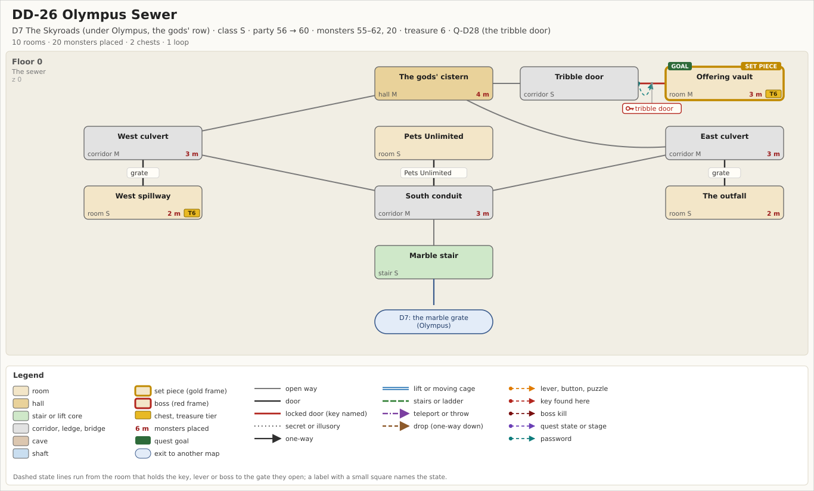

# Act VI dungeon graphs, lane A8 (MU-6)

Review page for phase 6, 2026-11-21, lane A8 (`xeen-a8`, session 13), for a decider. It holds **DD-26 Olympus Sewer**
(Q-D28, the tribble door, under D7's Olympus), drawn now because D-62 set DD-22's L1 to wait on DD-26's share of their
common row (DD-22 + DD-26: 40 monsters at 48-65, 33.5k; DD-22 took 20 at 17.20k, so DD-26 20 at 13.0k-19.6k). DD-22
Sheltem's Pod is on A8's second Act V page ([act5_dungeon_graphs_a8b.md](act5_dungeon_graphs_a8b.md), decided by D-62).
A review document, not a brief; L1 starts from the graph file once the questions below are answered. **Every open
question is numbered once, continuing A8's Act V pages** (Q56-Q62).

**Reading the picture:** as on A8's Act V pages and A7's Act VI page ([act6_dungeon_graphs_a7.md](act6_dungeon_graphs_a7.md)):
one band per floor; box colour by kind; gold frame set piece, green tag quest goal, red "6 m" monsters placed, gold
"T6" a chest of that tier; one line style per connection kind; a gate's label names the state that opens it (the
teal dashed line is the password). Blue pills are exits.

**Files:** [act6_graphs/](act6_graphs/) (shared with A7's Act VI maps): `dd26.graph.yml`, `dd26.svg`, `notes_dd26.md`.
Redraw with `python3 devdocs/xeen/mockups/act6_graphs/render_graphs.py dd26` (no overlap printed); PNG
`output/studio_cal/a8_s13/png/dd26.png` (headless Chrome, looked at). This page is assembled by
`output/studio_cal/a8_s13/make_act6_page.py` from the notes file.

**Rules used** (A8's Act V pages'): sizes and counts inside the class bands (MAPS, Dungeons) and MAPS §0's rows, kill
XP per member L(L+10) per kill over four within the decider's range; A2's rows by id; every dead end holds a chest, a
find or a goal; no riddle the game does not answer; only engine words that exist; lamps where they can hang; props by
the walls; rewards at MM6-MM8 size; every exit the `exit` preset (D-24); inside entrances named after the map they are
entered from (D-37); the first room past the map door quiet (D-11.3). Map qbit block proposed: DD-26 117800-117839.

| Dungeon | Stands on | Class | Rooms | Monsters | Kill XP per member | Chests | Loops |
| --- | --- | --- | --: | --: | --- | --: | --: |
| DD-26 Olympus Sewer | D7 | S | 10 | 20 | 18.76k per member | 2 | 1 |

---

## DD-26 Olympus Sewer

D7 · S · party 56 → 60 · 55–62 (band 48–65) · 20 · treasure 6 · Q-D28 (Cyrano's Tribble) · D-62's share of DD-22 + DD-26

The source's Olympus Sewer (dark maze0038, aaze0038) lies under Olympus (maze0037), reached by four grates ("Descend into
the sewer?", aaze0037:1). It is a ring of water channels with walkways round a closed central room. Cyrano Jones the
Salesman sits in that room behind the "Pets Unlimited" door, with his bed. Four drains each hold a piece of a note (TR,
IB, BL, ES). A door's voice asks "What's the password?" (tribbles). Cyrano sells a tribble for 100,000 gold and tells an
owner that "TRIBBLES ... doors they can open". The source placed no monsters. Ours keeps the plan: one level of
marble-lined channels under the gods' row, one stair up to D7's marble grate (D-58: both ways). It has 10 review rooms,
about 12 sectors, about 11 M units² and 5 doors (S: 6–15 sectors, 7–20 M units², 3–8 doors).

- **What it is.** The gods' drains, cleaner than most temples and full of the city's sky-water. Cyrano's pet shop sits in
  the middle of the ring, and the tribble door leads to the undercroft where the temples' offerings wash down.
- **Critical path.**
  1. The marble stair (`entrance:d7_stair`, quiet; "Search the drains.", aaze0038:11), the south conduit, Cyrano's den.
  2. Round the ring: the west culvert (drain TR) and its spillway (drain IB, a T6 chest), the gods' cistern (drain BL),
     the east culvert and the outfall (drain ES).
  3. The tribble door off the cistern: "What's the password?"; TRIBBLES opens the bronze pair for good (map qbit 117805).
  4. The offering vault: the set piece and a T6 chest.
- **Way back.** From the vault round either side of the ring to the stair; the exit preset at the stair's top.
- **Off the path.** Every dead end holds something: the spillway (chest, drain), the outfall (drain), the den (Cyrano,
  the bed's find), the vault (the goal).
- **Loop (1).** The ring: the conduit, the west culvert, the cistern, the east culvert (the source's ring round the den).
- **Set piece.** The tribble door and the offering vault. A bronze two-leaf door sits under a marble lintel, with a grille
  mouth above it for the voice. Behind it lies the undercroft: coins in the silt, gilded cups and a toppled gilt statue
  (dressing by the walls), and a T6 chest on a ledge.
- **Riddle and answer-givers.** The word TRIBBLES has two answer-givers:
  - the four drains' pieces in the ring's order (TR, IB, BL, ES);
  - Cyrano's line to a tribble's owner, aaze0038:15.

  "Cyrano sells the password." (aaze0038:12) on the den's door points to him. Both TRIBBLES and TRIBBLE pass (the source
  takes both).
- **Monsters (20) and kill XP.**
  - The mix: Lesser Water Elemental 55 (11625) × 16 and Water Elemental 62 (11710) × 4. They are the sky-water of the
    gods' city, gathered in its cisterns, all in one faction (`water_elementals`), with installed bodies.
  - By room:
    - conduit 3;
    - west culvert 3, spillway 2;
    - cistern 2 + 2 of the 62s;
    - east culvert 3, outfall 2;
    - vault 1 + 2 of the 62s.
  - The stair, the den and the tribble door's landing are quiet. Groups are 2–3.
  - XP: **18.76k per member** (75,056 / 4), inside D-62's 13.0k–19.6k. With DD-22's 17.20k the row is **35.96k against
    33.5k, +7.3 %**. Q56 has two mixes nearer the middle (17.01k and 17.20k).
  - No sewer family has a tier in 48–65: sewer stalkers end at 35, and oozes and rats are low (A2's `monsters.yml`).
  - Rest encounters 10 % from the water elementals at Dif 0, which rolls Water Elemental 62 only (Q61).
- **Treasure.** Two T6 chests (S: 0–3): the spillway and the vault. Cyrano's bed is a find: one random T6 item once, map
  qbit 117806, then "Nothing here." (aaze0038:17). The four note pieces are finds of lore. Cyrano sells the Tribble
  (12362, items.yml).
- **Original lines.**
  - aaze0038:11, "Search the drains.": on the stair's wall.
  - :1–:4, the four pieces: the drains, each once (117801–117804); afterwards the source's "Drain" (:0).
  - :5, :8, :9: the tribble door's voice, the wrong and the right answer; :6/:7, the accepted words.
  - :13–:15, :18: Cyrano's name, offer, TRIBBLES line and refusal ("Maybe some other time."), A3's topics.
  - :12, "Cyrano sells the password.": on the den's door.
  - :16/:17, "Bed" / "Nothing here.": the bed's find.
  - :19, "Pets Unlimited": over his counter.
  - aaze0037:1, "Descend into the sewer?": D7's side of the grate. The way up's meaning is map-local, "Climb up to
    Olympus?" (A3).
- **Door to D7.** D7's `door:dd26` is the marble grate (`platform:sewer_grate` at (−8704, 8704) in the gods' row). It is
  sealed with a line until DD-26 is installed and names the arrival.
  - **Inside arrival:** `entrance:d7_stair`, the name D7's wiring already assumes (D-37). It stands at the stair's foot,
    (0, 0, 0) in the map's frame, facing north (512) into the conduit. The stair climbs south from y −256 to the
    grate's underside at y −1,024, z 448.
  - **Return:** the exit preset at the stair's top, to D7's installed `entrance:dd26_stair` (−8704, 8192, 1808) facing
    0. That point is 512 south of the grate; the facing is D7's own (east) and is kept. **It matches.** D7 drops the
    sealed line and names `arrival: entrance:d7_stair` at DD-26's install.
- **Hooks.** `quest_hooks.yml` names none on DD-26, and Q-D28 has no quest file yet (`source/quests/q-d28.yml`, A3). The
  map needs from A3:
  - Cyrano's topics: the sale, and the TRIBBLES line for an owner;
  - optionally a hook for the tribble door's first opening;
  - the four pieces as an autonote, if A3 wants one.

  Until then the map's lines are the source's, map-local.

  Map qbits: 117800–117839 proposed (the block after DD-22's 117760–117799):
  - 117800: `dd26_arrived_once`;
  - 117801–117804: the drains;
  - 117805: the tribble door;
  - 117806: the bed.
- **Textures.** A6's assign (sewers):
  - MM7 Erathian Sewers `d01`, as XD-21 but another face (XD-21 has its brick culverts; DD-26 its stone channels and
    grates);
  - the town shafts in the royal kit's `t3s2b`/`t3s2b1` marble: the stair, the conduit's walls, the tribble door's
    surround;
  - the vault in MM8 Temple of the Sun `gtempw1`/`gtempflr` with gold trim (A6's "an Olympus shrine");
  - the tribble door, a shipped bronze two-leaf pair.

  About 20 of 30, 0 new. Distinct from XD-21, DD-21 (sewer.blv, 6d14) and DD-01/18/20.

Open questions: Q56–Q62 below. **State and next steps.** The graph, the SVG and these notes were written on 2026-11-21 (A8 session 13, phase 6, graph
only; nothing is built). The render printed no overlap. The PNG (`output/studio_cal/a8_s13/png/dd26.png`, headless
Chrome) has been checked. Next: the decider answers; then DD-26's L1, and DD-22's L1 with D-62's drive-room find.

---

## The surface maps' doors against the graphs

Outside points from the installed (`xeen_d7.studio.yml`, A6); inside arrival proposed here (D-37 name).

| Map | Door | Inside arrival (proposed) | Outside |
| --- | --- | --- | --- |
| DD-26 | D7: the marble grate (Olympus) | entrance:d7_stair: at the stair's foot, (0, 0, 0) in the map's frame (the conduit's centre line at y 512, the stair climbing south from y -256 to the grate at y -1,024, z 448), facing north (512). The name is the one D7 assumes (D-37; D7's wiring names entrance:d7_stair) | D7 door:dd26 (the marble grate platform:sewer_grate at (-8704, 8704) in the gods' row), sealed with a line until DD-26 is installed and names the arrival; D-58: both ways. Out by the exit preset to D7's installed entrance:dd26_stair (-8704, 8192, 1808) facing 0 (east), 512 south of the grate (A6's point; D7's own facing, kept) |

## Open questions (Q56–Q62)

Each gives the options with the proposed default first and marked "(a, proposed)", the evidence and what depends on it. The graph files hold the same questions under `open_questions`.

### DD-26 Olympus Sewer

**Q56.** **Count and mix.** D-62 gives DD-26 20 at 13.0k–19.6k; the source placed none.

- (a, proposed) Lesser Water Elemental 55 × 16 and Water Elemental 62 × 4: 18.76k, the row +7.3 %. Existing rows and
bodies, one faction.
- (b) Lesser Water Elemental 55 × 14 and DD-14's grounded Octopod 50 (11473, placed only, immobile) × 6 in the
cistern: 17.01k, +2.1 %. Two factions side by side.
- (c) A new sewer-stalker tier D "Sewer Lord" 50 (placed only; the ratman body with a new recolour) × 14 and Water
Elemental 62 × 6: 17.20k, +2.7 %.
- Evidence: no sewer family reaches 48. Depends: A2's Act VI recount; S under (c).

**Q57.** **Cyrano Jones.**

- (a, proposed) A walk-in den with his counter as a house door "Pets Unlimited": A4 adds a house from D7's block
4801–4850 and Cyrano as an npc from 5601–5700; A3 writes his topics. No row, no body.
- (b) A placed talking actor (`monsters[].npc`) in the den: a peaceful row (A2) and a shipped merchant body (S).
- (c) A house front only on the conduit, no den (the bed's find moves to a drain).
- Depends: A4, A3.

**Q58.** **The tribble's price and use.** The Tribble (12362) is worth 5,000.

- (a, proposed) 10,000 gold: the source's joke price at MM6–MM8 scale. An owner hears the TRIBBLES line, and the
drains alone also give the word. The pet does nothing else.
- (b) 100,000 gold, as the source.
- (c) As (a), and a carried tribble also opens the door without the word ("what doors they can open").
- Depends: A3 (Q-D28's file), A2 (the ledger).

**Q59.** **What the tribble door guards.**

- (a, proposed) The offering vault: the set piece and a T6 chest, the map's goal.
- (b) A short cut from the cistern to the stair (one chest less).
- Depends: A2 (treasure).

**Q60.** **Q-D28's experience.**

- (a, proposed) None: the joke pet and the vault are the reward (D-62's rule for Act V).
- (b) A small sum at the door's first opening (A3, A2's Act VI ledger).

**Q61.** **Rest encounters.**

- (a, proposed) 10 % from the water elementals at Dif 0 (Water Elemental 62 only, in the band; the 55s are a
placed-only tier).
- (b) 0.
- Depends: A2 (map row 9178).

**Q62.** **Textures.**

- (a, proposed) As A6 assigned, about 20 of 30, 0 new; the door a shipped bronze pair.
- (b) Plus 1 new: a bronze tribble relief on the door's leaves, once per leaf.
- Depends: A6.

## Requests by lane

A number such as "2 (a)" in a request is the map's own DECIDE item and option: DD-26 1–7 = Q56–Q62.

**A1**
- DD-26: nothing. Text prompts, a one-way door by qbit, finds and a house door exist.

**A2**
- DD-26: The Act VI recount: DD-26 20 at 18.76k, the row with DD-22 35.96k (+7.3 %). Add DD-26 to the water elementals' `where`. Map row 9178: water elementals Dif 0, 10 %, treasure 6. Under 1 (c), the Sewer Lord row.

**A3**
- DD-26: Q-D28's quest file: Cyrano's topics (the sale at 3's price, aaze0038:13–15, :18), the tribble, and the door's line. Register map block 117800–117839. ORIGINAL_LINES rows for aaze0038:0–19. The way-up line "Climb up to Olympus?".

**A4**
- DD-26: under 2 (a), "Pets Unlimited" (a house from 4801–4850) and Cyrano (an npc from 5601–5700) in `source/towns/d7.yml` or a DD-26 town file.

**A6**
- DD-26: At DD-26's install, D7's `door:dd26` names `arrival: entrance:d7_stair` and drops its sealed line. Confirm the d01 face and the t3s2 shafts, and recount.

**AU**
- DD-26: optional: tribble purring in the den.

**S**
- DD-26: nothing under the defaults (the water elementals are bound). Under 1 (c), the Sewer Lord's skin.

