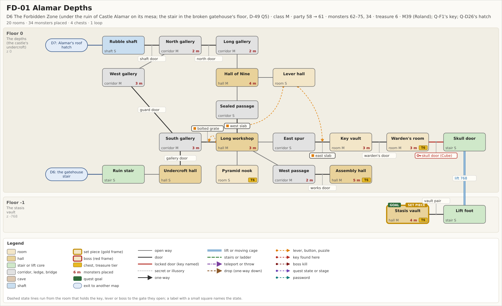

# FD-01 Alamar Depths: dungeon graph, lane A8 (MU-6)

Review page for phase 6, 2026-11-21, lane A8 (`xeen-a8`, session 16), for a decider. It holds **FD-01 Alamar Depths**
(Story M39, Prince Roland; the Key to the Dragon Tower; Q-D26's hatch), the last of the world's 82 maps to be drawn.
D-57 Q7 set its share of the FD-01 + FD-02 row (60 monsters at 55-80, 68.0k; FD-02 took 26 at 31.07k, so FD-01 plans 34
at 36.93k, room 30.1k-43.7k), and D-61 Q14 sends D7's roof hatch into it after M33. A review document, not a brief; L1
starts from the graph file once the questions below are answered. **Every open question is numbered once, continuing
A8's pages** (DD-26's ended at Q62): Q63-Q72.

**Reading the picture:** as on A8's DD-26 page ([act6_dungeon_graphs_a8.md](act6_dungeon_graphs_a8.md)) and A7's Act VI
page ([act6_dungeon_graphs_a7.md](act6_dungeon_graphs_a7.md)): one band per floor; box colour by kind; gold frame set
piece, green tag quest goal, red "3 m" monsters placed, gold "T6" a chest of that tier; one line style per connection
kind; a gate's label names the state that opens it (orange dashed lines: the levers and the grate's bolt; the red key
label: the skull door, which reads the Cube). Blue pills are exits.

**Files:** [act6_graphs/](act6_graphs/): `fd01.graph.yml`, `fd01.svg`, `notes_fd01.md`. Redraw with
`python3 devdocs/xeen/mockups/act6_graphs/render_graphs.py fd01` (no overlap printed); PNG
`output/studio_cal/fd01/png/fd01.png` (headless Chrome, looked at). The source read: `output/studio_cal/fd01/`
(`maze0052_ascii.txt`, `maze0052_evt.txt`, `tools/ascii_maze.py`, `tools/regions.py`). This page is assembled by
`output/studio_cal/fd01/tools/make_fd01_page.py` from the notes file.

**Rules used** (A8's earlier pages'): sizes and counts inside the class bands (MAPS, Dungeons) and MAPS §0's rows, kill
XP per member L(L+10) per kill over four within the decider's range; A2's rows by id; every dead end holds a chest, a
find or a goal; no riddle the game does not answer; only engine words that exist; lamps where they can hang; props by
the walls; rewards at MM6-MM8 size; every exit the `exit` preset (D-24), and the map's own Yes/No on a hatch exit into a
BLV (D-66); a hook's text before a choice ends on the request (D-65 B1); a stand-in with a title reads right (D-66);
Xeen's indoor radius cap 60 (D-67); inside entrances named after the map they are entered from (D-37); the first room
past a map door quiet (D-11.3). Map qbit block proposed: FD-01 117840-117879.

| Dungeon | Stands on | Class | Rooms | Monsters | Kill XP per member | Chests | Loops |
| --- | --- | --- | --: | --: | --- | --: | --: |
| FD-01 Alamar Depths | D6 | M | 20 | 34 | 40.81k per member | 4 | 1 |

---

## FD-01 Alamar Depths

D6 · M · party 58 → 61 · 62–75 (band 55–80) · 34 · treasure 6 · Story M39 (Prince Roland) · D-57's share of FD-01 + FD-02 ·
map row 9179, music 50

The source's Castle Alamar Dungeon (dark maze0052, aaze0052) is entered by a stair at (15,1) from Castle Alamar Level 1.
A long C of corridors runs round its west half, past three doors, to the hall of the plaque "Nine is the time." and a
hall with two levers:
- The west lever opens a wall into the west maze. It holds a two-row workshop, a working travel pyramid, and a block of
  halls with Alamar's boasting statue and the plaque "FEWAEEFFWAEF...".
- The east lever opens the maze's far end into the east wing:
  - the Key to Dragon Tower in a box;
  - a Silver I.D. skull door, then the Key to Darkstone Tower;
  - a Gold I.D. skull door, then Prince Roland's stasis coffin (aaze0052:9, the Amulet of the Southern Sphinx).
- Five "XEEN Power Juice" boxes give +5 levels each.
- The source placed Annihilator × 17 and Autobot × 6, none in the east wing. The plan is a tree, with no loop.

The plan was read with `output/studio_cal/fd01/tools/ascii_maze.py 52` and `regions.py` (the regions under each gate
state); the event dump is `output/studio_cal/fd01/maze0052_evt.txt`.

Ours keeps that plan as the castle's undercroft after the self-destruct: the C round the west maze, the two levers, the
east wing with both keys, the skull door, and Roland at the bottom. The robots still stand guard, and the metal groans
as it settles. One main level holds everything but Roland, whose stasis vault is a lift (768) below. The map has 20
review rooms, about 27 sectors, about 43 M units² and 11 doors (M: 20–45 sectors, 30–90 M units², 6–16 doors).

- **What it is.** The bottom of Castle Alamar, buried under its ruin. Sheltem's warden kept the keys of two towers here,
  and the true Roland lies in a stasis coffin under a field. The way in is a stair in the gatehouse ruin. After Q-D26,
  the Megadragon's hatch on D7 opens onto a shaft that comes down through the rubble.
- **Critical path from D6.**
  1. The ruin stair (`entrance:d6_stair`, quiet).
  2. The undercroft hall: Alamar's statue boasts (`m39.statue`). Quiet.
  3. The gallery door, then the south gallery, the guard door, the west gallery, the north gallery, the north door and
     the long gallery.
  4. The Hall of Nine ("Nine is the time.", `m39.plaque_nine`). Off it, the lever hall: pull both levers.
  5. Back through the Hall of Nine, down the sealed passage (the west slab is down) into the long workshop.
  6. The east spur (the east slab is down) into the key vault: the Key to the Dragon Tower in the box (`q-f1.tower_key`).
  7. The warden's door, then the warden's room: the Darkstone key chest (`m39.darkstone_key`, T6).
  8. The skull door (`m39.skull_door`, the Cube), the lift down 768, the vault pair, then the stasis vault: Roland's
     coffin (`m39.roland`).
- **From D7.** The rubble shaft (`entrance:d7_roof`, quiet) and the shaft door bring the party to the north gallery,
  which is step 3's middle. Most of the galleries are skipped.
- **Way back.** From the vault back up the lift, through the warden's room, the key vault and the east spur, into the
  workshop. There the party draws the bolted grate's bolt (Q66), and the south gallery leads to the undercroft
  hall and the stair. That is about a third of the walk in. The shaft also works once Q-D26's key has opened the hatch
  (Q68).
- **Off the path.** Every dead end holds something:
  - the pyramid nook: the dead pyramid and a T6 chest;
  - the assembly hall: a T6 chest and the FEWAEE plaque;
  - the stasis vault: the goal and a T6 chest.

  The two exits are the stair and the shaft.
- **Loop (1).** The ring: the south, west, north and long galleries, the Hall of Nine, the sealed passage, the workshop,
  and back to the south gallery by the grate. It is closed once the bolt is drawn (the source is a tree; Q66).
- **Set piece.** The stasis vault: a round chamber a lift below the warden's wing, cold and humming. Alamar's machine
  ring stands round a dais. On the dais lies the stasis coffin, hover "Coffin" (aaze0052:7), under a dark blue field leaf
  with cyan hex lines (`xafield`, D-51). The click calls `m39.roland`. The field drops and stays down with `m39.done`
  (111781), and the coffin lies open and empty: "An empty stasis coffin, still faintly cold." (Q65).
- **The levers.** Both are in the lever hall, hover "Lever" (aaze0052:15). Each pull grinds (the source's sound) and drops
  its slab for good: the west slab at the sealed passage's end and the east slab at the east spur's end (map qbits
  117841 and 117842, down on every load). Afterwards each lever says "The lever won't budge." (:17). Neither slab can be
  seen from the hall. The east one only matters once the west one lets the party through, as in the source.
- **M39's beats** (A3's `m39.yml`; hook ids as written):
  - D6: `m39.depths_door` on the gatehouse stair (the Cube; A6's side).
  - The undercroft hall: `m39.statue`, the first time the party comes near (once per game, map qbit 117840; then the hover
    "Statue").
  - The Hall of Nine: `m39.plaque_nine`. A3's `where` says "a plaque by the lift"; the source puts it in this hall, by
    the lever hall, and the graph keeps the source.
  - The key vault: `q-f1.tower_key` (12376, the map's box; map qbit 117844). It is on the critical path, so every party
    that finishes M39 carries it (D-57 Q23).
  - The warden's room: `m39.darkstone_key`, the warden's chest (A3's text; quest qbit 111780, which FD-03's door reads).
  - The skull door: `m39.skull_door` (the Cube; map qbit 117845). There is one skull door (Q64).
  - The stasis vault: `m39.roland`. It gives the Amulet of the Southern Sphinx 12372, the award "Rescued Prince Roland",
    autonote 4138 and 40,000, and moves Roland home (A4's npc 4405 to house 4201).
  - XD-07 afterwards: King Burlock's topic "My brother" (A3).
- **Monsters (34) and kill XP.**
  - The mix: Annihilator 62 (11611) × 28 and Autobot 75 (11612) × 6. These are the source's two families, still on guard
    after the self-destruct. They are one faction with bound bodies (Xeen Robot B and C: 188 and 228 high, radius 63,
    capped at 60 by `levelRadiusLimit`). Walking lines are 512 wide with ceilings of 384 or more, and doors are 320 high.
  - Patrol 50 (tier A) is under the band 55–80, so the robots in band are 62 and 75 only. Thirty-four robots therefore
    cannot come under 37.94k (all Annihilators).
  - By room:
    - the galleries: south 3, west 3, north 2, long 2;
    - the Hall of Nine: 2 + 2 Autobots;
    - the workshop: 3; the west passage: 2; the assembly hall: 3 + 2 Autobots;
    - the key vault: 3; the warden's room: 2 + 1 Autobot;
    - the stasis vault: 3 + 1 Autobot.

    The stair, the undercroft hall, the shaft, the lever hall, the passages, the nook and the lift are quiet. Groups
    are 2–3.
  - XP: **40.81k per member** (163,242 / 4): Annihilators 28 × 4,464, Autobots 6 × 6,375. That is 1,116 per member for
    an Annihilator and 1,594 for an Autobot. FD-01's planned share was **36.93k** (D-57 Q7), with room 30.1k–43.7k. With
    FD-02's 31.07k the row is **71.88k against 68.0k, +5.7 %**. Q63 has 39.38k (+3.6 %) and 37.46k (+0.8 %, 31
    monsters).
  - **Exception:** 34 monsters is under M's 45. D-57 Q7 asks for a NOTES exception line at L4, as for XD-16 and XD-18.
  - Rest encounters 0 (Q71).
- **Treasure.** Four T6 chests (M: 3–7):
  - the pyramid nook;
  - the assembly hall;
  - the warden's chest (with the Darkstone key's hook);
  - the stasis vault.

  The Key to the Dragon Tower is a find in the key vault's box. The source's five Power Juice boxes are dropped
  (Q69): DD-17 already has the juice.
- **Original lines.**
  - aaze0052:13, the statue: the undercroft hall (A3's `m39.statue`, shortened).
  - :12, "Nine is the time.": the Hall of Nine (`m39.plaque_nine`).
  - :14, the FEWAEE plaque with "Remember: A = Air, E = Earth, F = Fire, W = Water.": the assembly hall. It is lore (the
    order of DD-17's belts) with no use here.
  - :15/:17, "Lever" / "The lever won't budge.": the lever hall.
  - :2/:16, "Box" / "Nothing here.": the key vault's box.
  - :3 and :4 rewritten, the skull's denied and granted lines (`m39.skull_door`).
  - :7–:9, "Coffin", "Prince Roland" and his speech, shortened (`m39.roland`).
  - Not used: :0/:1 (the Power Juice, DD-17's) and :5/:6 (the second skull, Q64).
- **Door to D6.** D6's `thing:fd01_stair` is a pit hatch in the broken gatehouse's floor, at D6 cell (51, 52), in the ruin
  state only. Its condition is `m39.depths_door`. `gen.py` keeps it sealed whatever exists (`DUNGEON['fd01'] = False`)
  until A6 lifts that line.
  - **Inside arrival:** `entrance:d6_stair`, the name D6's `ENTRANCE['fd01']` already gives (D-37). It stands at the
    stair's foot, (0, 0, 0) in the map's frame, facing west (1024) into the undercroft hall. The stair climbs east from
    x 256 to the hatch's underside at x 1,280, z 640.
  - **Return:** the exit preset at the stair's top (the leave window, D-24; D6 is an ODM) to D6's installed
    `entrance:fd01_stair` (−6656, 4608, 2208), facing 1536. That is DD-17's gate point in front of the ruin, facing south
    down the ramp. **It matches.**
- **Door to D7.** D7's `evt:hatch_dd17` sits under the Megadragon. After `m33.done` it asks "Descend to Castle Alamar?"
  and, once FD-01 is installed, moves the party to FD-01's `entrance:d7_roof` (A3's `q-d26.hatch` decides). Until then it
  says "Castle Alamar is gone." D7's `gen_objects.py` already reads `entrance:d7_roof` from FD-01's studio file.
  - **Inside arrival:** `entrance:d7_roof` at the rubble shaft's foot, about (−7680, 7168, 0) (the source's north-west
    corner), facing east (0) towards the shaft door.
  - **Way up:** the map's own Yes/No "Climb up through the hatch?" (D-66's rule for hatch exits into a BLV; no text
    before it, D-65 B1). Then A3's `q-d26.alamar_hatch`: "Bolted from above." until `roof_unlocked` (Q68). Then at
    once to D7's `entrance:dd17_roof` (−18688, 8448, 1536), facing 1024: the hatch's existing point (Q67).
  - A party on D7 can only take this way after `m33.done`, so it always carries the Cube, and the skull door holds.
- **Hooks and qbits.** A3's hooks: `m39.statue`, `plaque_nine`, `skull_door`, `darkstone_key`, `roland` (FD-01),
  `m39.depths_door` (D6's side), `q-f1.tower_key` (the map's box) and `q-d26.alamar_hatch` (the shaft; FD-01 to be added
  to its `where`). Map qbits 117840–117879 are proposed (the block after DD-26's 117800–117839; no file uses it):
  - 117840: the statue has spoken;
  - 117841, 117842: the west and east slabs down;
  - 117843: the grate's bolt drawn;
  - 117844: the Dragon Tower key taken from its box;
  - 117845: the skull door open.

  The rest is spare. The stasis field reads `m39.done` (111781) and needs no map bit.
- **Textures.** A6's assign, ancient kit `per_site`: "the sw set darker (swll5dk, swankdk) with xahullbn".
  - `swll5dk` walls, `swankdk` floors, `swceilf` ceilings, `swgirder` and `swaled` pillars;
  - `swdoorb` leaves; the stasis vault's pair as two mirrored wings (the double-door rule);
  - `swtrpnl`/`swtrdk` skull-mask panels for the skull door (the source's skulls);
  - `xahullbn` scorched plating where the castle came down (the shaft, the galleries' broken ends);
  - `swor2` and `trekscrn` in the warden's room and the vault, `xafield` for the stasis field, `swflora` under the dais;
  - the shaft's rubble from `gn_mtl03` slabs and a shipped rock.

  About 22 of 45, 0 new. It is distinct from DD-17 (bright teal, `swll4dk`), DD-22 (`swll5dk` with red accents, since
  D-67) and DD-16 (the Lincoln). Q72 asks whether to move FD-01's main wall off `swll5dk`.
- **Sounds.** DD-17's machine bed (`pan: false`), fainter, broken by groans of settling metal. The levers grind (the
  source's FX 35). The lift. The coffin's cold hum stops with the field. Wind and trickling grit come down the shaft.
- **Lighting and sky.** The shaft has `open_sky` with the preset `xeen_darkside_day`, since the sun is back after M33
  (lane rule: a preset, never `xeendark1`). The galleries are dim, lit by teal pilot lights on the walls. The vault is
  lit by the field and the machine ring.

Open questions: Q63–Q72 below. **State and next steps.** The graph, the SVG and these notes were written on 2026-11-21 (A8 session 16, phase 6, graph
only; nothing is built). The render printed no overlap. The PNG (`output/studio_cal/fd01/png/fd01.png`, headless
Chrome) has been checked. Next: the decider answers; then FD-01's L1–L4, with a sub-agent, as DD-26's.

---

## The surface maps' doors against the graphs

Outside points from the installed (`xeen_d6.studio.yml`, `xeen_d7.studio.yml`, A6); inside arrival proposed here (D-37 name).

| Map | Door | Inside arrival (proposed) | Outside |
| --- | --- | --- | --- |
| FD-01 | D6: the gatehouse stair | entrance:d6_stair: at the stair's foot, (0, 0, 0) in the map's frame, facing west (1024) into the undercroft hall; the stair climbs east from x 256 to the hatch's underside at x 1,280, z 640. The name is the one D6's gen.py already gives the door (ENTRANCE['fd01'], D-37) | D6 thing:fd01_stair (a pit hatch in the broken gatehouse's floor at D6 cell (51, 52), ruin state only, condition m39.depths_door), sealed with a line whatever exists until A6 lifts DUNGEON['fd01'] = False. Out by the exit preset (the leave window, D-24; D6 is an ODM) to D6's installed entrance:fd01_stair (-6656, 4608, 2208) facing 1536, the point of DD-17's entrance:dd17_gate in front of the ruin, facing south down the ramp |
| FD-01 | D7: Alamar's roof hatch | entrance:d7_roof: at the rubble shaft's foot, about (-7680, 7168, 0) in the map's frame (the source's north-west corner), facing east (0) to the shaft door. The name is the one D7's gen_objects.py already reads (LIVE['fd01'], D-61 Q14) | D7 evt:hatch_dd17 (platform:hatch_dd17 under the Megadragon): after m33.done it asks 'Descend to Castle Alamar?' and moves to FD-01's entrance:d7_roof once FD-01 is installed (A3's q-d26.hatch decides; until then 'Castle Alamar is gone.'). Way up: the map's own Yes/No 'Climb up through the hatch?' (D-66), then A3's q-d26.alamar_hatch ('Bolted from above.' until roof_unlocked), then at once to D7's entrance:dd17_roof (-18688, 8448, 1536) facing 1024 (open question 5), the hatch's existing point |

## Open questions (Q63–Q72)

Each gives the options with the proposed default first and marked "(a, proposed)", the evidence and what depends on it. The graph files hold the same questions under `open_questions`.

### FD-01 Alamar Depths

**Q63.** **Count and mix.** D-57 Q7 gives FD-01 34 at 36.93k (room 30.1k–43.7k). The source placed Annihilator × 17 and Autobot × 6. In the band, the robots have only Annihilator 62 and Autobot 75.

- (a, proposed) Annihilator × 28 and Autobot × 6, 34: 40.81k, the row 71.88k (+5.7 %). It keeps the source's six Autobots.
- (b) Annihilator × 31 and Autobot × 3, 34: 39.38k, +3.6 %.
- (c) Annihilator × 25 and Autobot × 6, 31: 37.46k, +0.8 %. The row's 60 becomes 57.
- Depends: A2 (the Act VI recount).

**Q64.** **The skull doors.** The source has two, Silver and Gold I.D.; our quests have no I.D. cards (D-57 Q18 dropped FD-03's Gold one). A3's `m39.yml` has one skull door on the Cube.

- (a, proposed) One skull door (`m39.skull_door`) before the stasis lift. The Silver skull's place becomes a plain warden's door.
- (b) Two skull doors, both calling `m39.skull_door`, each with its own map qbit.
- Depends: A3 (the hook's `where`).

**Q65.** **Roland in the coffin.**

- (a, proposed) No figure. The coffin lies under a stasis field leaf; the field drops on `m39.roland`, and the coffin lies open and empty. Roland exists only in the text, with no row and no body.
- (b) An upright stasis tube with Roland standing in it: a peaceful, placed-only, unkillable row (A2) and a shipped noble body in his portrait's colours (S). A load event hides him on `m39.done` (D-57 Q27's pattern).
- Depends: A2 and S only under (b).

**Q66.** **The way back.** The source is a tree: from Roland the party walks back round the whole C (about 60 cells).

- (a, proposed) A bolted grate between the workshop and the south gallery, drawn from the workshop's side (once, 117843). It closes the ring and shortens the way back. From the gallery side before that: "Bolted from the other side." (map-local).
- (b) None: the source's tree.
- Depends: A3 (two map-local lines).

**Q67.** **D7's return point.** D7 has `entrance:dd17_roof` at the hatch for DD-17's way up. D-37 names an outside point after the map it is entered from.

- (a, proposed) FD-01's way up uses `entrance:dd17_roof` (no D7 change; it is the same hatch).
- (b) A6 adds `entrance:fd01_roof` at the same point, and FD-01 names it.

**Q68.** **The shaft's way up.** DD-17's hatch reads "Bolted from above." until Q-D26's key opens it. Without that, a party that came down D6's stair before the Megadragon fight would climb out onto its roost.

- (a, proposed) The map's own Yes/No "Climb up through the hatch?", then `q-d26.alamar_hatch` (FD-01 added to its `where`).
- (b) The way up is always open from below after the Yes/No.
- Depends: A3.

**Q69.** **The source's five Power Juice boxes** (+5 levels each). DD-17 already has the juice (+2 Might once per character, D-61 Q19).

- (a, proposed) Dropped.
- (b) Five spent boxes: "Box" (:2), then "Nothing here." (:16).
- (c) Five boxes, each a find of one random T6 potion, once.

**Q70.** **The source's second travel pyramid** (2,2). Our second pair of pyramids is Shangri-La's and the one outside Alamar's gate on D6 (D-50), which stands just above this map.

- (a, proposed) A small dark Ancient pyramid in the nook. Hover "Pyramid"; click "Its light is out. Its twin stands outside the gate." (A3, map-local). The nook's T6 chest stands beside it.
- (b) Dropped; the nook keeps its chest.
- (c) A working one-way pad to D6's travel pyramid (`entrance:xd17_pyramid`), a shortcut out.
- Depends: A3 (the line), S (a shipped pyramid or obelisk decoration).

**Q71.** **Rest encounters.** The robots' slot rolls Patrol 50 at Dif 0, which is under the band.

- (a, proposed) 0, as D-57 set for A7's Act VI maps.
- (b) 10 % robots at Dif 0 (Patrol 50 only).
- Depends: A2 (map row 9179).

**Q72.** **Textures.** A6's line puts `swll5dk` on FD-01's walls, which DD-22 has used since D-67.

- (a, proposed) As A6's line: `swll5dk` walls, `swankdk` floors, `xahullbn` where the castle came down, and the skull panels. About 22 of 45, 0 new, with no red accents (those are DD-22's).
- (b) `swall4` (crossed braces, red grime) and `swall2` as the main walls, so the depths read apart from DD-22. The rest as (a).
- Depends: A6.

## Requests by lane

A number such as "2 (a)" in a request is the map's own DECIDE item and option: FD-01 1–10 = Q63–Q72.

**A1**
- FD-01: nothing. Two-state slabs by event, a lift, a field leaf, `open_sky` with a preset, the map's Yes/No, finds, chests and a hook-checked door all exist.

**A2**
- FD-01: The Act VI recount: FD-01 34 at 40.81k; the FD-01 + FD-02 row 71.88k (+5.7 %). Add FD-01 to the robots' `where`. Map row 9179: encounter 0, treasure 6. Under 3 (b), a peaceful Roland row.

**A3**
- FD-01: Register map block 117840–117879. `m39.plaque_nine`'s `where`: "the plaque in the Hall of Nine, by the lever hall" (not by a lift). `m39.skull_door`'s `where`: "the skull door between the warden's room and the stasis lift". `q-d26.alamar_hatch`: add FD-01 (the rubble shaft's ladder) to its `where` and maps. `q-f1.tower_key`'s `where`: "the box in the key vault". Map-local lines: the grate, "Bolted from the other side." and "You draw the bolt."; the dead pyramid, "Its light is out. Its twin stands outside the gate."; optionally, a line for the first arrival down the shaft. ORIGINAL_LINES rows for aaze0052:2, :7, :8, :12–:17.

**A4**
- FD-01: nothing (Roland's move to house 4201 is already in `m39.yml`).

**A6**
- FD-01: D6: at FD-01's install, drop `DUNGEON['fd01'] = False` in D6's `gen.py`, so that `thing:fd01_stair` leads to `entrance:d6_stair`, and rebuild. D7: nothing under 5 (a). `gen_objects.py` reads `entrance:d7_roof` from FD-01's studio file once FD-01 is installed. Under 5 (b), add `entrance:fd01_roof`. Confirm the texture assign (10) and recount.

**AU**
- FD-01: the shaft's wind and grit, and the coffin's hum (optional). The beds and the lever grind are shipped (DD-17's).

**S**
- FD-01: under the defaults, a shipped small pyramid or obelisk decoration for the nook (8 (a)). Under 3 (b), Roland's body.

