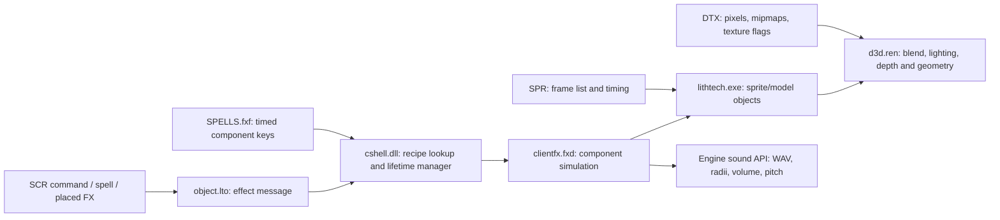

# MM9 original VFX/SFX investigation

Investigated 2026-09-21 using Rizin 0.10.0 and rz-ghidra. This is an original-binary
behavior specification and OpenMM9 discrepancy audit, **not a claim of completed visual parity**.
No game binaries, extracted assets, or engine implementations were modified.

**Playable preview:** [standalone effects viewer](viewer/README.md), with all 48 FX groups,
original textures/models, timeline controls and optional sound. Run `./mm9_vfx/viewer/run.sh`
from `re_mm8`.

**Implementation plan:** [shared models, animation and effects](MODEL_AND_FX_IMPLEMENTATION_PLAN.md).
It retains SPR/FXF support, imports DTX to PNG and ABC to GLB, and separates the initial
rigid/node-animation scope from future skinned monsters and props.

**Melee blood follow-up:** [native hit flash and blood spray](MELEE_HIT_EFFECTS.md)
traces melee collision feedback through `object.lto` and `cshell.dll`. These hardcoded
effects are separate from the FXF spell recipes below.

The supplied binaries establish several substantial errors in the existing approximation.
For Column of Fire, the descending emitters use **inward rings**, wind contributes
**100 units/second downward**, and the fourth color byte means **transparency**.
Its density depends on update rate and detail settings. Those differences alone change
the shape, motion, opacity, and timing; changing texture decoding cannot compensate for them.

## Evidence and reproducibility

Source installation:

```
/run/media/pjasicek/bf1d5926-921e-46b1-a33a-ea3a7b79927d/home/pjasicek/github/OpenMM9/reference
```

`game/` supplies binaries; `extracted/` supplies original asset data. The sibling
`OpenMM9/game/` supplies comparison code only. This revision has been fingerprinted,
not authenticated against retail media. PE timestamps alone do not authenticate it.
Installed wrappers/runtime patches and the user's original-game settings have not been
inspected in a live process. Findings describe **disk code in the supplied revision**.

| Module | Bytes | SHA-256 |
| --- | ---: | --- |
| `clientfx.fxd` | 548921 | `d158abcb6aef362f80441dfb7584c350445d4ebaa1f380cacb6f424fe5d862df` |
| `data/cshell.dll` | 970752 | `678700ff1cc795aeee49fe8427a42e1686d5a20dfdc1617eb46a8ef19f82f7ae` |
| `data/object.lto` | 2158592 | `b1271f37e5314281035efe6425dd59051bb8a9b0271de0d75a5926a7bc37f162` |
| `lithtech.exe` | 647168 | `4e9ddd2b69db934ecbd7399dd92992004e596907da4a214450f31c5dd39e56d8` |
| `d3d.ren` | 679936 | `f4c708f55d2c6ca666b4e550ecdc387df5ca6ddaa4c03ef6a6a5004a1c113805` |
| `mm9.exe` | 1445888 | `33e8e9a5d7efe8543c591e5ce27ca6aea3246bc353c9225e44d6f10b9a09233c` |

All addresses below are preferred **virtual addresses**, not file offsets. DLL/FXD/LTO/REN
images use base `0x10000000`; `lithtech.exe` uses `0x00400000`. Identical addresses in
different modules are unrelated. `mm9.exe` is the launcher; the investigated engine is
`lithtech.exe`. Labels in the annotation files are research names, not recovered symbols.

Files accompanying this report:

- [SHA256SUMS](SHA256SUMS): originals and the comparison-source revision, paths relative to OpenMM9.
- [inspect_assets.py](inspect_assets.py): independently authored, read-only FXF/SPR/DTX reader.
- [column_of_fire.json](column_of_fire.json): exact float32 recipe, enum discrepancies, compact asset metadata.
- Module-specific `*.rz` scripts: navigation labels and evidence comments, to load only after hash verification.
- Large analysis projects and decompiler exports: `../work/mm9_vfx/`, deliberately outside the small research artifacts.

From `re_mm8`, with `MM9_ROOT` set to the supplied OpenMM9 directory:

```bash
python3 mm9_vfx/inspect_assets.py --original-root "$MM9_ROOT/reference" \
  --effect 'spell-column of fire' --output work/mm9_vfx/column_verified.json
../third_party/rizin/build/binrz/rizin/rizin -N -q -e scr.color=0 \
  -i mm9_vfx/clientfx_d158abcb.rz "$MM9_ROOT/reference/game/clientfx.fxd"
```

To verify the manifest, run `sha256sum -c /absolute/path/to/mm9_vfx/SHA256SUMS`
with OpenMM9 as the working directory. Rizin annotations do not check hashes themselves.
Use `af @ address`, then `pdf`/`pdr`; `aaa` misses some virtual functions.
Decompiler signatures and stack types are frequently wrong in these binaries. Important
numeric comparisons, flag writes, and x87 operations were checked in disassembly.
Existing RetDec exports and local LithTech headers helped navigation and naming only;
later LithTech source is not proof of this binary's behavior.

## End-to-end ownership



| Stage | Module and address | Verified behavior |
| --- | --- | --- |
| Client setup | cshell `1009bde0`, call near `1009c0d4` | Creates FX manager, loads `clientfx.fxd`, loads clientfx recipes |
| DLL exports | clientfx `10009200`, `10009230` | 15 registered component types and their factories |
| Recipe loader | cshell `100a32f0` | FXF records, eight property payload types, seconds conversion |
| Group creation | cshell `100a3910` | Stores start time, origin, parent, loop and smooth-shutdown bits |
| Manager update | cshell `100a2a50` | Updates live components, starts due keys, handles completion |
| Component creation | cshell `100a2970` | Factory, Init, then immediate Update at current engine time |
| SCR command | object `100b0320`, `100b0410` | Parses and executes `DoClientFX` |
| SCR message sender | object `100b9200` | Sends `0x2d`, effect name, flags, position, parent object |
| Message receive | cshell `100a3b70` | Handles `0x2c` and `0x2d` effect messages |
| Parent removal/stop | cshell `100a3100` | Smooth shutdown can create a temporary replacement attachment |

`DoClientFX`'s first boolean sets bit `1`; the second sets bit `2`
(`object:100b0498..100b04bd`). Group creation stores them at instance offsets
`+38` (loop) and `+39` (smooth shutdown). During removal, smooth shutdown obtains
the last parent position and creates a temporary engine object; live components
receive that handle. Without it they are terminated. This is separate from a
component reaching its own scheduled end.

The manager processes existing components **before** pending keys. Due keys are
created on an update, not at arbitrary sub-frame timestamps. Component final end
is checked against engine time; draining components enter state `0x10`, have their
parent cleared, and continue updating until their shutdown test succeeds.
Group duration does not necessarily equal the end of the last visible particle.

Looping also has a per-key continuous flag at key `+48`. The examined loader writes
`1` at `100a3845` unconditionally, even though adjacent instructions calculate a
duration comparison whose status is not used before the next loop test. The manager
suppresses ordinary key expiry for continuous keys in looping groups. Do not assume
every group loop means destroy/recreate every component; runtime loop cases remain
part of the validation work below.

## FXF format and actual content

`CLIENTFX/CLIENTFX/SPELLS.fxf` is 288375 bytes, SHA-256
`468cbe2265fac31539b30c09f203517cca2900f4be6ad9dcea548019d02879bf`.
The independent reader consumes it exactly: **48 groups, 176 component keys**.

| Used component | Keys | Init / Update in clientfx.fxd |
| --- | ---: | --- |
| SpriteSystem | 109 | `1001c120` / `1001d920` |
| Sprite | 24 | `1001b0d0` / `1001b680` |
| PlaySound | 19 | `100171f0` / `10017c60` |
| Model | 18 | `10014980` / `10015370` |
| Null | 6 | `10015ba0` / `10015e00` |

The DLL also registers Lightning, LTBModel, DynaLight, CamJitter, WonkyFX,
BouncyChunk, LTBBouncyChunk, FallingStuff, PolyTrail, and PlayRandomSound. They do
not occur in this FXF; their complete simulation is outside the verified coverage.
Native spell/projectile effects outside this manager are not automatically covered.

All fields are little-endian. Sequential layout:

```
u32 groupCount
per group:
  u32 keyCount; char name[128]; u32 phaseMilliseconds
  per key:
    char componentReference[128]   // can include semicolon suffix
    u32 id; u32 linked; u32 linkedId; char linkedNode[32]
    f32 startSeconds; f32 endSeconds; u32 repeat
    u32 track; f32 minScale; f32 maxScale; u32 propertyCount
    per property:
      u8 nameLength; char name[nameLength]; u32 type; payload
```

Payloads: types `0/3/7` = 128-byte string; `1` = integer; `2` = float;
`4` = three floats; `5` = four floats; `6` = float time + packed u32 color.
The native switch has cases `0..7`; a guessed type `8` is not established here.
Track/min/max fields should not be promoted into runtime behavior without a consumer trace.

`Ck` packs low-to-high bytes R, G, B, **transparency**. `Sk` uses time and scale
from its vector payload (remaining entries unused by base initialization);
`Mk` uses time and XYZ. Base Init at `100023a0` computes cycle duration
`(end-start)/repeat`. Scale/motion key times are multiplied by that duration;
color times stay normalized. Base Update at `10002f70` handles positioning,
color, scale, rotation and motion tracks. Do not use one universal age for a
group, a component cycle, a particle, and an SPR animation.

`UpdatePos` is numeric too: 0 fixed, 1 follow, 2 LHand1, 3 RHand1,
4 LeftFoot, 5 RightFoot, 6 Head, followed by tail/user-node modes. Named linked
nodes have a separate lookup path. Column's keys use mode 1.

## SpriteSystem: verified semantics

### Emission opcode, not dropdown text

`1001c369..1001c3c6` splits `EmissionType` at the comma, converts the first token
to an integer, and stores it at `+220`. The switch is `1001cc35`, table `1001d2e3`.
Labels saved after that integer are editor descriptions, not the execution mapping.

| Opcode | Native branch | Distribution / initial velocity |
| ---: | --- | --- |
| 0 | Point | Zero offset; independent signed random XYZ velocity components times speed |
| 1 | Plane | Independent random components on two plane axes; normal times speed |
| 2 | Sphere | Cached normalized random direction times radius; radial outward velocity |
| 3 | PlaneIn | Random planar pair normalized onto radius; inward radial velocity |
| 4 | PlaneOut | Same ring construction; outward radial velocity |
| 5 | Cone | Zero offset; normalize random planar contribution + normal times 100, then multiply speed |
| 6 | Circle | Same code as opcode 1 in this binary |

These are not uniformly sampled disks/spheres/cones by mathematical definition.
The random initializer `1001bb30` seeds from time and builds 8192 scalar samples
and normalized vectors. Each emitter precomputes **256 offset/velocity pairs**
(24 bytes each); emission selects cached records with `rand() & 255`.
Independent fresh random sampling changes repeat patterns and distributions.

Five saved selections disagree with native behavior:

| Effect / key | Property file offset, decimal | Numeric | Saved selected label | Executed branch |
| --- | ---: | ---: | --- | --- |
| sparklies / 2 | 1029 | 3 | PlaneOut | PlaneIn |
| spell-town portal / 8 | 37657 | 4 | Cone | PlaneOut |
| spell-enrage / 30 | 81571 | 4 | Cone | PlaneOut |
| spell-column of fire / 6 | 88426 | 3 | PlaneOut | PlaneIn |
| spell-column of fire / 8 | 90173 | 3 | PlaneOut | PlaneIn |

### Timing and detail

`cshell:100a2acf..100a2af8` maps GlobalDetail 0/1/2 to 0.15/0.5/1.0.
The DLL detail setter is `100099b0`; its global is `1007ed60`.

For nonzero detail and interval, Init divides stored interval by initial detail
(`1001d2a3..1001d2bb`). Update divides that result by current detail again
(`1001d9e2..1001da0d`). Thus the tested native path has
`effectiveInterval = assetInterval / (initialDetail * currentDetail)`.
This surprising double division is in the instructions, not a recommended correction.

Update emits only when `now - lastEmission > effectiveInterval` (strict greater-than,
`1001da20..1001da31`), and state is not `0x10`. It emits **one batch**, timestamps
particles with `now`, and stores `lastEmission = now`. There is no catch-up loop.
Batch count is truncation of configured count times current detail, with a minimum
of one when configured count is nonzero. The initial old timestamp allows an
immediate first batch. A nominal 0.01-second emitter therefore cannot emit 100
batches/second when it is updated 30 or 60 times/second.

Expiry compares age against **lifespan minus 0.1**, at `1001e088..1001e0a9`;
live rendering repeats the same check at `1001e296`. Equality expires the particle.
Rotation accumulators add RotateAdd once per update at `1001dffb..1001e031`, without
delta-time multiplication. The rotation matrix is constructed before that increment.
Changing the frame rate can therefore change both density and rotation.

The emission path forces Interpolate on at `1001dab1`, regardless of the saved
boolean. It calculates batch placement from previous/current emitter positions.
Its exact placement order should be retained when implementing; an analytical
"sample the emitter at each ideal birth time" simulation is not equivalent.

### Motion, color and scale

Init scales the complete WindDir vector by WindAmount (`1001d223`); parent rotation
can transform it first. Update adds velocity times delta time and this wind vector
times delta time (`1001e14d..1001e1bf`). WindDir is **not normalized**, and wind is
a velocity contribution, not acceleration.

Particle color evaluation is `1001e850` (call at `1001e236`). After interpolation,
RGB is divided by 255 and alpha is `1 - transparency/255`, clamped to [0,1].
The subtraction is explicit at `1001ec2f`; the terminal-key branch does it at
`1001e979`. There is another native quirk: the early terminal-key test compares
normalized age `(now-born)/lifespan` against **lifespan**, not 1
(`1001e88b..1001e89c`). For a lifespan of 0.8, that selects the terminal color
at approximately 0.64 seconds, before expiry at 0.7 seconds.

Particle scale evaluator `1000abb0` maps particle normalized age into the base
component cycle, applies modulo, and interpolates the scale keys. StretchU/V
multiply the resulting X/Y object scales (`1001e2d8..1001e31e`). SPR animation
is maintained separately by the engine object.

## Column of Fire and the Bootcamp monk

`BC_MANAGER.scr:103..105` spawns the ReverendMonk and requests `SPELL_MIST`.
`BC_TREASURECHEST.scr:64`, in the `SpringTrap` callback, requests
`DoClientFX hOpener SPELL_COLUMNOFFIRE FALSE TRUE`. Its later waits destroy/remove
the monk. This is a nonlooping fire effect with smooth shutdown, not the spawn mist.
The chest also plays `doorlatch01.wav` separately. These scripts declare the aliases
locally: `SPELL_MIST = "mist"` and `SPELL_COLUMNOFFIRE = "spell-column of fire"`.
`SPELLNAMES.inc` is a reference list, explicitly marked not to be included.

The fire group's name is `spell-column of fire`; phase is 3500 ms. Values below
are rounded for reading; the JSON retains actual float32 values and property order.
All four emitters are camera-facing, normal blend (`AType=0`), Follow, one sprite
per batch. Times are relative to group start, not relative to chest-open input.

| Key | Start–end, seconds | Interval / life | Emission | Wind Y × amount | Other distinguishing data |
| ---: | --- | --- | --- | --- | --- |
| 6 | 0–0.791 | .01 / 1 | Inward ring, R10, speed10 | -50 × 2 | Torchflame4; motion Y222→-66; stretch2×4; scale .204545→.238636 |
| 8 | 0–0.800 | .01 / 1 | Inward ring, R10, speed10 | -50 × 2 | Torchflame3; same motion/stretch/scale |
| 9 | 1.597–2.867 | .04 / 1 | Plane, R30, speed20 | 60 × 2 | Offset Y-20; stretch1×2; scale .306818→.022727 |
| 7 | .495–2.542 | .05 / .8 | Sphere, R20, speed10 | 90 × 3 | Offset Y-10; RotateAdd Y-.05/update; stretch2×3; scale .1→.409091 |
| 10 | .494–2.860 | — | PlaySound | — | column03.wav; spatial; no loop; inner100/outer500; volume100; pitch1 |

The descending keys' initial color `[255,255,0,100]` means opacity **155/255**.
Transparency 189 and 213 later mean opacity 66/255 and 42/255. Treating those
bytes as ordinary alpha reverses the intended fade. Key 7 has lifespan .8 and
therefore exercises the color-endpoint quirk above.

### SPR and DTX assets

Torchflame3/4 SPRs each contain 15 frames, FPS15, keyed0, translucent0, colorKey0.
Frame filenames end in `TORCHFLAME_ADDITIVE0030..0044.dtx` and `0045..0059.dtx`.
The word ADDITIVE in an asset name does not choose the blend state.

`lithtech:004667a1` reads five u32 header fields, then u16-length frame paths.
Frame duration is integer `1000/FPS`; here **66 ms**, total cycle **990 ms**.
Tracker initialization `00466991` starts at time0 with flags3 (play and loop).
Update `004669be` accumulates integer milliseconds, wraps a looping animation,
or clamps a nonlooping animation to cycle-1; frame is `(time/frameMs)%frameCount`.
The caller's frame-time-to-millisecond rounding still needs live/assembly validation.

The 30 textures are 64×64, four mip levels, DTX version -5, internal flags `0x88`,
user flags0, format identifier6, empty command strings. Native DTX loading is
`lithtech:0042a685`: it reads the 164-byte header and validates resource0/version-5.
Its byte-count helper `0044d76b` distinguishes compressed identifiers4/5/6.
`d3d:1001fca0`, branch `10020114` to `10020295`, maps identifier6 to FOURCC
`0x35545844` (**DXT5**). This identifies the format from the native renderer too.

`0x08` controls the native section-count path (`0042a836`); local LithTech naming
is SECTIONSFIXED. `0x80` is named PREFER4444 in the local format headers, a texture
conversion preference. Neither is the object additive flag. Exact GPU-format
fallback, 16-bit quantization, mip selection, filtering, and wrapper behavior have
not yet been calibrated against original-game output.

## Renderer contract

SpriteSystem creates OT_SPRITE=3 with primary flags `VISIBLE=1`, plus `8` when
Facing is nonzero; secondary flags gain `4` only for `AType==1`
(`clientfx:1001ddb0..1001de63`). It does **not** set primary NOLIGHT `0x200` there.

Native blend selection is `d3d:1004cda0`; submission is `10054f30`.
The latter applies D3D render states19/20 (source/destination), 28 (fog enable),
34 (fog color), then dispatches primary flag8 to the rotated-sprite routine
`10053510`, otherwise the camera-facing path.

| Object state | Source / destination blend | Fog treatment |
| --- | --- | --- |
| secondary `4`, additive | ONE / ONE (2 / 2) | black fog color |
| secondary `8`, multiply, without additive | ZERO / SRCCOLOR (1 / 3) | white fog color |
| neither | SRCALPHA / INVSRCALPHA (5 / 6) | normal fog color |
| primary `0x80` | as above | fog disabled |

Normal sprites enter `10057e80` → `10057e50` → translucent queue `1003ec00`.
The no-Z queue entry `10057f00` disables state7 (Z enable) around drawing and
restores it. This does not mean all effect sprites disable depth testing.

Object color bytes are at +94..97. The camera-facing path tests NOLIGHT at
`10055518` and can combine world light samples/dynamic additions with effect color.
Rotated sprites use the corresponding helper `10052b80`. Thus an always-unlit
texture-times-vertex-color shader is not automatically equivalent for SpriteSystem.
Exact texture-stage RGB/alpha operations and translucent sorting still need a
complete state trace before declaring final-pixel equivalence for additive sprites.

Native dimensions depend on texture dimensions, object scale and projection
(`10055379..1005544a`); rotated geometry also uses object rotation/scale
(`10053653..10053677`). OpenMM9's extra 2.56 factor and minimum half-size clamp
are not established by this trace. Calibrate coordinates and native quad extents
explicitly rather than compensating for incorrect wind/opacity with sprite size.

2026-11-10: in `draw_sprite` the camera-facing half-extents are texture width (height) x view
constant `+0x94` (`+0x98`) x object scale X (Y), added to and subtracted from the view-space centre.
The view constants are set at `10002d16`/`10002d2a` (a near-plane ratio; `atan` of it gives the
frustum angle), so a sprite is about twice its texture width x scale across. OpenYAMM's sprite is
logical width x scale across, so the importer doubles MM9 sprite and sprite-system scale keys
(`NATIVE_SPRITE_EXTENT`). Whether the view matrix at `+0x15c` cancels the `+0x94` factor is not
traced; compare with the original game at a known distance before changing it further.

## Other used components and sound

**Sprite:** Init `1001b0d0` creates a single sprite with primary NOLIGHT `0x200`
(plus rotated flag8 for nonzero Facing) and **secondary additive4 unconditionally**
at `1001b328`. Update `1001b680` mirrors parent visibility and calls base Update.
Facing is converted to a boolean by `test/setnz` at `1001b1f9..1001b201`, despite
a later Update comparison against2. Do not merge this behavior with SpriteSystem's
integer Facing property. ParentRotate is parsed separately.

**Model:** Init `10014980` reads Model, Skin, Facing, EnvironmentMap,
NoBackfaceCulling, SmoothFade, FadeTime and Shadow. Creation is OT_MODEL=1,
primary NOLIGHT0x200, environment-map0x20, optional shadow2. Reading a property
does not establish that it is subsequently honored: NoBackfaceCulling's complete
renderer path is not verified here. Update `10015370` follows parent visibility,
calls base Update, then handles shutdown. SmoothFade disables base color updates
and fades alpha as `1 - elapsed/FadeTime`; a saved FadeTime of zero becomes .5.
Without smooth fade it removes the object. MDL animation/tracker and skin rendering
have not been fully traced; these 18 components cannot yet be called visually complete.

**Null:** `10015ba0` creates OT_NORMAL=0; `10015e00` runs base Update. It can
provide a moving attachment for linked components despite rendering nothing.

**PlaySound:** actual Init is `100171f0`, Update `10017c60`, Term `10017b60`.
Do not confuse it with the separate PlayRandomSound implementation around `100160f0`.
Init builds a 0x134-byte sound request: spatial flags **0x2d2**, local **0x2d0**,
OR4 for loop; it supplies filename, position, inner/outer radius, volume byte,
priority byte and pitch. Those bits match the local API's client/get-handle/
controlled-volume/controlled-pitch flags, plus 3D when spatial. The multiplayer
flag can force spatial playback and select MultiPlaySound.

The request is sent through ILTClient+0xd0; its handle is retained at +280 and
position set through +0xd4 at initialization. The inspected update calls base
Update and kills the handle on shutdown; it does not resubmit a moving sound
position every frame. Term also kills a remaining handle. UseMarkers is parsed;
its complete effect in the audio backend is unverified.

Column's sample is mono PCM16 at 22050 Hz, 52431 frames (**2.377823 s**).
Its scheduled window is about 2.366 s, so sound lifetime and key shutdown can
matter even for a nonlooping WAV. Do not automatically play every file to its end.
The exact attenuation curve, sample scheduling, provider mixing and truncation
audibility remain unmeasured.

## OpenYAMM effect library status (2026-11-10)

`tools/mm9_import_discovery/import_mm9_effect_assets.py --all-supported --repository-root .` (from the repository
root; model export needs `pygltflib`) compiles 42 of the 48 FXF groups into `assets_dev/engine/effects/mm9/library.yml`,
plus two hardcoded effects (`mm9:melee_blood`, `mm9:explosion_sparks`); `capabilities.yml` lists every group's status.
`test_effect_asset_pipeline.py` checks that every group MM9 plays (MONSTERS.txt FX0/FX1/FX2/ResurrectFX, the scripts'
`DoClientFX`) has an entry.

- Body anchors: a component with UpdatePos 2-9 carries its node as `body_anchor` and the effect emits at its origin
  (`anchor_fallback: origin`); the caller places it (an actor socket, a marker).
- A Model component plays the model's first animation (FXF names no clip): pathup.abc's is `wormpath`,
  headtwirl.abc's `headtwirling`.
- Not imported (6), each needs a visible deforming (skinned) model with per-model colour/opacity keys, which the effect
  runtime does not draw (its models are invisible animation paths): `spell-death's touch` (centerdrop.abc),
  `spell-armor` (tube.abc, fades in and out), `fg spell-eye of the storm` (storm.abc, translucent wind),
  `jarjarb setup` (jajarb.abc, emitters on its nodes), `ghost` (ghost.abc; its skin `skins/ghost.dtx` does not exist,
  only GHOST1-3) and `blobby` (monk.abc; `models/spells/armortube.abc` does not exist). No MM9 script or monster plays
  them.

### Additive blend

Native SpriteSystem (`AType 1`) and Sprite components draw ONE/ONE: the texture's alpha does not weight the light,
and MM9's glow textures already hold their falloff in RGB (black where transparent; `spells/skull` has alpha 0
everywhere). Multiplying by the texture alpha squared the falloff and left `greenyeldots`, `bluedots` and `sparklies`
2-5 times too dark, and `skull` invisible. The vertex opacity does not weight it either: `draw_sprite` packs the
object's alpha byte beside its RGB without premultiplying (`d3d:100554b2..10055700`), sets no texture-stage state of
its own (stage 0 keeps the device default COLOROP MODULATE, `100099a8`), and ONE/ONE ignores source alpha, so a
colour key's transparency byte has no effect on an additive sprite; only its RGB fades it. The compiler marks MM9's
additive components `additive_texture_alpha: false`; `fs_particle.sc` then draws texture colour times vertex colour
(`u_particleParams.y`), `EffectRenderer` samples their sprites without the transparent-edge bleed (a separate
`raw-texels:` cache entry), fades them by colour near the camera, and leaves them out of the bloom glow (LithTech had
none; at the default strength the glow spread each dot into a soft blob). Every other effect, including OpenYAMM
effects that reuse MM9 sprites (`openyamm:fx/creature_fire_hand`), keeps the texture alpha, opacity, bled texels and
bloom. Not reproduced: SpriteSystem sprites are not NOLIGHT, so native adds the world light at the sprite to its
colour (`10055518`); ours are unlit. Not yet compared with frames of the original game.

`bluedots` is green: its FXF colour keys are greenyeldots' ([128,255,0] fading to [0,128,0], offsets 244147/244162),
only its sprite (flareparticle) and end scale differ.

### Projectile explosions

PROJECTILE.txt's `Explosion` names (None, RedRing, PurpleRing, BlueRing, FireExplosion, GreenOrangeRing, BlueLine,
YellowLine, Flare, Ice, Grenade, Poison, Sparks, RedLine, YellowRing, PoisonCloud, Egg) are not FXF groups: object.lto
`10040940` maps the name to an index into its table at `101a160c`, and cshell `10069390` (switch at `1006971c`, 17
cases, `EffectsManager.cpp`) creates a hardcoded impact class per index. `Sparks` (12, Lightning and ScreamingSkull) is
`1006c180` (vtable `100c77c0`): its Init `1006c1b0` runs the FireExplosion base `1006f9f0` (a hemisphere of radius about
66 skinned with a random explosion1/2/3.spr for 0.8/0.53/0.6 s, scaled by age+0.5 in `1006fdb0`) and then effects
manager type 5 (`10066ac0`, a LithTech particle system, Init `1007f900`, emit `1007fac0`, Update `1007fa10`): 20 sparks
of `SpriteTextures\flare\BlurredWhiteStar.dtx`, velocity box +-300 across and 7.5..300 along the surface normal,
gravity -650, grey 128..255, particle radius 3000/640, the system's alpha falling linearly over 1 s.
`mm9:explosion_sparks` approximates it (explosion1 as a camera-facing sprite; point emission plus the mean forward
speed as wind; mean grey); the other 15 explosion classes are not imported.

## Concrete OpenMM9 discrepancies

Comparison paths below are relative to the supplied OpenMM9 directory and their
hashes are retained in SHA256SUMS. They are evidence about that checkout, not a
statement about every OpenYAMM path.

| Comparison location | Difference from original |
| --- | --- |
| `game/effects/ClientFxRuntime.cpp:111–179` | Prefers saved dropdown labels; five emission keys select a different native branch |
| Same file, `543–589` | Analytical emission counts/birth times instead of one batch per update; ordinary lifespan instead of native -.1 expiry |
| `game/render/effects/ClientFxSpriteRenderer.cpp:369–383` | Normalizes WindDir, erasing magnitudes: Column -100 becomes -2; +120 becomes +2; +270 becomes +3 |
| `game/effects/ClientFxDatabase.cpp:326` and renderer color packing | Fourth Ck byte is carried as opacity rather than inverted transparency |
| Sprite renderer `565–580` | Additive uses SRC_ALPHA/ONE rather than native ONE/ONE |
| Sprite renderer `42`, `543–562` | Extra world-scale2.56 and size clamp need native coordinate/quad calibration |

The blending discrepancy is definite at the state level; its exact brightness
impact also depends on texture-stage operations. Column itself requests normal
blending, so changing only additive blending cannot repair that example.

## Implementation and validation boundary

An OpenYAMM implementation should own this in shared effect simulation/rendering,
with MM9 recipes and asset lookup scoped to mounted MM9 content. Preserve separate
group/key/particle/SPR clocks, numeric opcodes, parent/node handles and shutdown.
Use newly authored code; do not embed decompiler output or make per-spell tuning
substitute for the verified system rules.

Validation performed: all 46 manifest entries matched; all five annotation scripts
loaded successfully in Rizin with the expected addresses; the independent reader
consumed the full FXF; the retained Column recipe matched a fresh decode; both SPR
clocks and all 30 DTX headers matched; four truncated FXF inputs were rejected.
The original binary/FXF fingerprints were checked again after investigation.

The investigation completed static tracing across all five ownership modules,
independent parsing of all 48 groups, a detailed Column recipe/asset audit, and
initialization/update entry-point tracing for all five used component classes.
It did **not** run the original Windows game or compare captured frames/audio.

Before accepting visual parity, remaining work is concrete:

1. Capture the Bootcamp spawn and chest trap separately, logging FPS/detail,
   camera, parent pose/removal, loaded module hashes and any wrapper settings.
2. Log original component births/deaths and particle positions/color/scale/SPR
   frame indices at the annotated functions. Compare equal update sequences;
   mismatched random seeds require distribution comparisons, not pixel diffs.
3. Finish geometry, texture-stage/filter/mip/depth/sort state tracing and verify
   attachment interpolation/rotation basis and frame-time rounding. Include a
   standalone additive Sprite and a short-lived SpriteSystem, not just fire.
4. Trace Model animation/skinning and remaining native projectile/spell paths
   before claiming all MM9 special effects are covered. Test looping/linked
   groups, parent destruction, detail changes and large time steps.
5. Capture sound start/stop and attenuation at known distances; verify the sound
   backend beyond the request fields recovered here.

No OpenYAMM builds or runtime tests were appropriate for this research-only change.
